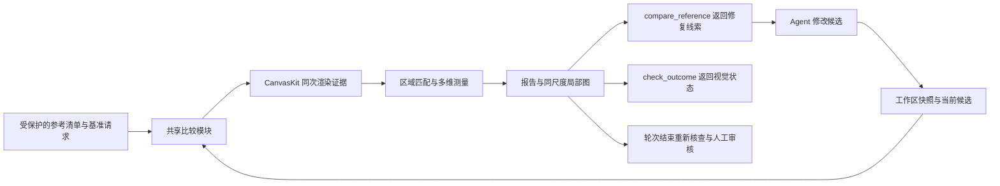

# 模板代建的视觉测量与单轮反馈：设计提案

- 日期：2026-10-22（用户时区）。
- 状态：2026-10-22 用户批准并实施首期中文纵向切片；接入、验收与边界见 [视觉反馈指南](../../docs/agent-visual-feedback.md)。完整独立样式/状态验收与真实模型效果尚未完成，票据状态以各票文件为准。
- 目标项目：`F:/GenCode/render-weave`；核对源码为 `33305e5d7b5d54aafcf750af831e4fcbf9d4b0ef`。
- 输入：[研究报告](../../docs/research/2026-10-22-template-visual-fidelity-harness.md)、用户提供的 Agent 复核意见，以及当前源码与离线实验。
- 当前范围：2026-10-23 按用户要求聚焦中文、英文（M307）；阿拉伯文仅保留既有诊断。已交付实现与验证边界见[提交记录](../../docs/agent-visual-feedback-results.md)。

## 拍板建议

首期实现 **可信参考区域 + 同尺度局部证据 + 结构化偏差清单 + 现有单轮内复检**。用一个共享比较模块支持 `compare_reference`、`check_outcome` 和轮次结束检查。沿用 CanvasKit 渲染器；先不引入新的视觉模型、OCR 服务或总相似度门槛。

用户真正需要的工具回答是：“已核查哪些内容；哪一处少了、偏了多少；涉及哪些实例；应该去看哪个模板元素；修改后是否改善。”多维测量与覆盖范围一起回答相似程度，不能把未覆盖区域折算为通过。

建议把这作为票据 34 的首批实现内容，连同 35 的证据绑定一起做；33 继续负责提取阶段的信息事实，36 继续负责 OCR 收益试验。下文的 34A/34B 是实现切片，不是新票据编号或已批准的排期。

## 1. 对补充反馈的复核

| 反馈中的判断 | 复核结果 | 设计上的处理 |
|---|---|---|
| 工具的图像尺度完全断裂 | 默认展示尺度确实不同；但 `view_image` 已返回原图尺寸、裁切区、输出尺寸，`inspect_layout` 有毫米与实际输出尺寸。缺的是统一比较封装，不是完全没有换算信息。见 `src/mcp/tools.ts:352,389`、`src/layout/types.ts:5` | 工具负责换算与同尺度展示，Agent 不再自行心算 |
| 缩放导致字号选小，正确值应是 10–11 mm | 因果未验证。当前源码复跑排除了这组样本的自动缩字与 DPI 改变物理尺寸；11 mm 是干预对照，不是参考真值 | 诊断“当前文字有多大”，只有可信锚点才能断言“比参考小多少” |
| `qualified` 等于视觉合格 | 不成立。`OutcomeCheck` 明确是技术合格，`content` 固定为 `needsReview`。见 `src/agent/outcome.ts:100` | 保留技术语义，增加独立视觉结果，工具文案明确剩余问题 |
| `inspect_layout` 没用 | 它是有用的候选侧证据，缺参考侧事实；布局框本身也不等于墨迹框。见 `src/layout/types.ts:18,76` | 在其已有测量上补参考、匹配和证据类型 |
| 没有单轮纠偏，只能人类重跑 | 现有任务已要求逐段渲染、检查与修改，见 `agent/tasks/template-design.md:14`；缺的是局部、可执行的比较结果 | 给当前循环接入测量，不重写执行器 |
| 红蓝差分能直接表示缺项与多项 | 原始像素差异只能证明两图不同，文字抗锯齿、错位、字体替代都会产生红蓝区域 | 图例只叫“参考/候选差异”；语义缺项另由区域匹配与内容检查判断 |

### 当前源码实测

从仓库根运行：

```powershell
node --import tsx out/review-visual-feedback-2026-10-22/font-dpi-probe.mjs
```

直接导入 `src/index.ts`，不使用旧 `dist`；读取同一组已保存候选，三个场景只在内存中更改变量，原候选不变。结果保存在 [font-dpi-results.json](../../out/review-visual-feedback-2026-10-22/font-dpi-results.json)。

| 场景 | 最终字号 mm | 摘要文字宽 × 高 mm | 压缩比 / 溢出 | PNG 像素 |
|---|---:|---|---|---|
| 原候选，50 DPI | 5.5 | 44.685 × 5.162 | 1 / false | 1575 × 1772 |
| 只改字号为 11，50 DPI | 11 | 89.370 × 10.323 | 1 / false | 1575 × 1772 |
| 原字号，100 DPI | 5.5 | 44.685 × 5.162 | 1 / false | 3150 × 3543 |

物理尺寸不随 DPI 改变、字号干预使宽高约翻倍的断言全部通过。三组仍有 `text.unshapedScript`；该实验只证明当前引擎的尺寸行为，不证明阿拉伯文排版正确，也不证明视觉反馈能提高模型成功率。

## 2. 参考数据先于评分

### 一份受保护的参考清单

由发起任务的一侧提供 `reference.json`，与原始示例图一起固定在 Agent 可写目录之外。参考的文件路径与哈希由现有 `OutcomeContext` 旁的受信上下文传入；Agent 看图用的 `agent/sample.*` 副本不作为最终比较真值。现状只是记录了 sample 哈希，并未把这个比较功能实现出来，见 `src/agent/run.ts:310,326`。

宿主使用启动时加载的不可变内容或经过哈希复核的快照，不能仅靠“路径在目录外”假定内容未变。参考内容变化必须形成新的基准版本，使已有比较报告失效。

首期参考清单包含：

| 内容 | 用途 |
|---|---|
| 原图哈希、像素尺寸、方向、`boardRectPx` | 明确画板在原图哪一块，排除照片外框与留白 |
| 目标画板毫米尺寸、基准请求、数据快照 | 建立原图像素与画板毫米的固定关系 |
| 区域 ID、信息角色、原图框、框的定义 | 区分文字墨迹、色块边界、容器范围，禁止跨类型直接相减 |
| 已核准的文字或展示规则、样式组、状态、读序 | 知道期待显示什么，区分同名站点与重复行 |
| 每项来源与信任等级、容差、允许的字体替代/适配 | 人工确认的事实可作硬证据；模型起草项仅作线索 |
| 清单完整性与未核查区域 | 已核查 8 个锚点不能宣称整张图通过 |

标注工作按大区块、独立样式、普通/本站/已过/终点/最长文本选代表锚点；同时为重复列表建立期望项清单，以便自动扫描全部实例。无需手工画每个字框，但也不能用一个站名代表全部状态。没有完整清单时明确 `coverage: partial`。

参考文字事实可复用提取阶段已核准的记录；“数据里存在字段”不自动意味着“图上必须展示”。业务必填与归属仍由票据 33 处理，视觉工具不重定义数据模型。

Agent 可以在工作目录起草建议标注，不能在同一次修复中自行将它升级为核准真值。新任务尚无锚点时，工具仍提供同尺度图，但返回“未校准”，不会卡住骨架生成。模板修改任务需要冻结本次需求允许改变的区域与内容；改名、换色等授权变化不能被旧示例当作回归。

### 坐标与对齐

正视图且画板范围已确认时：

```text
x_mm = (x_source_px - boardRectPx.x) * boardWidthMm / boardRectPx.width
y_mm = (y_source_px - boardRectPx.y) * boardHeightMm / boardRectPx.height
```

输出同时保存 `sourcePx → boardMm → comparisonPx → displayedCropPx` 的变换与实际尺寸。使用实际输出宽高计算裁切后的变换，不把 `view_image.scale` 的两位小数作为精确换算。画板纵横比不符时先报告输入问题，不能非等比拉伸到看似一致；整数像素造成的取整误差单独计入测量精度。

照片透视、倾斜、缺边不能直接套该公式；在固定参考预处理后才比较几何。首期支持已确认的正视图，其他情况返回 `alignmentUnknown`。不能按每个候选自动寻找最佳平移、缩放或紧裁字框，这会隐藏原本要发现的偏移和尺寸错误。

## 3. 一个比较模块，三个调用位置



模块拟放 `src/agent/visual-comparison.ts`，对调用者只暴露比较操作；内部负责证据生成、匹配、测量、哈希与报告。MCP、轮次末检查和审核展示共用它，不分别实现三套出图和评分。暂不引入通用评分插件注册器、多个渲染后端或微服务。

### 从现有渲染中取证据

在公开 `render()` 的选项里增加按需生成比较证据的能力，默认行为不变。比较时仍用同一展开、字体、排版和 CanvasKit 绘制：

1. 保留真实内容的布局、绘制结果与来源映射。
2. 再生成已有的草稿占位与错误边框。
3. 比较使用第一步，Agent 排错仍能看第二步；问题清单完整保留。

当前 draft 会先替换占位内容，必要时重新排版，再附加边框（`src/render.ts:134–151`）。因此只在最终 PNG 上擦边框不够，只返回“去掉边框的 draft layout”也可能测到占位文字。证据必须来自替换之前的真实布局。比较证据只作草稿诊断；正式模式有 severe 时继续不出图，不给交付入口增加绕过能力。

第一版优先复用 `LayoutSummary`、文字片段颜色、实际字体与 `FontStore.inkBounds()`。需要的字形墨迹边界从最终 glyph 位置和变换汇总，不能把字号或行高当墨迹高；见 `src/text/fonts.ts:114`、`src/layout/types.ts:199`。旋转、裁切与后绘元素遮挡的最终可见性不能从未旋转布局框推定；首期无法可靠处理的项返回 unknown 并给局部图，不造一个准确率。

文字框分清 `layoutBox`、`textExtent`、`inkBounds` 与 `visibleInkBounds`。颜色也分清 DSL 解析后的颜色和最终像素颜色；透明度、混合、遮挡没有处理时，只能报告前者。全元素 ID/可见像素遮罩属于后续增强，不作为首期比较器的前置大改造。

### 把实例定位到源模板

报告分别返回：

- `instancePath`：例如带 `[1]` 的循环实例，定位图上哪里出了问题。
- `sourceLocation`：候选文件、被调模板名、该模板内的元素路径，定位应检查哪段源码。
- `propertyHints`：可能有关的字号、边距、状态样式或参数；只是检查建议，不保证问题一定由该字段引起。

不能复用 `outcome.locations` 当实例索引：现实现拒绝循环下标，跨子模板还要求改写为被调模板文件（`src/agent/locations.ts:140–151`）。应在求值展开处保留来源；`src/evaluate.ts:100–105` 已经能同时接触展开路径、当前模板与静态路径，可从这里做最小增量。不要在报告端简单删除 `[n]` 后猜源码。

同一源元素通过参数、分支产生多个样式，问题可按“源元素 + 有效样式 + 状态”聚合，返回受影响实例数量及最差实例，不能只展示第一项。来源定位到元素不等于定位到最终控制字段；若字号来自参数，还需提示调用处，不能把共享子模板整体改坏。

## 4. 工具合同草案

新增只读 MCP 工具 `compare_reference`，输入只选择当前候选和报告范围：

```json
{
  "templates": ["candidates/main-board.json", "candidates/stop-row.json"],
  "regions": ["header", "stop-list"]
}
```

- `templates` 可省略，使用 `outcome.json` 的完整候选列表；显式传入时沿用现有候选叠加规则，未列入的工作区模板按现规则解析。比较与 `check_outcome` 必须是同一张有效模板调用图。
- `regions` 可省略，表示全部参考区域。只影响详细证据与局部图，报告明确本次范围；局部报告不能证明全图已核查。
- 参考图、物理尺寸、基准数据、容差来自受保护的任务上下文，不允许 Agent 临时换参考或降低标准。探索不同数据仍用 `render_draft`；它不能替代基准比较。
- 没有参考上下文：返回 `referenceUnavailable` 及可用能力。缺候选、基准请求不能解析：返回具体输入问题。匹配歧义、基准未校准、引擎能力受阻：返回结构化未完成原因，不假装度量为 0。
- 沿用 MCP 只读约束，Agent 工作目录无新增副作用；工具返回文本与图片。轮次宿主负责保存最终报告；中途可内存缓存，相同输入复用结果。

报告的固定内容：

| 输出 | Agent 的决策 |
|---|---|
| `reportId`、参考/有效模板图/请求/数据/资源/引擎/算法指纹 | 证明测的是本次候选，决定旧报告是否失效 |
| 基准状态、核准清单覆盖、未测量项与原因 | 区分“相近”和“没有证据” |
| 参考项对应的 missing / matched / ambiguous，与候选多余项 | 优先补缺项；未匹配候选只有参考清单完整时才能判多余 |
| 每项文字差异、位置 Δx/Δy mm、宽高比例、颜色差异 | 判断具体哪里偏，先修最大且可信的偏差 |
| 每个数值的测量方法、框类型、容差、可信来源 | 防止把布局宽高和参考墨迹框混比 |
| 实例路径、源码位置、受影响数量、代表局部图 | 批量修共享样式，再核查例外状态 |
| 与上次同基准报告相比 resolved / remaining / regressed / new | 判断这次修改是否有效，避免往返震荡 |

“匹配到 18/20 个核准参考项”可以报告，“整体相似度 90%”不能由此推导。文字比较使用明确的归一化规则，保留原始文本；不能自动删掉编号、标点等差异来抬分。匹配用角色、文字、父区与读序约束，再用几何消歧；禁止强行把每个参考项配给最近元素。

匹配单位是视觉信息块，不要求一个参考框恰好等于一个 DSL 节点：拆成多个文本片段或多个子元素的同一标签先按规则组合，再匹配。分组不确定就报告 ambiguous，避免“源码分段方式不同”被误报为多项或漏项。

局部图提供同一物理区域的参考、候选和半透明叠图，各自标明坐标与比例；不得分别紧裁再各自缩放。整图只定位问题，局部图承担小字检查。建议一次最多返回 3 个最优先局部图与 20 条问题摘要，超出部分给总数和区域查询办法；这是初始预算，须用真实工具耗时与模型成本校准。

例如本轮只有“字号 5.5 mm、textExtent 高 5.162 mm”是实测值。尚未标注参考墨迹时工具应返回“参考高度未校准”，不能输出“预期 fontSize=11 mm”。有经核准的同口径墨迹边界后才可报告“实际墨迹高为参考的某一比例”，并建议检查字号、字体和缩放；修改后的测量负责验证建议。

## 5. Harness 怎样实际使用这些结果

### `check_outcome` 保持兼容、增加独立反馈

保留 `verdict: qualified/unqualified` 的技术语义、现有 render capabilityBlocked 分支与 `content: needsReview`。新增 `assessment.visual`，状态建议仅用：

- `notChecked`：未提供或无法使用参考，附原因。
- `needsWork`：核准参考范围内存在确定的缺项/超容差差异。
- `needsReview`：已测部分无待修确定差异，或剩余项需要人判断；总是带覆盖率与 unknown 数量。

单项测量可以 `withinTolerance`，整张模板仍走人工审核。工具最前面的文字同时呈现“技术检查、视觉待修项、未核查项”，避免一个 `qualified` 淹没重要信息。

`check_outcome` 自动调用共享比较逻辑，不能只检查 Agent 是否调用过一次工具或是否自述已经核对。最终宿主重新读取候选内容并比较；指纹至少覆盖有效模板依赖、真实请求、数据、字体/图片实际内容版本、参考与预处理规则。用缓存时重新核对指纹；不能只按候选主文件名、mtime 或 Agent 提交的 reportId 放行。

首期视觉差异驱动修复与人工审核提示，不把未校准的总分变成 `apply` 拒绝条件。已核准约束的例外由人工审核记录原因；技术 severe 的正式出图阻断继续保持。

### 一次现有 Agent 执行里的流程

1. 读参考摘要，确认哪些区域与状态已核准；先建立骨架并保存 outcome。
2. 骨架时查全局分区与位置，内容缺项标记“尚未完成”；不能因为骨架像素分数高就结束。
3. 每补一组内容，调用 `compare_reference` 查看对应区域，优先处理确定的缺项、文字、尺寸、对齐，再处理颜色和装饰。
4. 对重复样式自动扫所有实例；局部图看各独立样式、关键状态和最差项，不让模型逐个看上百张图。
5. 修改后比较报告差异；若同一问题连续两次无改善，返回原因/剩余问题并保留候选，不无界重试。这个次数是建议初值，不是已校准参数。
6. 交回前 `check_outcome` 执行全参考清单检查；预算或已知引擎能力受阻时走原来的受阻草稿分支。
7. Agent 退出后宿主重新核查，报告给人工审核；不会自动再启动一轮模型。

现状 `run.ts:355` 使用 `--no-session-persistence`，`run.ts:360` 执行一次，`run.ts:368` 在退出后检查。因此“结束检查发现差异后自动注入同一会话继续修”并不是已有能力。首期通过进程仍在运行时的 MCP 调用实现反馈，不承诺强制模型修完所有问题；绕过工具的交卷也会在宿主检查中留下真实差异。

新工具加入模板设计和模板修改两类 allowlist，见 `src/agent/tasks.ts:43,50`；更新两类任务资料与 `docs/mcp.md`，按仓库规则升级 MCP 合同并更新 `test/snapshots/mcp-tools.json`。

## 6. 最小实施切片与验收

| 切片 | 交付 | 边界 |
|---|---|---|
| 34A：可比较的证据 | 冻结画板范围与变换；真实内容图/布局；同尺度局部对照；一个只读比较工具 | 无锚点也能看，但只声明“未校准” |
| 34B：有依据的诊断 | 人工核准锚点、文字/区域匹配、简单文字墨迹测量、实例到源码映射、全部重复实例扫描、视觉状态与报告差异 | 首期复杂遮挡/透视返回 unknown，不硬凑“全覆盖” |
| 随切片落实 35 | 输入内容指纹、算法版本、复跑入口、报告失效及宿主重新核查 | 不只保存一张截图或一次工具调用日志 |
| 36：降低人工标注成本 | 用中文与阿拉伯文试验 OCR 草拟清单，记录漏字、定位、人工修正时间、耗时与费用 | 实测有收益后再接默认流程 |
| 后续研究 | FLIP/LPIPS 局部残差、可见像素归属、受证据约束的 VLM 评审 | 不能替代缺项检查，也不先训练总分 |

验收通过公开渲染、MCP、Agent/CLI 入口进行，不直接测试私有匹配函数。具体必须覆盖：

| 反例/变更 | 应观察到的行为 |
|---|---|
| 同一候选 50/100 DPI、不同展示尺寸 | 物理位置与字号判据不变；像素测量差异在已声明的取整精度内 |
| 画板带外边距、裁切图、纵横比错误 | 正确转换或明确拒绝几何判定；不能靠拉伸提升相似性 |
| 空骨架与完整模板 | 在含文字期待项的核准清单上，骨架明确缺项；不能获得“整体通过” |
| 站名缩小、整区平移、行距改变、单个错字 | 对正确区域报出方向和量；OCR 未接入也能比候选文字与核准文字 |
| 字体替代、参考只有墨迹框 | 不把框高当字号，允许配置容差；证据不足返回 unknown |
| 透明/白字、遮挡、旋转、裁切 | 不因布局中有节点就声明可见正确；首期不支持的情况至少返回 unknown |
| 重复站名、不同本站参数、最长文本、循环子模板 | 全部实例计数；不误配；源路径可定位，不能简单去掉循环下标 |
| 草稿错误边框和占位文字 | 不进入视觉测量；原始引擎问题完整保留 |
| 修改子模板/数据/字体/参考/请求 | 旧报告失效；显式候选列表与 outcome 列表相同则比较一致 |
| 修改任务按要求换字/换色 | 授权变化不会被旧参考强迫回退；未授权区域的退化仍可见 |
| Agent 不调用比较或提交自造报告 | 宿主最终核查得到真实状态，不采信自述 |
| 额度耗尽、`text.unshapedScript` | 保存可审查草稿与已完成测量；不自动开新模型轮次 |

离线验收后，按票据 38 做真实模型对照：同一输入与预算，现流程 vs 新工具，保留首交而非只看人工修好后的结果。盲评偏好、关键错误数、人工纠正时间、token/墙钟成本一起记录；先用少量预试验测变异，再确定正式样本量与通过线。不能仅用工具被调用次数证明有效。

## 7. 与研究结论的关系

[CANVAS](https://github.com/kixlab/CANVAS) 和 [Design2Code](https://arxiv.org/html/2403.03163v2#S2.SS3) 提供的是分解评价与匹配思路；它们的可用设计/网页结构不等于任意中文站牌图片已有真值。本方案用人工核准区域与自身渲染结构补上这条前提。

[LPIPS](https://richzhang.github.io/PerceptualSimilarity/) 和 [FLIP](https://github.com/NVlabs/flip) 可作为后续残差图候选。此前离线试验里 FLIP 同样把空骨架的平均误差排得更低，而且当前草稿存在错误边框与阿拉伯文能力阻塞；它支持“不能只换总分”的判断，不能作为指标优劣的最终校准。完整来源、适用边界和实验记录见[研究报告](../../docs/research/2026-10-22-template-visual-fidelity-harness.md)。

上述中文纵向切片已实施，中文与英文受控诊断均已验证，中文已完成两次真实模型纠偏。下一步：收齐合同 0.10.1 的四场景模型门槛，再用真实中文、英文参考图补齐独立样式与状态，并与人工比较校准；不继续投入阿拉伯文还原。
