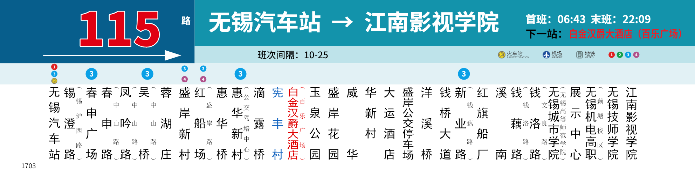

# 数据集模块的本机运行与接续

2026-11-04，M387。本机应用运行在固定提交 `31575c76dfb4c5cf0a2ed8ccd40dd50a467aa0ad`，开放 API 1.12.0，数据库迁移到 16。交付范围是可操作的本地应用；生产托管与隔离门槛仍按原计划验收。验收状态、命令和结果以 [票据 08](../../.scratch/dataset-import-app/issues/08-local-rollout.md) 为准。

## 从哪里使用

- [数据集智能导入](http://127.0.0.1:18080/console/#/dataset-imports)：选择已发布的静态数据定义及精确版本，上传 Excel，审核来源、批注和映射后整组保存。
- [数据集](http://127.0.0.1:18080/console/#/datasets)：选择保存的数据，再用兼容模板预览、填写参数和出图。
- [115 参考图模板设计](http://127.0.0.1:18080/console/#/templates/wuxi-production-sign/design)：四个关联模板已发布为修订 1，继续修改时从当前修订创建工作副本。样例选 `115-up-display-review`，第 13 站对应用户参考图；尺寸 `525 × 135 mm`、96 dpi。
- [115 本轮验收批次](http://127.0.0.1:18080/console/#/batches/99834217-8ea0-4ca8-a2ac-09402cfce07b)：使用原有正式模板，带“本地模块验收 · 非制作交付”说明。

既有账号继续使用。本机登录资料在运行目录 `.secrets/dataset-115-login.json`；非公交合成验收使用另一个租户，资料在 `.secrets/rollout-login.json`。两者均不入库，也不把密码放入本文。

参考图模板从底层到主模板依次为 `wuxi-115-connection-mark`、`wuxi-115-transfer-marks`、`wuxi-115-stop-column`、`wuxi-production-sign`。用户接续指令后已按此顺序发布，65 项正式批次及图片清单包见 [接续说明](reference-115-delivery.md)。继续修改时创建新的工作副本，预检后发布新修订；现有 `production-115` 模板保持不变。



## 固定运行目录

运行目录是 `F:/GenCode/render-weave-runtime-31575c7/`，API、渲染 worker、Agent worker 均使用此目录的构建：

`sha256:23f276fe9f3d820a64a3825f391535906185425a4483c3c769891db516981857`

运行期间不要在此目录修改源码或重新构建。后续升级在新工作树安装、构建，停服务并备份后整组切换。旧 `render-weave-dataset-import-app` 保留历史材料，不再作为服务启动目录；数据库迁移后不能直接启动旧构建。

依赖仍为专用 Docker 容器 `rw-dataset-import-115-postgres-1`（本机 25474）与 `rw-dataset-import-115-s3-1`（本机 29074）。本机 `.env`、模型环境变量及容器数据必须保留；不依赖其他项目的容器。

## 重启与只读检查

当前进程已启动，不要重复执行启动命令。机器重启后，先启动上述专用数据库、S3 容器，确认 18080/18081 没有旧服务，再在运行目录的三个终端各执行一行：

```powershell
node out/rollout/host-service.mjs worker
node out/rollout/host-service.mjs agent-worker
node out/rollout/host-service.mjs api
```

宿主脚本从本机 `.env` 载入既有配置；Agent 终端需要已安全配置的 `OPEN_CODE_API_KEY`。模型为 Claude Haiku 5.5 + OpenCode Go。脚本、凭据、日志与证据在本机忽略目录中，不是另一个已发布的部署产品；尚未配置系统开机自启。

只读检查（不会再调用模型、创建数据集或提交出图）：

```powershell
Invoke-RestMethod http://127.0.0.1:18080/readyz
Invoke-RestMethod http://127.0.0.1:18081/readyz
node out/rollout/status.mjs
```

`status.mjs` 验证 API 版本、API/worker 构建一致、功能开关、活动队列和既有验收结果；有其他正常任务执行时，其空队列断言会失败，应先检查任务，不应终止用户任务。启动时 Agent worker 的日志也必须报告上述构建及 `schemaVersion:16`。当前日志、进程登记和实测产物都在 `out/rollout/`。

## 备份与回退

升级前 PostgreSQL 备份为 `out/rollout/before-31575c7.dump`，129745 字节，SHA-256：

`39a11a2a6b6e9bb5c3577db71ee9af942fe697b4638d5f5d0bc3ca0256eb1ef1`

它包含业务资料，只留本机，不入版本库。升级没有迁移或删除 S3 对象。恢复必须停止整组服务、另存升级后的数据库与对象存储，再恢复匹配备份及旧构建；恢复前备份会丢失本轮以后新增的数据库记录，不能把它当普通重启。本轮检查了备份目录可读，未执行破坏性回退演练。

多行批注完整保存，模板排版遵循既有单行文字合同，见 [模块说明](../dataset-import.md)。本地功能验收不等于新样式业务批准；人工业务审核工时和实际扣费未知。
