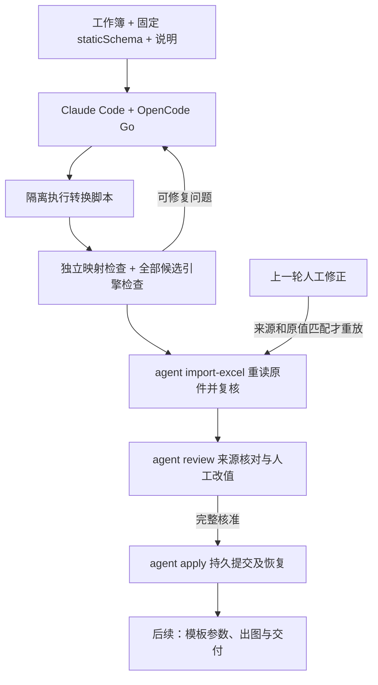

# Excel Agent：正式审核应用与嵌套定义实测

2026-11-03。采用正式导入适配器，把已完成的 Excel 提取包接入既有审核、人工改值和完整应用。验收状态与命令结果只记在[票据 03](../../.scratch/excel-agent-extraction/issues/03-review-correct-apply.md)，操作方法见[使用说明](../excel-agent-review.md)。代码在 `feature/excel-agent-p05`，未合入主检出。

## 数据链路

宿主固定原件、目标定义、原始候选、映射、脚本及重新生成的检查结果；清单和各文件哈希进入审核身份。导入不会执行模型脚本，只运行仓库中的受限读取器和独立映射检查器。通过标记不是信任依据。所有候选都重新做引擎校验，人工编辑保持身份、需要原因，不能通过删除部分候选绕过完整应用。

重放按数据集身份、源工作表/坐标/规则和原候选值定位；列表移动不按文件名或数组下标盲写。原件或依据变化时记录冲突，不能沿用旧批准。提交恢复同时核对 Excel 证据，复用现有持久意图和幂等回执。

## 新一轮真实模型观察

| 项目 | 记录 |
|---|---|
| 渠道 / 模型 / 执行器 | OpenCode Go / `claude-haiku-5-5` / Claude Code `2.1.296` |
| 输入 | 原有 `fixtures/excel/price-tags.xlsx`；新的 `fixtures/workspaces/excel-catalog` |
| 目标 | `catalog@1` → 列表 `batches` → `catalog-group@1` → 列表 `items` → `商品价签@1` |
| 会话 | 1 次，11 个模型轮次，146323 ms；无故障注入 |
| 转换 | 2 次：首轮报错，第二轮通过；全部尝试保留 |
| 产物 | 1 份目录数据集，1 个批次，6 个商品对象；70 个非空单元格全部分类 |
| 独立真值 | 嵌套 `items` 与模型不可见的 `fixtures/excel/price-tags.json` 逐字段一致，6/6 |
| 正式接入 | `agent import-excel` 导入为 1 份待审候选；未代替业务审核或应用 |

首轮脚本在读取不存在的 H4 单元格时抛出 `ValueError: missing source cell sheet-1!H4`，使可选空字段处理失败。宿主把真实异常返回给模型；第二轮脚本把缺失坐标按空单元格处理，再由映射的 `omitIfEmpty` 规则省略。两次请求脚本与实际执行脚本各自相同、前后脚本不同，且 `injected: false`。这一轮证明了模型修复自身生成的算法错误；它不同于 P04 的宿主截断注入。

用量：输入 20、输出 35146（thinking 18491）、缓存读取 247652、缓存创建 52963 tokens。全部类别分别保存，OpenCode Go 套餐实际扣费未知；不从一次小表测试推断长期速度和成本。

证据位于该分支 `scripts/prototypes/excel-agent/evidence-p05/nested-01/`，含固定输入、实际提示词、工具与流式事件、两轮代码、检查、独立真值和调用时源码哈希。`provenance.json` 是实测时的源码身份；后续修正重放及资源快照加固未再调用模型。受影响的正式导入路径重新经过本地测试。

## 验证范围和后续

本地测试通过公开 CLI/API 覆盖多候选、错误类型、身份与范围约束、连续修正重放、可选字段删除、候选重排、嵌套列表移动、原件冲突、伪造通过标记、证据修改、完整应用、重试和强退恢复。现有图片审核与提交恢复测试同时回归。精确命令和数量见票据。

页面 HTML、脚本语法、审核 HTTP 接口与固定 xlsx 下载已核对；本机浏览器控制宿主不可用，未完成浏览器交互走查。当前编辑入口是整份候选 JSON，并非字段表单。

提取运行仍使用原型入口，正式 `agent run` 尚未支持工作簿输入、统一检查点和提取宿主崩溃恢复。该样本验证引用对象和两层列表，不覆盖跨表 join、多层复杂表头、大表、全部 Excel 格式或真实客户业务。P06 接按模板参数生成通用渲染项；P07 用实际制作表和人工真值验收，ADR-0028 的生产隔离结论仍保留为草案。
