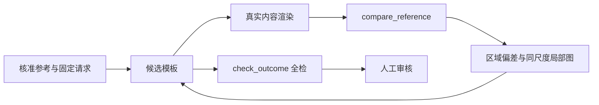

# 模板参考比较与内容事实核查

当前实施与验收聚焦中文、英文（M307）；已验证结果与未完成项见[结果记录](agent-visual-feedback-results.md)。阿拉伯文材料仅作历史诊断，不继续投入还原。

合同 0.10.0 将技术合格和参考还原分开：`qualified` 仍表示成果结构与引擎检查通过；视觉结果回答核准范围内缺了什么、偏多少、涉及哪个实例与源模板。不输出 SSIM、LPIPS 或加权总分，不将未检查区域计为通过。研究依据与取舍见[研究报告](research/2026-10-22-template-visual-fidelity-harness.md)和[设计](../.scratch/agent-template-authoring/visual-feedback-design.md)。

## 准备本次参考

发起模板任务时增加 `--reference reference.json`。基准由操作者核准，不能让正在设计的 Agent 在工具调用中自选真值。命令校验并固定示例图字节与基准，存入宿主 `logs/`；下一轮沿用并校验哈希。区域坐标相对原始示例图，`boardRegion` 是图中对应完整画板的轴对齐裁切区域；省略时使用整图。透视照片需事先校正、审核，工具不会自动拉伸成相同版面。

```json
{
  "sampleWidthPx": 1000,
  "sampleHeightPx": 600,
  "artboardWidthMm": 100,
  "artboardHeightMm": 60,
  "complete": false,
  "approvedRegions": [{
    "id": "stop-name",
    "name": "普通站名",
    "sampleRegion": { "x": 100, "y": 100, "width": 300, "height": 100 },
    "targetPathPattern": "主模板/站名",
    "boxKind": "ink",
    "expectedText": "科技园",
    "expectedColor": "#000000",
    "state": "normal",
    "positionToleranceMm": 1,
    "toleranceRatio": { "min": 0.8, "max": 1.2 }
  }]
}
```

以上仅为格式示例，尺寸与区域必须换成本次实测值。`boxKind: ink` 比字形墨迹外接框；`layout` 比排版框；不指定就不比几何。`expectedFontSizeMm` 只有独立核准字号时才填写，不能由框高推算。`expectedText` 和 `expectedColor` 可单独提供；颜色当前只核对解析后的文字片段色值，未测背景与最终像素对比度。默认尺寸/字号容差 0.8–1.2、位置容差 1 mm，是可配诊断参数，未证明符合全部业务验收标准。

`targetPathPattern` 完整匹配实例路径，`*` 表示任意片段；`targetText` 可作为额外筛选。无匹配报缺项；多匹配在没有 `repeat: true` 时标为歧义。重复区域对全部匹配实例比尺寸，不把每个实例移动到代表项的位置；不同文字长度、状态或样式应分别标注。状态仅来自核准区域的 `state`，不会由第几个循环项推断。`statesMeasured` 是已取得数值的状态；`statesCovered` 要求全部已核查且无异常。最终可见性尚未验证，因此当前不会声称某状态完全通过。

## Agent 单轮工作流



`compare_reference` 输入可选 `templates`（省略时读 `outcome.json` 的候选）、`regions`（最多 20 个核准 ID）。合同 0.10.1 新增 `regionOffset`：从缺省 0 开始读取 `regionCatalog`，目录最多 20 项，按 `nextRegionOffset` 继续直到 null；用目录中的 ID 点查被文字预算省略的详情。`regions` 与 `regionOffset` 互斥。即使只看局部，仍测量全部区域；筛选和翻页只控制返回证据，页面图片跟随目录起点。工具只读，不写评估文件。参考、候选、50% 叠图从左到右排列，每次最多 3 组；采用同一个画板毫米裁切范围，保留平移误差，附原图/候选像素坐标换算。真实内容图在草稿占位与问题边框加入前生成；严重问题仍在问题清单中，正式出图行为不变。

返回内容：

- `status`：`notChecked`（没有基准或尺度不一致）、`needsWork`（测得偏差）、`needsReview`（已测维度无偏差但未完成视觉审核）。
- `regions`、`anomalies`：缺项、文字、字号、尺寸、位置、文字颜色；每个实例有毫米数值、比值与 `unknown`。复杂旋转、裁切等几何与最终遮挡/对比度明确保留未知。
- `coverage`：核准区域总数、匹配数、扫描实例数、状态、未知区域数。`complete` 是基准清单的声明，不是自动验证覆盖全图。
- `sourceLocation`：源模板名与静态元素路径；结合 `sourceFiles` 找候选文件。`path` 是本次调用/循环展开后的实例路径，两者不可互换。
- `reportId`：绑定有效工作区、数据、请求、参考、实际读取的资源字节、引擎构建与算法。相同输入得到相同 ID。`changes` 是同一 MCP 会话内前后异常集合的已消除/新增/仍存在数量，不能当作美观改善百分比。

摘要有文字预算（视觉部分约 10,000 字符，每区域最多 3 个实例）；`partialDetails` 表示截断，`regions` 可用于继续查询。已知画板基准但没有区域锚点时返回总览图并保持未校准。宿主最终 `check.json` 的 `styleVerification` 保存完整报告。`check_outcome` 的问题、内容事实明细与模板修改差异共享总预算；内容明细的 `detailsTruncated` 保留截断字段的 shown/total 和完整异常分类计数，不能把省略项当作无问题。`check_outcome` 与轮次结束使用相同比较模块，技术检查与视觉检查使用同次渲染。未核准区域、语义关系、层级、遮挡、对比度和跨状态样本不会被折算成通过。

## 提取任务的内容事实

提取任务可传 `--content-baseline content.json`，格式例如：

```json
{
  "name": "本次站牌",
  "items": [
    { "id": "stopCode", "label": "站码", "definition": "站点", "field": "code", "sampleOmissions": 15, "mustBeOptionalIfPartial": true },
    { "id": "minutes", "label": "累计分钟", "values": [{ "path": "stops[1].minutesFromStart", "value": 0 }, { "path": "stops[2].minutesFromStart", "unknown": true }] },
    { "id": "payment", "label": "付款方式", "allowConstantWithoutBrief": false }
  ],
  "allowedConstantsInBrief": []
}
```

`15` 和第几站未知都必须来自本次人工核准事实，不从 `route-sign` 或 `code` 名字推断。`definition`/`field` 明确定位定义，`values.path` 使用 1-based 数据路径；未知值只能留空或作为真正的 `pending` 交给人审核。常量白名单由操作者根据项目说明核准，不解析“不得作为固定常量”等自然语言来放行。`coverage.notes` 只是模型说明，不能证明来源、字段存在或数值正确。

无基准返回 `notChecked`；只有已核准事实的不一致触发严重异常。旧的五维总分未校准，保留兼容字段但值为 `null`。派生计算和没有逐项事实的内容仍列未知，不承诺自动核验全部业务语义。

## 留存与复跑

普通轮次保存 `logs/prompt.md`、实际发给 Agent 的 `logs/materials/`、`logs/provenance.json`（源码提交/脏状态、资料哈希、工具合同、引擎标识）以及参考输入。模型/轮数/力度/端点仍见 `round.json`。评估与普通轮次共用源码/资料清单生成逻辑；凭哈希能识别输入变化，脏工作区仍需要保留对应源码才能在另一设备复现。

从仓库根运行：

```powershell
node --import tsx scripts/accept-agent-visual.mjs
node --import tsx scripts/accept-agent-visual.mjs out/agent-visual-acceptance-en en
npx vitest run test/agent-style-verification.test.ts test/agent-coverage-verification.test.ts test/agent-dataset-template.test.ts
node --import tsx scripts/accept-agent-content-replay.mjs
```

脚本不调用模型，生成 `out/agent-visual-acceptance/`：参考图、核准基准、请求、各候选、完整报告、干净内容图、草稿图、局部三联图及汇总。覆盖正确初稿、空骨架、缩字、平移、错字、颜色错误、修正结果、已知能力受阻，以及 DPI 对照；人工审核时用这些报告验证诊断方向。真实站牌的标注质量、模型纠偏成功率与人工排序相关性尚需另验，见票据 38。

内容重放脚本读取不入库的 `out/arabic-board-retest-2026-10-20/`（也可用首个参数指定目录），按存档 truth.json 检查旧首次及反馈候选，分别保存报告及输入哈希到 `out/agent-content-replay/`。已复现首轮必填站码与 12 个累计分钟遗漏，反馈轮相应严重异常消失，待确认仍需审核；这不是一次新的模型运行。

真实原图的 86 区域独立标注、16 个阿文站名的偏小诊断及 DPI 对照见[原图参考记录](examples/arabic-reference/README.md)。已完成一次中文受控样例的[真实模型纠偏](agent-visual-live-acceptance.md)，6 项异常归零且没有越出修改范围；它不替代原图全流程与四场景评估门槛。
