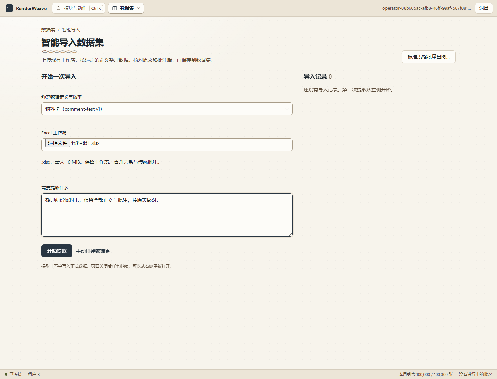
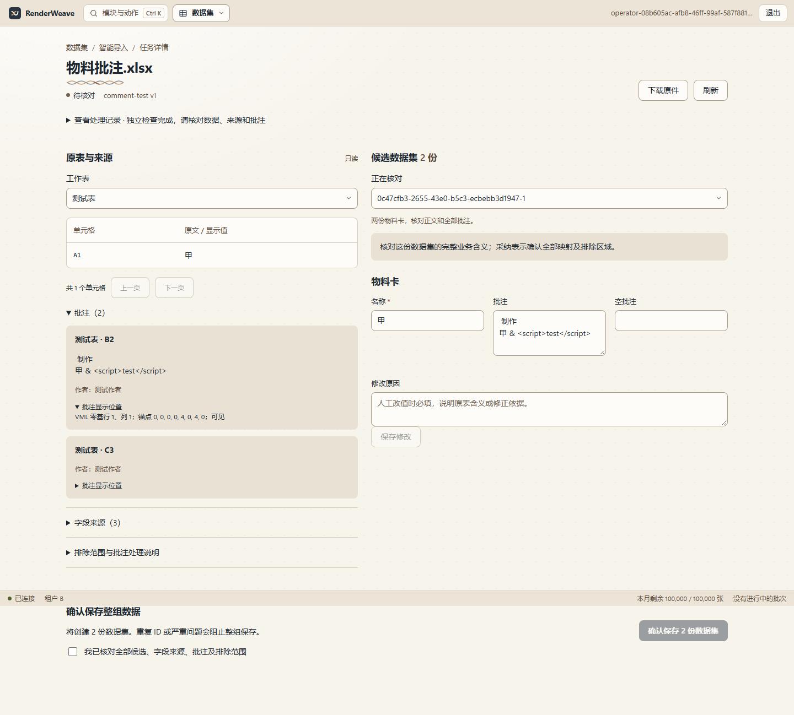

# 数据集智能导入

2026-11-03，M375。入口在控制台的**数据集 → 智能导入数据集**。按工作空间已发布的静态数据定义整理 `.xlsx`，生成可核对的候选，确认后保存为普通数据集。字段由定义决定，模块没有线路、上下行或站序特例。

## 页面怎么用

1. 在数据集模块选择“新建数据集”，可以直接选择静态数据定义和确切版本，手动填写并保存，不要求已有模板。从静态数据定义详情的新建/智能导入入口进入时带入当前版本。
2. 选择“智能导入数据集”，选定义、上传工作簿，填写对象划分、范围和需要保留的内容，例如“每个门店生成一份，保留商品顺序和全部批注”。点击开始提取。
3. 任务详情显示读取、映射、转换重试和独立检查进度。关闭页面后继续处理；从导入记录重新打开。处理期间可以取消，失败或取消不写正式数据集。
4. 待核对页面左侧是工作表单元格、传统批注、字段来源和排除理由，右侧是按定义生成的候选表单。点字段来源的坐标回看原文；展开“批注显示位置”查看 VML 零基行列和原始八项锚点。批注归属以单元格引用为准，显示框不是数据位置；缺少显示框时仍保留原文。多行文本用多行输入框显示。
5. 修改候选业务字段必须填原因，再点“保存修改”。修改会清除本次整组确认。逐份核对后勾选确认，点击“确认保存 N 份数据集”。任一候选不合格或 ID 已存在，整组都不保存。候选 ID 和定义在本轮固定；需要改变身份或范围时重新提取，在说明中指定新的 ID。
6. 成功页打开普通数据集，继续编辑或选择兼容模板预览、出图。没有模板也可以保存数据；模板制作沿用已有设计与发布页面。本次导入不自动生成模板或出图。

原有入口改名为“标准表格批量出图”，仍调用 `/v1/excel-imports`，按标准表头直接生成批量出图请求，合同不变。

目标定义含显示类别时，在任务说明中给出明确的原文对照。`split.values` 可将拆分项转换为定义要求的标量、对象或列表；未知项阻止完成，原文应另存字段。审核的“字段来源”展示分隔符和完整对照，确认时同时核对解释与原文。不得因独立检查通过而默认批准新解释。实例见 [115 显示字段与模板审核](agent-eval/dataset-display-115-review.md)。





## 启动配置

这是可启用的内部开发功能，默认关闭新任务入口。已有任务仍可查询。启用标志表示 API 允许入队，不代表处理进程在线；必须同时启动独立 Agent worker。

先按 [服务部署说明](service.md)配置 PostgreSQL、S3 和应用账号，并用 `setup` 执行包括 `0016_agent_jobs.sql` 在内的迁移。模型密钥仅给 Agent 宿主进程，不交给浏览器或转换容器。

```powershell
npm run build
npm run build --prefix service
# 环境中已设置服务的 RW_DATABASE_URL、RW_S3_* 等配置。
node service/dist/main.js setup

# API 进程所在终端
$env:RW_DATASET_AGENT_ENABLED = 'true'
node service/dist/main.js api

# 另一终端：同一数据库与对象存储配置，OPEN_CODE_API_KEY 已在本机安全配置。
node service/dist/main.js agent-worker
```

Agent 宿主需要 Node、Python 3 和能启动容器的 Docker CLI。Windows 缺省 `python`，其他平台 `python3`，可用 `RW_AGENT_PYTHON` 指定。模型沿用 Claude Haiku 5.5 + OpenCode Go，由现有 Tool Runner 驱动；`RW_AGENT_MODEL`、`RW_AGENT_ENDPOINT` 可覆盖宿主配置，不接受浏览器指定。已有本地 Claude Code 原型入口保留。

转换镜像须预先存在（工具使用 `--pull=never`）：

```powershell
docker pull python:3.13-slim@sha256:ae14d4ce8771606477a81446e7ef429edd6762305fc50c84507c1041fa8285d1
```

普通 Compose 不自动开启 Agent worker，也不自动挂载 Docker 控制接口。开发时可在宿主启动上述进程；托管部署需要独立执行节点及隔离复核。运行镜像已包含 Python、Docker CLI 和固定检查程序；镜像具备这些程序不等于获得执行节点权限。

## 数据处理与存储

`上传 → 固定原件及定义 → 受控读取 → Agent 编写映射与转换 → 沙箱执行 → 独立来源检查及 Schema 校验 → 人工核对 → 整组提交`。

- API 只接受文件字节、文件名、确切定义和说明，不接受宿主目录、任意 URL 或脚本。任务、原件、证据按租户隔离；原件以哈希保存到内容存储。
- Agent 仅能调用查看定义、查看工作簿、读取范围、提交转换、交回成果。生成脚本仅在固定 Docker 镜像中执行，无网络、无宿主目录挂载、只读根文件系统、非 root、去掉 capabilities，限 CPU/内存/进程/输出量。模型 key 和服务存储凭据不进入转换环境。
- 检查器重读原件，独立检查来源覆盖、顺序、批注分类、VML 与目标定义。通过检查只得到候选，业务含义仍由用户确认。
- 原件、最终审核材料和执行诊断保存到租户内容存储；任务状态与有序事件存 PostgreSQL。页面轮询进度，可刷新恢复；当前保留最近 200 条进度事件，不是 SSE 接口。
- 审核修改复用正式 `changeReview`；整组保存再次检查来源、定义与当前工作区。`AgentJobStore.save` 在同一租户事务/锁内登记所有数据集、应用结果和审计，任何 ID 冲突全部拒绝。
- 入队 `requestId` 支持同内容重试；审核用 `revision` 拒绝过期覆盖；已应用任务再次提交返回同一 ID 集合，不重复写入。
- worker 领取任务后有 15 分钟租约。取消会停止模型和转换；租约过期只标失败，不自动再次调用模型。失败后从原件重新发起，产生新任务；不自动继承上轮人工修改。

首版限制：`.xlsx` 默认最大 5 MiB，以任务列表返回的 `maxWorkbookBytes` 为准（宿主证据包最多接收 16 MiB），每租户至多 4 个排队/执行任务；每个 worker 串行处理，轮次 10 分钟、24 轮工具交互、6 次转换尝试，每次脚本 10 秒。单次归档最多 100 MiB/2000 文件。只支持已验证的传统批注与纯 Note VML；不把现代线程批注或 `.xls` 标为已支持。当前提取使用空资源仓库，含图片资源引用的定义暂不纳入验收范围。

## 接口与代码入口

OpenAPI **1.11.0**，完整描述见 [openapi.json](api/openapi.json)。查询要求 `tenant.read`，创建、取消、修改和确认要求 `datasets.write`。这是数据集确认保存，不增加模板/定义的管理员发布审批。

| 接口 | 用途 |
|---|---|
| `GET /v1/agent-jobs` | 开关状态、上传字节上限、租户任务记录 |
| `POST /v1/agent-jobs` | 上传 base64 工作簿并入队 |
| `GET /v1/agent-jobs/:id` | 状态、事件、候选和审核资料 |
| `GET /v1/agent-jobs/:id/source` | 下载固定原件 |
| `GET /v1/agent-jobs/:id/cells` | 按 sheet/cell/offset 查原文，每页 100 格 |
| `POST /v1/agent-jobs/:id/cancel` | 取消任务 |
| `POST /v1/agent-jobs/:id/review` | 带 revision、item、document、reason 保存人工修改 |
| `POST /v1/agent-jobs/:id/apply` | 带 revision、confirmed:true 确认整组保存 |

主要入口：页面 `service/console/src/pages/dataset-imports.tsx`；接口 `service/src/api/agent-jobs.ts`；调度 `service/src/agent-worker.ts`；任务/提交合同 `service/src/agent-jobs.ts`；工具宿主 `src/agent/excel-run.ts`。引擎不引用 Fastify、PostgreSQL 或 S3。

## 验证边界

浏览器测试使用确定性模型接缝，真实读取器、独立检查、审核、HTTP 与数据集写入；另做真实 Claude + OpenCode Go 小样和完整服务任务实测，结果见 [验收票据](../.scratch/dataset-import-app/issues/03-smart-import-module.md)。同一 115 原件的新版网页自动走查及兼容模板预览已补做，见 [现场说明](agent-eval/dataset-import-115-app.md)。这些验证不替代新增显示投影的业务核准、生产隔离复核或 P0/P1 原有门槛。

模型上报的 token 按轮次身份登记；进程硬崩溃前未落盘的用量可能缺失，不能据此结算。**人工业务审核工时、实际扣费未知。**


## 合并前内部测试库的迁移编号

合并后的开放 API 为 1.12.0，命名版本使用 `0015_named_schema_versions.sql`，Agent 任务使用 `0016_agent_jobs.sql`（M385）。新安装和已执行命名版本迁移的库按普通 `setup` 升级。

仅在合并前已执行 `0015_agent_jobs.sql` 的内部测试库：先停止 API、渲染 worker、Agent worker，并备份数据库；使用数据库属主执行 [编号转换脚本](../service/scripts/reconcile-agent-migration.sql)，再用新构建执行 `setup`，最后启动同构建的全部服务。脚本取得与迁移器相同的锁，核对旧名称、确切 SHA-256、任务表和未占用的新编号后，只将旧登记 15 改为 16；`setup` 补执行命名版本迁移 15，已有 Agent 表和任务保留。任何条件不符都会拒绝，不能绕过哈希检查或直接重跑建表 SQL。转换后旧构建不能再启动；回退须恢复备份及旧构建。

本次提交只验证升级步骤，不升级正在运行的 115 验收服务。
