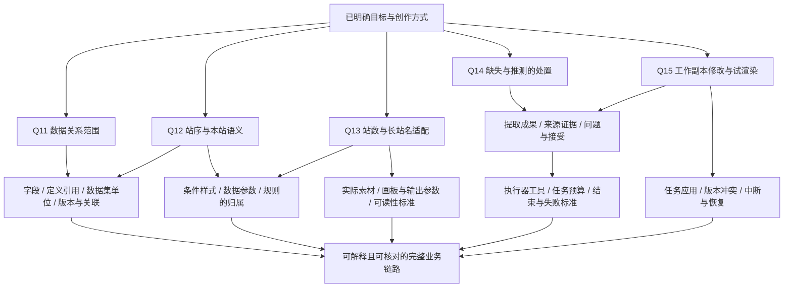

# RenderWeave 需求探索

状态：第 1–3 轮已答；建模草稿 M1–M104 已定，实施中的决定 M105 起。本文保存目标、事实、建议和决策树；已明确术语见 [GLOSSARY.md](../../GLOSSARY.md)，项目现状见 [CONTEXT.md](../../CONTEXT.md)。

## 用户已明确

- 新项目位于 `F:\GenCode\RenderWeave`，来源是 `D:\Yiwer\code\RenderWeave` 的重构迁移。
- 核心是设计数据定义、数据结构、数据关系，设计关联模板，再用符合定义的数据集渲染出图。
- 首个业务场景为线路牌：单条线路、一个行驶方向、有序站点。
- 用户明确旧项目在模板表达式部分的失败是：没有达成共同理解、实现成本太高、过于复杂而难以使用。
- 此次重新挖掘需求，重点是 human 与开发 coding agent 对项目上下文达成共同理解，使实现可理解、可核对。
- 希望借助 Coding Agent As an API server 的理念，聚合 coding agent 能力，把单次或串行 LLM 流程改为 agent 任务，覆盖 Schema 提取、模板修改、模板设计和数据集提取。
- 产品内 agent 主要承担提取、辅助设计和辅助修改。渲染由系统提供，并可作为 agent 调用的 function；边界已记入 [ADR-0001](../adr/0001-agent-assistance-and-rendering-boundary.md)。
- 重新设计；数据定义与模板 DSL 可以复用经过实例核对的概念，表达式重新依据需求选择。其他实现可参考但全部重写，旧文件原样加载仅在有明确资产需要时纳入范围。
- 每个增量的共同理解以用户能解释业务概念、数据关系、模板规则、agent 改动差异及验证结果为标准；难以解释的行为或高代价取舍再深入代码。
- 输入来源原则：结构化业务数据负责核对字段值，图像或设计稿负责核对呈现；只有图像时，分别交付可核对的数据定义与数据值候选。
- 模板以可视配置与中文意图辅助创作为主；必需规则无法清楚表达时再引入公式入口，见 [ADR-0002](../adr/0002-template-rules-before-expression-language.md)。
- 首先统一业务任务成果要求，使执行 agent 可替换，用一个 agent 跑通首场景；具体任务需要分工时再引入协作，见 [ADR-0003](../adr/0003-business-tasks-and-replaceable-agents.md)。

## 已核查事实

核查日期：2026-09-30。旧仓库代码快照：`830cdf2046893d6d6a5705ce4a68c7b1e4d1c5e1`。以下为静态代码和文档核查，需求访谈期间未运行产品测试或模型调用。

旧项目来源路径均相对 `D:\Yiwer\code\RenderWeave`。

| 事实 | 证据 | 证据边界 |
|---|---|---|
| 新工作目录最初为空，尚未初始化 Git | `Get-ChildItem -Force` 的 `EntryCount=0`；`git status --short --branch` 返回 `not a git repository` | 是本次落文档前的目录状态 |
| 旧表达式使用自有语言，输入读取只接受 `input.alias`，函数取自固定枚举 | `renderweave-template/src/main/java/cn/hbads/renderweave/template/internal/ExpressionParser.java:377`、`:421`；`.scratch/renderweave-template-v1/issues/07-value-binding-expression-model.md:66`、`:69` | 证明已有实现及边界；不能据此推断用户的失败原因 |
| 旧表达式要求理解类型、缺失值和作用域；前端另有保守语法解析器 | 上述规范 `:35`、`:46`、`:53`、`:75`；`web/src/features/template-editor/template-expression-syntax.ts:17` | 用户已确认表达式复杂难用；哪些具体规则产生负担仍需用实例拆解 |
| 旧 AI 提取由程序控制固定阶段，包含模型分析、本地结构物化、确定性验证及 critique/repair | `renderweave-inference/src/main/java/cn/hbads/renderweave/inference/live/LiveInferenceWorker.java:544` | 该控制流程不能直接等同于自主 coding-agent 工具循环 |
| 候选成果进入审核，apply 检查 revision、阻断问题并落为 Draft | `renderweave-inference/src/main/java/cn/hbads/renderweave/inference/candidate/CandidateApplyService.java:43` | 是旧项目的业务流程；新项目的审核职责由后续访谈决定 |
| 旧 Schema 的 reference 字段按嵌套对象递归验证 | `renderweave-validation/src/main/java/cn/hbads/renderweave/validation/RootDocumentValidator.java:535` | 此处是结构引用；新需求是否还涉及实体关联和 join，需结合首个场景决定 |
| 旧渲染合同以单一 RootDocument 作为必需输入 | `openapi/renderweave-v1.yaml:5534` | 不能由此确定新项目“数据集”的批次、提取或复用语义 |
| 旧测试以站点标题为根，包含多条线路及每条线路的停靠站点 | `renderweave-inference/src/test/java/cn/hbads/renderweave/inference/live/SerialVisualAnalysisContractTest.java:290`、`:302`、`:310` | 是站点下多线路的站牌模型；不能直接解释用户所说的线路牌 |
| 旧视觉语料是确定性合成评估 fixture，来源声明明确无真实业务记录 | `renderweave-inference/src/main/resources/visual-eval/v2/SOURCE-NOTICE.md:3` | 不能作为用户真实素材或真实线路数据 |
| 旧通用示例通过重复节点、条件节点、直接字段绑定表达列表、显隐与宽度变化 | `web/e2e/template-candidate-preview-live.spec.ts:359`、`:365`、`:381` | 本次只核对测试代码；这些示例没有使用 Expression，也未定义线路牌的必需规则 |
| 保存并重载的真实产品 E2E 曾因 Docker/backend 不可用而未执行 | `.scratch/renderweave-template-v1-implementation/issues/224-land-static-schema-definitions-and-bindings.md:48` | 是该票的历史记录；本轮没有验证当前运行状态 |
| 旧 reference 复用结构，数据值必须内嵌；站点数组按出现位置验证 | `renderweave-validation/src/main/java/cn/hbads/renderweave/validation/RootDocumentValidator.java:543`、`:583` | 不具有共享站点实例的自动关联或更新能力 |
| 旧图像元素合同保存类型提示与 Evidence，没有实际提取的数据值字段 | `renderweave-inference/src/main/java/cn/hbads/renderweave/inference/live/VisualElementInventory.java:42` | Schema 推断的不确定性合同不能直接等同于数据值提取合同 |
| 旧 renderer 当前 Text 切片限制为裁切、无缩字，正例不能证明中文长站名适配 | `renderer/crates/engine/src/lib.rs:1917`；`renderer/crates/engine/tests/native_text_vectors.rs:36`、`:93` | 需对新线路牌单独定义长站名与站数变化的验收，不能据词汇存在推断功能已交付 |
| 旧 dirty 编辑内容先保存再预览，渲染闭包读取已保存的 current | `web/src/features/template-editor/TemplateEditorShell.tsx:2012`；`renderweave-template/src/main/java/cn/hbads/renderweave/template/internal/CanonicalTemplateClosureAuthority.java:197` | 候选模板直接试渲染需要重新设计入口语义 |

公开能力参照：[Codex App Server 官方文档](https://learn.chatgpt.com/docs/app-server) 已描述会话历史、交互审批和流式 agent 事件，并使用双向 JSON-RPC 通信。这里只核查概念可行性，具体 agent 产品、协议和部署方式留待任务需求明确后选择。

### 参考资料核查（2026-10-08）

用户提供的参考来源：公交站牌制作系统后台模板模块 `E:\MiLu\code\route-info-board\rid-rs`（下称 rid-rs，路径相对其 `src/main/java/cn/hbads/ridrs/modules/template/`）、设计渲染端 `D:\Yiwer\code\design-layout-draw`（含布局引擎 `ts-layout-wpf`、渲染器 `canvaskit`、在线编辑器 `svg-edit-web`）、旧 RenderWeave 草稿项目。`D:\Yiwer\code\stop-sign-mgt` 只有 `pom.xml` 与 `.gitignore`，没有可核查内容。以下为静态阅读，未运行任何系统。

| 事实 | 证据 | 证据边界 |
|---|---|---|
| rid-rs 的模板类型是写死的业务层级（整张站牌、线路单边、途径站点、分站列表、班时、单值等），每类对应一份固定的系统数据结构 | rid-rs `models/enums/TemplateType.java`；`domain/component/document/SystemSourceKeys.java` | 新设计用可定义的数据定义取代固定层级，是对这一结构的泛化 |
| rid-rs 模板数据源分系统、自定义、映射、拼接四类；自定义数据源可"暴露"给上层模板填充，并有默认值 | rid-rs `models/enums/TemplateDynSourceType.java`；`domain/aggregate/TemplateDynSource.java` | 对应新模型的数据字段、模板参数、派生变量 |
| rid-rs 求值按固定阶段：系统 → 自定义 → 映射（映射之间拓扑排序）→ 拼接；映射以"结果非空"判定命中，未命中取默认值，最多 10 条规则 | rid-rs `domain/component/context/RenderContextLoader.java:205`、`:216`、`:430`、`:419`；`models/dto/dyn_source/MappingDynSourceDTO.java:44` | 结果为空的分支会被当作未命中继续向下匹配；拼接不能被映射引用 |
| rid-rs 拼接把数值按 `#0` 格式化，小数会丢失 | rid-rs `RenderContextLoader.java:514` | 如"票价拼接"遇到 2.5 元会显示整数；支持把展示格式放在变量插槽上 |
| rid-rs 绑定值为空时跳过绑定，元素保留设计时的静态内容 | rid-rs `RenderContextLoader.java:269` | 缺数据时成品会出现设计占位文字；需明确新模型的缺值处置 |
| rid-rs 支持嵌套子模板（上层填充子模板暴露的数据源）、循环容器（每项渲染一个子模板，可合并相邻同值项、可反序）和动态模板（按条件选择子模板，含默认模板） | rid-rs `domain/component/processor/ExpandEmbeddedTemplateProcessor.java`、`LoopContainerExpandProcessor.java`、`DynamicTemplateProcessor.java` | 新模型尚未定义子模板 |
| rid-rs 在代码中派生了途径站状态（已经过/当前站/未经过）、是否下一站/起点站/终点站、开往名称（缺省取终点站）、线路名称字符长度、线路经过同站序号 | rid-rs `SystemSourceKeys.java:48`、`:51`、`:66`、`:75`；`domain/component/document/RouteLayerSystemSourceStruct.java` | 新模型中这些值需由数据集提供或由派生变量计算，可作为运算种类的需求来源 |
| rid-rs 模板以毫米记录适用尺寸范围（最小/最大宽高）并带 DPI；业务文档称整版按最小尺寸设计、出图时在范围内缩放 | rid-rs `domain/aggregate/TemplateDefinition.java:57`、`:82`；`svg-edit-web/src/views/Editor/agent/skills/stopsign-design-tutorial/SKILL.md` | 与"固定画板"的假设不同，影响 Q13 |
| rid-rs 中 `render=false` 的元素在交给渲染端前被移除，不占布局空间 | rid-rs `domain/render/RenderPipeline.java:62` | 条件显示的语义是"不参与布局"而非"透明" |
| 渲染端字体缺字时按字重选用思源黑体逐字替代；替代成功记为提示，替代后仍缺字记为严重问题 | `design-layout-draw/canvaskit/src/drawCore/V4/text/font/checker.ts:194`、`:225` | 用户所说"黑体"在旧系统中即思源黑体 |
| 渲染端自动缩字可一直缩到 1px，没有最小可读字号 | `canvaskit/src/drawCore/V4/text/horizontal.ts:546` | Q13 建议的最小可读标准在旧系统中不存在 |
| 渲染端按模板数据的计算日期加载当日冻结的渲染代码，以保证历史图可复现 | `canvaskit/docs/ARCHITECTURE.md:139` | 业务上存在历史出图复现需求 |
| 旧 RenderWeave 的数据定义 DSL：类型为 text/decimal/date/time/boolean/reference/array，time 固定 `HH:mm:ss`，字段出现时 `null` 永远无效，不持久化 fieldId（改名即删除加新增） | 旧 RenderWeave `specs/renderweave-v1.md:61`、`:132`、`:189` | 约束种类与冲突规则（§3.6）可复用；时刻精度、字段身份需在新模型中决定 |
| 旧 RenderWeave 以自有验证器为权威，编译出的 JSON Schema 仅用于互操作 | 旧 RenderWeave `docs/adr/0002-closed-dsl-inline-compiler-and-authoritative-validator.md` | 新草稿写的是用 JSON Schema 验证数据，两者不同 |
| 旧 RenderWeave 模板侧已有：带对外/私有之分且必须有默认值的自定义定义、首个命中加必填 otherwise 的映射定义、按显式上下文和参数填充调用子模板的 TemplateUse；绑定不回退到静态值 | 旧 RenderWeave `docs/context/template-editor.md:46`、`:52`、`:60`、`:67` | 概念可参照，不代表其版本、授权、Profile 等机制需要继承 |
| 旧 RenderWeave 资源（Asset）内容可替换、引用指向当前内容；删除时只检查各模板当前内容中的引用 | 旧 RenderWeave `docs/context/asset.md:10`、`:21` | 与 M10 一致，可回答"历史版本是否计入引用" |

### Rust 渲染器核查（2026-10-09）

用户提供 `E:\rust-app\busbox-render-engine`，由子 agent 阅读、主会话抽查。路径相对该仓库根；只读，未构建。

| 事实 | 证据 | 证据边界 |
|---|---|---|
| 仓库含两套引擎：Legacy 把 design-layout-draw 的 CanvasKit drawCore V4（TS）逐段移植为 skia-safe + SkParagraph；Haibo 是 2026-07-26 加入的严格 DSL 服务，文本与布局自写 | `docs/specs/001-render-engine/requirements.md:12-19`；`crates/engine/src/text/vertical.rs:599-615`（注释逐段对应 `vertical.ts` 行号）；最后提交 2026-07-26 | 旧 RenderWeave 的 `renderer/` 是另一套代码，从未调用该引擎（子 agent 结论，未逐条复核） |
| 竖排两端分布按字形墨迹让首字贴顶、末字贴底，溢出时以 scaleY 压缩；但没有"先收紧字距"、没有 60% 下限，也不上报严重问题 | `crates/engine/src/text/vertical.rs:188-257`、`:599-725` | 我们的 M82、M88 需要在其算法上补齐 |
| 横排两端按墨迹宽度分配间隙，间隙为负时改用 scaleX；缩字号用二分搜索，可缩到 1px | `crates/engine/src/text/horizontal.rs:253-380`；`crates/engine/src/text/fit.rs:45-96` | 顺序、下限与上报不符合 M84、M86 |
| 缺字按 glyphId 为 0 检测并分两级上报，但实际整段换用后备字体；斜体固定为直立；外描边画两遍；两套引擎都不支持 SVG 图片、缩字组与布局摘要 | `crates/engine/src/text/horizontal.rs:1081-1097`；`crates/engine/src/text/stroke.rs:141-171` | M10/M12 的逐字替代、M80 倾斜、M74 SVG、M91 缩字组需自行实现 |
| 原生 Skia 在 Windows（DirectWrite）与 Linux（FreeType）出图像素不同；绘制约比 CanvasKit WASM 快 18 倍 | `docs/specs/001-render-engine/design.md:84`；`acceptance.md:140-173`、`:206-210` | 性能数字为其文档记录，未复测 |
| 拟合在绘制阶段进行、最终字号不回写，因此产不出布局摘要，也做不了跨元素的统一缩字 | 子 agent 结论（`crates/engine/src/pipeline/mod.rs`） | 我们的实现须把"测量、决定、记录"放在绘制之前 |

### Agent 执行环境核查（2026-10-08）

用户计划借用 `F:\GenCode\CloudKiln`（coding agent 加云沙箱的异步任务平台）作为业务 Agent 任务的实施环境。以下为静态阅读，路径相对 CloudKiln 仓库根，未提交任何云任务。

| 事实 | 证据 | 证据边界 |
|---|---|---|
| CloudKiln 以 Caller、Task、Attempt、Environment、Sandbox、Skill、Artifact、Publication 为领域词汇；RenderWeave 将作为一个 Caller | `GLOSSARY.md` | Attempt 尚无独立实体，见其 `.scratch/agent-platform/spec.md` 基线表 |
| 首版为独立批处理 Task：需要补充信息时明确结束，补充后重试；暂停、恢复返回 409，运行中不能等待用户输入 | `.scratch/agent-platform/spec.md:78`；`README.md:65` | 重试归属同一 Task 还是新 Task 尚未决定 |
| 平台只保证 agent 执行与文件交付，业务验收由调用方负责 | `docs/adr/0002-first-release-callers-and-delivery-boundary.md`；spec `:80` | RenderWeave 须自行对成果做业务校验 |
| 进入 agent 执行前，沙箱出网收紧到模型端点（文档环境另含少量依赖域名） | `task_platform/execution.py:33`、`:35`、`:111` | agent 运行中无法直接访问 RenderWeave 服务，除非另行放行 |
| MCP 目前显式配置为空；首批 MCP 范围建议为只读，尚待其访谈确认 | `task_platform/remote_runner.py:58`；spec `:106` | 通过 MCP 提供校验与渲染未经验证 |
| Skills 由管理员审核后登记，按 Task 选择注入，不能上传任意技能包；较重工具链预装在环境镜像中 | `README.md:217`；`docs/adr/0001-cloud-sandbox-and-dynamic-skills.md` | RenderWeave 的领域知识可作为 Skill 提供 |
| 输入：单文件 20 MiB、二进制合计 40 MiB、最多 10 个路径；输出：单文件 5 MiB、合计 20 MiB | `README.md:148`、`:178` | 线路牌素材、DSL 与预览图通常在范围内，未实测 |

### 外部 OCR 能力核查（2026-10-08）

用户计划调用阿里云百炼的 Qwen-OCR 系列（如 Qwen-VL-OCR）。来源为[阿里云帮助中心《文字提取（Qwen-OCR）》](https://help.aliyun.com/zh/model-studio/qwen-vl-ocr)，页面更新于 2026-09-10；只阅读文档，未调用接口。

| 事实 | 证据边界 |
|---|---|
| 当前系列包括 qwen3.5-ocr 与 Qwen-VL-OCR（qwen-vl-ocr 稳定版、latest 及 2025-11-20、2025-08-28 等带日期版本）；2025-04-13 及更早版本不推荐，文档建议迁移到 qwen3.5-ocr | 线路牌素材上的实际效果未测 |
| "高精识别"内置任务（`ocr_options={"task": "advanced_recognition"}`）返回每行文字及旋转矩形坐标 `rotate_rect: [center_x, center_y, width, height, angle]`，位于 `ocr_result.words_info` | 完整内置任务需 DashScope SDK；OpenAI 兼容方式需自行构造 Prompt 并解析输出 |
| 文档未提供逐字或逐行置信度；明确提示文字过小或分辨率低时可能产生幻觉，关键业务建议人工审核 | "看不清"无法由置信度阈值自动判断 |
| 图像限制：宽高均大于 10 像素，宽高比不超过 200:1；qwen3.5-ocr 单图不超过 20MB，其他版本不超过 10MB；4K–8K 仅支持 JPEG/PNG | |
| qwen3.5-ocr 支持多轮对话、内置任务与自定义 Prompt 结合、经 Response API 直接解析 PDF；qwen-vl-ocr-2025-11-20 及更早版本只处理最新一条消息 | |
| 按输入、输出 token 计费，按地域使用不同端点与 API Key；另有 Batch API 用于大规模非实时调用 | 费用与限流未按线路牌业务量估算 |

## 决策树

第 1、2 轮已确定场景、失败问题、agent 职责、重写范围、规则创作方式与聚合原则。当前前沿是 Q11–Q15；具体字段、数值阈值与技术选择按答案继续展开。讨论样例见[线路牌案例](../examples/route-sign.md)。

## 第 1 轮答案

| 问题 | 用户明确的答案 |
|---|---|
| Q1 首个场景 | 线路牌 |
| Q2 旧项目失败 | 没有达成共同理解；表达式实现成本太高，复杂难用 |
| Q3 agent 职责 | 主要是提取、辅助设计、辅助修改；渲染可以是 agent 调用的 function |
| Q4 继承范围 | 重新设计，DSL 可部分复用；其他实现参考后全部重写 |
| Q5 理解标准 | 接受业务概念、数据关系、模板规则、agent 改动差异及验证结果可解释的标准 |

## 第 2 轮答案

用户回答“全部按推荐”，接受以下原则：

| 问题 | 已接受选择 |
|---|---|
| Q6 场景含义 | 单线路、单方向、有序站点 |
| Q7 输入与提取 | 结构化数据核对值，图像或设计稿核对呈现；仅有图像时分别交付 Schema 与数据值候选 |
| Q8 创作方式 | 可视配置加中文意图辅助；必需用例触发公式入口 |
| Q9 DSL 复用 | 核对后复用数据与模板概念，表达式按需求重新选择；明确资产需要时才要求旧文件加载 |
| Q10 聚合方式 | 统一任务成果要求、可替换执行 agent、先单 agent 闭环，具体需求触发协作 |

## 第 3 轮

进展：Q12 由 M30 与模型走查回答；Q14 由 M29、M44–M47 回答；Q15 由 M49–M52 回答；Q11 由 M60–M66 回答；Q13 由 M81–M88 回答。第 3 轮 Q11–Q15 均已回答。以下保留原问题与建议，具体反例见[线路牌案例](../examples/route-sign.md)。

### Q11：数据关系范围

首版的数据关系需要表达对象、列表和数据定义之间的结构复用，还是还要管理独立站点实体，按 ID 跨数据集关联并同步更新？

建议：先支持结构复用，渲染消费一份准备好的完整数据。跨数据集的共享实体与关联展开在出现明确业务需要后引入。

### Q12：站序与本站语义

线路牌是否需要标出本站？若站序中两次出现相同站名，如何确定标记哪一次？

建议：每个行驶方向提供明确的有序站点列表；本站是可选出图参数，定位到列表中的一次出现，首版可按位置明确指定。数据变化后重新核对该位置；相同站名保留，不据站名自动合并。

### Q13：站数和长站名适配

同一模板从 6 个站变成 28 个站，或出现很长的站名时，应该自动适配、改换模板，还是直接拒绝？

建议：固定画板上的同一模板先通过排布、换行与有限缩字适配；设最小可读标准，超限时给出可定位的问题。具体尺寸、字号和排布策略在实际素材确定后验收。

### Q14：缺失与推测的处置

素材不完整、字看不清或来源冲突时，agent 是否可以补出候选值？这些情况如何影响预览和正式出图？

建议：可以提出候选，但保留来源与待确认项，区分已提供值、未提供、看不清、推测与业务允许缺失。未解决的必需数据问题阻止正式出图；草稿预览允许清楚标注问题后用于讨论。

### Q15：工作副本修改与试渲染

agent 是否能在工作副本上直接修改、校验和反复试渲染，还是必须先把候选保存到已有模板内容才能预览？

建议：允许直接在工作副本上修改并试渲染，交付规则差异、前后预览和检查结果；试渲染本身不写入已有模板内容。成果应用、保存与冲突处理在这项边界明确后继续展开。

## 建模草稿讨论

2026-10-08 用户提交数据定义、字段、约束、DSL、模板与"数据源定义"的建模草稿，讨论后确定：

| 编号 | 已确定 |
|---|---|
| M1 | 三要素为数据定义、模板、数据集；模板侧统称模板变量，分为数据字段、模板参数、派生变量（第三类原称条件变量，见 M8） |
| M2 | 派生变量定义在所属模板中；列表项的派生变量（如站点状态）定义在循环模板中，由其对外参数（如序号、本站序号）计算；作用域不嵌套（随 M13 修订） |
| M3 | 条件分支的条件只用结构化比较（变量、运算符、值），按序取首个命中的分支，必须有"否则"分支 |
| M4 | 条件分支产出业务语义值（如站点状态），元素按该值选择样式，不直接产出颜色等呈现值 |
| M5 | v1 可配置约束限于可编译为 JSON Schema 2020-12 的子集 |
| M6 | 日期如 `2026-01-02`；时刻为 `HH:mm`，秒可选，如 `10:28`；时间如 `2025-01-02 09:08:12`（空格分隔、带秒）；均不带时区 |
| M7 | 增加图片类型；必填是字段上的约束，用于约束数据集，判定为"键存在且值不为 null"，空字符串与空列表交给长度、项数约束。图片取值有两种形式：资源仓库中的资源引用，或 URL；URL 不预先校验图片是否有效，仅在渲染时获取并嵌入 |
| M8 | 派生变量由一个运算加若干操作数构成，不嵌套，靠引用其他变量组合；条件分支是其中一种运算；拼接放入文本元素内容中的变量插槽；暂不引入文本表达式，见 [ADR-0004](../adr/0004-derived-variables-without-text-expressions.md) |
| M9 | 图片取值在数据集中统一写为字符串：资源引用使用专用前缀，URL 限 http/https；图片字段可设"允许的来源"约束。资源引用的存在性与资源种类检查属于类型自带的检查，不计入 M5 |
| M10 | 资源仓库分图片、字体两类，资源种类不可改变；资源内容可以替换，引用保持不变，每次替换产生新的内容版本号，替换前列出引用它的模板与数据集；被引用的资源不可删除，"被引用"只看各模板与数据集的当前内容；每次出图记录所用资源的内容版本与渲染器版本，以便复现历史图片。模板自身使用的装饰图片与字体只来自资源仓库 |
| M11 | URL 图片需经过安全校验器：在实际取图时按解析出的 IP 校验，每次重定向重新校验；数据集校验时只做静态检查用于提前反馈。取不到或未通过校验时，草稿预览用占位图并标出问题，正式出图失败并指明位置 |
| M12 | 字体缺字时按字重选用思源黑体逐字替代；替代成功记为提示，替代后仍缺字记为严重问题 |
| M13 | 模板地位平等，子模板是被调用时的角色。子模板的数据来自调用方的单引用字段、调用方的当前数据（基准相同时），或没有数据（以空数据定义为基准）；不继承调用方作用域，参数通过其对外参数显式填写。列表[数据定义引用] 由循环容器遍历，容器须指定基准与列表元素一致的循环模板。后续扩展为在同一基准数据定义的不同模板之间按条件选择（动态模板），见 [ADR-0007](../adr/0007-equal-templates-composed-by-schema-references.md) |
| M14 | 画板以毫米为单位；模板声明适用尺寸范围；渲染请求给出实际尺寸；DPI 为出图参数；需设定最小可读字号 |
| M15 | 模板参数类型为字段类型或颜色；分对外参数与内部参数：内部参数必须有默认值、调用方不能修改；对外参数没有默认值时调用方必须提供 |
| M16 | 缺值时绑定不回退到设计时的占位内容，结果为空；必填字段缺失在数据集校验时拦截；草稿预览可显示占位但须标出问题 |
| M17 | 以编译出的 JSON Schema 为数据集校验权威；前提是注册时刻、时间的自定义格式，并按十进制精确解析数值，见 [ADR-0006](../adr/0006-compiled-json-schema-as-dataset-validation-authority.md) |
| M18 | 数据定义可修改，发布后形成不可变的静态数据定义（StaticSchema）；数据集必须选定一个静态数据定义，依赖不可变版本使已有数据集不受后续修改影响。字段以字段名称为身份，数据集中的键与模板绑定都使用字段名称；显示名称可随时修改、不影响绑定（据 G1 两次修订；ADR-0005 已被取代），见 [ADR-0008](../adr/0008-immutable-static-schemas-for-datasets.md) |
| M19 | 循环容器通过循环模板的对外参数显式传入循环信息：序号（从 1 开始）、是否首项、是否末项、总数 |
| M20 | 基本类型的列表（如换乘线路列表[文本]）由系统内置的单值数据定义包装每一项后调用循环模板；每种基本字段类型一个单值数据定义，只含一个"值"字段 |
| M21 | 子模板所用单引用字段的路径可经过多层单引用，不能穿过列表 |
| M22 | 动态模板（后续扩展）的每个条件分支分别填写所选模板的对外参数 |
| M23 | 条件分支的条件是结构化比较，右侧可以是固定值或另一个变量（G2） |
| M24 | 引入"取项"运算：从列表取首项、末项或第 N 项；派生变量可以产出数据定义引用类型的值，插槽与绑定的路径可以经过它的单引用（G3） |
| M25 | 模板可声明检查项：一个布尔派生变量，加问题等级与提示文字，渲染前求值；为此引入"长度"运算，求文本字数或列表项数（G9） |
| M26 | 模板之间的调用关系（子模板调用与循环调用）必须是无环图，保存模板时检查（G11） |
| M27 | 条件显示隐藏的元素不参与布局（G4） |
| M28 | 状态样式：元素按某个模板变量的取值选用不同属性取值，未列出的取值归入"其他取值"；条件显示即对"是否显示"属性的状态样式（G5） |
| M29 | 数据集只放已确定的数据；候选值、来源证据与待确认项属于 Agent 任务成果，确认后才写入数据集（G7） |
| M30 | 线路牌的本站序号默认 0，表示不标本站（G8，回答第 3 轮 Q12 的"可选"） |
| M31 | 修改被其他模板调用的模板时，保存前列出受影响的调用方模板并要求确认（G12） |
| M32 | 数据定义之间的引用不能成环（G13） |
| M33 | 列表的元素不能又是列表（G14） |
| M34 | 模板创建后不能更换基准数据定义；需要时复制模板并选定新基准（G15） |
| M35 | 模板元素、子模板调用、条件显示、状态样式、渲染请求、问题清单、草稿预览、正式出图加入术语表 |
| M36 | 模板的基准是静态数据定义的确切版本（G16） |
| M37 | 渲染时，数据集选定的静态数据定义必须与模板的基准完全一致（G17） |
| M38 | 静态数据定义以数据定义名称加自动递增的版本号标识，如"线路牌 v1"（G18） |
| M39 | 静态数据定义中的数据定义引用指向确切版本，如"线路牌 v1"引用"站点 v1"（G19） |
| M40 | 模板不配置版本，可以直接修改，包括把基准升级到同一数据定义的新版本。升级前列出失效的绑定，由人或 agent 修复后才能保存；字段以名称为身份，系统不区分"改名"与"删除后新增"。改用另一个数据定义仍需复制模板（M34）（G20） |
| M41 | 模板升级前列出会失配的数据集与调用方模板，由用户选择：一并迁移到新版本，或先复制一份模板留给旧版本。数据集迁移生成新数据集，原数据集保持不变（G21） |
| M42 | RenderWeave 构建 MCP 服务，执行 agent 经 CloudKiln 的 MCP 支持接入，借此使用 RenderWeave 的能力（回答 T11，选择 MCP 方案；CloudKiln 将支持 MCP） |
| M43 | 业务 Agent 任务分四种：数据定义提取、数据集提取、模板辅助设计、模板辅助修改，每个任务产出一种成果；只给图片时，先做数据定义提取并由人发布，再做数据集提取（T1） |
| M44 | 待确认项分四类：看不清、推测、来源冲突、必填未提供；可选字段没有值不算待确认项（T2） |
| M45 | 每个待确认项记录位置、候选值（可无）、原因与来源证据；来源证据只能指向已记录的识别结果中的文字行，或结构化素材中的位置，审核时把框画回原图；证据说明出处，不保证正确（T3、O3） |
| M46 | 草稿预览可以使用候选值并标出问题；所有待确认项处理完才生成数据集，因此之前不能正式出图（T4） |
| M47 | 审核时，待确认项逐项处理；其余来自图片识别的值连同识别框展示，由人整体确认一次（O4） |
| M48 | 每轮交回 `outcome.json` 与一份说明；RenderWeave 先校验结构，不合格的轮次由人决定是否带着问题清单重跑，首版不自动重试（T12） |
| M49 | 模板所有未保存的修改（人或 agent 产生）统称工作副本；可校验、可草稿预览，不影响已保存的模板；应用即保存（T5，回答第 3 轮 Q15） |
| M50 | 草稿预览可以指定若干工作副本，代替对应的已保存模板，用于在调用方模板中查看被调模板的修改效果（T6） |
| M51 | 系统记录工作副本基于哪次保存的内容；应用时若模板已被他人保存，重新显示差异，由人选择覆盖或基于最新内容重做（T7） |
| M52 | 给人审核的修改前后预览由 RenderWeave 重新渲染，不采用 agent 交回的图片；agent 自己的渲染只用于自查（T13） |
| M53 | MCP 服务只提供读取、校验、草稿预览、识别四类只读工具；agent 不能保存、发布、删除或正式出图；成果以 CloudKiln 产物文件交回，不经 MCP 写入（T8） |
| M54 | RenderWeave 为每一轮签发只对该轮有效的 MCP 凭据，只能访问本任务相关的素材与对象，任务结束即失效 |
| M55 | OCR 统一经 MCP 识别工具按需调用，不在沙箱内直连；新增素材与识别结果两个实体，识别结果归属素材、不可变、记录模型名与确切版本，相同素材、模型与区域的调用复用已有结果（O1、O2） |
| M56 | OCR 固定使用带日期的模型版本；首选模型在 qwen3.5-ocr 与 qwen-vl-ocr-2025-11-20 之间用线路牌样图对比后确定（O5） |
| M57 | 接受素材经过阿里云百炼、CloudKiln 云沙箱与 DeepSeek 模型服务三处（O6） |
| M58 | 一个业务 Agent 任务由若干轮组成，每轮对应一个 CloudKiln Task，输入为素材、上一轮成果（含人工修改）与反馈；轮与轮之间由 RenderWeave 保存状态（T9） |
| M59 | 正式出图时记录模板内容快照（含被调模板）与所用数据集，连同 M10 的资源内容版本与渲染器版本，用于复现历史图片（T10） |
| M60 | 数据集既可以作为实体保存在系统中（有身份，可列出、审核、复用），也可以随渲染请求附带 JSON；附带的 JSON 同样按选定版本校验（D1） |
| M61 | 保存的数据集可以直接修改，修改后仍须通过所选版本的校验；正式出图的出图记录保存数据集内容快照（D2，细化 M59） |
| M62 | 一份数据集对应一个业务对象，如一条线路的一个方向；出图张数与本站等由渲染请求决定（D3） |
| M63 | 新增批量出图：一个模板加多个渲染项，每项为数据集、对外参数值与出图参数；每项独立校验、独立出图、各有问题清单，一项失败不影响其他项；首版由调用方或界面显式列出各项，"每站各出一张"等便捷操作以后再加（D4） |
| M64 | 数据集首版来源：按数据定义表单录入、导入 JSON、Agent 数据集提取；表格类素材也经 Agent 提取；不做直连数据库或定时同步的 Connector（D5） |
| M65 | 每份数据集自成一体，不设跨数据集的共享实体；同一站点出现在多份数据集中时分别维护，或由外部系统重新推送；首版不提供"改一处全部更新"与数据变更后的站牌影响追踪（D6，回答第 3 轮 Q11），见 [ADR-0010](../adr/0010-self-contained-datasets.md) |
| M66 | 数据集可以删除，出图记录中的快照不受影响；每份数据集记录来源：手工录入、导入、来自哪个 Agent 任务，或从哪份数据集迁移而来（D7） |
| M67 | 模板元素目录首版：画板、容器、循环容器、子模板调用、文本、图片、矩形、椭圆、线条、多边形、路径、二维码、条形码；多边形、路径、条形码为用户追加（G10，见[模板元素目录](../model/template-elements.md)） |
| M68 | 容器是一种元素，以"布局方式"属性区分自由、堆叠、网格（E1） |
| M69 | 模板中所有长度单位都用毫米，包括字号（E2） |
| M70 | 子模板与循环模板以调用框尺寸作为实际尺寸重新排布，须落在其适用尺寸范围内，否则记入问题清单；不整体缩放（E3，可随 Q13 复核） |
| M71 | 可以绑定：文本内容（经变量插槽）、图片来源、二维码与条形码内容、颜色、数值（尺寸、间距、内边距、字号、圆角、透明度、旋转）、是否显示（经条件显示），以及元素在网格中的位置（所在行、列与跨行、跨列数，用户追加）；不可以绑定：元素种类、布局方式、循环容器的列表字段与循环模板、子模板调用的被调模板、元素名称、多边形顶点与路径数据（E4） |
| M72 | 叠放顺序等于容器内的元素顺序，后者在上，不设层级编号（E5） |
| M73 | 文本内容由片段组成，片段是一段文字或一个变量插槽，可单独设字体、字号、颜色、字重（E6） |
| M74 | 图片资源支持 PNG、JPEG、WebP 与 SVG，SVG 入库时去除脚本与外部引用（E7） |
| M75 | 网格的行列定义不绑定变量，可用状态样式按变量取值切换几套预设定义；元素在网格中的位置（所在行、列与跨行、跨列数）可以绑定（E9，与 M71 一致） |
| M76 | 路径数据采用 SVG 路径语法，坐标以毫米计、相对元素框（E10） |
| M77 | 设计稿中的 ①②③ 是地标图片；地标是停靠站点的属性（图片），显示在站名下方，没有地标时隐藏不占位，站名占满整列（N1） |
| M78 | 引入"加减"运算；下一站 = 取项（停靠站点，第"本站序号 + 1"项），本站是末站时为空，整行隐藏（N2） |
| M79 | 循环容器可按某个字段合并相邻同值项：每组调用一次循环模板，组内项数作为循环信息传入并跨相应列数；按原始项数等分宽度，使道路带与站点列对齐（N3，同时回答 G6 的主要部分） |
| M80 | 文本片段增加倾斜属性，以倾斜变换模拟；M402 设计稿中的线路号是图片素材（N4） |
| M81 | 线路的停靠站点数为 2–50 站（Q13a） |
| M82 | 每个停靠站点一列，平分可用宽度；一块线路牌上所有停靠站点的站名字号一致，字号随站数变化；站名过长时纵向压缩字形，不减小字号（Q13b，取代原 Q13c 建议中"缩字"一步） |
| M83 | 站数多到列宽放不下时，统一缩小全部站名字号，直到最小可读字号；仍放不下记为严重问题，正式出图失败；设计者可另备两排版式，用状态样式按站数切换（Q13d） |
| M84 | 横排短文本放不下时，先横向压缩字形，最多压到原宽的 60%，再缩小字号，仍放不下报问题；跨度大时拉开字距（Q13e） |
| M85 | 画板宽度在适用尺寸范围内变化时重新排布，站点列随之变宽，字号不因宽度改变（Q13f） |
| M86 | 最小可读字号默认 5 mm，模板可为个别元素设得更高（M14） |
| M87 | 站名统一字号由设计者用条件分支按站数分档给出（如站点数 ≤ 20 用 12 mm、≤ 35 用 9 mm、否则 7 mm），经对外参数传给站点模板并绑定到字号；不由排版引擎按宽度自动求（与 M85 一致） |
| M88 | 纵向压缩字形最多压到原高的 60%，与横向压缩的下限一致；仍放不下记为严重问题，正式出图失败 |
| M89 | DSL 的结构关键字用英文；被引用的变量名（字段名称、参数名、派生变量名）一般用英文，中文写在显示名称里，因此数据集中的键也是英文；其他业务名称（数据定义名、模板名、元素名称、状态取值）不作语言要求（M402 DSL 草稿 S1，按用户意见修订） |
| M90 | 确认 M402 DSL 草稿的写法约定 S2–S13：变量引用写法与"."路径、模板内统一命名空间、属性值写成变量引用即为绑定、状态样式写法、数据集文件分为身份与数据两部分、编译产物不允许未定义的键、资源引用写成 `res:资源ID`、单值数据定义命名、网格行列从 1 编号、条件运算符与派生变量须声明类型、取项超出范围结果为空、模板按名称引用 |
| M91 | 文本适配增加"缩字组"：同一次出图中同组的文本缩到相同字号，用于站数过多时统一缩小全部站名（F1，落实 M83） |
| M92 | 调用框设为"随内容"时，被调模板的实际尺寸取其内容的自然尺寸，仍须落在适用尺寸范围内（F2，补充 M70） |
| M93 | 自由布局的位置可选"距左或距右""距上或距下"，使元素能贴住可变尺寸容器的右边或下边（F3） |
| M94 | 路径与多边形的坐标以毫米计、相对元素框，框变化时图形不拉伸；异形外框用固定尺寸的路径加可伸缩的容器拼接（F4） |
| M95 | 首版接受多个循环容器靠相同内边距保持列对齐（F5） |
| M96 | 循环模板的适用尺寸范围可以写得很宽，主要用于防止明显错误的调用（F7） |
| M97 | M402 设计稿中站名上方的蓝色"1"圆标是早期的错误设计，忽略；地铁、医院等标识沿用草稿处理，作为停靠站点的"标识"（列表[文本]，按取值选图）（F6） |
| M98 | 渲染引擎用 TypeScript（Node 22）实现为不依赖框架的模块加命令行入口；数据集校验用 ajv，栅格化与文字排版基于 Skia（必要时按字形逐个排版），布局自行实现；本期不用 NestJS，服务外壳后续再选（实施规划，见 [ADR-0011](../adr/0011-typescript-framework-free-render-engine.md)） |
| M99 | 栅格化定为 CanvasKit，字体全部显式加载、不使用系统字体，以保证跨平台出图一致；busbox-render-engine 只作算法参考，不作后端；排版按"测量、决定、记录、绘制"分步，布局摘要在绘制前生成（实施规划，见 [ADR-0011](../adr/0011-typescript-framework-free-render-engine.md)） |
| M100 | 毫米换算像素：像素数 = 毫米 ÷ 25.4 × DPI，四舍五入为整数；740 × 165 mm、120 DPI 得 3496 × 780 像素，与设计稿一致（票据评审） |
| M101 | 元素路径：由模板调用链上的元素名称逐层组成，循环容器处带循环序号（从 1 开始），如 `标准线路单边/站点面板/站点列[12]/名称区/站名`；问题清单、布局摘要与草稿预览的标注共用；模板内元素名称唯一（票据评审，细化 G10 的"名称"） |
| M102 | 渲染检查顺序：先解析；再执行互不依赖的模板静态检查、数据集校验、版本一致性与对外参数检查，全部执行并汇总；存在阻止展开的问题（模板或数据集无法解析、数据集的静态数据定义版本与模板基准不一致、调用成环、循环模板基准与列表元素不一致）时停止，两种模式都不出图；否则依次求值（含检查项）、排版、绘制（票据评审，取代业务实体模型中的建议顺序） |
| M103 | 工作区中的静态数据定义附带编译产物 JSON Schema；渲染入口只读取编译产物，出图时不编译（票据评审，落实 ADR-0006、ADR-0008） |
| M104 | 草稿预览中，因问题而缺值的变量插槽显示该变量的显示名称作为占位，缺值的图片不画内容、只画问题边框；可选字段正常缺值时不显示占位；正式出图从不显示占位（票据评审，落实 M16） |
| M105 | DSL 补充写法 S14–S17：自由布局的位置写法、文本对齐的取值与缺省、渲染请求附带数据集的写法、资源仓库清单 `resources.json`；工作区文件按内容归类（票据 01，见 [M402 DSL 草稿](../examples/m402-dsl/README.md)） |
| M106 | 文本行框取字体 OS/2 表的 typo 上下高度：思源黑体为表意字 em 框（基线上 0.88 em、下 0.12 em），随内容的文本高度等于字号；读不到时退回 Skia 度量。横排文字逐字排列，不做连字与字偶距，便于后续竖排、字形压缩与逐字缺字替代（票据 01，落实 M98） |
| M107 | 问题清单中的字段路径写成 `stops[12].name`，列表序号从 1 开始，与循环序号、元素路径一致（票据 01） |
| M108 | 文字描边画在填充之下，`width` 是字形外侧可见的描边宽度（画笔宽度取两倍），转角为圆角；字形压缩在生成轮廓时完成，描边作用在压缩后的轮廓上，压缩后描边宽度不变（票据 02） |
| M109 | 竖排排法：每字一个字格（宽为字号、高为行框），字在格内水平居中。两端分布时首字墨迹贴顶、末字墨迹贴底、字格等距；放不下时字距先收到 0，再把字格与墨迹一起纵向压缩（字号、字宽不变），不低于 compressMin（缺省 0.6，模板只能设得更高）；仍放不下时从顶端排起，按 onFail 等级报 `layout.textOverflow`。不写 fit 的文字不做适配，横排、竖排放不下都报严重问题。墨迹边界按字形轮廓求交精确计算，不用 Skia 取整后的字形边界（票据 02，落实 M82、M88） |
| M110 | 图形描边的位置：矩形、椭圆、容器与画板的描边画在框内（不超出元素框，便于排版）；线条、多边形与路径的描边以轮廓为中线；容器的填充画在子元素之下、描边画在子元素之上，免得被填满的子元素盖住（票据 04） |
| M111 | 布局规则：未写宽高时网格中填满、堆叠与自由中随内容；堆叠中填满的元素按权重分剩余空间，超出最小最大尺寸的固定在边界、余下的重新分配；主方向分布只在有剩余空间且没有填满的元素时生效；网格中随内容的行列只按只占这一行（列）的元素算，按比例的行列分剩余空间；容器随内容时按比例的行列与填满的元素都按随内容算；堆叠主方向或网格行列总和超出可用空间时报严重问题 `layout.contentOverflow`；旋转绕元素框中心、只影响绘制；透明度作用于元素及其子元素整体；隐藏的元素在布局摘要中标为不显示、尺寸为 0（票据 04，落实 M27、M72、M93、M94） |
| M112 | 数值最多 15 位有效数字（数据集中的值与数据定义中的界限都适用）：此时按双精度比较与按十进制比较结果完全一致，ajv 的 minimum、maximum 即可作为权威；超过的数值在读取工作区文件时按原文、在校验时按读出的值报 `dataset.tooManyDigits`（票据 03，落实 ADR-0006、M17） |
| M113 | 发布：版本号由发布自动分配，取同名静态数据定义的最大版本加 1，文档中写了版本号时必须一致，已发布的版本不能再次发布；编译时日期用标准 `date` 格式加等价正则，图片字段按允许来源编译成资源引用、http(s) URL 或两者之一的正则，允许来源不写时两种都允许；引用不存在或成环时拒绝，问题位置写从根定义起的字段路径（票据 03，落实 M9、M18、M32、M38、M39） |
| M114 | 图片元素：完整显示（contain）按比例缩放到放得下并居中，铺满裁剪（cover）按比例缩放到铺满、居中裁去多余部分，拉伸（fill）不保持比例；随内容时一边固定、另一边按比例，两边都随内容时按文件记录的 DPI（没有时按 96）换算天然尺寸；格式按文件头识别，只接受 PNG、JPEG、WebP，其他报 `resource.unsupportedFormat`；缩小绘制时用多级纹理线性取样（票据 05，落实 M74） |
| M115 | 文字片段：文字片段与变量插槽都可单独设字体、字号、颜色与倾斜，未设的沿用文本元素的设置；字重随字体资源，一个字体资源就是一个字重的字体文件，换字重即换字体资源，模板不写 `fontWeight`（写了报 `template.invalid` 并说明写法；缺字替代按原字体的字重选用思源黑体，见票据 11）；横排各片段按自己的字体与字号逐字排在同一条基线上，行框取有字的片段中基线以上、以下的最大值，没有字的片段不撑高行框；竖排按统一的字号与字格排列，片段只能单独设颜色；布局摘要的文字项列出各片段求值后的文字与合并后的样式（票据 06，落实 M73、E6） |
| M116 | 展示格式：时刻、时间与日期用 `yyyy`、`MM`、`M`、`dd`、`d`、`HH`、`H`、`mm`、`ss` 组成模式，其余字符原样输出，其他 ASCII 字母报错；数值写成整数部分若干个 `0`（前面可加 `#`）、小数部分若干个 `0` 再接若干个 `#`，如 `0.##`、`0.00`，按十进制四舍五入（远离零），不经过浮点运算；未给格式时，数值输出最短的十进制写法（不用指数记法），时刻、时间与日期按数据集中的写法；数据不合规时插槽为空（票据 06，落实 M17、rid-rs 拼接丢小数的教训） |
| M117 | 倾斜：以基线为轴的错切变换，角度以度计，正值向右倾，绝对值不超过 45°，只用于横排；字形描边随字形一起倾斜；测量时把每个片段的行框按倾斜变成平行四边形，文字宽取它们与前进宽度的总范围，左对齐时倾斜后的左下角贴着框边，所以随内容的文本框能装下倾斜后的字（票据 06，落实 M80） |
| M118 | 插槽的模板静态检查在求值之前进行，覆盖全部元素（包括隐藏的）：路径在数据定义中找不到报 `template.unknownVariable`，经过列表或基本类型的值报 `template.invalidPath`，布尔、图片、列表、引用字段放进插槽或展示格式与字段类型不符报 `template.typeMismatch`，都是严重问题、定位到文本元素；没有通过检查的插槽求值为空，文本其余片段照常排版。本期插槽只绑定数据字段，参数与派生变量随票据 07 加入同一检查（票据 06） |
| M119 | 绑定缺值时按属性类型取空值，不回退到占位内容：颜色为透明，是否显示为否，图片不画内容，插槽为空文字；数值没有空值，缺值或超出属性的取值范围（如透明度 1.5）时报严重问题 `template.bindingValueInvalid`，属性有缺省值时用缺省值，没有时该元素按隐藏处理；没有通过静态检查的绑定当作缺值、不重复报告；隐藏的元素不再求其他属性的值，所以末站时"下一站地标"缺值不报问题；绑定到 URL 图片时报问题、不画内容（URL 图片不在首期范围）（票据 07，落实 M16、M27） |
| M120 | 模板参数：类型为基本字段类型或颜色；约束随类型，数值可写 integer、min、max、enum，文本可写 minLength、maxLength、pattern、enum；内部参数必须有缺省值，缺省值必须合规。渲染请求只能填写对外参数：填写内部参数报 `parameter.internal`，填写模板没有的参数报 `parameter.unknown`，对外参数没有缺省值又没提供报 `parameter.missing`；取值类型不对时报 `parameter.invalid` 并按未填写处理（用缺省值），违反约束时报 `parameter.invalid` 但仍用该值，草稿预览可以照常看效果（票据 07，落实 M15、M102） |
| M121 | 派生变量的运算：条件分支按序取首个命中的分支；取项的序号从 1 开始，超出范围得空值；长度对文本按字数（码点）、对列表按项数，缺值时为 0；加减按十进制计算（0.1 + 0.2 得 0.3）。比较：empty 指缺值、空文本或空列表（数值 0 不算空）；有一侧缺值时 eq 只在两侧都缺值时成立、大小比较都不成立；大小比较只用于数值、日期、时刻与时间，时刻比较前补齐秒；固定值跟随另一侧变量的类型检查写法。派生变量可以按任意顺序声明，按需计算；引用成环报 `template.variableCycle`。检查项的问题条件为真时报 `check.failed`，等级与提示文字取自检查项（票据 07，落实 M3、M23–M25、M78） |
| M122 | 模板静态检查扩展到全部变量引用：数据字段、参数与派生变量同名报 `template.duplicateVariable`；绑定的变量类型必须与属性类型完全一致（颜色只来自颜色类型的参数或派生变量，M71）；状态样式的依据必须是基本类型，列出的取值在能确定全部取值时（布尔、带 enum 的字段或参数、结果全是固定值的条件分支）必须在其中，否则报 `template.unknownStateValue`，用于发现拼错的状态名；状态样式可以覆盖除 type、name、children、states 以外的属性，覆盖值同样经过检查；字体、路径数据、多边形顶点与网格行列定义不能绑定；尺寸写成 `{"fixed": {"var": …}}`，内边距、圆角可整体绑定一个数值。实现上同一个模板读取器分静态读取与求值读取两种用法，属性规则只写一份（票据 07，落实 M28、M71、M102） |
| M123 | 循环容器写法沿用草稿：`list: {var: 列表字段路径}`、`template: 模板名`、`args: {参数名: 运算数}`、`itemLayout: {direction: "row", widths: "equal" / "content" / {fixed: 毫米}, gap?: 毫米}`；gap 缺省 0，每项高度填满循环容器的内容区。等分宽度先扣除左右内边距与项间距，按内容宽度取被调模板的自然尺寸；缺值或空列表展开为零项。循环信息只在 args 中使用 `{loop: "index" / "isFirst" / "isLast" / "count"}`，不注入被调模板的变量表；groupSize、mergeBy 与 spanBy 留给票据 09（票据 08，落实 M19、M70、M92） |
| M124 | 子模板调用写成 `type: "call"`、`template: 模板名`、`data: {var: 单引用字段路径}` / `"current"` / `"none"`、`args`；data 缺省 none，args 缺省空对象。单引用路径可以经过多层单引用，current 要求基准名称与版本相同，none 只适用于空数据定义。每次调用独立求参数、派生变量、检查项与元素绑定；调用框尺寸交给被调画板重新排布，不整体缩放。place 随内容时取自然尺寸（包含画板内边距），不自动夹到适用尺寸范围内；画板 `size: "hug"` 可保留作为说明，最终尺寸仍由调用框或渲染请求决定（票据 08，落实 ADR-0007、M70、M92） |
| M125 | 系统内置 `空数据定义 v1` 与 `单值·文本/数值/日期/时刻/时间/布尔/图片 v1` 的固定编译产物；单值数据定义只含必填字段 value，空数据定义没有字段，均拒绝未定义的键。这些内置名称保留，渲染不接受工作区对它们的覆盖，也不需要工作区另存同名文件；基本类型列表项包装为 `{value: 项值}`。被调模板同样可以用匹配的内联数据集直接渲染（票据 08，落实 M20、S9、M103） |
| M126 | 静态检查遍历根模板可达的全部调用，包括隐藏元素与状态样式的未命中分支；检查目标存在、调用数据类型与确切基准版本、对外参数名称和类型、必填参数、调用成环。目标模板不存在、不能解析、没有基准编译产物，或调用数据类型/基准不符时同样阻止展开，两种模式都不出图；参数填写问题按普通严重问题处理。状态样式不能覆盖 template，动态选择模板留待后续（补充 M122）。展开后的调用框在布局摘要中保留 call 类型，循环容器为 loop、每项为 call，项路径以带序号的循环段替换容器段，不加入被调模板名称；实例中的参数问题与检查项保留原名称，并增加 path 指向调用框（票据 08，落实 M101、M102） |

| M127 | 合并循环用 `mergeBy: 字段路径`，路径从列表项出发，只能经过单引用，末端须为基本类型字段；出图前按编译产物静态检查，非法路径阻止展开。相邻值按原始类型严格相等才合并，不排序，不合并相隔同值项；缺值各自成组，空文本、0、false 是有效键。每组用首项作为被调模板数据；循环信息 index 与元素路径序号取首项的原始序号，count 仍为原始项数，groupSize 为组内项数，isFirst/isLast 按组是否含首项/末项判断；未合并时 groupSize 为 1（票据 09，落实 M79、M101） |
| M128 | 合并循环必须用 `widths: "equal"` 与 `spanBy: "groupSize"`：原始列宽为（内容区宽 − 原始列间距总和）÷ 原始项数，组宽包含对应原始列和组内间距，组间保留一个 gap，因此可与相同内边距、gap 的站点列对齐。空列表没有列与间距；随内容时取能容纳每组内容的最大原始列宽，间距超过可用宽时报布局问题（票据 09，落实 M79、M92、M95） |
| M129 | 横排 `horizontalAlign: "distribute"` 按每个字形的真实墨迹区间排列，含各片段字体、字号与倾斜后的轮廓；首字墨迹贴左、末字墨迹贴右，余宽在相邻字形间均分，间距不为负。单字墨迹居中，无墨迹字形按前进宽度占位；随内容宽取墨迹宽之和。普通 start/center/end 仍沿用 M117 的前进宽度与倾斜行框边界。实现只参考 `D:\Yiwer\code\design-layout-draw\canvaskit\src\drawCore\V4\text\horizontal.ts:207–281` 的墨迹分布思路，不复用实现（票据 09） |
| M130 | 横排适配 `fit.steps` 支持 compressGlyphs、shrink，缩字必须排在压缩之后：先按可用宽压缩到刚好放下或 compressMin（缺省 0.6，仅可提高），再在宽或高仍不足时同比缩小本元素全部非空片段的字号；任一片段到 minFontSize（缺省 5 mm，仅可提高）即停止，原字号已小于下限的不再缩小，不主动放大。字号与片段字号摘要记录最终值，压缩比单独记录；仍超出按 onFail 报 layout.textOverflow。倾斜与字形一起横向压缩，描边厚度不变；此适配局限于一个文本元素，跨实例的缩字组属票据 10（票据 09，落实 M84、M86、M88、M108） |

| M131 | 根据用户对 M402 参考图的纠正，道路名采用同间隔分布 `horizontalAlign: "spaceEvenly"`：按真实字形墨迹宽度求余宽，n 个字形把余宽均分为 n+1 份，字间与左右两侧各留一份（在固定内边距之内）；单字居中、空文本间距为 0。余宽不足时所有间隔收到 0，再沿用 M130 的压缩与缩字。保留 distribute 的两端分布语义，M402 道路段模板改用 spaceEvenly；道路合并与原始列边界规则不变。依据：`docs/examples/materials/m402-route-sign.jpg` 中“西环路”“布澜路”的明显两侧留白（票据 09 复核，纠正原道路名两端贴边的选择） |

| M132 | 竖排文本启用 `fit.widthOverflow: {shrinkGroup: 组名, minFontSize?: 毫米}`，组名为首尾无空白的非空文本，同一次出图内按名称匹配，跨循环项与子模板；minFontSize 缺省 5 mm，只能提高。可见文本按自身实际框扣除左右内边距计算候选字号，取原字号与可用宽的较小者，再取全组最小候选值，并遵守全组最高下限。同组原字号不一致时取较小值；最高下限超过任一原字号属于配置错误，报严重问题。隐藏元素与隐藏祖先的后代不参与，可见空文本仍按框参与。此配置只用于竖排，横排适配沿用 M130（票据 10，落实 M83、M86、M91） |
| M133 | 缩字组严格两轮排版：第一轮测候选字号，第二轮以统一字号重新测量整棵元素树的自然尺寸、重新决定框并做竖排收距与纵向压缩，只输出第二轮的摘要、绘制记录和布局问题；保留独立的组配置问题。高度不足不触发全组缩字，字号变小后压缩程度减轻，即 compression 数值趋向 1。第二轮宽度仍不足时报严重 layout.textOverflow，不受 onFail: hint 降级；仅高度不足仍遵守原有 onFail。摘要 text.shrinkGroup 标明所属组，text.fontSize 与 fragments 字号均为最终值。组计算与字号修改仅存在于本次布局副本，不修改模板、参数或跨次渲染状态（票据 10） |
| M134 | 包含可见缩字组的随内容元素及祖先，在自由布局、网格单元与纵向堆叠交叉方向等已有可用宽的分配处，宽度受可用空间限制，再应用明确的最小/最大尺寸；内边距逐层扣除，从而允许 M402 的随内容名称区与站名按列宽缩字。明确的固定尺寸仍按声明，横向堆叠主方向的随内容项仍按自然宽分配，不新增自动换行或迭代收敛。主模板现有分档为 ≤20 站 12 mm、≤35 站 10 mm、否则 7 mm；已验证 2/20/35/50 站在 740/1500 mm 均保持分档值。道路段适用宽度上限由 800 改为 1500 mm，使整条线路同路名合并时能覆盖主画板的最大可用宽（票据 10，落实 M85、M87、M96） |

| M135 | 用户以 366 线路牌纠正站多时的适配方式：优先收窄列间留白，不能仅因站数跨档就预先缩小字号。两张参考图均为 3496 × 780 像素，M402 35 列、366 59 列；首字墨迹宽中位数约 44/43 px，列中心间距约 93.75/55.5 px，字列间空白约 49/13 px。主模板改为内部参数 stopNameSize 缺省 10 mm，经对外参数传入站点；每站仍等分可用宽，保持字号直至列内（扣内边距）确实不足，再由缩字组全组微缩，最小字号规则不变。此决定取代 M87 与 M82/M134 中“默认按站数分档”的部分，条件分支能力仍保留供其他设计使用。依据：[M402 参考图](../examples/materials/m402-route-sign.jpg)、[366 参考图](../examples/materials/366-route-sign.png) 与用户“列间距”纠正（票据 10 复核） |
| M136 | 366 参考图包含 59 个站点列，因此 M81 的 2–50 不能作为通用线路范围；超过 50 站应通过相应数据定义与模板版式校验，最终能否容纳由列宽、可读字号下限和适用尺寸范围决定。已发布的线路牌 v1（maxItems: 50）保持不可变；59 站实验用发布入口在内存生成取消该上限的 v2，并使用 v2 基准模板副本与内联数据集，v1 拒绝 59 站的行为仍有回归测试。共享 M402 数据集仍选 v1，真实新线路落地时应选新版本、迁移生成新数据集，不覆盖旧数据（票据 10 复核，遵循 ADR-0008） |
| M137 | 缺字替代在求值后、布局前按 Unicode 码点检查字形 ID，仅 ID 为 0 的字改用后备字体；片段按实际字体拆分，原字号、颜色、倾斜保留，横竖排测量与绘制使用同一组片段，竖排行框取实际字体上下高度的最大值；不改写模板或数据集，隐藏分支不检查（票据 11，落实 M12、M106） |
| M138 | 引擎 `render` 的可选第三参数 `fallbackFonts` 指定后备字体资源 ID（不带 res:），缺省为准备脚本获取的四档思源黑体；属于引擎配置，不进入模板 DSL 或渲染请求。遇到缺字才加载候选，未安装或不可读的候选视为缺档；按字体文件 OS/2 字重选最近值，等距离取较轻者，同字重按配置顺序；读不到有效字重按 400。原字体资源已在后备配置中时不重复尝试；选定后备仍缺字时不再串换其他字重，空配置或无可用后备时直接报仍缺字（票据 11） |
| M139 | 缺字成功替代报提示 text.glyphFallback，仍缺字报严重问题 text.glyphMissing；每个文本元素按成功与失败各汇总一项，按首次出现顺序去重列出字符与 Unicode 码点，定位含循环序号的元素路径。摘要仅在有替代时增加 fontFallback: true，实际片段另用 sourceFont 保存原资源引用，font 表示实际字体；未替代文本摘要保持原样。缩字组重排不重复报告，正式出图遇仍缺字无图片，草稿可出图（票据 11） |
| M140 | 渲染入口按各自输入独立执行模板静态检查、数据集校验、版本一致性与对外参数检查，汇总后才决定是否展开；模板静态检查使用模板基准的编译产物，不借用数据集的版本。请求解析失败直接返回原请求问题码；后续无法展开时保留具体原因并追加 render.expansionBlocked，两种模式均无图片和布局摘要。可展开时，正式严重问题仍返回真实内容布局摘要（票据 12，落实 M102） |
| M141 | 草稿插槽因已有问题而为空时显示〔变量显示名称〕，字段名称来自编译产物 title，参数与派生变量来自声明；未知变量退回引用名。问题来源沿单引用、循环实例、子模板参数、取项和派生依赖追溯，正常可选缺值、未取到项及合法空默认值不占位。缺值图片不画内容，只在能定位的元素框标记问题；源模板和数据集保持不变（票据 12，落实 M104） |
| M142 | 草稿与正式出图共享真实内容的求值、资源与排版诊断；草稿含占位时另做显示排版，合成占位自身的溢出或缺字不进入公共问题清单，保证两种模式的问题清单一致。草稿摘要描述实际显示内容，占位片段标记 placeholder: true；正式摘要不含占位。没有问题时两种模式的图片与摘要一致（票据 12） |
| M143 | 草稿问题边框在业务绘制结束后叠加，红线宽 0.6 mm、白色衬边宽 1.2 mm，跟随元素及祖先的旋转，不受内容透明度、裁剪与叠放遮挡；零尺寸缺值框至少画 2 mm 定位标记。元素问题与已追踪到绑定的缺值标记实际元素，被调模板静态问题映射到各实例；隐藏元素及无元素位置的字段、参数、检查项不画框，正式出图从不画问题边框（票据 12） |

| M144 | SVG 作为图片资源，采用 resvg WASM 2.6.2 解码；加载时取得按 96 DPI 换算的天然尺寸并把文字转为路径，布局完成后按实际显示尺寸和出图 DPI 栅格化，再交给 CanvasKit 合成。contain、cover、fill 沿用图片适配；cover 按裁剪前整图取样，fill 按两轴较高像素密度取样；同次出图按资源和栅格宽度缓存、结束释放。Windows 与 Linux 的 127/508 DPI PNG/JPEG 四份样例已验证字节相同，依据见 ADR-0012 与 docs/render-svg.md（票据 13，落实 M74、M99） |
| M145 | SVG 加载先结构化清理 XML/CSS：拒绝 DOCTYPE/实体声明，移除脚本、事件、动画、foreignObject、外来命名空间元素、外部图片/字体/样式表；保留内部片段引用、普通内部 CSS 和内嵌 PNG/JPEG/WebP，不接受嵌套 data SVG。引擎选项 svgFonts 指定可用字体资源 ID，缺省为四档思源黑体，与 fallbackFonts 独立，禁用系统字体；有文字却没有可用资源字体时报严重问题。解析或栅格化失败报定位到图片元素的 resource.unreadable，两种模式诊断相同；中间位图遵守已有单边/总像素上限（票据 13） |

| M146 | 首期 M402 按结构与行为验收：直接加载共享工作区原文件，本站 5 的完整布局快照与图片固定；本站 0/35/36、1500 mm、11 字站名及思源黑体仍缺字的场景通过。参考图的四区结构、站点顺序、高亮与道路跨列正确；既有草稿的顶栏/底栏尺寸、字体与示意图标造成的外观差异逐项记录在 docs/examples/m402-acceptance.md，精确复刻另行调整模板与素材。本票不修改 DSL、静态数据定义、编译产物或共享数据集（票据 14，首期验收） |

| M147 | 首期在票据 01–14 后收尾，以本地渲染引擎、CLI 和 M402 结构/行为正确为阶段范围。可靠性、鲁棒性、可用性检测及两轴代码审查见 docs/stage1-acceptance.md；新增能力转入下一阶段，本次不修改共享 DSL、静态数据定义、编译产物或数据集 |
| M148 | CLI 发布只读取工作区文档，无需资源仓库；版本历史读取有严重问题则停止。输出文件排他创建，不覆盖已有定义或编译产物；可捕获写入失败撤回本次创建的文件，不承诺断电或进程强杀的事务原子性。发布读取原始数字时遵守 15 位有效数字约定。渲染调用开始即清除固定的上次成果，I/O 失败返回非零退出码和中文原因；同一渲染输出目录串行使用 |
| M149 | 派生加减的输入与十进制结果须为有限且不超过 15 位有效数字的数，溢出或精度不足报 template.evaluationInvalid 并按缺值处理，草稿可显示占位，正式不出图；子模板诊断附调用实例路径。固定值与参数共用基本类型检查，日期须真实存在；动态网格位置越界隐藏异常元素，不生成非有限布局摘要。重复出图以脚本检查确定性、输入不变及内存释放 |

以下 M150–M155 为 2026-10-12 第二阶段 PRD 的规划决定，不改变首期验收范围；其中二维码、CODE128、EAN/UPC、资源 v1 导入与替换已随票据 01–05 落地，实施细节见 M157–M171，其余按后续票据推进。

| 编号 | 规划决定 |
|---|---|
| M150 | 第二阶段聚焦本地生产出图：二维码/条形码、资源内容版本、批量出图及出图记录重放；依据 M67、M10、M63、M59 补齐已确定需求。HTTP/数据库/在线编辑器、Agent/MCP/OCR、URL 图片、动态模板及循环扩展继续后置。规格发布到 `.scratch/local-production-output/spec.md`，Status 为 ready-for-agent；后续独立拆票，从 01 开始，不续接首期票据 15 |
| M151 | 码元素内容为固定文本或文本变量绑定；二维码支持 L/M/Q/H、缺省 M，条形码先支持 CODE128（可打印 ASCII）、EAN-13/EAN-8/UPC-A（带校验位的完整数字文本），不自动改写编号。保留必要留白、按最终 DPI 使用整数像素模块，最窄模块至少 2 px 为本期产品下限；仍须从最终 PNG/JPEG 独立解码验收，不能把尺寸检查当成扫码保证。内容或尺寸非法时草稿标问题位置、正式阻断；具体 DSL 写法随可执行样例定稿，旧模板行为不变 |
| M152 | 正式交付使用带内容版本的本地资源仓库；旧清单保留单次渲染兼容，显式导入时保留 ID/种类/字节并从 v1 开始。成功替换保持引用、增加内容版本，旧内容不可覆盖，哈希不代替版本号。替换先检查所提供工作区的当前引用与字体配置影响，应用时检查预期版本和工作区内容指纹；冲突拒绝。暂不提供删除或历史清理 |
| M153 | 批量出图为一个根模板、统一草稿/正式模式和显式渲染项列表，每项带唯一标识、数据集、对外参数及出图参数；缺省串行、上限 1,000 项，逐项消费与落盘，不累积所有图片字节。外层非法则整批拒绝，合法批次中单项失败不影响其他项；启动前固定文档及资源版本，运行中修改不混入本批。交付目录排他创建，成功需所有本项成果完整；取消在项间生效，已完成保留、剩余标未执行，不自动重试或续跑 |
| M154 | 新增正式交付入口支持单项批次，每个成功项保存不可变、自足且有格式版本的出图记录，包含模板调用闭包、数据集、静态定义及编译产物、请求/选项、资源内容版本及实际字节、渲染器构建标识、问题/布局与原图片摘要；后备字体及 SVG 字体的可用/缺失状态固定。记录脱离原工作区仍可读取，重放校验完整性与确切构建后重新渲染，不回退当前内容、不执行记录中的程序；现有纯渲染入口不承担持久化。取舍见 ADR-0013 |
| M155 | 第二阶段主测公开渲染、批量交付和记录重放入口，资源管理用公开导入/替换接口，CLI 补文件与退出码行为；不测试私有中间结构。验收含独立解码、35 项 M402、混合失败、版本替换后的自足重放、故障成果保护、1,000 项串行 RSS 回归、Windows/Linux 全新安装与确定性，以及首次使用走查；阈值和场景以 PRD 验收矩阵为准，不能把本地批次稳定性等同服务隔离认证 |
| M156 | 用户确认第二阶段按 tracer bullet 拆为 13 张独立票据，逐票发布为 ready-for-agent，保留完整行为、直接阻塞、用户故事与验收追溯。无阻塞起点为 01 二维码、02 CODE128、04 资源导入；06 先完成纯文字牌交付/重放，07 扩展完整 M402，08 批量正式交付，12 汇合码图/资源替换/历史重放，13 阶段验收。覆盖 50 条用户故事与 A01–A15，依赖无环且无冗余传递边；父规格不修改，索引见 `.scratch/local-production-output/README.md` |

以下为第二阶段票据 01 的实施决定：

| 编号 | 实施决定 |
|---|---|
| M157 | 二维码 DSL 使用 `type: qrcode`，必填 `content` 为固定文本或严格文本变量绑定；`errorCorrectionLevel` 为 L/M/Q/H，缺省 M，只接受固定值（可由状态样式选择）。`foreground`/`background` 缺省黑白，可绑定颜色。按 UTF-8 字节模式保留原文及前导零，不做数字/汉字模式优化；拒绝空内容、孤立代理项及超过 2,953 字节内容，各纠错等级容量由编码器另行检查。独立样例在 `docs/examples/qrcode-dsl/`，M402 的 11 份共享 JSON 不改 |
| M158 | 二维码需要固定或填满得到的确定宽高，自身随内容尺寸不支持；网格省略尺寸默认为填满，自由/堆叠省略尺寸视为随内容。最终 DPI 下向框内侧取整数像素，四边各留 4 模块空白，最大可容纳的正方形居中且模块至少 2 px。颜色须不透明且不同。摘要记录实际码区、留白、纠错与模块像素尺寸；空内容/容量/颜色/尺寸使用稳定严重问题码并定位循环实例，草稿只标错误框，正式不出图。任意低对比色、裁剪、透明度或旋转不保证扫码，详见 `docs/render-qrcode.md` |
| M159 | 运行编码依赖锁定 qrcode 1.5.4（MIT），测试用独立 jsqr 1.4.0（Apache-2.0）从最终 PNG/JPEG 解码，类型声明 @types/qrcode 1.5.6 仅用于开发。29 项二维码测试纳入全量 393 项回归；内容/纠错/DPI/格式 48 种组合读回原文。Windows Node v24.12.0 与 Linux Node v22.23.3 各 16 份码图解码通过，图片及布局摘要哈希一致；本票共用构建与锁定依赖，全新环境安装仍在票据 13 验收 |

以下为第二阶段票据 02 的实施决定：

| 编号 | 实施决定 |
|---|---|
| M160 | 条形码 DSL 使用 `type: barcode`、必填固定 `format: CODE128`；`content` 为固定文本或严格文本变量绑定，接受非空的 U+0020–U+007E 可打印 ASCII，保留前导零、首尾空格和标点，不自动转换、不解释 `^FNC1` 等编码库指令。输入最多 500 字符，与锁定编码器边界一致，不宣称为通用标准容量；EAN/UPC 留待票据 03。前景/背景缺省黑白，支持颜色绑定，必须不透明且不同 |
| M161 | CODE128 需确定宽高，不支持自身随内容尺寸；码区按最终 DPI 向框内取整数像素，最窄模块至少 2 px，左右至少各 10 模块留白，上下各 1 模块保护间隔，条高至少 5 mm（产品下限）。`showText` 缺省 false，可绑定布尔；开启时须指定资源 `font`，字号 `fontSize` 缺省 3 mm，可绑定数值。原文下方文字沿用缺字替代，单独预留行框与墨迹空间，距码区保护间隔至少 1 mm，不压缩、不自动缩字。内容、容量、颜色、尺寸使用稳定严重问题码，字体问题用既有问题码；草稿只标错误实例，不留部分有效条码，正式阻断。摘要含格式、模块、必要留白、实际条区、完整背景框及独立文字摘要 |
| M162 | CODE128 编码锁定 bwip-js 4.11.4（MIT）同步 raw 接口，只使用条空序列，由 CanvasKit 统一合成；独立验证锁定 zxing-wasm 3.1.5 reader（封装 MIT，ZXing-C++ 核心 Apache-2.0），本地读取包内 WASM，从最终 PNG/JPEG 读回编号。34 项新增回归纳入全量 427 项测试，含 24 种内容/文字开关/DPI/格式组合和全部 95 个可打印 ASCII；Windows/Linux 各 8 份图片与布局哈希一致。独立样例在 `docs/examples/barcode-dsl/`，M402 11 份共享 JSON 未改，完整使用与验收说明见 `docs/render-barcode.md` |

以下为第二阶段票据 03 的实施决定：

| 编号 | 实施决定 |
|---|---|
| M163 | `barcode.format` 扩展为 CODE128、EAN-13、EAN-8、UPC-A，须明确指定固定值，不接受格式变量绑定。EAN/UPC 内容为含校验位的完整 ASCII 数字文本，长度分别 13、8、12；保留前导零，拒绝数值自动转换、空格、全角、缺位和多位。编码前按 GS1 模 10 规则检查校验位，错误记 `barcode.checksumInvalid`，不让编码库猜补或修正。语法与校验位通过不等于已核实编号分配给某商品 |
| M164 | EAN-13、EAN-8、UPC-A 码区分别为 95、67、95 模块，左右必要留白分别 11/7、7/7、9/9 模块；含必要留白的整体居中。沿用模块至少 2 px、条高至少 5 mm、上下 1 模块保护间隔与独立下方文字的产品边界。EAN/UPC 摘要的 quietZoneModules/quietZoneMm 分别记录 left/right；CODE128 继续用单侧标量，已有图片及布局哈希不变。整行下方文字沿用资源字体、缺字替代和错误处理，不作 GS1 包装专用排版或印刷质量认证 |
| M165 | EAN/UPC 复用 bwip-js 4.11.4 与 zxing-wasm 3.1.5，不增依赖。独立解码逐图限定目标格式并核对完整字节；锁定 ZXing 对 UPC-A 报告 UPCA，但返回补一个前导零的 13 位表示，验收仅接受该确切映射，不进行通用去零或数值归一化；EAN 字符串直接等于输入，模板/摘要/下方文字保留用户的原格式与编号。42 项新增回归纳入 469 项全量测试；Windows/Linux 各 24 份图片、布局哈希及解码结果一致，CODE128 原有 8 份图片和布局哈希未变。独立工作区在 docs/examples/retail-barcode-dsl/，M402 11 份 JSON 不改，说明见 docs/render-retail-barcodes.md |

以下为第二阶段票据 04 的实施决定：

| 编号 | 实施决定 |
|---|---|
| M166 | 旧资源清单通过显式导入进入 `renderweave-resources/1` 仓库，保留 ID、种类与全部实际字节，首个内容版本为 1；源清单与源文件不改写。公开准备、导入、查询、明确版本读取与固定映射接口；CLI 增加 resources-init、resources-import、resources-list，既有 render 自动识别两种仓库。导入不承担图片/字体格式转换，原清单与单次渲染保持兼容；替换留待票据 05 |
| M167 | 当前元信息含 version、sha256、byteLength；每次按版本读取校验字节数和 SHA-256，损坏使用 resource.integrityMismatch，缺失版本不回退。打开仓库固定当时清单；pin 缺省固定全部当前资源，显式映射仅暴露所列资源，复制映射后供既有渲染入口消费。资源 ID 区分大小写，内容采用随机文件名避免 Windows 文件名冲突；版本不是内容哈希，映射不是自足出图记录 |
| M168 | 本地资源维护先获排他目录锁，排他写完并同步内容，最后发布整份清单；已有 ID 整批拒绝，不覆盖历史。初始化不覆盖发布，导入以同目录重命名提交，可捕获失败撤回本次文件；并发失败方不清理其他调用的文件。拒绝非法路径和路径中的链接。强杀后可能有孤立内容与写锁，不自动抢锁或回收，不宣称断电/网络文件系统/服务隔离保证，取舍见 ADR-0014。37 项新增回归纳入全量 506 项测试；Windows/Linux 的 15 个资源及 M402 图片、摘要、问题哈希一致；文档见 docs/resources-versioning.md，共享 M402 JSON 未改 |

以下为第二阶段票据 05 的实施决定：

| 编号 | 实施决定 |
|---|---|
| M169 | 资源替换先生成只读影响报告，再显式应用。报告按指定本地工作区扫描模板固定图片/字体、文字片段字体、隐藏元素、全部状态分支、图片参数默认值、图片派生值、子模板图片实参及数据集图片字段；后备字体与 SVG 字体配置单独列出。引用位置用 JSON Pointer，普通文本或码图内容中的 res: 字样不当资源引用；范围不含其他工作区及调用时临时数据/参数。不完整模板或缺少内联编译产物时拒绝给出空引用的成功报告 |
| M170 | `renderweave-resource-replacement/1` 检查报告固定资源仓库真实目录、资源 ID/种类/预期版本/哈希、候选字节数与哈希、工作区真实目录、指纹与有效字体配置。指纹覆盖顶层全部 JSON 文件名和原始字节及有效配置；格式化、新增/删除或更改 JSON 都需重新检查。应用复制报告、持写锁重新核对，内容与临时清单写完后再核对工作区；任一条件不匹配则拒绝且不推进版本，零引用走同一路径。候选种类不可改变，成功替换总是加 1，包括相同字节；沿用 ADR-0014，不对任意外部编辑器承诺跨文件事务 |
| M171 | CLI 新增 resources-check、resources-apply、resources-get，报告不覆盖已有文件且保存到工作区外；检查/应用可用 --options 提供后备字体和 SVG 字体配置。render --versions 消费明确版本映射，不回退当前版本；旧版查询与资源历史出图不等同自足记录重放。22 项新增回归纳入 528 项全量测试，图片与字体替换均实际改变 M402 当前出图，而固定 v1 的图片、摘要、问题与原结果一致；并发、过期检查、同字节版本推进及提交失败回滚均已验证，脚本见 scripts/accept-resource-replacement.mjs |

以下为第二阶段票据 06 的实施决定：

| 编号 | 实施决定 |
|---|---|
| M172 | 新增 deliverBatch 正式交付入口；请求为 template、mode、items，每项包含非空唯一 id、dataset 引用或 inline、parameters、output。本票只接受 final 和一个渲染项，单项输出目标即记录目录，id 只作数据；仅支持单根模板的文字与图形，调用、循环、图片、引用定义与码图明确拒绝，既有 render 不变 |
| M173 | 出图记录格式为 renderweave-output-record/1，保存实际请求、模板、数据集、静态定义原文及编译产物、显式展开的字体配置；内置定义保存实际编译产物。文档先序列化，所有字体先固定版本并读取校验，渲染使用同一份内存内容。显式文字/片段/状态字体及后备/SVG 字体候选均记录可用或缺失状态，可用字节独立复制，不从现有工作区补缺 |
| M174 | 构建标识散列实际引擎文件、package.json、package-lock.json 及递归解析的实际生产依赖文件（含 WASM），不含安装位置；源码执行与编译构建分别标识。readOutputRecord 检查内容完整性，replayOutputRecord 只接收记录和新输出目录，核对确切构建后重新出图，图片、问题清单与布局摘要全部哈希一致才成功；不加载记录程序、不自动下载历史构建 |
| M175 | 正式交付与重放独占新目录，内容排他写入并同步，最后原子发布完成清单；残留但无清单的目录拒绝读取。记录引用限定受控单层文件名，拒绝链接、越界、重复、缺失及字节改动。CLI 增加 deliver、record-read、replay；45 项记录回归和真实编译 CLI 覆盖独立复制、目标冲突、写入一半失败、清单发布失败、单项进程强退及引擎/依赖字节改变 |

以下为第二阶段票据 07 的实施决定：

| 编号 | 实施决定 |
|---|---|
| M176 | 单项正式记录扩展为根模板可达的完整调用闭包，隐藏调用和全部状态分支均包含；保存每层基准、派生引用类型、实际数据集基准及静态定义原文/编译产物中的确切版本引用。缺失、重复、循环依赖明确拒绝；实际调用的数据版本仍由原渲染器校验，不把不同版本合并 |
| M177 | 资源收集按类型覆盖固定图片、文本/片段/状态字体、图片参数默认值及根实参、图片派生分支、被调模板图片实参，以及嵌套对象/列表图片字段。普通文本的 res: 不作为资源；PNG/JPEG/WebP/SVG 与字体都先固定版本并独立复制字节，后备与 SVG 配置保留顺序及可用/缺失状态；SVG 外部引用继续由既有清理器处理，不加载外部内容 |
| M178 | 继续使用 renderweave-output-record/1，新增受控 image-序号.bin 资源文件，保持原字体记录可读；读取核对保存文档与重新收集的完整依赖相同，包括内置静态定义编译产物，不得从本机重建缺项。M402 原 11 个共享 JSON 不改，5 模板与 4 静态定义/内置包装随记录重放；另用 record-media 夹具核对 SVG 中文和实际缺字替代提示。码图交付、URL 图片及多项调度仍后置 |
| M179 | 全量回归捕获 Windows 资源清单 rename 的真实 EPERM，外部占用者未知。仅对 Windows EPERM/EACCES/EBUSY 增加最多 7 次重试、累计等待上限 2540 ms，始终持写锁、每次重试重新核对提交条件；不先删除旧清单，持续失败沿用回滚。3 项故障回归覆盖短暂拒绝后成功、持续拒绝安全失败、重试期间工作区改变拒绝；此为有界容错，不保证任意外部文件占用下提交成功 |

以下为第二阶段票据 08 的实施决定：

| 编号 | 实施决定 |
|---|---|
| M180 | `deliverBatch` 改为批次合同：输出目标是新建的批次目录，每项在受控序号子目录 `0001/`…中交付，全部项结束后原子发布 `renderweave-batch/1` 的 `batch.json`（构建标识、根模板、模式、汇总、逐项状态/目录/文件/问题计数、批次级问题）。单项批次的记录也在 `0001/`，取代 M172 "单项输出目标即记录目录"；`renderweave-output-record/1` 不变，旧记录照常读取与重放。返回 `BatchDeliveryResult`（directory、summary、items、problems），不再有 `delivered` 字段 |
| M181 | 整批拒绝且不建目录：外层结构或未定义属性、项不是对象、空列表、超过 1,000 项、标识重复、非 final 模式、选项非法、工作区严重读取问题、根模板调用闭包缺失/成环/含码图、模板引用资源种类不符、固定资源字节不符、目标已存在。只使本项失败：数据集缺失或数据版本错误、参数/尺寸非法、渲染严重问题、本项写入失败。失败项目录只写 `problems.json` 及可用的 `layout.json`，无 `record.json` |
| M182 | 首次异步操作前同步复制文档、渲染项与配置，逐项预准备求出所需资源种类，按并集一次性固定版本映射，再读取字节校验并在本批内复用；执行中不再向仓库取当前版本。以能看到最新版本的仓库包装实测：运行中真实替换资源、改写传入的模板与请求都不混入本批，下一批使用 v2 |
| M183 | 串行执行，每项结束调用 `onItem(item, { completed, total })`。单项写入失败后在批次目录排他写入并删除探测文件：可写则继续，不可写则以 `delivery.storageUnavailable` 停止、其余项 `notRun`（`delivery.notRun`）；回调抛错以 `delivery.stopped` 停止。CLI `deliver` 逐项进度写标准错误流、汇总写标准输出；全部交付且汇总写出返回 0，其余 1，用法或请求读取错误 2；取消（130）留给票据 10 |
| M184 | 实测：每份记录独立复制所用字体，M402 单项约 34 MB；35 项 Windows 用时 37.6 秒、占 1.22 GB，按此 1,000 项约 34 GB。票据 11 须先实现 ADR-0013 的硬链接去重，A12 长批次验收才可在普通开发机执行 |

以下为第二阶段票据 09 的实施决定：

| 编号 | 实施决定 |
|---|---|
| M185 | 批次 `mode` 取 `draft` 或 `final`，整批统一；渲染项带 `mode` 属于未定义属性，整批拒绝，其他模式值以 `request.invalid` 拒绝。逐项沿用单次渲染的草稿规则：有图片即 `previewed`（可含严重问题），无法展开为 `failed`；同一输入两种模式的问题清单逐项一致 |
| M186 | 草稿成果与正式成品分开命名：状态 `previewed` 而非 `delivered`，图片为 `draft.png`/`draft.jpg`，最后原子发布 `renderweave-preview/1` 的 `preview.json`（模式、构建、项标识、三个文件哈希）；不复制输入与资源，不生成 `record.json`，`record-read`/`replay` 拒绝，记录读取另外要求批次模式为 final |
| M187 | `batch.json` 与返回值的 summary 增加 `previewed` 项数及全部项的 `severe`、`hints` 总数，返回值带 `mode`。CLI 草稿全部预览完整返回 0，含严重问题时另在标准错误流提示不是可交付成品；有失败或未执行项返回 1。固定输入、逐项释放与目标保护与正式批次共用 |

以下为 2026-10-13 阶段复核的决定：

| 编号 | 决定 |
|---|---|
| M188 | 用户同意收窄第二阶段剩余票据，M156 的其余拆分不变。10 删去 08 已覆盖的目标冲突、写入故障、存储不可用与失败项重组，只做取消（API 信号、CLI SIGINT 返回 130）与新增批次读取入口 `batch-read`：缺 `batch.json` 时按各项已发布的 `record.json`/`preview.json` 判定完整，整批报告为未完成运行。11 去重限定为同一批次内按 SHA-256 硬链接、失败回退独立复制，不做跨批次或资源仓库级去重：接入服务后记录进对象存储，按哈希去重由存储层承担（推断）。12 改为"码图模板正式交付，换素材后旧记录仍能重放"，首条为解除 `src/record-input.ts` 对码图的 `delivery.unsupported` 拒绝并收集条形码文字字体；运行中编辑不混入本批（A13）由 08 承担。13 改为两平台全新安装后重跑全部测试与 `scripts/accept-*.mjs`、指南走查与两轴审查，A01–A13 引用各票证据 |
| M189 | 用户明确核心目的：依托本引擎与系统，用户在系统中借助 agent 能力给出示例图，辅助完成 Schema（数据定义）与数据集设计，再进一步完成模板设计。CloudKiln 实际不可用；用户考虑改为在服务器内启动 Claude Code 作为执行 agent，运行方式待定，定下后改写 ADR-0009 |
| M190 | 用户决定：Agent 验证使用 Claude Code 加通义千问 token plan key（经兼容端点调用 Qwen 模型），在第二阶段完成后由用户提供密钥再做。验证点：所用 Qwen 模型经兼容端点能否读取示例图与草稿预览图；进程内渲染工具的调用闭环；从 M402 示例图产出的数据定义与数据集候选质量 |

以下为第二阶段票据 10 的实施决定：

| 编号 | 实施决定 |
|---|---|
| M191 | `deliverBatch` 增加可选 `signal`（AbortSignal），只在开始执行前、建批次目录前和每一项开始前检查。建目录前已取消则不建目录，返回批次级 `delivery.cancelled`；运行中取消时正在执行的一项完成并提交后停止，其余项 `notRun`，`batch.json` 照常发布并带 `delivery.cancelled`；取消请求到达时已没有待执行项，批次照常完成、不报取消。CLI 结果含 `delivery.cancelled` 即返回 130。`bin.js` 只为 `deliver` 监听一次 SIGINT，第二次 Ctrl+C 恢复默认行为立即结束进程，其他命令行为不变 |
| M192 | 新增公开 `readBatch` 与 CLI `batch-read --batch`。有 `batch.json` 时为 `finished`：核对清单格式、项序号与受控目录名、模式与状态匹配，以及各项完成清单与状态和项标识一致；写入失败项可留下未列入清单、也没有完成清单的残留目录。没有 `batch.json` 时为 `unfinished`：已发布 `record.json`/`preview.json` 的项为 `delivered`/`previewed` 并带项标识，其余为 `incomplete`；同一目录不得混有正式与草稿、项标识不得重复。只核对完成清单，不读内容哈希；以点开头的临时与探测文件忽略，其他非受控条目拒绝。退出码 0 已结束、1 未完成或无法读取、2 用法错误。中断后的重试由调用方从原请求去掉已完成标识，不新增续跑 |
| M193 | 实测：Windows 无法从外部投递 POSIX 信号，脚本在子进程内触发 `bin.js` 的 SIGINT 监听验证接线与 130；Linux 容器另验真实 SIGINT 与连按两次立即结束。三处强杀点（第 2 项写图片、第 2 项清单发布前、`batch.json` 发布前）只有已发布完成清单的项可读与可重放。加入本票测试后 Windows 全量 13 轮有 5 轮在其他文件的资源导入偶发 M179 清单提交失败，排除本票测试 3 轮全过；本票测试改用空后备字体减少写盘，根因待单独排查，票据 11 去重会减少测试写盘 |

以下为第二阶段票据 11 的实施决定：

| 编号 | 实施决定 |
|---|---|
| M194 | 去重只在同一批次内进行，只针对资源副本 `font-*.bin`/`image-*.bin`：以固定版本已核对的 SHA-256 为键，某内容在本批第一次写入并同步后登记为链接源，后续项用硬链接建立自己的文件入口。链接失败（链接数上限、源被删等）则独立写入并成为新链接源，交付照常成功。不跨批次、不链接到资源仓库、不建共享目录、不用符号链接；记录格式不变，`record.json` 中资源副本的哈希直接取固定版本，不再逐项重复散列；读取仍逐文件核对。原地改写任一入口会使同批共享该内容的记录全部按哈希拒绝；不保留硬链接的复制或打包会按每项一份展开 |
| M195 | A12 验收脚本 `scripts/accept-long-batch.mjs` 在同一进程内调用编译后的公开入口：先交付 50 项 M402 批次预热，按本站记下图片与布局摘要哈希；再交付 1,000 项（本站 1–35 循环），逐项比对。每项结束与每秒各采一次 RSS，以前 50 项与最后 50 项的中位数之差判断增长，门槛 256 MiB；按（设备，inode）统计实际磁盘占用，以资源副本链接数判断去重方式；核对源工作区与资源仓库哈希未变，最后一项复制后独立重放 |
| M196 | A12 首轮千项实测通过门槛但 RSS 线性上涨（前 50 项中位数 326.3 MiB → 最后 50 项 517.5 MiB，增长 191.2 MiB）。拆分采样确认增长全在 V8 堆（300 项：40 → 66 MiB），外部与 WASM 内存持平。根因：数据集校验按编译产物对象引用缓存 ajv 校验器，而 ajv 的 `_cache` 与值作用域按 schema 对象强引用永久保留编译结果；交付时每项重新解析记录输入得到新对象，于是每项编译一次并逐项累积。修复为按编译产物 JSON 文本缓存校验器，同一内容在进程内只编译一次，内存只随不同 schema 数增长；同一缺陷也影响长期运行进程中反复加载工作区的单次渲染 |
| M197 | 实测（修复后）：Windows Node v24.21.0 千项 RSS 318.5 → 324.6 MiB（增长 6.1，峰值 344），用时 1,036.1 秒；Linux 容器 Node v22.23.3 为 287 → 291.4 MiB（增长 4.5，峰值 307.1），用时 1,278.8 秒。两平台实际磁盘均为 612 MiB，若逐项独立复制为 33.25 GB，资源副本各有 1,000 个硬链接入口。逐项与预热结果一致，源输入未变，最后一项复制后重放一致。A12 门槛 256 MiB 未放宽 |

以下为第二阶段票据 12 的实施决定：

| 编号 | 实施决定 |
|---|---|
| M198 | 解除码图模板的正式交付拒绝。记录收集把条形码 `font` 与文本字体同等对待：固定写法与状态样式切换的字体都固定版本并写入记录，关闭文字时也固定，记录不随显示与否变化；二维码不引用资源。码图编码依赖 qrcode、bwip-js 属于生产依赖，已在构建标识内，记录格式不变 |
| M199 | 扩展样例 `docs/examples/coded-route-sign/`：模板 `带码线路牌` 以线路牌 v1 为基准，左列以当前数据调用 `标准线路单边`，右列码区放查询二维码与资产条形码，条形码格式经状态样式按文本参数 `assetFormat` 选择；条形码文字用 M402 未用的 `font-hei-regular`，便于单独验证换字体。M402 共享 JSON 不改，运行时与扩展模板合成临时工作区。实测 Windows/Linux 交付图片哈希逐一相同；替换字体后新批次用 v2，归档旧记录在原工作区与仓库移走后仍重放一致 |

以下为 2026-10-13 Windows 资源清单 EPERM 的修复决定：

| 编号 | 决定 |
|---|---|
| M200 | 根因：初始化以硬链接发布首份清单并删除临时名，Windows 上约 2% 的新仓库此后无法 rename 替换 `resources.json`。该文件可删除、可独占打开，持续 15 秒以上且跨进程不恢复，所以首次导入持续 EPERM，M179 的有限重试无效。并发压测中旧代码 960 次失败 3–21 次；纯文件系统对照下，link 发布 640 次失败 13 次，rename 发布 0 次。修复为初始化持锁确认尚无清单后以 rename 发布，与导入共用提交与重试循环；所有写者持锁，不覆盖语义不变。单元测试复现率过低，回归门槛为 `scripts/stress-resource-commit.mjs`（8 路 × 120 轮，旧构建 3 轮全红、修复后全过）；修复后 Windows 全量连续 6 轮无 EPERM。出图记录的完成清单发布后不再替换，继续用硬链接 |

以下为第二阶段票据 13（阶段验收）的决定：

| 编号 | 决定 |
|---|---|
| M201 | 全新环境复跑方式：两个平台都用同一工作树快照（临时索引 `git write-tree` 加 `git archive`，不含被忽略文件），在空目录安装；Windows 在本机解包，Linux 在 Docker `node:22-alpine` 容器内解包并 `npm ci`，不挂载宿主 `node_modules`。随后各自下载固定字体、构建、类型检查、全量测试，由 `scripts/accept-stage2.mjs` 依次运行全部验收脚本与资源提交压测并收集成果指纹，再用 `scripts/compare-platforms.mjs` 比较。指纹覆盖图片、问题清单、布局摘要、出图记录、批次与预览清单及各脚本的哈希文件。记录 `input.json` 为每份文档保存交付机上的路径（`source`），比较前把这些绝对路径换成占位符，`record.json` 中 `input.json` 的哈希相应替换，其余逐字节比较（PRD A14：路径不参与比较）。取消验收在随机时刻强杀进程，长批次已逐项自检，二者只用各自断言，不比目录。另用两个平台各自的全新构建互相重放对方交付的出图记录。 |
| M202 | `docs/guide.md` 是首次使用者的唯一入口：准备、复制工作区、导入资源、35 项交付、失败定位、检查后替换、脱离原工作区重放、记录内容与交接、退出码与常见问题，命令在 PowerShell 与 Linux shell 下各给一种写法；README 链接到它。A15 按指南逐条执行，Windows 用 PowerShell 写法、Linux 用 shell 写法各走一次，记录命令、退出码与成果。 |
| M203 | 两轴审查无阻断项。顺手修正：`renderer-build.ts` 的英文注释、CLI 头注释缺 `record-read`/`replay`/`resources-*` 退出码、README 与资源版本说明中的过期能力描述。`record-input.ts` 与 `resource-impact.ts` 各自遍历资源引用的问题（Standards P2），验收后由 `8e8fe11` 抽出共用的 `src/resource-references.ts` 处理；合并后全部验收重跑，成果除构建标识外与验收运行完全相同。转为后续独立任务、本阶段不改：批量项找不到数据集或静态定义时报 `record.invalid`，而单次渲染给出 `input.datasetNotFound` 等精确问题码（Spec P2，指南已说明看 `message`）；条形码与二维码布局重复像素对齐和颜色检查（Standards P3）。 |

以下为 2026-10-13 产品形态与路线图讨论的决定，展开见 [产品路线图](../roadmap.md)：

| 编号 | 决定 |
|---|---|
| M204 | 产品事实（用户回答）：用户既有内部团队也有对外客户，以对外 SaaS 为主；新模板每月几个；部署在云服务器。因此第一版就要多租户隔离与配额，客户不会写 DSL，做模板是上手阶段的事，日常价值在出图。 |
| M205 | 产品形态：Agent 是做模板的主入口；网页是看、改与出图的主界面，可视化为检查器加结构化属性面板，v2 之前不做自由拖拽画布。不把 Claude Code 原样作为产品入口，它与 Agent SDK 只作运行时及开发者经 MCP 的入口。Agent 运行时每个会话一个独立容器，只给只读领域工具，写入只经人工批准的提案；工具合同固定，模型可替换（Claude 或 Qwen）。若阶段 3 证明 Agent 做不出可用模板，重心改为结构化属性面板加组件库。 |
| M206 | v1.0 采用代建模式：只把出图做成多租户服务（数据集表单与 Excel 导入、批量交付、出图记录、开放 API 与 webhook、模板只读预览），模板由内部团队用 Agent 工作台代建。代建排期跟不上或客户频繁要求小改时开放自助，先开放点选元素做小改，再开放示例图向导。 |
| M207 | 阶段：3 Agent 可行性（DSL 1.0 冻结、MCP 工具、本地预览查看器、Claude Code 加 Qwen 验证，v0.3）→ 4 SaaS 第一版（v1.0）→ 5 客户自助做模板（v1.x）→ v2。阶段 4 开工前以 ADR 定下租户与存储抽象、对象存储中的出图记录格式、字体授权、模型提供方抽象。界面形态的概念原型保存在分支 `prototype/saas-workbench`，不进 main。 |
| M208 | 设计方向（用户偏好）：交互向 Claude Design 靠拢——左对话右画布，在画布元素上评论定位修改，助手按需生成对应模板参数的调节旋钮并由引擎实时渲染，保留版本历史、导出与进入批量出图；结构化属性面板作辅助。视觉采用暖色中性风格（米白底、陶土色强调、衬线标题），保持 RenderWeave 自有品牌，不用 Anthropic 的标识与字体。原型变体 D 为参考：50 DPI 实时渲染约 120–300 ms。v1.0 中 D 作内部代建工作台、C 作客户出图界面，v1.x 向客户开放 D。 |

以下为 2026-10-14 Agent 运行方式验证（M190）的决定，证据见 [Agent 运行方式验证](../agent-validation.md)：

| 编号 | 决定 |
|---|---|
| M209 | M190 三个验证点均通过：qwen3.8-max（用户指定）经 token plan 的 Anthropic 兼容端点能读示例图，也能读 MCP 工具结果中的预览图（埋入的两个预览标记均答对）；进程内渲染工具闭环可用；从 M402 示例图产出的数据定义与数据集三次均一次通过校验。Agent 运行方式定为 Claude Code（`-p`、`--restricted`、`--strict-mcp-config`）加兼容端点：子进程环境从空白开始、配置目录独立，不继承宿主凭据，key 只经环境变量 `QWEN_TOKEN_PLAN_API_KEY`。云上按会话隔离的方式未测，ADR-0009 待阶段 3 改写 |
| M210 | 模型：做数据定义与模板用 qwen3.8-max（一轮约 10.5 分钟）；qwen3.8-flash 读图 25 s 且转录全对，作为交互轮（评论、旋钮）的候选，阶段 3 实测其工具调用。qwen3.7-max 不接受图片（400），glm-5.3、deepseek-v4-pro 忽略图片，不用于看图。对端点逐个请求，8 路并发时部分模型连接失败 |
| M211 | 候选质量：结构（站点定义加 list<ref>）与转录（三次合计站名 105/105、道路 100/105，班次每次 15 个全部转出、其中一次另编 2 个）可靠，偏差集中在 5 条领域约定：地标圈号是图片（M77）、标识是文本枚举列表（M97）、票价拆为票制与数值、终点站由末项派生（M24）、本站序号是请求参数（M30、M62）；蓝色"1"圆标三次都被转录（M97 决定忽略）。专家每份约改 6 处，不触发路线图切换条件，代建路线继续。阶段 3 把这些约定写成 Agent 的领域提示，用 `scripts/m190/run.mjs --steps design` 复测；模板生成另测 |
| M212 | 写 ADR-0015 取代 ADR-0009：每轮是一次 Claude Code 无头运行（受限模式、只连 RenderWeave 的只读 MCP 服务、凭据只经进程环境变量），成果以工作目录中的文件交回。M42 的"经 CloudKiln 的 MCP 支持接入"、M57 的数据流、M58 的"每轮一个 CloudKiln Task"相应改为此方式；素材经过的外部服务变为千问 token plan 的模型服务与阿里云百炼（识别），对外说明须同步更新。云上独立容器、经网络连接 MCP 服务、凭据按轮签发与额度在阶段 4 前验证 |
| M213 | 领域约定交给 Agent 有效：把 M211 的 5 条约定与客户对蓝色圆标的说明写成领域约定文档（`scripts/m190/route-sign-hints.md`，后按 M216 拆分为 `guide.md` 与 `domain-route-sign.md`）后复测两次，5 条约定全部做对，专家返工从每份约 6 处降到 1–2 处（个别字段取舍与零星转录错误）。因此 Agent 的领域约定作为代建经验的沉淀物维护，阶段 3 把它与 DSL 参考一起纳入 Agent 的固定资料；是否能推广到其他线路牌，需换设计稿复测 |
| M214 | 模板生成首测（1 次）：Agent 拿到按解析器规则写成的模板 DSL 参考（`scripts/m190/template-reference.md`，示例已实测渲染）与专家版数据定义，23 分钟、33 轮写出 5 个模板，出图 0 问题，与示例图的相似度 0.909（专家模板 0.916，纯白图 0.830），只读了自己工作目录内的资料。压测中 3 处适用范围设置不满足其他线路（画板只允许 740 mm、道路段宽度上限不够、本站 0 被当作越界，M30），其余场景与专家版一致。路线图"Agent 做一个 M402 级模板需要几轮、多少人工"的初步回答：约 33 轮、专家改 3 处数值。模板 DSL 参考即阶段 3"DSL 1.0 冻结"的底稿；模板层的领域约定补进领域约定文档后复测 |
| M215 | 用户验收模板首测：其余都不错，2 处版面问题——带圈数字（地标）被排成站点列之外的一行，而设计稿中地标是竖排站名的最后一格、无地标站名延伸到同一底线（M27、M77）；道路名用了两端分布，应为同间隔分布（M131）。两处加进模板评估的自动检查（地标底线差 ≤ 2 mm、绑定 road 的文字为 spaceEvenly），专家模板两项都通过 |
| M216 | 用户要求提示词通用、兼顾其他场景。交给 Agent 的资料分三层：通用做法指南（`scripts/m190/guide.md`，15 条与行业无关的规则）、领域约定包（`domain-<领域>.md`，线路牌一份）、项目说明（`scenarios/<场景>/brief-<步骤>.md`，尺寸、目标范围、命名、客户说明）；提示词只写三层的优先级（项目说明 > 领域约定 > 通用做法），不含具体业务。实测：通用指南加线路牌约定时，M402 数据定义 15 个专家字段全部对上，模板两次都通过 10 个压测场景与 M215 的两项检查；只给通用指南时拆分类规则大多做对，带圈数字与地标的对应列为待确认；366 设计稿上线路牌约定照样适用，约定未覆盖的分段票价按通用规则拆成三个字段，转录漏 1 站。以后沉淀经验按归属写入对应一层；换领域先写约定包 |
| M217 | 增加局部放大工具 `view_image`（只读，按像素区域裁切工作目录内的图片并放大到最长边约 1400 px），通用指南补第 16 条转录规则（先整图后分段放大，列表项数与图上数出的一致，看不清列待确认）。366 人工转录真值（59 站、15 地标、18 图标）下两次复测：59/59 站，地标 15/15、设施图标 18/18 且无多标，站名各错 1 处（长站名首或尾掉一字）；加工具前为 58/59、地标 11/15。用时由约 8 分钟增至 16–20 分钟。放大工具纳入阶段 3 的正式 MCP 工具 |

以下为 2026-10-14 第三阶段规划的决定（用户确认），展开见[第三阶段 PRD](../../.scratch/agent-template-authoring/spec.md)：

| 编号 | 决定 |
|---|---|
| M218 | 第三阶段（v0.3）做 Agent 代建模板的本地闭环：DSL 1.0 与 JSON Schema、`renderweave mcp` 只读工具服务、`renderweave agent` 任务闭环（数据定义提取、数据集提取、模板辅助设计、模板辅助修改；审核、应用、多轮）、三层资料与评估门槛。完成标准：内部成员按指南用新示例图走完全流程，不手工复制文件。服务化、识别工具与对话加画布界面不在本期。拆为 9 张票据 |
| M219 | DSL 1.0 即现行写法（数据定义、模板、数据集、渲染请求、批次请求），只冻结、不新增能力；1.x 只做加法，解析器继续拒绝未知键，破坏性改动升 `/2` 并附迁移说明；兼容策略在票据 01 写成 ADR |
| M220 | 本期不做识别工具（OCR），待确认项暂不带来源证据，M45 的来源证据随识别工具落实；审核时用 Agent 说明与示例图局部放大核对。切换条件：若"候选值无法核实"成为主要返工来源，提前做识别工具 |
| M221 | 审核页只做最小可用版本，长期界面以原型 D 为方向（M208）。评估不进 `npm test`，在升级 Claude Code、换模型、改资料或改工具后手动运行；通过线以 M213–M217 实测为基线，连续两次达线才算通过 |
| M222 | 跨领域验收样例为用户提供的超市商品价签版式图（昵图网素材，1024 × 669，带水印），不进版本库。它是空白版式：数据定义从标签提取，数据集用自拟样例数据；先只给通用指南、再加价签约定包各跑一次。为避免泄露答案，Agent 参考中的示例改用第三个领域（如会议胸牌），既不是线路牌，也不是商品价签 |

以下为第三阶段票据 01 的实施决定：

| 编号 | 实施决定 |
|---|---|
| M223 | DSL 1.0 冻结时让解析器与 JSON Schema 同进同退，收紧了几处原先静默接受的写法：数据定义根上的 `description` 必须是文本；`displayName`、`constraints`、`allowedSources` 写成 `null` 不再当作"没写"；字段与列表元素的 `ref` 只能有 `name`、`version`；数据集根上只能有 `dataset` 与 `data`，`dataset.staticSchema` 只能有 `name`、`version`。这些写法在仓库语料中都不存在，全量测试不受影响。新增公开入口 `checkDslDocument` 做单份文档的自足检查，供一致性测试与后续 MCP 校验工具使用。模板与请求中的引用对象留待票据 02 一并收紧 |

以下为第三阶段票据 02 的实施决定：

| 编号 | 实施决定 |
|---|---|
| M224 | 模板与请求同样让解析器与 JSON Schema 同进同退：`children`、`place`、`args`、`data`、`fit` 的 `steps`/`compressMin`/`minFontSize`、码元素的 `foreground`/`background`、渲染请求的 `parameters` 写成 `null` 不再当作"没写"；`base`、派生变量的 `ref`、`sizeRange` 及其范围对象不再静默忽略多余键；检查项的 `displayName` 必须是非空文本；渲染请求的 `dataset` 只能是 `{ id }`（非空）与 `{ inline }` 之一。仓库语料中都没有这些写法，全量测试不受影响。`checkDslDocument` 识别全部五种文档。批次请求没有格式标识，`renderweave-batch/1` 是交付后批次清单的标识；此前规格与 ADR-0016 的误写已改正。请求的两份 Schema 各自内嵌数据集文档结构，以测试保证与 `dataset.schema.json` 一致 |

以下为第三阶段票据 03 的实施决定：

| 编号 | 实施决定 |
|---|---|
| M225 | `renderweave mcp` 的工具合同 0.3.0，详见 [MCP 工具服务](../mcp.md)。 **工具**：10 个只读工具，即 `list_documents`、`read_document`、`list_resources`、`check_definitions`、`check_dataset`、`check_templates`、`render_draft`、`inspect_layout`、`view_image`、`dsl_reference`。 **快照与路径**：工作区在启动时读入为快照，本轮内不变，应用时按快照判断工作区是否已变（M51）；读文件的工具只读 `--root` 内的文件，按真实路径判断，经目录联接越界同样拒绝。 **草稿预览与元素检查**： • `mode` 只能是 `draft`、`format` 只能是 `png`，写了其他值作为工具错误拒绝，不悄悄改写； • DPI 上限 300、最长边不超过 2000 像素，超出时降低并注明原值； • 工作副本以 `templates` 文件路径传入，按模板名代替或新增，只在本次调用的内存中生效（M49、M50）；`datasetPath` 代替 `request.dataset`。 **放大预览**：用户故事 22 的预览放大用 `render_draft` 的 `region`（毫米），按区域大小提高 DPI，不把预览写成文件。 **错误与输出**：参数按输入 Schema 校验；不合规、越界与文件不存在作为工具错误返回，便于 Agent 修正，协议错误才用 JSON-RPC 错误。结果是 JSON 文本加图片内容块，问题位置中的宿主路径改写为"工作区/…"。 **其他**：资源仓库接口新增 `list()`；`--tools` 可只开放部分工具。`scripts/m190/` 改用本服务，一次性的 `mcp-server.mjs` 删除；模板步骤的工作区改为快照，模板写在 `candidates/` 并以工作副本预览 |

以下为第三阶段票据 04 的实施决定：

| 编号 | 实施决定 |
|---|---|
| M226 | `renderweave agent run` 发起一轮任务，说明见 [业务 Agent 任务](../agent-tasks.md)。 **任务类型**：任务类型有英文标识（`definition-extraction` 等）与中文名称，命令行两者都接受。本票只实现数据定义提取。按 M43"每个任务一种成果"，数据定义提取只交数据定义；验证脚本 design 步骤顺带交的数据集，改为 `scratch/` 中的自查草稿，不算成果。 **轮次目录**：独占，由命令新建（不存在或为空）。工作区复制为快照，并记录指纹，供应用时判断工作区是否已变（M51）。 **成果分两层**： • Agent 交回 `agent/outcome.json`（候选、待确认项、说明）； • RenderWeave 先校验结构，合格时写轮次成果 `outcome.json`（`renderweave-outcome/1`，加上输入哈希、指纹与用量），并把候选复制进轮次目录；结构不合格时不写； • `round.json`（运行记录）与 `check.json`（问题清单）总是写出。 **待确认项**：原因取英文枚举 `unreadable`、`inferred`、`conflicting`、`requiredMissing`，对应 M44 四类；位置在数据定义中写字段名。 **退出码**：0 合格，1 不合格（不自动重试），2 用法错误。 **隔离与 key**：环境按白名单组装；key 只从 `--key-env` 指定的环境变量读取，不再像验证脚本那样回退读取 Windows 用户级变量。 **示例图**：按文件头定扩展名（M402 示例图文件名是 .jpg，内容是 PNG）。 **工具**：MCP 工具按任务开放，数据定义提取开放 7 个。 **资料**：通用指南与线路牌约定提前迁入 `agent/guide.md`、`agent/domains/route-sign.md`（票据 08 的一部分）；提示词在 `agent/tasks/<任务>.md`；成果格式在 `agent/reference/outcome.md`，示例用会议胸牌（M222） |

以下为第三阶段票据 05 的实施决定：

| 编号 | 实施决定 |
|---|---|
| M227 | 审核与应用，说明见 [业务 Agent 任务](../agent-tasks.md#审核)。 **审核页形态**：本地服务，不用静态页，因为静态页写不了 `review.json`。由 `renderweave agent review <轮次目录>` 启动： • 只用 `node:http`，只绑定 `127.0.0.1`，只服务一个轮次目录； • 核对 `Host`，写操作要求 `application/json` 与同源 `Origin`； • 页面在 `web/review.html`，Agent 写的内容一律按纯文本显示。 它是命令行附带的单用户本地页面，不是阶段 4 的 HTTP 服务外壳；CODING_STANDARDS 的引擎边界据此补充说明。 **处理方式在数据定义中的含义**： • 采纳候选：保留候选文件中的写法； • 改值：替换整个字段，没有位置时替换整份定义； • 标为空：删去该字段，没有位置时不发布这份候选。 只有待确认项能逐项改，其余内容整体确认一次。审核中发现别处不对，就判不通过，带反馈重跑（票据 07）。切换条件：如果审核时经常要改待确认项以外的字段，再开放任意字段改值。 **图上位置**：成果增加可选的 `locations`（文字描述，加可选的示例图像素区域），满足"字段对应图上哪一部分"。它是 Agent 的自述，不是识别证据（M220）。资料要求 Agent 写；票据 04 的旧轮次没有它，也能审核。 **review.json**（`renderweave-review/1`）： • 用 `outcomeSha256` 绑定所审核的成果； • 每次操作整份替换，关闭后重开可以继续； • 给出结论后要先撤回才能再改，应用后不能再改； • 通过的条件：待确认项全部处理、其余内容整体确认、引擎校验没有严重问题。 **应用**： • `renderweave agent apply <轮次目录>`，工作区缺省为发起本轮时的 `--workspace`； • 应用前重新核对审核结果与候选哈希； • 工作区指纹变化时，列出同名定义的新版本与新增、删除、修改的文件，拒绝应用； • M51 的"覆盖"就是明确加 `--overwrite`：按当前工作区发布为下一个版本，候选之间的引用改到新版本。"重做"就是基于当前工作区重新发起一轮； • 全部定义先在内存中发布成功，再排他写入；任一失败都撤回已写文件； • 成功后写 `applied.json`，同一轮不能再应用。 **问题码**：`round.invalid`、`review.pending`、`review.invalid`、`review.notApproved`、`apply.workspaceChanged`、`apply.alreadyApplied`、`apply.failed` |

以下为第三阶段票据 06 的实施决定：

| 编号 | 实施决定 |
|---|---|
| M228 | 数据集提取与模板辅助设计，说明见 [业务 Agent 任务](../agent-tasks.md)。 **输入**： • 数据集提取用 `--definition 名称[@版本]` 选已发布的数据定义，只写名称时取最新版本； • 模板辅助设计用 `--dataset` 选已保存的数据集，数据定义取它选定的那一份； • 两者都要 `--workspace`。 **出图请求**：`--request` 给出示例图对应的出图请求，模板辅助设计必须给，数据集提取可选。命令把它规范化后存进轮次目录的 `request.json`，Agent 改不到，审核时按它重新渲染预览。 **只新建**：数据集提取只交一份新数据集，模板辅助设计只交新模板，id 与名称都不能与工作区重复；修改已保存的模板留给模板辅助修改（票据 07）。模板辅助设计的轮数上限改为 80，因为票据 03 的模板步骤在 60 轮处停下。 **位置**：数据集写字段路径，列表序号从 1 开始，与问题清单一致；模板写元素路径，不带循环序号，可以从模板名开始，也可以省略模板名。首次实跑时 Agent 全部省略了模板名，原先的严格写法让 37 分钟的成果无法审核，因此放宽。 **图上位置只作提示**：图上位置指向不对或找不到时只记提示，不影响结论；待确认项的位置仍必须找得到，因为审核要作用在它上面。 **数据集的候选值**： • 待确认项的 `candidate` 就是该位置的值；"采纳候选"把它写到该位置； • 还没处理的待确认项，在预览与校验中先用候选值（M46 的"草稿可用候选值"）； • 落在待确认位置上的问题不计入本轮结论，留给审核。 审核要求待确认项全部处理才能通过，所以处理完之前不会写入数据集。 **Schema 前置校验**：候选数据集与模板先按 `schemas/` 中的 JSON Schema 校验，不通过时只报 Schema 的问题，不再做引擎校验。 **预览**（M52）： • 由 RenderWeave 以草稿模式重新渲染，不用 Agent 的图； • 模板辅助设计用审核后的候选模板与已保存的数据集，严重问题阻止通过； • 数据集提取用已保存的模板与审核后的候选数据集，问题只作参考，因为模板不是本轮的成果； • DPI 按示例图的像素宽度折算，不低于 50，不超过 300，最长边不超过 4000 像素，便于两图按同样的显示宽度对照； • 按输入与渲染器构建的哈希缓存在 `previews/`。 **应用**： • 数据集与模板作为新文件保存为 `dataset-<名称>.json`、`template-<名称>.json`； • 写入前在当前工作区上重新校验； • 工作区已有同 id 的数据集或同名模板时，即使 `--overwrite` 也拒绝，不替换别人保存的内容； • 之后经现有交付入口正式出图。 |
| M229 | 带反馈的下一轮与模板辅助修改，说明见 [业务 Agent 任务](../agent-tasks.md#模板辅助修改)。 **下一轮**（M58）：`--from <上一轮> --feedback <反馈>`。任务、素材、基准、出图请求与修改要求全部沿用上一轮，命令行不能再给，要换输入就重新发起第 1 轮，这样一条轮次链里的输入不会悄悄变化。工作区与资源仓库沿用上一轮的来源、重新取快照，所以 M51 的"重做"就是带反馈的下一轮。 **上一轮成果**：按上一轮的 review.json 作用审核时的修改（与审核页、应用同一套规则），放进 candidates/ 作为起点；原样记录放进 previous/。审核通过、不通过、还没审核的轮次都可以作为上一轮。结构不合格的轮次给当时交回的文件与问题清单，即第三阶段 PRD 第 9 条的"带着问题清单重跑"。反馈优先于其余资料。 **轮次链**：round.json 的 previous 记录上一轮的目录、轮次、成果与审核结果的哈希；审核视图列出整条链，某轮目录不见时链在那里断开。 **模板辅助修改的范围**：出图请求的主模板及它调用的已保存模板（调用树），原样复制进 candidates/ 作为工作副本（M49）；可以新建被调模板，调用树以外的已保存模板不能改。切换条件：如果常要同时改调用树以外的模板，再开放参数指定范围。 **修改要求**：Markdown，反引号里以调用树中模板名开头的元素路径必须找得到，否则报用法错误。不另设结构化格式：审核页按纯文本显示它，改了什么由差异说明。 **基准与差异**：记录调用树中每个模板的文件名与内容哈希（M51）。结构化差异由 RenderWeave 比对工作副本与已保存模板得出，不靠 Agent 自述：元素按元素路径配对，子元素换序单独列出，参数、派生变量与检查项按名称比对。成果只列改过的与新建的模板；与已保存内容相同的只记提示，应用时不写入。 **预览**（M50、M52）：修改前用已保存的模板，修改后用审核后的工作副本代替同名的已保存模板，都由 RenderWeave 渲染；修改后的严重问题阻止通过。 **应用**：工作副本整份替换当前保存这份模板的文件。先排他创建全部新文件，再逐个替换；任一步失败都删去新文件、恢复被替换的文件。要改的模板已被他人保存时，列出他人自基准以来的改动并拒绝；由人选择 `--overwrite` 覆盖（他人的改动丢失，记入应用记录），或用 `--from` 重做，此时下一轮从最新保存的内容开始。 **实测**（M402，见[验证记录](../agent-validation.md#模板辅助修改与带反馈的下一轮实跑票据-07)）：M215 的两处版面问题一轮改好，地标底线差从 −12 mm 变为 0 mm，道路名改为同间隔分布；从已应用的第 1 轮带反馈发起第 2 轮，修好本站 0 与 1500 mm 宽，压测从 6/10 到 10/10。实跑发现下一轮沿用修改要求时不该再核对其中的元素路径，因为上一轮可能已把那些元素移走并应用，已改为只在第 1 轮核对。 |
| M230 | 三层资料归档与评估门槛，说明见 [Agent 评估](../agent-eval.md) 与 [agent/README.md](../../agent/README.md)。 **资料**：`agent/README.md` 写三层资料的优先级与归属规则（M216）；新增 `agent/domains/_template.md`（领域约定包模板）与 `agent/briefs/_template.md`（项目说明模板）。以 `_` 开头的文件不算领域约定包，`--domain` 不接受、可用列表不列出。评估场景的项目说明、出图请求、366 的人工转录，以及票据 06、07 实跑用的修改要求与反馈，放在 `scripts/agent-eval/scenarios/`，不放 `agent/briefs/`：它们是某一单的事实，跟着场景走。这改变了票据 06、07 记录的"归入 agent/briefs/"。 **运营方的取舍**（票据 04 留下的二选一）：写进通用指南第 1 条——公司名、品牌、类型说明这类内容文字，一张示例图看不出是否随对象变化时，建可选字段并列为待确认（推测）。理由：这句话与行业无关；票据 04、05 两次产品实跑都把"巴士集团"当作固定标识漏掉。切换条件：如果评估或试用中待确认项因此明显增多、审核人多数选择删去，就改为写进项目说明。 **评估工具**：`scripts/agent-eval/`（TypeScript，`npx tsx scripts/agent-eval/run.ts`），调用构建好的 `renderweave agent run` 发起轮次，`renderweave mcp` 由它启动；`scripts/m190/` 退役，只留一份说明。 **评分**：数据定义提取只交数据定义，评分改在数据定义上判断：专家 15 个字段按所在定义、类型与名称或显示名称中的关键词对应，一个候选字段只对应一个专家字段；M216 的 6 项约定同样在数据定义上判断。用存档的 6 份历史数据定义校准，与当年记录一致（只有 DSL 参考的首轮当年记 8、现算 10，远低于通过线，不再对齐）。366 的转录与模板的压测、两项版面检查沿用原规则。 **366 两轮**：数据集提取要基于已发布的数据定义（M43），评估在两轮之间模拟审核人全部采纳、通过并应用到场景自己的工作区。这只是评估中的模拟，不是产品的自动审核或自动应用。 **门槛**：通过线写在 `scripts/agent-eval/config.json`；每个场景在一次评估中有连续两次达线才算通过；场景按 `--jobs`（缺省 3）并行。报告存档到 `docs/agent-eval/reports/`，只存摘要，记录模型、端点、Claude Code 版本、MCP 合同版本、资料哈希、各轮用时与 token、逐项检查。 **实测**（见[历次评估](../agent-eval.md#历次评估)）：第一次评估门槛未通过——M402 数据定义第 2 次把看不清的设施图标写成了数据定义的待确认项，位置是数据集路径，结构不合格（数据定义本身 14/15、6/6）。据此在数据定义提取的提示词中写明待确认项只针对数据定义本身。第二次评估只重跑用到数据定义提取的两个场景，门槛通过：M402 数据定义两次 15/15、6/6，366 站名 58、59、地标与设施全对；模板场景的资料没变（资料哈希可核对），沿用第一次的 2/2（压测 10/10，两项版面检查都过）。由此确立：只改了部分场景读的资料时，可以只重跑受影响的场景，用报告中的资料哈希证明其余场景的资料没变。 |
| M231 | 第三阶段验收与新示例图端到端代建，记录见[第三阶段验收](../stage3-acceptance.md)。 **结论**：能力验收通过，代建模式可行；只差 A11 的真人计时，票据 09 为 ready-for-human。价签（新领域）与 366 线路牌两张没见过的示例图都由 Agent 做到可交付模板并完成一轮修改，价签 4 轮、366 6 轮，每轮 46 秒到 6 分钟（Claude Haiku 5.5），返工都靠一段文字反馈完成，没有人手改 DSL。 **价签约定包**（agent/domains/price-tag.md）：只给通用指南时，7 个待确认项都是领域缺口（店标、必填、价格上限、监制单位等），水印被排除；加约定包后只剩 2 个业务上限。约定包只写价签行业成立的事，这一单的尺寸与品名长度写在项目说明里（M216）。 **模型**：用户改用 OpenCode Go（key 在 `OPEN_CODE_API_KEY`）。Claude Haiku 5.5 评估门槛通过，成绩与 qwen3.8-max 持平、快 3–6 倍；Gemini 4 Argon 经转换代理门槛通过，三项成绩最好（模板与示例图相似度 0.941、0.945），但模板轮 21–24 分钟、单价约为 Haiku 的 40 倍；Step 5 Preview 按用户决定停测（经代理时会话累计到 61–63 张图片就报上游 400，推断是图片张数上限，未验证）。代码里的缺省模型仍是 qwen3.8-max：换缺省会改变素材流向的外部服务（M212，变为 OpenCode 与模型提供方），要先确认客户资料能否外发。切换条件：确认可以外发，且新模型在当时的评估门槛上通过。 **OpenCode Go 额度**：文档写各模型各有 5 小时、每周、每月三个窗口；实测 Step、Gemini、Haiku 在同一时刻（2026-10-16 07:33–07:36Z）都报 5 小时窗口的 429，按共用一个池对待，评估与代建不同时并发太多。 **评估代理**（scripts/agent-eval/proxy.ts）：只用于评估只提供 OpenAI 或 Google 接口的模型，不进产品路径；只接受本机命令行的请求（Host、Origin、Content-Type 三项检查），key 只从环境变量读进内存，日志不记内容。评估工具加 `--repetitions` 分段跑。 **本票的修正**：审核服务严格按 UTF-8 解码请求体（Git Bash 的 curl 曾把中文意见按本机代码页发出，三轮已应用的意见成了乱码）；模型服务报错时 Claude Code 仍以 success 结束，现在把 `is_error` 的结果写进 round.json 的 error。 **转后续**：交回前核对成果的只读工具（成果路径错误已三次导致整轮不合格：票据 06、票据 08 评估、本票 366 模板）；让 Agent 能查看资源图片；小尺寸标签的缩字下限（M86 的 5 mm 对 3.2–3.4 mm 的价签文字不可用）；resources-import 写入未初始化目录时的报错。 |
| M232 | 用户决定（2026-10-16）：模型不再用千问，改用 OpenCode Go 上的 Claude Haiku 5.5 与 Gemini 4 Argon。说明见[业务 Agent 任务](../agent-tasks.md)与[代建指南](../agent-guide.md)。 **缺省**：`agent run` 缺省模型与轻量任务模型都是 `claude-haiku-5-5`，端点 `https://opencode.ai/inference/go/anthropic`，key 变量 `OPEN_CODE_API_KEY`；代码里不再有千问的缺省。日常代建用 Haiku：评估成绩与千问持平，每轮快 3–6 倍，单价最低。 **Gemini 4 Argon**：`--model gemini-4-argon-contributor`，用于质量要求高的单子（评估中三项成绩最好，模板轮 21–24 分钟，单价约为 Haiku 的 40 倍）。它只有 Google 接口，`agent run` 在本进程起转换代理（`src/agent/model-proxy.ts`）：只绑定 127.0.0.1、系统分配端口、随本轮关闭；Claude Code 只拿到本轮随机令牌，上游 key 留在 RenderWeave 进程内；校验 Host、Origin、Content-Type 与令牌；日志 `logs/model-proxy.jsonl` 只记用时、状态、token 与内容块类型。端点缺省 `https://opencode.ai/inference/go/google/v1beta`；轻量任务模型缺省与模型相同，两者要同为 Gemini 或同为 Anthropic 接口，否则报用法错误；round.json 的 runtime 记 `protocol`。 **评估代理退役**：`scripts/agent-eval/proxy.ts` 删除，评估经 `agent run` 走同一个代理；OpenAI 格式（Step 5 Preview）不再支持，用户已停测。 **门槛不重跑**：两份通过的报告与当前资料逐文件比对哈希，Haiku 那次只少了评估场景不读的价签约定包，Gemini 那次完全一致（M230 的规则）；转换逻辑从评估代理原样移入。用真实模型各跑一轮价签数据定义提取核对产品路径：不带模型参数时用 Haiku，合格；`--model gemini-4-argon-contributor` 经内置代理，合格。 **数据流**：示例图、项目说明、工作区快照与工具返回的预览图经 OpenCode 发给 Anthropic（Haiku）或 Google（Gemini），取代 M212 中千问 token plan 的部分，ADR-0015 已加修订；对外说明要同步。切换条件：如果客户资料不能出境，改用国内模型，先过评估门槛。 **上游改走流式**：见 M287。 |

以下为第三阶段票据 10 的实施决定（验收后的后续，来自 Spec 审查第 1 项）：

| 编号 | 实施决定 |
|---|---|
| M233 | 交回前核对成果，说明见 [MCP 工具服务](../mcp.md#交回前核对)与[业务 Agent 任务](../agent-tasks.md#校验)。 **问题**：成果引用的元素路径与候选对不上，第三阶段已三次让整轮结构不合格（票据 06、08、09），每次多跑一轮。Agent 能查模板，查不了自己写的待确认项与图上位置。 **做法**：新增只读工具 `check_outcome`，直接调用 `agent run` 交回后的 `checkAgentOutcome`，不另写一套规则，两边结论不会分叉。工具没有参数，固定读工作目录根上的 `outcome.json`。 **上下文**：校验要知道本轮任务与已知输入（所选数据定义、主模板、可以改的模板）。`agent run` 写到 `logs/outcome-context.json`，经 `renderweave mcp --outcome-context` 交给服务。不从工作目录里的 `docs/request.json` 推断，因为 Agent 能改工作目录。没给上下文时，工具返回工具错误；不按宽松规则猜。 **返回**：与 `check.json` 相同，去掉 `sha256` 与模板修改的结构化差异 `revision`。这两项 Agent 用不上，差异还可能很长。 **资料**：四个任务提示词的最后一步与 `outcome.md` 要求交回前核对到 `qualified`。不限次数，不自动重试的规则（M48）仍只管 RenderWeave 一侧。 **合同**：0.3.0 → 0.4.0。只是新增工具与可选参数，按兼容规则本可不升；升版本是为了让评估报告的 `mcpContract` 区分 Agent 有没有这个工具。改了合同与资料，按 M230 复跑评估门槛。 |

以下为第三阶段票据 11 的实施决定（验收后的后续，来自 Spec 审查第 2 项）：

| 编号 | 实施决定 |
|---|---|
| M234 | 业务 Agent 查看资源仓库中的图片，说明见 [MCP 工具服务](../mcp.md#查看资源图片)。 **问题**：`view_image` 只能看工作目录里的图片，`list_resources` 只给 ID 与种类。366 数据集的 3 个地标待确认项写着"按资源 ID 序号推测，没能看图核对"（[第三阶段验收](../stage3-acceptance.md) Spec 审查第 2 项）。 **做法**：`view_image` 的 `path` 接受 `res:资源ID`，区域、放大与输出不变。 • 资源只经工作区的资源仓库接口按 ID 读，与出图用同一份内容；版本仓库取服务启动时固定的当前版本。`res:` 后面只认资源 ID 的写法，不开放资源仓库目录里的路径。 • 解码沿用出图的 `loadResourceImage`（从 `ImageStore` 提出），未知 ID、字体资源与格式不受支持的报错与出图一致，作为工具错误返回。SVG 按放大后的尺寸栅格化。 **取舍**： • 不另加 `view_resource` 工具：Agent 在 DSL 里本就写 `res:资源ID`，同一写法直接能看；工具数不变，改动只在一个参数的取值上。代价是 `path` 有两种含义，工作目录里恰好叫 `res:…` 的文件要写成 `./res:…`。 • 不给 `list_resources` 加缩略图：一次返回所有图片会占满上下文，按需逐个看更省。 • 不把资源复制进工作目录：Agent 能改工作目录，复制品可能与资源仓库不一致，成果目录也会夹带资源。 **资料**：数据定义提取、数据集提取与模板辅助设计的提示词，通用指南第 6 条与线路牌约定第 3 条，写明引用图片资源前先用 `view_image` 看过、与示例图对照，不按资源 ID 推测。 **合同**：0.4.0 → 0.5.0。工具清单只有 `view_image` 的说明与 `path` 描述变化；按兼容规则本可不升，升版本是为了让评估报告的 `mcpContract` 区分 Agent 能不能看资源图片。改了合同与资料，按 M230 复跑评估门槛。 |
| M235 | 第三阶段收尾：A11 的真人走查补测，记录见[第三阶段验收](../stage3-acceptance.md#真人走查a11-补测)。 **结果**：用户本人照代建指南走查，用的是一张新的 M162 竖版站台线路牌（350 × 950 mm、21 站），同属线路牌领域，版式是竖排列表。走到正式出图为止：人工约 30 分钟（用户估计；墙钟 70.6 分钟，其中等模型 21.8 分钟）；待确认项 9 个（6、0、3）；没有被打回重做的轮次；出图 3 张，0 问题。修改轮由用户决定不做，修改能力已由价签、366 两次代操作验证。第三阶段到此结束。 **指南补充**：审核只在 `agent review` 打开的页面上做，没审核就应用会报"本轮还没有审核"；补了待确认项的判断原则；导入只做一次，重复执行报 `input.duplicate`，用 `resources-list` 查看；补了自己的图片素材怎样加进资源仓库（复制 `fixtures/resources` 后登记）；本站序号这类对外参数写在批次每项的 `parameters` 里，不在数据集里。 **下一项 DSL 改动是纵向循环**：循环容器只能横排（DSL 参考「已知限制」），竖排站点列表只能把循环容器旋转 90° 绕过，坐标与行高还按站数分档写死。站台竖牌在这个领域常见，给 `itemLayout.direction` 加 `"column"` 是 1.x 的加法（ADR-0016）；收尾后开票据，改了 Agent 参考要重跑评估门槛。切换条件：近期的单子都是横排时可以先不做。 **Gemini 的门槛**：MCP 合同升到 0.5.0 后还没复跑，这次模板轮在复跑前就用了它，成果审核通过；下次用前先跑。 |
| M236 | 循环容器可以纵向排列列表项（[票据 12](../../.scratch/agent-template-authoring/issues/12-vertical-loop.md)，来自 M235）。 **写法**：`itemLayout.direction` 增加 `"column"`，列表项从上往下排；纵向用 `heights` 定每项高度，宽度填满循环区域。`heights` 与横向的 `widths` 取值相同（`equal`、`content`、`{ "fixed": 毫米 }`），`gap` 沿用。 **两个方向各用各的词**：不让 `widths` 在纵向时表示高度，免得读模板的人要先看方向才知道它量的是哪条边。横向写 `heights`、纵向写 `widths` 都报模板错误，提示该用哪个词。 **合并相邻同值项只支持横向**：`mergeBy`、`spanBy` 依赖按原始列划分的网格，纵向写了报错。切换条件：出现需要纵向合并的设计稿时再做。 **兼容**：`direction` 缺省仍是 `"row"`，旧模板的解析、出图与布局摘要不变，是 1.x 的加法（ADR-0016），记入 DSL 参考的「1.0 之后的加法」。超出循环区域时报 `layout.contentOverflow`，与横向相同。 **Agent 参考**：会议胸牌示例加了纵向的"日程列"（参会场次，每项固定 4.5 mm），为放下 6 个场次，胸牌的高度范围从 110–140 改为 130–140 mm。 **结果**：Haiku 5.5 门槛复跑通过（[2026-10-18-vertical-loop](../agent-eval/reports/2026-10-18-vertical-loop.json)），横排的 M402 仍写横向循环。用 M162 材料重做模板，站点列表写成纵向等分循环，模板里没有旋转，本站 1、不标本站、本站 10 三张交付 0 问题。字号仍按站数分档，因为横排没有缩字组，另作考虑。 |
| M237 | 网格中的元素不再静默重叠（[票据 13](../../.scratch/agent-template-authoring/issues/13-grid-overlap.md)，来自与 design-layout-draw 网格的对照）。 **对照结论**：轨道种类不缺，固定、比例、随内容与 design-layout-draw 的 `"100"`、`"n*"`、`"auto"` 对应。它另有自动排位、按项数扩展与超出时默默压缩，前两项需要时做在循环上（换行、两排的列表），压缩不做，与"放不下就报问题"相反。 **修正**（参照 CSS Grid）： - 网格本身随内容时，比例轨道每份取刚好放得下各元素的尺寸（"扣去所跨非比例轨道后 ÷ 所跨份数"的最大值），比例不变。原来测量按随内容、排列按比例，元素会重叠。 - 跨多条轨道、不跨比例轨道的元素按跨度从小到大，把放不下的差额平均分给所跨的随内容轨道。原来随内容轨道只看只占一条的元素。 - 元素连同 `margin` 比所在单元格大时报 `layout.contentOverflow`，位置是网格容器，与堆叠一致。 **与 ADR-0016 的关系**："出图结果保持不变"不保护布局缺陷，ADR-0016 补了修订：先统计命中、核对变化，再记入 DSL README「1.0 之后的变化」。统计用临时日志，范围是全量测试 763 项、六次评估轮次的重新评分、价签与 366 的批次、M162 的两版模板，三种情形的命中都是零。Agent 写的 51 个模板只有 6 个用了网格，没有随内容轨道，也没有跨行列的元素。 |
| M238 | 模板在画板上声明自己的缩字下限（[票据 14](../../.scratch/agent-template-authoring/issues/14-template-min-font-size.md)，来自第三阶段 Spec 审查第 3 项；修订 M86）。 **写法**：画板新增可选键 `minFontSize`（毫米），缺省 5，不低于 1.5。元素的 `fit.minFontSize` 与缩字组的 `minFontSize` 缺省取它，写了只能更高。 **放在画板上**：最小可读字号取决于产品与观看距离，M14 把它和适用尺寸范围并列为模板的声明。每个元素各写一个下限，既重复又容易漏，漏写就回到 5 mm，缩字照样不生效。M86 "只能调高"的意思保留，只是基准从固定的 5 mm 变成画板的值。 **最低 1.5 mm**：八号字约 1.76 mm，再小的印刷文字基本读不了；也拦住把 5 写成 0.5 的笔误。切换条件：出现必须更小的合规文字（例如药品说明）。 **只管缩字**：不检查文字的原始字号，价签 3.2 mm 的标签文字照常可用，旧模板不受影响，是 1.x 的加法（ADR-0016）。 **作用域不继承**（ADR-0007）：被调模板用自己画板的值；缩字组跨模板时取各成员下限中最高的（M132）。 **说明**：缩字到了下限仍放不下时，`layout.textOverflow` 的说明写明下限的值与来源（缺省值、画板、元素或缩字组）。字号本来就不高于下限时写"没有缩字"，原来这种情况缩字不起作用，却不说原因。 **价签约定包**第 10 条改为在画板上写 `"minFontSize": 3`，原来写的"缺省最小字号 3 mm"与引擎矛盾。线路牌约定不变。 **结果**：用价签材料让 Haiku 重做模板，画板写了 3 mm，30 字的最长品名从 4 mm 缩到 3.556 mm 放下，三张交付 0 问题。M402 模板与 366 的门槛都是 2/2。M402 数据定义资料没变，沿用上一份的 2/2；今天在同一份输入上四次里两次是 13，另作待查。 |
| M239 | 还不是资源版本仓库的目录提示先 `resources-init`（[票据 15](../../.scratch/agent-template-authoring/issues/15-uninitialized-resource-store.md)，第三阶段验收「后续」第 3 条，第二阶段遗留）。 **问题**：`resources-import` 写入不存在的目录时报 `resource.writeFailed` 与 `ENOENT: realpath`，目录为空时报 `input.unreadable` 与 `ENOENT: lstat`，都不说先初始化；把旧版资源目录当版本仓库传给 `deliver` 时只报"需要 renderweave-resources/1 清单"。 **做法**：除初始化外，打开已有仓库的命令与接口先检查目录与清单。目录不存在或没有清单时报 `input.unreadable`，说明写调用者给的路径与要执行的 `resources-init` 命令；清单是旧版格式时，说明写先新建仓库、再用 `resources-import --source <这个目录>` 导入。 **不自动初始化**：M166 把准备与导入分成两步，导入时顺手建仓库，会把写错路径的导入变成静默新建。 |

以下为 2026-10-20 阿拉伯文站牌试跑之后的实施决定（用户决定：阿拉伯文排版属特殊需求，暂不做塑形与双向排版）：

| 编号 | 实施决定 |
|---|---|
| M288 | 需要塑形或从右往左的文字报严重问题 `text.unshapedScript`（[票据 26](../../.scratch/agent-template-authoring/issues/26-unshaped-script-problem.md)），说明见[字体与缺字](../render-fonts.md#结果)。 **原因**：引擎逐字从左往右排（M106），阿拉伯文出来是不连写、顺序颠倒的孤立字母，此前报 0 个问题。 **范围**：希伯来文、阿拉伯文（含补充、扩展与表现形式）、叙利亚文、它拿那文、N'Ko、撒马利亚文与曼达文、印度系文字、泰文与老挝文、藏文、缅甸文、高棉文、蒙古文；东阿拉伯数字不算。 **等级**：严重，与 `text.glyphMissing` 同级：正式出图无图，草稿可看。每个文字元素一条，列文字种类与最多 8 个字。 |
| M289 | MCP 合同 0.6.0：工具输出不超过客户端的转存阈值，看图缺省最多放大 2 倍，字体带覆盖的文字（[票据 19](../../.scratch/agent-template-authoring/issues/19-view-image-multiple-regions.md)、[22](../../.scratch/agent-template-authoring/issues/22-mcp-output-within-client-limits.md)、[29](../../.scratch/agent-template-authoring/issues/29-list-resources-font-coverage.md)），说明见 [MCP 工具服务](../mcp.md#文字结果的上限)。 **上限**：文字结果不超过 40,000 字符（Claude Code 2.1.296 超过 50,000 字符就转存成文件；按提示路径用 Read 加 `allow_large` 读得到，但要多绕 1–2 轮、读不读取决于模型，2026-10-20 实测）。问题清单最多 200 条、约 25,000 字符，截断时给总数与按代码的计数；元素检查约 30,000 字符；Schema 超过 30,000 字符时不带 `pointer` 返回目录；服务层兜底改为工具错误。 **看图**：缺省最多 2 倍，`scale` 1–4；不做多区域拼图（实测掉转录准确率）。 **字体**：`list_resources` 给字体 `weight` 与 `scripts`（常用字抽样，覆盖 95% 以上算），只是选字体的参考。 **同批**：`mode: "final"` 按草稿出图并注明 `modeDowngraded`；工具带只读 `annotations`；调用日志记 `chars` 与 `imageBytes`，评估报告记转存次数。 |
| M290 | 模板仍由 Agent 用文件写入与修改，不加"增加元素、修改元素"一类的 MCP 写工具；改为在资料里要求分段写（[票据 27](../../.scratch/agent-template-authoring/issues/27-materials-schema-judgement-and-incremental-templates.md)，用户 2026-10-20 授权取舍）。 **依据**：阿拉伯文试跑的 Gemini 模板轮看到问题清单后用 Edit 迭代很快（714 → 0 一步，176 → 23 → 3 → 0 每步几分钟），浪费在一次写出 113KB 才检查与最后用满轮数；加写工具要改 MCP 只读的前提（ADR-0015），且每个元素一次调用，轮数更多。 **做法**：通用做法与模板任务提示词要求先写骨架、分段加内容并逐段检查，大区块拆成被调模板；第一次合格就写 `outcome.json` 并随修改更新；不按数据取值写分支；模板参考加"常见错误"。数据定义一侧补"领域约定只用于示例图上出现的元素"与"必填按业务判断"。 **切换条件**：之后的评估或代建中，模板轮首次 `check_templates` 仍过百个问题，或仍有用满轮数的，再评估只读的"元素片段预检"工具（只校验 Agent 打算写入的片段，不写文件）。2026-10-20 门槛评估两次模板轮首次检查都是 0 个问题。 |
| M291 | 业务 Agent 的推理力度用 `--effort` 调，缺省不改（[票据 23](../../.scratch/agent-template-authoring/issues/23-agent-thinking-budget.md)），说明见[业务 Agent 任务](../agent-tasks.md)。 **原因**：Claude Code 2.1.296 对 Haiku 5.5 固定发 `thinking: {type: "adaptive"}`，`MAX_THINKING_TOKENS` 不进请求（本机记录中继实测）；`--effort` 进请求的 `output_config.effort`，缺省是 medium。 **对照**：low 档门槛通过，两个场景输出降 31.2%（366 降 35%、M402 模板降 28%），但 M402 模板相似度 0.870 低于近三份报告的最低值 0.898，按票据事先定的切换条件不改缺省。 **后续**：提取类任务单独用 low 也不改（[票据 30](../../.scratch/agent-template-authoring/issues/30-extraction-tasks-effort-low.md)，2026-10-20-effort-low-extraction）：门槛通过、成绩不低于近三份最低值，但两个提取场景的输出只降 24.8%，没到事先定的 30%。数据定义提取降 38%、用时减半，数据集提取几乎不降（逐站转录的思考仍有约 3 万 token）。 |
| M292 | 模板辅助修改进入自动评估（[票据 24](../../.scratch/agent-template-authoring/issues/24-eval-template-revision-scenario.md)，2026-10-20 用户确认实施）。 **场景**：`m402-revision` 从首测的 5 个已保存模板出发，按 M215 两条修改要求做一轮，不带反馈。工作副本按名称叠加，未交回的模板保留原样。 **通过线**：轮次合格、版面 2/2、压测至少 6/10、修改范围违例 0，连续两次达线。范围用 `revisionDiff` 比较每个已保存模板，只允许改站点格、道路段；改动元素路径数只作参考，不把历史压测缺陷的修复纳入本轮任务。 **校准修正**：完整 `t07-round2` 含第二轮对主模板的修改，范围违例 1，应是不达线反例；正例只取其中站点格、道路段，其余保留首测，已离线验证合格、版面 2/2、压测 7/10、范围违例 0。带反馈的下一轮另定评分，不并入本票。 |
| M293 | `check_outcome` 返回模板辅助修改的差异范围（[票据 17](../../.scratch/agent-template-authoring/issues/17-check-outcome-revision.md)）。 **返回**：复用成果校验已有的 `revision`，每个模板候选给 `status`（`modified` / `unchanged` / `added`）及 `changes`。差异只给 `path`、`target`、`change` 和 `properties` 键名数组，不带 `before` / `after`，新增、删除元素也不带正文。其他任务不加此字段，审核页与 `check.json` 保留完整差异。 **预算**：每个候选最多 100 条、约 20,000 字符；超出时给 `truncated: true` 与 `total`，整份结果仍受 40,000 字符兜底保护。 **边界**：供 Agent 对照修改要求自查，不改变校验结论，修改范围仍由人审核（M48）。首轮真实评估出现 Agent 明知越界仍修复历史问题，修改任务提示词据此要求逐项核对差异、撤销无关改动，极端验证中的无关既有问题只写说明；截断部分另读已保存模板核对。M233 关于剥掉 `revision` 的决定由本条修订；不改 `check_templates`。 **合同**：票据 22 已发布 0.6.0，本票单独升 0.7.0；全部四个场景复跑，修改场景对照 M292 的改前基线。 |

以下为阶段 4 开工前的用户决定（2026-10-19，回答路线图「现在就要定下来的难逆转事项」的输入）：

| 编号 | 决定 |
|---|---|
| M240 | 用户决定：云服务器的地点不作约束，国内云或海外 VPS 都可以，上线手续由用户自己办。开发阶段在本机 Docker 上模拟服务环境；对象存储只用 AWS S3 协议，不绑定某一家。 |
| M241 | 用户决定：字体授权放宽，不做限制。客户上传字体时不要求确认授权范围，也不检查来源；字体照常用于服务端渲染并存入出图记录。路线图中的"字体授权"一项由此了结，不另写 ADR；以后要收紧，在上传处加确认即可，已有记录不受影响。我们自带的缺省字体只用可商用的开源字体，现在是思源黑体（SIL OFL 1.1，`scripts/fonts.json`）。 |
| M242 | 用户决定：计费参考大模型厂商，每个租户每月一定额度，计量出图张数与 token 数；细则按以下建议（用户同意）。 **计张数**：正式交付成功一张算一张；失败项、取消后未执行的项不计。草稿预览与重放不计额度，只限并发与频率。 **批量交付**：开始前按项数预占，额度不够整批拒绝；结束后按实际成功数结算，其余退回。 **大幅面**：先不按像素加权，套餐限定单张最大像素；大幅面客户明显更耗算力时再改为按像素加权。 **token**：v1.0 里 Agent 只供内部代建，token 按租户记账、不拦截；阶段 5 客户自己用 Agent 时按额度拦截。 **周期**：自然月，不结转。 **套餐**：管理员手工设置，不接在线支付（目前还没有客户）。 实现口径见 ADR-0020。 |
| M243 | 阶段 4 开工前的 ADR：[ADR-0017](../adr/0017-service-shape-and-render-isolation.md) 服务形态与渲染隔离、[ADR-0018](../adr/0018-tenants-and-storage-abstraction.md) 租户与存储抽象、[ADR-0019](../adr/0019-output-records-in-object-storage.md) 对象存储中的出图记录、[ADR-0020](../adr/0020-metering-and-monthly-quotas.md) 计量与额度。字体授权由 M241 了结，不另写；模型提供方并入 ADR-0017。 **修订 M206**：v1.0 的服务端不托管业务 Agent，代建仍用第三阶段的命令行流程在团队机器上进行，成果经导入接口写入客户的租户；原型 D 的代建工作台推迟到托管 Agent 时再做。切换条件：代建排期跟不上、命令行流程成为瓶颈，或到阶段 5 向客户开放 Agent。 **实测**（`scripts/probe-worker-isolation.mjs`，Node v24.21.0）：worker 线程能在 WASM 死循环中被 `terminate` 打断；`resourceLimits` 的 32 MB 堆上限挡不住 1024 MB 的 `WebAssembly.Memory`。所以渲染的隔离单位是进程，内存上限靠容器。 |

以下为 2026-10-19 阶段 4 规划的决定（用户确认），展开见[阶段 4 PRD](../../.scratch/render-service-v1/spec.md)：

| 编号 | 决定 |
|---|---|
| M244 | 阶段 4（v1.0）把出图做成多租户服务：存储接口、接口进程与渲染 worker、租户与鉴权、开放 API 与 webhook、出图记录进对象存储、计量与额度、代建推送命令、出图控制台、容量基线。完成标准：本机 Docker Compose 从空环境起服务，平台管理员建租户 → 代建工程师推送 → 客户用表单与 Excel 填数据、预览、批量交付 → 导出记录离线重放 → 额度正确、超额整批拒绝；客户开发者经 API 走同一流程并收到 webhook。验收矩阵 A01–A12 |
| M245 | 测试只有两个接缝：引擎的公开入口（现有测试不改即兼容证据，另加三种存储实现共用的合同测试）与服务的开放 API。API 用例跑两种后端：内存后端加进程内 worker 进 `npm test`；PostgreSQL、S3 兼容存储与真实 worker 进程的 Docker 后端单独运行，行级安全、超时与内存超限、按构建重放、对账与容量只在这里测。出图控制台只做少量浏览器端到端测试加真人走查 |
| M246 | 开放 API 是 JSON over HTTP，路径带 `/v1`，OpenAPI 描述做快照测试，1.x 只做加法（比照 ADR-0016）。正式图一律走批量交付，单张按一项批次，保证每张都有出图记录并计费。开放 API 之前先对齐批量项与单次渲染的问题码（M203 遗留），按 ADR-0016 的缺陷修正口径统计影响 |
| M247 | v1.0 每个租户一个工作区与一个资源仓库；客户需要按产品线隔离时再加"项目"。成员账号由平台管理员创建，邮箱加密码登录，不做自助注册、第三方登录与邮件找回。角色：客户管理员（含操作员权限，另管成员、API 密钥、webhook、替换资源、看用量与审计）、客户操作员（数据集、上传新资源、预览、交付、记录）、API 密钥（操作员权限加 webhook 管理）、代建工程师（只对指定租户推送与预览）、平台管理员（租户与套餐） |
| M248 | 出图控制台是开放 API 的客户端，不另开后端接口，由接口进程作静态文件提供；前端缺省 React 加 Vite；只做中文。表单由编译产物生成，校验以服务端问题清单为准。Excel 在服务端解析，一行一个渲染项，简单列表用分隔符写一格，一层引用列表另起一张表用关联列对应主表的行；超出这两种写法时再加映射配置 |
| M249 | 与并行的 DSL 1.x 平面设计能力规格协调：两边都改引擎，按提交顺序，后合入的一方负责 rebase 并跑全量测试；本期不改 DSL |

以下为阶段 4 票据的实施决定：

| 编号 | 实施决定 |
|---|---|
| M250 | 存储接口（[票据 01](../../.scratch/render-service-v1/issues/01-storage-interfaces.md)，ADR-0018），说明见[存储接口](../storage-interfaces.md)。 **三处接口**：工作区文档来源只给原始字节，归类、精度检查与重复检查统一在引擎里做；版本化资源仓库的后端是 `open()` 加 `commit(changes)`，变更分新建与按预期版本追加，整批生效或整批不生效，提交前可再核对一次条件；出图记录分成果去处 `BatchOutput`、记录来源 `RecordSource` 与批次来源 `BatchSource`。 **交付拆两步**：`freezeBatch` 得到批次快照 `renderweave-batch-snapshot/1`，可序列化为 JSON，不含资源字节；`deliverBatchItem` 按快照交付一项，按固定版本取资源字节。本地 `deliverBatch` 就是两步加本地实现，同一进程内复用固定时已核对的字节。 **本地流程不改走新接口**：`importResources`、资源替换的检查与应用保持原实现，保证行为与问题说明逐字不变；服务端的导入与替换基于 `commit` 实现。 **内存实现**：资源内容按 SHA-256 存放，可传入自己的内容表；内存批次同时是成果去处与读取来源。 **合同测试**：`test/storage-contract.test.ts` 按实现参数化，服务端实现接进同一组用例。 |
| M258 | 批量交付的问题清单与单次渲染对齐（[票据 02](../../.scratch/render-service-v1/issues/02-batch-problem-codes.md)，M203 遗留，M246）。 **规则**：单次渲染也会报的问题，由渲染入口的同一段同步检查给出，批量交付不另写检查（第二阶段 PRD 实施决定 13）：本项准备失败时先问渲染入口能否展开，不能就用它的问题清单；根模板准备失败时只看模板一侧；工作区有严重读取问题时整批拒绝，报这些读取问题本身。`record.invalid` 只留给出图记录特有的要求（能展开却成不了自足记录，如静态定义缺少原文、同一资源既当图片又当字体）与读取时记录本身不合法。 **范围**：比票据多对齐了整批拒绝的一侧（根模板不存在、调用闭包缺失、模板读不出、基准缺失），因为 DSL 参考早已写明交付入口报 `input.templateNotFound`，开放 API 之后它也是对外合同。 **影响**（按 ADR-0016 的缺陷修正口径统计）：只改问题清单，状态、出图与记录都不变——原来失败的项仍失败、整批拒绝的仍拒绝。5 个批次请求样例中只有混合样例的 `wrong-version`、`no-dataset` 两项变化；测试与验收脚本各 2 处断言随之修改；Agent 任务与评估不经批量交付，golden、布局快照与已有记录的重放都不受影响。 |
| M259 | 出图服务骨架的选型（[票据 03](../../.scratch/render-service-v1/issues/03-service-skeleton.md)），说明见[出图服务](../service.md)。 **目录与依赖**：服务是 `service/` 下单独的 npm 包，有自己的锁文件。它只经 `service/src/engine.ts` 引用引擎构建出的 `dist/index.js`，所以服务依赖不进引擎的 `npm ci`，也不进渲染器构建标识。TypeScript 与 vitest 用引擎根目录的同一版本，共用的合同用例因此只加载一份测试框架与引擎。 **HTTP 框架用 Fastify 5**：路由校验用 JSON Schema（与引擎同为 ajv），自带 pino 结构化日志，路由声明可以生成 OpenAPI，供开放 API 的合同快照用。外壳只做鉴权、校验与入队，换框架不影响引擎与 worker（ADR-0017）。 **数据库与迁移**：PostgreSQL 17，驱动 node-postgres。迁移是手写的 `NNNN_名称.sql`，版本号连续，执行器自己写：咨询锁、每个迁移一个事务、记文件哈希；接口进程启动时执行，worker 只检查；改过已执行的迁移或数据库版本比代码新，都拒绝启动。没用迁移框架，因为需求只有"按版本顺序执行、启动时检查"。 **对象存储**：AWS SDK v3，路径形式地址，关掉 SDK 缺省附加的流式校验和（自建的 S3 兼容存储不一定支持），完整性靠内容哈希；只用读、写、取头信息、列举，建桶是部署步骤。本机模拟用 RustFS 1.0.3：2026-10-19 查 Docker Hub，MinIO 社区版镜像已经下架；RustFS 的凭据只经环境变量，实测基础操作、404 与错误凭据都符合 S3。 **凭据与镜像**：凭据只经环境变量。本机由脚本在仓库根生成随机的 `.env`（已忽略），Compose 从中取值。接口进程与 worker 共用一个镜像，按命令区分；构建时把渲染器构建标识写进镜像，以 `renderweave-service:sha256-<哈希>` 打标签。实测 Windows 本机构建与镜像里的构建标识相同。 **观测**：日志每行一个 JSON，带服务名与构建标识；`/healthz` 管存活，`/readyz` 管就绪（数据库、迁移、对象存储）。 **租户隔离**：每张租户表都带 `tenant_id`，存储句柄只生成本租户的键与查询；行级安全与应用账号随票据 04 开启。 |
| M260 | 版本化资源仓库的持久层构件 `resourceBackend(storage)`（票据 03，ADR-0018）。 **分工**：持久层只管读清单快照、放内容、原子提交新清单。核对变更、内容版本递增、问题码与提交前条件都在引擎里统一做，服务端不复写一遍核对。 **用法**：内存仓库改用它。服务端在事务里锁住租户的一行，按新清单追加资源与内容版本；新清单若删改已有版本就拒绝。本地仓库保留原来的写锁加重命名清单（ADR-0014、M179）。 **同时导出**：`manifestBytes`、`itemDirectory` 与 `rendererBuildId`，让服务端写出的清单与目录名和命令行一致，并能给镜像打构建标签。 |
| M261 | 账号与鉴权的做法（[票据 04](../../.scratch/render-service-v1/issues/04-tenants-and-auth.md)，M247），说明见[出图服务](../service.md#账号与鉴权)。 **令牌**：五种身份一律用 `Authorization: Bearer <令牌>`。会话、API 密钥与代建令牌都是 32 字节随机串，带前缀 `rws_`、`rwk_`、`rwa_`，服务端只存 SHA-256。出图控制台也走同一种方式，不用 cookie，就不必防 CSRF。 **有效期**：会话 12 小时。代建令牌由平台管理员签发并指定租户，缺省 30 天、最长 365 天。API 密钥不过期。三种都能吊销，吊销后立即失效。 **密码**：scrypt 慢哈希（N=2^15，参数随哈希保存）。初始密码与重置后的密码由服务随机生成，只在响应里出现一次。登录失败不区分邮箱不存在与密码错误，邮箱不存在时也算一次哈希。 **账号规则**：邮箱在成员与平台用户之间全局唯一，不区分大小写。停用成员或重置密码时吊销该成员的全部会话。租户至少保留一个启用的管理员。 **权限**：路由只声明需要的权限，权限按 M247 的矩阵分给五种身份，后续端点沿用矩阵里已有的权限名。 **租户与对象**：客户端点的租户由身份决定，路径里不带租户 ID；代建端点在路径里写目标租户。对象不在本租户时与不存在同样答 404。 **审计**：平台管理员与代建工程师对客户租户的读写都记进目标租户，标为跨租户。 **第一个平台管理员**由命令行 `platform-admin <邮箱>` 建。 **没做**：登录限频与锁定、成员自己改密码。 |
| M262 | 租户隔离的数据库防线（票据 04，ADR-0018）：应用账号加行级安全。修订 M259 里"接口进程启动时执行迁移"。 **应用账号**：接口进程与 worker 用 `renderweave_app` 连库，它不是超级用户，也不是表的属主，所以行级安全对它生效；不开 `FORCE`，属主不受行级安全限制。 **部署步骤**：迁移改由 `setup` 用属主账号执行，`setup` 同时让应用账号能登录并设置密码。接口进程与 worker 启动时只检查迁移。理由：应用账号没有改表结构的权限，最小权限。 **策略**：每个事务用 `set_config(..., true)` 设置当前租户，只在本事务内有效。 - 租户数据表（文档、资源、批次、API 密钥）只认当前租户； - 账号、会话与审计另认平台模式； - 代建令牌只在平台模式下可见。 两样都没设置时什么也查不到：宁可查不到，不可查错。 **跨租户查找**：按邮箱登录、按令牌解析身份，由属主身份执行的两个函数完成，只返回鉴权需要的列。 **权限**：审计与内容登记对应用账号只能追加。 |
| M263 | 服务的快速测试进 `npm test`（阶段 4 PRD「接缝」，票据 04）。 **怎么接**：根目录的 vitest 分引擎与服务两个项目；服务项目把 `service/src/engine.ts` 引用的 `dist` 换成引擎源码，不需要先构建。`pretest` 在服务依赖缺失或锁文件变动时自动安装 `service/` 的依赖，`service/` 仍是单独的包（M259）。 **两种后端**：开放 API 用例写一遍，内存后端进 `npm test`，PostgreSQL 加 S3 后端在 Docker 后端测试里跑；行级安全只在 Docker 后端测。 **两张表跟着端点维护**：权限矩阵与跨租户端点清单。用例核对已注册的路由，新端点漏列时测试失败。 |
| M264 | 代建推送的做法与冲突规则（[票据 05](../../.scratch/render-service-v1/issues/05-authoring-push.md)，ADR-0017、M243），说明见[出图服务](../service.md#代建推送)。 **命令**：`renderweave push --server --tenant --workspace --resources [--dry-run]`。命令行只是客户端，先把清单（每份文档与每个资源内容版本的身份、SHA-256 与字节数）交给服务算差异；`--dry-run` 到此为止。没有冲突时上传服务缺少的内容（单份最大 64 MiB），再请服务提交。HTTP 客户端在 `src/push.ts`，不算服务外壳。 **令牌**：代建令牌只经环境变量传入，缺省 `RENDERWEAVE_AUTHORING_TOKEN`，`--token-env` 换名，与模型 key 的规则一致；命令行不接受令牌参数。 **判定在服务端**：服务按自己的当前状态判定，提交时在事务里锁住租户的一行再重算一遍；有冲突整体拒绝（409 `push.conflict`），没有冲突一次写完。要写入的文档按内容重新归类，种类与键与声明不符就拒绝（`push.contentMismatch`）。归类规则与本地读工作区共用引擎的 `classifyWorkspaceDocument`。 **身份与比较**：数据定义与编译产物按"名称@版本"，模板按名称，数据集按 ID，资源按 ID；内容一律按原始字节的 SHA-256 比较，不做 JSON 等价比较。 **冲突**： - 静态数据定义与编译产物同名同版本、字节不同（ADR-0008）； - 数据集同 ID、字节不同：推送不覆盖租户里的数据集，因为客户可以改数据集（票据 10）；要换样例就另起 ID； - 资源种类不同，或两边都有的内容版本字节不同。 **不算冲突**：服务端的资源内容版本比本地多时不动，记为不变；推送只新增与更新，不删除服务端已有的内容。 **本地先检查**：工作区有严重问题不推送；资源目录还不是版本仓库或是旧版目录时，问题说明与其他资源命令一致（M239）。 **存储**：推送进来的文档来源写成"种类:键"，例如 `template:线路牌`，渲染问题里的位置就是它。 **审计**：代建端点的每次调用都记进目标租户，有冲突的提交也记（`push.reject`）。 |
| M265 | 服务端的模板修订（票据 05）。模板本身仍没有版本（ADR-0008），修订只是推送的历史，数据集与调用方仍按名称引用模板。 **记修订**：推送时模板与当前修订的字节不同才记新修订，修订号取已有最大号加 1；字节相同记为不变，不记修订。理由：每次推送都记会让无改动的推送刷出一串相同的修订，回退时分不清。 **当前修订**：按名称指向当前修订，渲染读到的是当前修订。`template-revisions --current <修订号>` 可以指回任何已有修订，旧修订保留；之后再推送，相对当前修订比较。 **存储**：修订只追加；另一张表记当前修订，工作区里模板那一行在同一事务里跟着指向当前修订的内容。 |
| M266 | 任务队列与渲染 worker 的做法（[票据 06](../../.scratch/render-service-v1/issues/06-draft-preview-and-workers.md)，ADR-0017），说明见[出图服务](../service.md#渲染-worker)。 **队列**：PostgreSQL 的 `render_tasks` 表。入队、查结果与写回结果都在租户的事务里，行级安全照常生效；只有领取要跨租户，由属主身份执行的 `rw_claim_task` 用 `FOR UPDATE SKIP LOCKED` 领最早的一项，只返回渲染需要的列。结果是引擎 `render` 的结果：问题清单与布局摘要放 JSON，图片单独一列，接口进程取走后清掉。 **子进程**：调度进程 fork 渲染子进程，经 IPC 一次交一项。子进程自己连库与对象存储读工作区与资源，不经调度进程转发字体。启动时先加载 CanvasKit，准备好才接任务，单项时限从交出任务起算，所以首项不会因加载超时。 **超时与内存**：超时由调度进程结束子进程。内存上限是容器的限制，关掉交换分区，否则超限只会变慢、最后报成超时。子进程把自己的 `oom_score_adj` 调到最高，内核先结束它而不是调度进程；看 cgroup `memory.events` 的 `oom_kill` 是否增加，来区分内存超限与崩溃。 **换新**：做满 N 项、超时、内存超限或崩溃后换新，换下后立即起一个新的预热。 **暂定数值**：单项超时 30 秒、500 项换新、容器内存 2 GB，容量基线（票据 15）实测后再定。实测：草稿每像素约 13 字节，1 亿像素峰值约 1.3 GB、3 秒，2 GB 放得下引擎上限的一张图。 **快速测试**：内存后端用进程内渲染，打断不了同步绘制，没有超时；超时、内存超限与换新只在 Docker 后端测（脚本给 worker 设 512 MB、5 项，单项超时原为 1.5 秒，M349 改为 8 秒）。 **没做**：任务行的定期清理、队列积压的指标（票据 15）。 |
| M267 | 草稿预览与入队前的限制（票据 06，ADR-0017），说明见[出图服务](../service.md#模板与草稿预览)。 **预览**：`POST /v1/previews` 收渲染请求，只出草稿；写 `final` 答 400，正式图只走批量交付。接口进程入队后轮询结果，同步回答引擎 `render` 的结果，图片以 base64 放进 JSON。 **worker 没渲染完时**仍答 200，没有图片，问题清单写原因（`worker.timeout`、`worker.memoryExceeded`、`worker.crashed`、`worker.failed`），与引擎"无法出图时只有问题清单"一致。 **等不到**：最多等 60 秒，等不到答 503 `worker.unavailable`，还在排队的任务撤回，worker 不再做。 **入队前的检查**在接口进程里用引擎的纯函数做，不出图： - `measureRender` 与 `render` 共用展开段，量出像素、展开后会显示的元素数与循环项数； - 无法展开的请求不入队，直接答与单次渲染完全相同的问题清单； - 超限答 413（`limit.requestTooLarge`、`limit.datasetTooLarge`、`limit.pixelsExceeded`、`limit.expansionExceeded`）。 **暂定限值**：请求 1 MiB、已保存数据集 1 MiB、元素 20,000、循环项 2,000。单张像素在套餐（票据 09）出来前取引擎上限 1 亿。 **按租户限预览**：同时排队与渲染中最多 2 个，一分钟最多入队 60 次，撤回的也算频率，超过答 429 `preview.rateLimited`。入队超过等待时长的任务不再占并发，worker 中途退出时租户不会一直被卡住。同一租户的入队用咨询锁依次进行，计数才准。 **精度**：全部 JSON 请求体按原文检查，超过 15 位有效数字答 400，与命令行一致（M112）。 **模板列表与查看**：用引擎的 `describeTemplate`，只列对外参数。 **代建工程师**：用被指定租户的身份预览，同一套检查与限制，记审计。 |
| M268 | 批量正式交付（[票据 07](../../.scratch/render-service-v1/issues/07-batch-delivery.md)，ADR-0017、ADR-0019、M246），说明见[出图服务](../service.md#批量交付)。 **接口**：`POST /v1/batches` 收与本地 `deliver` 相同的批量请求，只出正式图；写 `draft` 答 400，草稿走预览。单张也是一项的批次。`GET /v1/batches/{批次}` 查逐项进度与结果，`POST …/cancel` 取消；提交与取消记审计。 **固定与入队**：接口进程用引擎的 `freezeBatch` 固定批次。外层非法、根模板无法准备时整批拒绝，答 400 与本地相同的问题清单，不建批次。快照存成本租户的内容，各项入队，答 202。 **单项的限制**：像素、展开规模与已保存数据集的字节数逐项检查，超限只让这一项失败，问题码同预览（M267），其他项照常，与 M153 的"单项失败不影响其他项"一致。超限的问题写进快照里这一项的准备问题，worker 不渲染它。请求体超过 8 MiB（暂定）整批答 413。 **幂等**：请求头 `Idempotency-Key`，在租户内唯一。同一个键再提交同样的请求，答 200 与同一批次；请求不同答 409 `batch.idempotencyConflict`。"同样"按规范化后的请求 JSON 的 SHA-256 判断。 **提交点**：渲染子进程按快照交付一项，先写对象，再在一个事务里登记这一项（ADR-0019）。最后结束的一项（取消时若没有正在渲染的项，就是取消本身）在同一个事务里锁住批次行，发布 `batch.json`。批次清单由引擎的 `summarizeBatch` 生成，逐项结果的键序按引擎还原（数据库的 jsonb 不保留键序），字节与本地交付的相同。 **取消**：排队的项立即标为未执行；正在渲染的一项由调度进程结束，也标为未执行；已交付的保留；批次级问题 `delivery.cancelled`。本地只能在项与项之间取消，这里多做了一步（ADR-0017）。 **worker 没渲染完的项**（超时、内存超限、崩溃）：写出问题清单文件，标为失败，没有记录；不自动重试（M153）。 **去重**：对象按 SHA-256 存在租户前缀下，同样的批次再交一次不多一个对象（Docker 后端实测）。 |
| M269 | 批次项的调度：构建固定、排空、顺序与租约（票据 07，ADR-0017、ADR-0019），说明见[出图服务](../service.md#渲染-worker)。 **构建固定**：批次记下 `freezeBatch` 的构建标识，worker 只领本构建的批次项；预览不限构建。 **排空**：worker 收到 SIGTERM 后不再领预览，做完本构建排队的批次项再退出。Compose 的停止宽限缺省 30 分钟。旧构建的 worker 全都不在了，它接受的批次停在排队中，要再起旧构建的 worker；不由新构建代做，记录只由确切构建产出（ADR-0013）。 **顺序**：预览优先；批次项按项序号轮转，再按入队先后，各批次的第 1 项先于任何批次的第 2 项，小批次不被大批次堵住。切换条件：租户之间要按份额分配时（容量基线或客户反馈），改为按租户轮转。 **租约**：批次项的租约是单项超时加 60 秒，过了还没写回，同构建的 worker 重领。 - 重领前先看这一项是否已登记，已登记就沿用，不重渲染，记录只提交一次； - 写回以领取次数作凭据，重领之后旧的写回不生效； - 领了 3 次仍没做完，记 `worker.crashed`。 **快速测试**：构建固定、排空、租约重领与过期的写回在内存后端测；正在渲染的一项被取消、批次中的超时与去重只在 Docker 后端测。 **没做**：计费在票据 09 接到写回的事务里；队列积压的指标、任务行的清理留给票据 15。 |
| M270 | 数据集接口（[票据 10](../../.scratch/render-service-v1/issues/10-datasets-and-resources-api.md)，ADR-0018），说明见[出图服务](../service.md#数据集与资源)。 **端点**：`GET /v1/datasets`、`GET /v1/datasets/{数据集}`（读回原始字节）、`POST /v1/datasets`（新建）、`PUT /v1/datasets/{数据集}`（整份替换）、`POST …/{数据集}/copies`（复制）、`POST /v1/dataset-checks`（只校验、不保存）。读用 `tenant.read`，写与校验用 `datasets.write`；新建、修改、复制记审计，只记数据集 ID。 **原始字节**：写数据集的端点不经全局 JSON 解析，请求体原文交给引擎新的公开入口 `checkDataset(字节, 工作区)`，保存的也是原文，读回逐字节相同。超过 15 位有效数字的数值按原文报 `dataset.tooManyDigits`，不像其他端点那样在读请求体时就答 `request.invalid`。 **校验与引擎一致**：`checkDataset` 与渲染入口共用同一段数据集检查（预重构：从预检中抽出），所以保存与只校验给出的问题，与渲染时对同一数据集的检查相同，字段问题定位到字段路径。有严重问题答 400，什么也不存；只有提示时照常保存。保存要求合格，是因为数据集只用于出图，不合格的数据集出不了正式图；表单的草稿状态留在客户端，靠只校验的接口提示。 **ID 与冲突**：新建要写 `dataset.id`，经接口保存的 ID 1–200 个字符、无控制字符、首尾无空白；已有答 409 `input.duplicate`，`PUT` 的正文 ID 要与路径一致，原件不存在答 404（先答 404 再看正文，跨租户与随机 ID 回答相同）。复制只改身份部分的 ID 与可选的名称，副本重新写成缩进 2 格的 JSON，先按原件校验。 **提交**：新的存储操作 `saveDataset` 带"新建时不存在、修改时已存在"的条件，与推送、资源提交锁住同一行依次进行。请求体上限沿用已保存数据集的字节上限（缺省 1 MiB），保存下来的数据集都能用于预览与交付。 **没做**：删除（v1.0 不删）；并发修改的版本条件，后写的覆盖先写的。切换条件：控制台出现多人同时编辑同一数据集时，`PUT` 加 `If-Match`。 |
| M271 | 资源接口：上传、列出、读回、替换检查与应用替换（票据 10，M152、M241、ADR-0018），说明见[出图服务](../service.md#数据集与资源)。 **上传**：`POST /v1/resources?kind=image\|font&id=…`，请求体是 `application/octet-stream` 原始字节（上限同代建上传的 64 MiB），从 v1 开始；不写 `id` 由服务生成 `种类-12 位十六进制`。同一 ID 已有答 409 `input.duplicate`，换种类也一样：ID 与种类创建后不变。字体不做授权确认（M241）。不按文件头核对内容是不是图片或字体，与本地导入相同，能不能绘制由渲染器在预览里报告；切换条件：客户上传错文件成了常见支持问题时，在上传处加格式嗅探。 **读取**：`GET /v1/resources`、`GET …/{资源}` 列出全部内容版本；`GET …/{资源}/versions/{版本}/content` 读回原始字节，经引擎核对哈希，一律 `application/octet-stream` 加 `nosniff`，SVG 不会在接口的源下当页面执行。 **替换两步**（M152）：检查 `POST …/{资源}/replacement-checks`，请求体是候选内容，先存成本租户未登记的内容（v1.0 不回收），返回检查报告：资源的当前版本、候选内容的哈希与字节数、影响（引用位置、字体配置）与工作区指纹。影响由引擎新的公开入口 `resourceImpact(已读出的文档, ID)` 算，本地 `resources-check` 与服务共用（预重构：从本地检查抽出，本地的指纹与行为不变）。应用 `POST …/{资源}/replacements` 交回 `{ check }`，按报告里的版本、哈希与字节数提交。检查与应用都只给客户管理员（`resources.replace`），检查也是替换的一部分。 **指纹与锁**：服务端的工作区指纹是全部文档的来源、SHA-256、字节数加字体配置；检查时由读到的字节算，应用时由加锁后的登记算，内容按哈希寻址，两边同值。应用经新的存储操作 `guardedResources(guard)` 提交：guard 在资源提交的同一个事务、同一把锁里核对指纹，不另占数据库连接（另占连接时，排队等锁的写请求占满连接池会死锁）。资源已有新版本、或模板与数据集变了，答 409 `resource.replacementStale`；报告与路径不符、种类不符、候选内容不在服务端，答 400 `resource.replacementInvalid`；同一份报告只能用一次。 **审计**：`resource.upload`、`resource.replace`，只记资源 ID；检查是只读的，不记。 |
| M272 | 出图记录的查询、下载与导出（[票据 08](../../.scratch/render-service-v1/issues/08-records-export-replay.md)，ADR-0019），说明见[出图服务](../service.md#出图记录)。 **查询**：`GET /v1/records`，出图记录是正式交付成功、已登记的项，按登记时间倒序；可按 `batchId`、`template`、`from`（含）与 `to`（不含）筛选，`limit` 1–500，`before` 带回上一页的 `next`（登记时间、批次与项序号，按后端自己的精度编码，不丢微秒）。每条有批次、项序号、项标识、模板、构建、交付时间与图片文件名。 **下载**：`GET /v1/batches/{批次}/items/{序号}/files/{文件}` 读一项登记的任一文件，图片按图片类型、JSON 按 JSON、其他按字节回答，一律 `nosniff`；`GET …/images.zip` 是交付成功各项的图片，名字是项目录名加扩展名（`0001.png`）。 **导出**：`GET …/export.zip` 是 `batch-{批次}/` 下的批次目录，批次清单发布了就带 `batch.json`，各项目录里是登记的全部文件；`GET …/items/{序号}/export.zip` 是 `batch-{批次}-{项目录}/` 下的一项。导出的目录结构、文件名与内容和本地 `deliver` 的成果逐字节相同，能直接交给 `batch-read`、`record-read` 与 `replay`。失败项也能导出，只有问题清单，与本地相同。 **完整性**：每个文件读出时按登记的 SHA-256 与字节数核对（批次清单只登记了哈希），不符答 500 `record.integrityMismatch`，位置写到文件。zip 先写进临时文件、每个文件写进去之前核对，全部写完才回答，所以损坏时还能给出问题清单；文件按需读取，一大批图片不同时留在内存里，超过 4 GiB 用 ZIP64。 **依赖**：打包用 yazl 3.3.1（只有一个依赖，支持 ZIP64 与按需读取），测试解包用 yauzl 3.4.0（开发依赖）。 **没做**：按项目录以外的方式命名图片（项标识只作数据，与本地一致）；导出与下载不记审计（只读）。 |
| M273 | 重放按构建路由与镜像保留（票据 08，ADR-0013、ADR-0019），说明见[出图服务](../service.md#出图记录)与[构建标识与镜像](../service.md#构建标识与镜像)。 **重放**：`POST /v1/batches/{批次}/items/{序号}/replay`，权限 `records.read`，同步回答 `{ build, matched, replay?, problems }`；`replay` 是引擎的 `replay.json`。重放是队列里的一种任务（迁移 0006），带记录所属的构建，只由那个构建的 worker 领取；停止中的 worker 不领。并发与频率按租户限制，数值同预览、与预览各算各的（`replay.rateLimited`）；不计额度（ADR-0020）。等不到结果答 503 `worker.unavailable`。 **构建不在时拒绝**：worker 每 5 秒报到自己的构建，停止时离开；接口进程把 30 秒内报到过的算作在线。记录里的构建没有在线的 worker，答 503 `replay.buildUnavailable`，说明写明缺哪个构建与它的镜像标签，不排进一个没人领的队列，也不由别的构建"尽量还原"。报到另用定时器，渲染一项期间照样报到。 **镜像保留**：镜像以构建标识打标签（`renderweave-service:sha256-…`，M259 起）；运维规则是只要还有记录引用某个构建，就不删它的镜像。平台管理员用 `GET /v1/platform/builds` 看被记录引用的构建（记录数、最近交付时间、镜像标签）与在线的 worker 数；要重放旧构建的记录时，用 Compose 的 `replay` 配置以那个镜像起一个 worker。 **两个构建的验证**：Docker 后端测试里，测试进程跑引擎源码，构建标识与镜像里的不同；它的 worker 与 Compose 里的 worker 就是两个构建。两边交付的记录各自重放成功（错交给另一个构建会报 `record.buildMismatch`），镜像构建的记录导出后在测试进程里离线重放被拒。没有另打一个镜像：第二个构建要另起接口进程才能接受批次，代价大，证据不多。 **没做**：按需自动拉起旧构建的 worker；在线 worker 的清理（离开或 30 秒不报到即不算在线，行留在表里）。 |
| M274 | 套餐、预占与逐项结算（[票据 09](../../.scratch/render-service-v1/issues/09-metering-and-quotas.md)，ADR-0020、M242），说明见[出图服务](../service.md#计量与额度)。 **套餐**：每月出图张数（0–10 亿）、单张最大像素（1–1 亿，不超过引擎上限）、并发数（1–64），由平台管理员 `PUT /v1/platform/tenants/{租户}/plan` 整份设置，建租户时也可以带 `plan`。并发数限的是预览与重放同时排队与渲染中的任务数（按种类各算各的），取代票据 06 的全局缺省值；批次项不按租户限并发，按项序号轮转（M269）。改套餐时当期计数的限额随之改变。 **缺省套餐**：每月 0 张、1 亿像素、并发 2。没设套餐的租户不能正式交付，免得新租户无额度限制地出图；理由是套餐由管理员手工设置（M242），开通客户就要设。切换条件：阶段 5 自助注册时改为试用套餐。 **周期**：按 UTC+8 切分的自然月，写作 `YYYY-MM`，不结转。批次的周期按接受它的时间定，预占、结算与用量事件都记在这个周期，月底接受、次月交付完的也是：额度检查是按那个月做的。 **预占**：`POST /v1/batches` 在建批次的事务里先锁当期计数行（同一租户的建批次依次进行，幂等键的查重也在锁里），"已用 + 预占 + 本批项数"超过限额整批拒绝，答 429 `quota.exceeded`，说明写限额、已用、预占、剩余与本批项数，响应另带 `quota` 对象；够就预占本批项数，记在批次上（`batches.reserved`）。入队前就已超限、注定失败的项也预占，与 ADR-0020"本批项数"一致，批次结束时退回。同一幂等键的重试返回已有批次，不再检查额度。 **结算**：交付成功的一项与登记它（`batch_items`）同一个事务：已用加 1、预占减 1、记一条 `image` 用量事件；登记失败项时退回 1；没登记就结束的项在写回或取消时退回；批次结束与发布批次清单同一个事务退回剩余预占。退回只从批次的剩余预占里扣，总数不超过预占的总数。"批次加项序号"唯一，用量事件另有"租户、批次、项"唯一索引，重领与重试都只计一次。接口进程建的批次才计量，存储合同用例直接建的批次与迁移之前的批次没有周期，不计。 **查询**：`GET /v1/usage`、`GET /v1/usage/events`（客户管理员）与 `GET /v1/platform/tenants/{租户}/usage`、`…/usage/events`（平台管理员，记跨租户审计）：限额、已用、预占、剩余（不小于 0）与四种 token 的合计；明细按 ID 倒序，可按周期与种类筛选、按 ID 翻页。用量事件只追加，应用账号没有改与删的权限。 |
| M275 | 对账任务与代建 token 的记账（票据 09，ADR-0020），说明见[出图服务](../service.md#计量与额度)与[代建推送](../service.md#代建推送)。 **何时会遗留预占**：结算、取消与批次结束都在事务里退回，worker 单独崩溃时同构建的 worker 过了租约会重领。只有接受批次的构建再没有 worker（被强杀、滚动发布时没排空就没了），批次停在半路，它的预占才没人退回。 **对账**：接口进程启动时与之后每 `RW_RECONCILE_MS`（缺省 60 秒）调属主函数 `rw_reconcile_reservations`：已结束还有预占的批次全部退回；没结束的，接受它的构建 30 秒内（`WORKER_STALE_MS`）没有 worker 报到、批次在 `RW_RESERVATION_GRACE_MS`（缺省 10 分钟）内也没有动静（建批次、领取、写回），退回剩余预占，记一行日志。被别的事务锁住的批次跳过，多个接口进程同时对账也只退一次。那个构建的 worker 回来交付完时，成功的项照样计已用，限额最多超出这一批的剩余项数；代价可以接受，因为额度检查已在接受时做过。 **验证**：Docker 后端测试在 tester 里用镜像编译好的服务另起接口进程与 worker 进程（服务代码的副本多一个标记文件，构建标识与 Compose 里的 worker 不同，批次只能由它交付），批次进行中把两个进程强杀，只起接口进程，等对账退回预占，再起 worker 交付完。 **代建 token**：`renderweave push --rounds <目录>` 读这一单的轮次目录（目录本身有 `round.json`，或下面一层的各轮目录），把各轮的输入、输出、缓存读、缓存写 token 随清单交给服务，与推送同一事务各记一条用量事件，只记不拦。轮次的身份是 `round.json` 的 SHA-256（`round.json` 写出后不再改），同一轮的同一种 token 在一个租户只记一次；只看差异与被拒绝的推送不记。周期按推送的时间，不按轮次的结束时间，已结账的月份不再变。`round.json` 读不到或不是 `renderweave-round/1` 时命令行本地报问题，不推送。 |
| M276 | 开放 API 的 OpenAPI 合同、错误映射与 1.x 兼容策略（[票据 11](../../.scratch/render-service-v1/issues/11-api-contract-and-webhooks.md)，M246、比照 ADR-0016），说明见[开放 API](../api.md)。 **描述怎么来**：路径、方法与请求的 JSON Schema 取自已注册的路由，也就是服务实际执行的校验；说明、回答与错误状态集中写在 `service/src/api/openapi.ts`。每个路由都要有说明，少了或多了生成时就报错。描述是 OpenAPI 3.1，`GET /v1/openapi.json` 公开返回。批次请求、渲染请求与数据集的请求体就是 `schemas/` 里 DSL 1.0 的 JSON Schema，原样收录，所以镜像里带上 `schemas/`。错误回答按状态放进 `components.responses`；推送清单与套餐的请求 Schema 各端点共用，放进 `components.schemas`。 **怎样核对描述与实际一致**：测试里 `createWorld` 发出的每个请求，回答都按描述核对：状态码在这个端点的描述里，媒体类型对，JSON 正文符合 Schema。核对时把描述里的对象当作封闭的，漏写的回答字段也会被发现；发布的描述不封闭，客户端应忽略不认识的属性。两种后端的全部 API 用例因此都在核对描述。另有逐个端点的探查：未鉴权答 401，路径里的对象不存在答 404，请求体与查询串不合规答 400。 **错误映射**：`PROBLEM_STATUS` 把每个服务问题码对应到 HTTP 状态：400、401、403、404、409、413、415、429、500、503。引擎的问题码随 400 返回，出图记录与存储不符随 500 返回。核对时每个严重问题的问题码都要与状态对应。 **快照与基线**：快照是 `docs/api/openapi.json`，描述变了测试就失败，要用 `-u` 显式更新。基线是 `docs/api/openapi-1.0.0.json`，兼容检查列出相对它不是加法的改动：删端点或参数、新增必填、收窄请求的类型与取值范围、回答删属性或放宽类型、必有变成可有可无、改访问要求。新增端点、可选参数与属性、回答里的新属性与新枚举值、新的错误状态都算加法。描述与基线不同就要升 `info.version`，并在 `docs/api.md` 的变更记录里写一行。基线在票据 15 的阶段验收时定稿；在那之前没有对外发布，不兼容的改动可以重写基线并注明。 **顺带的加法**：批次在结束后多一个 `outcome`，取值是 `completed`、`partiallyFailed`、`failed` 或 `cancelled`，与 webhook 事件里的相同。请求过取消的批次一律是 `cancelled`，与批次清单里的 `delivery.cancelled` 一致。 |
| M277 | webhook 的注册、签名、投递与重试（票据 11，M246），说明见[开放 API](../api.md#webhook)与[出图服务](../service.md#webhook)。 **签名密钥每个 webhook 一个**：PRD 里的“租户的签名密钥”落实为租户名下、每个 webhook 各自的密钥。理由有两条：一个租户的几个接收系统不必共用一把钥匙，泄露一处不殃及别处；换钥匙就是注册新 webhook、确认收得到再停用旧的，自然有过渡期，不必另做轮换端点。密钥是 `whsec_` 加 32 字节随机数，只在注册的回答里出现一次。HMAC 要用明文，所以不能只存哈希；库里存的是用服务密钥 `RW_SECRET_KEY`（32 字节，由 `.env` 生成）以 AES-256-GCM 加密、绑定租户的密文。各接口进程用同一个服务密钥；它丢了，已有的 webhook 只能重新注册。 **签名**：`RenderWeave-Signature: t=<Unix 秒>,v1=<HMAC-SHA256(密钥, "<t>.<原始正文>")>`。每次尝试用发送时刻重签，接收端核对时间在 5 分钟内，挡住重放。另带事件 ID、事件种类、投递 ID 与第几次尝试。 **事件**：只有 `batch.finished`。批次结束（完成、部分失败、全部失败、取消）时，在发布批次清单的同一个事务里记一个事件，给当时启用、订阅了它的每个 webhook 各记一条投递，事件与批次一一对应。正文在记事件时定下，是批次的摘要：结果、汇总与批次级问题，不含逐项结果。以后新增的事件种类要显式订阅，已注册的 webhook 收到的不变。 **投递**：接口进程里的投递任务每 `RW_WEBHOOK_POLL_MS` 经属主函数 `rw_claim_webhook_deliveries` 领取到期的投递。领取跨租户，带租约，被锁的跳过。10 秒内回答 2xx 算成功，不跟随重定向。其余情况按 1、2、4……64 分钟退避，共试 8 次，约 2 小时后记失败。每次尝试记下时间、耗时与状态码或原因，不记回答的正文。投递任务中途退出时，租约过了别人再领，所以是“至少一次”，接收端按事件 ID 去重。停用的 webhook 不再领取，重新启用后接着投。 **出站地址**：生产只投 https 与公网地址。注册时检查 URL，投递时在连接前再查解析出的地址，挡住改指内网的域名（SSRF）。本机开发与 Docker 后端测试用 `RW_WEBHOOK_ALLOW_PRIVATE=true` 放开。每个租户最多同时启用 10 个 webhook，免得一个批次放大成大量出站请求。 **验证**：Docker 后端测试里由 Compose 中真实的接口进程投递，它与 tester 用同一个服务密钥与同样缩短的退避，接收端在 tester 容器里。 |
| M278 | 静态数据定义的只读端点（[票据 12](../../.scratch/render-service-v1/issues/12-console-form-preview-delivery.md)，M248、M264）。`GET /v1/static-schemas` 列出本租户的静态数据定义：名称、版本、显示名称与说明。`GET /v1/static-schemas/{name}/versions/{version}` 返回原文与编译产物。出图控制台按编译产物生成表单，开放 API 的客户读到的是同一份。 **只读**：静态数据定义与编译产物由代建推送（M264），服务端不改。引擎内置的空数据定义与单值数据定义不列：它们只给子模板用，不能新建数据集。没有编译产物的也不列，查看答 404：推送总是成对写入，这只防存储里的残缺状态。 **租户由身份决定**：别的租户的与不存在的同样答 404，两个端点都进权限矩阵与跨租户端点清单。 **并入 1.0.0**：v1.0 在票据 15 之前没有对外发布，新增端点并入 1.0.0 并重写基线，[变更记录](../api.md#变更记录)里注明（M276）。 |
| M279 | 出图控制台的技术形态（票据 12，M248）。 **React 加 Vite**：PRD 的缺省选择，没有理由换。源码在 `service/console/`，构建到 `service/dist/console`。镜像构建时一并构建并做类型检查，运行镜像里只有静态文件；依赖固定版本，是 service 的开发依赖。 **由接口进程提供**：`/console/` 下的静态文件在启动时读进内存，只回答构建目录里认识的类型；`/` 与 `/console` 转到 `/console/`。这些路由不属于开放 API，不进路由表与 OpenAPI 描述。index.html 不缓存，带内容哈希的文件长期缓存。页面用 # 路由，所以没有回退到 index.html 的路径。 **内容安全策略**：脚本、样式、请求与字体只许同源；图片另许 blob: 与 data:，因为预览图与资源图片经开放 API 读成 blob 再显示；不许被嵌入框架。所以不用外部字体，用系统字体。 **会话**：令牌放在本标签页的 sessionStorage，关掉标签页就丢；任何请求答 401 都回到登录页。只有客户管理员与操作员能用，其他身份登录后提示改用成员账号。 **只调开放 API**：表单边填边经 `POST /v1/dataset-checks` 校验，以服务端的问题清单为准，前端不另写校验规则（M248）。 |
| M280 | 控制台的出图参数与预览（票据 12）。 **缺省**：尺寸取模板适用范围的下限，120 DPI，PNG，都可以改。 **预览与正式交付用同样的尺寸与分辨率**：原型时实测，带码线路牌按 60 DPI 出草稿会报 `barcode.sizeInvalid`，按 120 DPI 就没有。低分辨率预览会给条码模板报出假问题。代价是预览慢一些：带码线路牌 850 × 165 mm 按 120 DPI 一张 4016 × 780 像素，本机草稿约 0.26–0.37 秒。只有模板列表的缩略图按约 720 像素宽出，只看样子。 **预览排队**：本页的预览一次只发一个，输入停下 0.6 秒后才发；被限频（429）时等 3 秒再试，不报错（票据 06 的限流）。 |
| M281 | 控制台的浏览器端到端测试（票据 12，M245）。 **以 Docker 后端为准**：tester 镜像装 Alpine 的 Chromium，由 playwright-core 驱动，打开 Compose 里真实接口进程提供的 `/console/`；预览与交付由真实的 worker 完成。每一步的结果再经开放 API 核对：读回的数据集、批次、出图记录与下载的字节，不看控制台的内部状态。脚本错误与被内容安全策略拦下的资源都算失败。 **本机快速版**：同一组用例跑内存后端与进程内 worker，只在设了 `RW_BROWSER`（本机 Chromium 内核浏览器）时运行，否则跳过。进程内 worker 渲染压力项时占住接口进程的事件循环，取消的用例在快速版里跳过。 **不比像素**：控制台显示的是引擎出的图，像素由引擎的 golden 与重放测试覆盖；这里核对问题框与布局摘要里的元素框一致，误差在 2 像素内。 |
| M282 | 出图控制台的结构与视觉：原型方案一（票据 12，2026-10-20 用户选定）。三种结构的一次性原型存档在分支 `prototype/console-v1`，不进 main。客户出图界面不再沿用 M206、M208 所说的原型 C；M208 定的代建工作台方向（D，对话加画布）不受影响。 **以数据集为中心**：首页是数据集。打开一份，左边是按数据定义生成的表单，右边是草稿预览与参数面板，问题叠加在图上。出图在侧栏里进行，提交后侧栏显示逐项进度。模板页只读：看缩略图、调参，按模板新建数据集。 **表单排版**：顶层的简单字段排成网格。对象列表的字段都能放进单元格时排成表格，一行一项，如停靠站点。简单值的列表是一排小输入框，可选值固定的列表是一组勾选。 **按参数出多张**：出图时可以选一个整数对外参数的范围，每个值出一张，如线路牌按本站序号 1–35 出 35 张；项 ID 写成“数据集/参数=值”。也可以在列表里勾几份同一数据定义的数据集一起出。一批最多 1,000 项。 **视觉“清爽”**：参考 calendly.com 的配色与形状，米白底、深海军蓝文字、蓝色强调、大圆角卡片与药丸按钮，品牌仍是 RenderWeave。 **导航**：只有数据集与模板两项。没有列出批次的接口，出图任务从数据集页进入；本标签页提交过的任务列在数据集页底部。客户管理员的顶栏显示本月剩余张数；操作员读不到用量（M247），不显示。 **切换条件**：Excel 导入（票据 13）落到数据集与批量请求上，不另开以表格为中心的首页。客户主要靠 Excel 大批量出图、很少用表单时，再评估方案二的任务表格。 |
| M283 | Excel 导入的接口与流程（[票据 13](../../.scratch/render-service-v1/issues/13-console-excel-import.md)，M248）。 **先预览、后提交**：`POST /v1/excel-imports` 收模板名、`.xlsx` 文件内容的 base64、对外参数与出图参数，答导入预览：逐行的数据集与问题清单，以及只含没有严重问题的行的批量请求。预览不保存任何东西；客户确认后把其中的批量请求原样提交到 `POST /v1/batches`，与表单出图同一条路，带幂等键、计额度。 **按模板导入**：模板决定数据定义，各行按它读取与校验；数据定义是引擎内置的模板答 400。 **JSON 加 base64**：开放 API 是 JSON（M246），一个请求带齐文件与出图参数，回答里的批量请求可以直接提交。代价是请求体比文件大三分之一，在 5 MiB 的上限内可以接受。 **数据集内联**：每行的数据集写在批量请求的各项里，不另存为数据集。每张图的出图记录自带数据，表格本身就是客户的数据源；几百行价签存成数据集只会塞满列表。身份部分的 `origin` 记下工作表与行号。 **问题与保存数据集时相同**：每行由引擎的 `checkDataset` 校验，引擎的问题原样保留，另带单元格（工作表、行、列与表头）。导入自己发现的问题用 `import.*` 问题码。关联值找不到、单元格是错误值这类原因已经说明时，不再列引擎对同一字段的问题。有严重问题的行不进批次。出图参数与对外参数对每一项都一样，用引擎的 `measureRender` 按第一行能提交的数据检查一次，只取参数、出图参数与尺寸超出适用范围的问题。这些问题，以及两列对应同一字段、没有数据行、能提交的行合起来超过批量请求上限，都算整份的严重问题，回答里没有批量请求，免得预览说能提交、提交时整批被拒。 **控制台**：数据集页"从 Excel 导入"打开侧栏：选模板、对外参数与尺寸，下载空白表，上传文件，逐行看能不能提交与问题所在的单元格，确认后提交，随后与出图一样看进度。 **并入 1.0.0**：同 M278，新增两个端点并入 1.0.0 并重写基线；两个端点都进权限矩阵与跨租户端点清单。 |
| M284 | Excel 的解析（票据 13）。 **只支持 .xlsx**：用 yauzl（MIT）在内存里解压，分三遍只解开用得到的部件：关系、工作簿、共享字符串，以及主表与引用表。样式、图形、数据透视缓存与别的工作表都不解开，也不算进上限。工作表、共享字符串与关系由本仓库的 XML 扫描器读取，部件按 BOM 认 UTF-8 或 UTF-16；空白表用 yazl（MIT）打包。不用现成的表格库：ExcelJS 停在 2023 年的 4.4.0；SheetJS 的新版不在 npm 上发布；read-excel-file 自带解压与 XML 解析，解压上限与拒绝 DTD 都得在它外面另套一层。自己读能在解开之前按 zip 里登记的大小拒绝超限的文件，并拒绝带 DTD 的 XML。 **只取值**：只读单元格的值（文字、数值、是否、错误值），不读样式与数字格式。日期与时刻按目标字段的类型从 Excel 的序号换算，1900 与 1904 两种日期系统都认。 **兼容的写法**：共享字符串与内联字符串、富文本（注音不算）、公式的计算结果、元素名带命名空间前缀、省略行号与单元格坐标、UTF-16 部件，都有用例。旧版 .xls 与加了打开密码的工作簿答 400，提示另存为不加密的 .xlsx。 **样例出自别的程序**：两份样例用 openpyxl 3.1.5（MIT）生成，与服务写空白表的代码无关；服务写的空白表也经 openpyxl 打开核对过。 **切换条件**：遇到读不了的真实文件，先补用例再修；客户需要 .xls 或 CSV 时再评估。 |
| M285 | Excel 的写法（票据 13，M248）。 **主表**：一行一个渲染项。工作表名等于数据定义的显示名称或名称的是主表，否则取第一张不是引用表的工作表。表头是前 5 行里第一个认得出列的行，表头上方的标题行忽略；都认不出时取第一行。表头写显示名称或字段名称，比较时不计空白与大小写；不认识的列提示后忽略。必填字段没有列时提示。 **渲染项 ID**：可选的"渲染项 ID"列，不写时用"第 N 行"；与前面的行重复时这一行不提交。 **简单类型的列表**写在一格里，用换行、顿号、逗号或分号分开（中英文都认）。代价是列表项里不能有这些符号。 **引用与引用列表**另起一张以字段显示名称命名的工作表。主表这一列写关联值，那张表里同名的列写同一个值，几行按表里的先后组成列表。主表的几行可以共用一个关联值，比如同一线路的几块牌子共用站点。单个引用只能对应一行。没被引用的行提示后忽略；引用表缺关联值的列只提示，引用了它的行各自报找不到。第二层引用不能从 Excel 导入。 **按字段类型转换**： - 文字去掉首尾空白； - 数值取 15 位有效数字，与 Excel 显示的精度相同，消掉二进制尾差（M112）；超出双精度范围的文字原样交给引擎； - 是否认 是/否、TRUE/FALSE、1/0； - 日期与时刻认序号，也认 2026/1/2、8:30 这类文字，并补成标准写法； - 图片可以只写资源 ID，补上 `res:`。 转换不了的原样交给引擎，由它报类型或格式问题。 **空白表**：`GET /v1/static-schemas/{name}/versions/{version}/workbook` 按数据定义生成，用 Excel 写法的同一份字段说明。主表先是"渲染项 ID"，再按字段顺序排列；引用与引用列表各一张表，第一列是关联值。工作表重名时加序号，导入认得这些名字。只写 DOS 时间戳，哪个时区生成的字节都一样。文字类的列设成文本格式，保住货号的前导零；单值的可选值与是否给下拉选择；每列选中时提示怎么填。术语叫"空白表"，不叫"Excel 模板"，免得与模板混淆。 **切换条件**：客户的表格结构超出这些写法时，再加映射配置（M248）。 |
| M286 | Excel 导入的上限（票据 13，ADR-0017）。 **数值**：文件 5 MiB，解压后的 XML 32 MiB，非空单元格 50 万个，主表 1,000 行，引用展开 5 万行。主表行数与一批的上限相同。引用展开按行重复计：主表的几行共用一大组关联值时，展开会成倍放大，5 万行是 1,000 条线路各 50 个站点。解压后的 XML 读的时候整份在内存里，所以只比文件上限宽到够用：1,000 条线路各 50 个站点约 18 MB。 **整份拒绝**：超出任何一项答 413 `limit.workbookTooLarge`，说明写明哪一项。解压大小按 zip 里登记的累计，超限就在解开之前停下；实际解出的字节多于登记大小的文件读不了（400）。 **暂定**：数值同其他入队前的限制，容量基线（票据 15）实测后再定。导入在接口进程里同步解析，与提交批次时固定批次一样占事件循环，按租户限流也留给票据 15 一起定。 |
| M287 | Gemini 转换代理向上游走流式（[票据 25](../../.scratch/agent-template-authoring/issues/25-gemini-proxy-streaming.md)，修订 M232），说明见[业务 Agent 任务](../agent-tasks.md)。 **原因**：非流式 `generateContent` 要等整次生成结束才回响应头，而全局 fetch 的响应头超时固定 300 秒（本机 Node 24 实测 304.6 秒报 `UND_ERR_HEADERS_TIMEOUT`）。2026-10-20 阿拉伯文站牌的模板轮因此 5 次在 306–309 秒处失败。 **做法**：发 `:streamGenerateContent?alt=sse`，按顺序合并各分块的 parts，用量与结束原因取最后出现的值，再照旧交给 Claude Code；没有结束原因就结束的，按流中断处理。 - 连上游用 `node:http`/`node:https`，不用 fetch：fetch 在响应体分块之间也有固定的 300 秒超时。套接字 600 秒没有数据才放弃，取代原来整次 600 秒的上限。 - 请求打开 `includeThoughts`，长思考时链路上也有数据；代理照旧丢掉思考部分。 **交回**：流式请求的响应头等上游回 200 才发，最迟 15 秒（第一次 ping）。 - 在此之前出错，照上游状态码交回（429 仍是 `rate_limit_error`），Claude Code 退避重试； - 之后出错，在流里发 `error` 事件，Claude Code 改发非流式请求重试； - 不设 `CLAUDE_CODE_DISABLE_NONSTREAMING_FALLBACK`：设了以后，流里的错误不再重试（Claude Code 2.1.296 实测）。 **日志**：`model-proxy.jsonl` 失败时记阶段（连接、状态码、流中）、底层原因的 `code` 与 `message`，以及失败前多久没有数据；成功时记分块数与最长停顿。 **切换条件**：上游的思考停顿超过 600 秒时调大空闲上限；思考摘要让输出 token 明显上升，或上游拒绝 `thinkingConfig` 时，关掉 `includeThoughts`。 |
| M300 | 用量的可见范围（[票据 14](../../.scratch/render-service-v1/issues/14-console-records-usage-admin.md)，改 M247、M282 中"操作员读不到用量"一处）。用户故事 18 要客户操作员看到本月已用、预占与剩余，故事 21 要客户管理员看用量明细，M247 只给了管理员；票据 12 把冲突留到这里。 **合计给客户成员与 API 密钥**：`GET /v1/usage`（一个周期的限额、已用、预占、剩余，套餐与代建 token 的合计）改用新权限 `usage.summary`，客户管理员、操作员与 API 密钥都有。理由：提交批次额度不够时，429 `quota.exceeded` 本来就把限额、已用、预占与剩余告诉提交者，合计不是新泄露的信息；操作员安排出图、客户开发者提交前判断剩余都要它。 **明细只给客户管理员**：`GET /v1/usage/events` 仍是 `usage.read`，逐条带批次与代建轮次，供核对费用（故事 21）。 **控制台**：顶栏的本月剩余张数两种角色都显示；用量页两种角色都看合计，明细只在管理员的页面上。 **API 合同**：`x-access` 变了，兼容检查算访问要求改变；1.0.0 在票据 15 定稿前没有对外发布，按 M276 的口径重写基线，变更记录注明。 **切换条件**：客户要求合计也只给管理员（例如按合同额度保密）时，再按租户配置收回，操作员的页面改成不显示。 |
| M301 | 出图控制台的记录、资源、用量与管理页面（票据 14，M248；改 M282 中"导航只有数据集与模板两项"一处）。 **导航**：数据集、模板、出图记录、资源、用量；客户管理员另有"管理"。操作员的导航里没有管理，直接打开管理页只显示说明，不请求管理端点；拒绝以服务端的权限矩阵为准（403），页面只是不让人走到那一步。 **出图记录**：按登记日期、模板与批次查询 `GET /v1/records`，一页 50 条、"加载更多"。筛选写在 # 路由的查询串里，可以收藏与转发。日期按浏览器的本地时间，起止都含当日，截止日期换成第二天零点作 `to`；不用 UTC+8 是因为看记录的人按自己看到的时间找图，计费周期另在用量页按 UTC+8 写明。每行下载图片、按项导出；按批次筛选时导出整批、下载整批图片、打开出图任务。没有"按筛选结果打包导出"：开放 API 只有按项与按批次导出，一个批次就是一次交付的整体。 **资源**：客户管理员与操作员都能上传新资源。替换只给客户管理员，分三步：选新内容、检查影响（直接引用它的模板与数据集逐处列出，加服务的字体配置）、确认替换。换了文件要重新检查；报告过期时服务端答 409，页面丢掉报告。 **管理**分四个标签：成员与角色（改角色、停用与启用，自己的不在这里改，免得把自己关在门外；新成员与重置密码仍由平台管理员办理，M247）；API 密钥；webhook 与投递记录；审计日志。 **只显示一次的密钥**：API 密钥与 webhook 签名密钥只放在那一块面板的 React 状态里，关掉、换标签或离开就没了，不写进 sessionStorage 与 URL。 **浏览器端到端测试**（M281 的做法）：管理员在另一个浏览器上下文里登录；记录导出、资源替换、管理四个标签与操作员被拒都经开放 API 核对；webhook 的接收端在测试进程里，Docker 后端由 Compose 里的接口进程投递。 |
| M302 | 容量基线与 worker 的数值（[票据 15](../../.scratch/render-service-v1/issues/15-capacity-and-acceptance.md)，ADR-0017；定下 M266、M267、M269 与票据 07、13 留下的暂定值，单项超时从 30 秒改为 60 秒）。实测经开放 API 在本机 Docker Compose 上做，脚本 `service/scripts/capacity.mjs`，说明见[出图服务](../service.md#容量基线)，逐项数字见[第四阶段验收](../stage4-acceptance.md#容量基线)。 **每个 worker**：1 个 CPU（渲染单线程，给 4 个只快约 4%）、2 GB 内存（1 亿像素峰值 1.3 GB）、单项超时 60 秒（限制之内最慢的一项约 18 秒，多起 worker 时会慢到 1.8 倍）、做满 500 项换新（千项长批次内存与用时都不涨，换新一次约 1 秒）。Compose 用 `RW_WORKER_CPUS`、`RW_WORKER_MEMORY`、`RW_RENDER_TIMEOUT_MS`、`RW_RENDER_RECYCLE_AFTER` 配置。 **并发数**：worker 个数 `RW_WORKERS`，每个物理核一个，留 1–2 个核给接口进程、PostgreSQL 与对象存储，内存按每个 2 GB 另留 2 GB；吞吐到 4 个 worker 几乎按个数增长，超过物理核后单项变慢。 **不变的数值**：入队前的限制（请求与数据集 1 MiB、元素 20,000、循环项 2,000、批次请求体 8 MiB）、预览每个租户并发 2 与每分钟 60 次、预览等待 60 秒、租约 = 单项超时 + 60 秒、领取 3 次、取消查看间隔 200 ms、停止宽限 30 分钟。停止宽限要盖住旧构建的积压：积压项数 ÷（worker 数 × 每个 worker 每分钟张数），超过时调大 `RW_WORKER_STOP_GRACE`。 **接口进程里的同步工作**：Excel 解析与提交批次留在接口进程里，不另限流；限制之内最坏的一次占住事件循环不到 1 秒（单元格上限的 Excel 0.57 秒，千项 M402 批次 0.9 秒）。提交批次时文档清单一个请求读一次，逐项量规模每 25 项让出一次事件循环。切换条件：一个接口进程每分钟要处理多个这样的大请求、别的请求延迟明显变长时，挪出事件循环。 **重测**：换机器、接入更重的模板类别时用 `capacity.mjs` 重测；限制之内最慢的一项超过单项超时的三分之一时调整。 |
| M303 | 队列积压、渲染用时与任务行的清理（票据 15，ADR-0017；落实 PRD「部署与运维」的指标，了结票据 06、07 留下的两项）。 **积压**：worker 的 `/readyz` 带 `queue`：排队与渲染中的任务数按种类（预览、批次项、重放）、排队最久的等了多久；跨租户只有计数，查不出来时不带它，就绪与否不受影响。接口进程的 `/readyz` 对外公开，不带积压；接口进程定期在队列不空时记一行"队列积压"日志，worker 全停时看它。 **渲染用时**：worker 的 `/healthz` 的渲染器计数加各项用时之和与最慢的一项；逐项用时仍在日志里。不另建指标系统。 **清理**：预览与重放的任务行由接口进程删掉入队超过 `RW_TASK_RETENTION_MS`（缺省 1 小时，至少 2 分钟）的，与对账同一个间隔；批次项的行是批次逐项状态与出图记录列表的来源，一直保留。迁移 0009 给应用账号两个属主函数 `rw_queue_backlog`、`rw_purge_tasks`，应用账号仍没有删除权限。 |
| M304 | 阶段 4 的验收做法（票据 15）。 **完成标准的全流程**：验收脚本 `service/scripts/accept-stage4.mjs` 从空环境起服务，只经产品的入口——平台管理员命令、开放 API、代建推送与离线重放命令、本机浏览器里的出图控制台——走完 PRD 的完成标准；客户开发者经开放 API 写数据集、预览、交付、收签名的 webhook 并离线重放；最后核对服务日志里没有本次生成的密钥。 **真人走查**：用户本人扮演客户操作员，在脚本另开的租户里从登录做到导出记录，用时与卡点取自服务的结构化日志。 **长期负载的判定事先写定**：接口进程与各 worker 最后一小时的内存中位数比第一小时多不过 max(32 MiB, 10%)，各种批次大小的用时中位数不超过第一小时的 1.2 倍加 1 秒，没有失败，计量与 webhook 逐个对得上。 **OpenAPI 1.0.0 基线定稿**（M276）：此后描述只做加法并升次版本号，不再重写基线。 **测试镜像**：Chromium 与测试字体放在不依赖源码的一层；`RW_ALPINE_MIRROR` 可选，直连 Alpine 源太慢时换镜像源（开发环境的便利，不进运行镜像）。 |

以下为 DSL 1.x 平面设计能力演进（[规格](../../.scratch/dsl-graphic-capabilities/spec.md)，票据 01–07）的实施决定：

| 编号 | 实施决定 |
|---|---|
| M251 | 派生变量扩充乘除取模、按分隔符拆取文本与复合条件（[票据 01](../../.scratch/dsl-graphic-capabilities/issues/01-derived-operations-and-conditions.md)，落实 ADR-0004、ADR-0016）。 **数值运算**：新增 `"op": "multiply" \| "divide" \| "mod"`，操作数为 `left`、`right`。`multiply` 与 `mod` 按精确十进制整数缩放计算，除数为 0（`mod`）或结果无法表示为有限且不超过 15 位有效数字时报 `template.evaluationInvalid` 并按缺值处理；`divide` 在除数为 0 或结果超出有限数值范围时报 `template.evaluationInvalid`，除数非 0 时按十进制四舍五入（远离零）保留最多 15 位有效数字并去除尾随 0，支持折扣率与 `1 / 3` 等非有限小数。 **按分隔符拆取文本**：文本派生变量新增 `"op": "splitPart"`，键为 `of`（可引用文本、数值、日期、时刻或时间变量）、可选 `format`（展示格式，非文本变量先按其格式化为文本，非法格式模式归入单文档语义检查「展示格式不合法」）、`delimiter`（非空文本字面值或文本变量）、`position`（`"first"`、`"last"` 或 `{ "index": 运算数 }`，从 1 开始）。源值缺失、为空文本、`delimiter` 为空文本或切分后序号越界时返回 `""`、不报错；非空 `delimiter` 在非空文本中未出现时，仅第 1 段（`"first"` 或 `index: 1`）为原文本，其余位置（含 `"last"`）返回 `""`，避免无括号站名的副站名重复主站名。 **复合条件**：`branch` 的 `when` 除单个比较外，支持单层 `{ "all": [条件…] }` 与 `{ "any": [条件…] }`（均为非空比较列表，不嵌套复合条件）。成环检查与草稿缺值依赖追溯（`dependencies`）完整覆盖新增运算与复合条件。 |
| M252 | 循环容器支持反序、区间切片与纵向合并相邻同值项（[票据 02](../../.scratch/dsl-graphic-capabilities/issues/02-loop-slice-reverse-and-column-merge.md)，落实 ADR-0016；修订 M236 纵向合并限制）。 **写法**：循环容器新增可选 `"reverse": true \| false`（布尔字面值或布尔变量绑定，缺省 `false`）与 `"slice": { "start"?: 运算数, "end"?: 运算数 }`（1-based 闭区间，至少写 `start` 或 `end` 之一；字面值须为正整数，静态字面值 `start > end` 报 `template.invalid` 并登记入单文档语义检查「循环切片起止颠倒」；绑定数值变量在求值时非正整数或 `start > end` 报 `template.bindingValueInvalid`）。纵向循环（`itemLayout.direction: "column"`）放开 `mergeBy` 与 `itemLayout.spanBy: "groupSize"`，要求 `heights: "equal"`，与横向 `widths: "equal"` 对称。 **求值顺序与原始序号基准**：固定按「标记原始列表 1-based 序号 → 按 `slice` 截取 `[start ?? 1, end ?? items.length]`（`start > items.length` 结果为空列表且不报错） → 按 `reverse` 决定排列顺序 → 按 `mergeBy` 合并相邻同值项（取排列顺序下首项数据与首项原始序号）」执行。`{ "loop": "index" }`、元素路径 `循环名[index]` 与草稿缺值追溯 `listOrigin` 始终使用原始列表中的 1-based 序号，使分栏切片与对向反序站点列仍可直接与本站序号比对并准确定位数据集字段；`{ "loop": "count" }` 为截取后（合并前）参与本次循环的项数，`isFirst` / `isLast` 按本次排列顺序判定，合并布局按排列顺序下的起始槽位（`start`）与 `count` 划分空间。 |
| M253 | 堆叠布局与循环容器支持自动流式换行 `wrap`（[票据 03](../../.scratch/dsl-graphic-capabilities/issues/03-stack-and-loop-wrap.md)，落实 ADR-0016）。 **写法与静态约束**：堆叠布局（`layout.mode: "stack"`）与循环容器 `itemLayout` 新增可选 `"wrap": true \| false`（结构布尔开关，缺省 `false`）与 `"crossGap": 毫米或数值变量`（非负，缺省等于 `gap`）。开启 `wrap: true` 的循环容器，`widths`（横向）或 `heights`（纵向）只能取 `"content"` 或 `{ "fixed": … }`，不能取 `"equal"`，也不能与 `mergeBy` / `spanBy` 同时使用（Schema 与引擎解析器一致拒绝）。 **测量与排版**：当 `wrap: true` 时，当前行/列剩余空间不足以放下下一个子元素（含外边距与 `gap`）且当前行/列已有至少一项时，开启新行/列，行/列之间间隔 `crossGap`；主方向设为 `"fill"` 的堆叠子元素先按自然尺寸（`hug`）参与折行判定，行内项确定后再按权重分配该行的剩余主方向空间；循环容器开启 `wrap: true` 时每项交叉方向尺寸取被调模板的自然尺寸（`hug`）；每一行/列内独立应用 `justifyContent` 与 `alignItems`（每行交叉方向尺寸取该行内各元素的最大交叉尺寸）。当 `wrap: true` 的容器在交叉方向为随内容（`"hug"`）时，结合主方向已知可用尺寸（`fixed`、`maxWidth`/`maxHeight` 或父容器分配的宽度/高度）计算折行后的总交叉尺寸（主方向为无上限 `"hug"` 时不折行）；交叉方向总跨度或单个元素主方向超出容器可用空间时报告 `layout.contentOverflow`。 |
| M254 | 矢量图形（`path`、`polygon`、`line`）支持 `viewBox` 随元素框缩放（[票据 04](../../.scratch/dsl-graphic-capabilities/issues/04-shape-viewbox-scaling.md)，落实 ADR-0016；扩充 M94）。 **写法与静态约束**：`path`、`polygon`、`line` 新增可选 `"viewBox": [minX, minY, width, height]`（4 个有限数值，`width > 0` 且 `height > 0`）与可选 `"fit": "fill" \| "contain" \| "cover"`（缺省 `"fill"`，仅声明了 `viewBox` 时可写 `fit`）。Schema 用 `prefixItems`（`exclusiveMinimum: 0`）与 `dependentRequired` 约束，引擎解析器一致拒绝。 **测量与绘制**：未声明 `viewBox` 时保持 M94 原坐标不拉伸；声明 `viewBox` 时，随内容（`"hug"`）的自然尺寸取 `viewBox` 的 `width` 与 `height`（若只固定宽或高一边且 `fit` 为 `contain`/`cover`，另一边按 `viewBox` 宽高比换算）。绘制时将 `[minX, minY, width, height]` 按 `fit`（`fill` 拉伸填满、`contain` 等比居中完整显示、`cover` 等比居中铺满并裁剪到元素框）经 `ck.PathBuilder.transform` 直接变换路径几何顶点而非缩放画布，使 `stroke.width` 与 `stroke.dash` 在非等比拉伸下仍保持声明的毫米值不变形。 |
| M255 | 文本支持固定字间距 `letterSpacing` 与横排收紧字距适配（[票据 05](../../.scratch/dsl-graphic-capabilities/issues/05-text-letter-spacing-and-tighten.md)，落实 ADR-0016；扩充 M82、M84）。 **写法与静态检查**：文本元素新增可选 `"letterSpacing": 毫米或数值变量`（有限数值，可正可负，缺省 `0`，支持状态样式覆盖；不设跨字段的字号比例限制，以免与变量绑定或片段字号冲突）。横排文本（`writingMode: "horizontal"`）的 `fit.steps` 允许包含 `"tightenSpacing"`，顺序须排在 `"compressGlyphs"` 与 `"shrink"` 之前（允许 `["tightenSpacing"]`、`["tightenSpacing", "compressGlyphs"]`、`["tightenSpacing", "compressGlyphs", "shrink"]`，与竖排顺序一致）。 **测量与排版**：非分布对齐（横排 `start`/`center`/`end`，竖排 `top`/`center`/`bottom`）下，跨片段相邻字形之间额外加上 `letterSpacing`（单字或空文本不加），自然宽度或自然高度对 `0` 取下限（`Math.max(0, …)`），布局摘要 `spacing` 记录实际生效的字间距；两端分布（`distribute`、`spaceEvenly`）下自然跨度不含 `letterSpacing`，余宽均分后的字距不小于 `0`。当横排或竖排配置了 `"tightenSpacing"` 且在 `letterSpacing > 0` 下超出可用宽/高时，先将字距从 `letterSpacing` 线性收紧至最低 `0`；收紧到 `0` 仍放不下（或原本 `letterSpacing <= 0`）时，再依次执行后续的 `"compressGlyphs"` 与 `"shrink"`。 |
| M256 | 竖排文本支持文本片段独立字体字号与方向性标点旋转（[票据 06](../../.scratch/dsl-graphic-capabilities/issues/06-vertical-text-fragments-and-punctuation.md)，落实 ADR-0016；修订 M109、M115）。 **写法与静态检查**：放开竖排文本（`writingMode: "vertical"`）的文本片段与变量插槽只能单独设 `color` 的限制，允许单独设置 `font` 与 `fontSize`（`slant` 仍只用于横排，竖排片段写 `slant` 继续由 Schema 与引擎一致拒绝）。竖排缩字组（`widthOverflow.shrinkGroup`）生效时，按比例同步缩放竖排文本内各片段的 `fontSize`（与横排 `shrink` 一致）。 **测量、排版与标点旋转**：竖排每个字形按所属片段的字体与字号计算各自字格高度（`ascent + descent`），整列宽度取有字片段中最大 `fontSize`（无字时取元素 `fontSize`），每个字形在列宽内水平居中；两端分布（`verticalAlign: "distribute"`）、收紧字距与纵向压缩字形按各字形的实际字格高度之和计算。竖排常见方向性标点（全角/半角括号 `（）〔〕【】《》〈〉「」『』［］｛｝()[]{}`、破折号与连接号 `—―–－-ー`、省略号 `…‥`、波浪号 `～〜〰~`、间隔号与冒号分号 `·・：；`）在测量时绕字格中心顺时针旋转 90° 换算墨迹边界参与两端分布，绘制时将纵向压缩施加于旋转前字形的横轴（`scaleX = compression, scaleY = 1`）再顺时针旋转 90° 绘制，使压缩后的文字描边粗细依然保持均匀不变形。 |
| M257 | 图片元素支持 `tint` 单色重染（[票据 07](../../.scratch/dsl-graphic-capabilities/issues/07-image-tint.md)，落实 ADR-0016）。 **写法与静态检查**：`image` 元素新增可选属性 `"tint": "#RRGGBB" \| "#RRGGBBAA" \| { "var": 颜色变量 }`，支持在 `states` 状态样式中覆盖 `tint`。静态检查核对绑定的变量类型为 `color`（M71）；未写 `tint` 键时保持原图本色，写了 `tint` 但绑定的颜色变量缺值时与其余颜色绑定一致取透明 `#00000000`（M119）。 **布局摘要与绘制**：布局摘要 `ImageSummary`（及 MCP `inspect_layout` 的 `image` 视图）在设置了 `tint` 时记录规范化后的 `#RRGGBBAA` 颜色值，未设置时不增加该键，保持已有布局快照不变。绘制位图（PNG/JPEG/WebP）与栅格化后的 SVG 时，若存在 `tint`，使用 `ck.ColorFilter.MakeBlend(color, ck.BlendMode.SrcIn)` 颜色滤镜以 `tint` 颜色替换原图像素 RGB 并乘算 `tint` 的 Alpha 与原图 Alpha 通道。 |

以下为阶段 5 的前置决定（2026-10-21 用户确认）：

| 编号 | 实施决定 |
|---|---|
| M297 | Agent 与人类共享代建写入能力（[ADR-0022](../adr/0022-agent-human-capability-parity.md)，修订 M53、M205、M278 与 ADR-0015 的只读边界）。 **同一能力面**：保存工作副本、校验、预览、发布静态数据定义、保存模板修订、应用资源替换只有一套代建 API，网页会话与 Agent 服务令牌共用；按 M247 的角色授权，不按人/Agent 分叉。Agent 令牌沿用代建令牌（代建工程师），默认可以推送、预览并写入发布静态数据定义与模板修订；资源替换等客户管理员操作要显式授权。 **写工具**：Agent 的 MCP 合同增加与代建端点一一对应的写工具，只对服务签发的 Agent 令牌开放；开发者使用的只读 MCP 会话仍只有读工具；合同升版并复跑 Agent 评估。 **控制**：静态数据定义发布仍不可变，回退是发布旧内容的新版本；模板修订可以指回旧修订；资源替换沿用影响报告与预期版本核对；每次写入审计主体、前后内容哈希与差异；租户可按范围配置发布前人工批准，默认直发。额度、限流与并发限制对人类和 Agent 同样适用。 |
| M298 | 从数据集提取 Schema 设计（2026-10-21 用户确认，M297）。 **入口**：Schema 设计页同时支持手动表单、从示例图提取与从数据集提取；三种方式写入同一份数据定义草案，走同一套校验与发布流程。 **数据集模式**：上传 Excel（.xlsx）或 JSON 原始数据（尚未绑定静态数据定义），Agent 推断字段、类型、必填、枚举、格式与引用关系，输出草案、逐字段证据与不确定项；草案填入表单，供人查看、修改、微调后发布。CSV 等其他格式按 M284 的切换条件另评估。 **边界**：已经绑定静态数据定义的既有数据集用于模板测试，不用于反推 Schema；要改定义时另起草案或新版本，不覆盖已发布版本（ADR-0008）。 |
| M299 | 阶段 5 的代建界面与 Agent 工作台（2026-10-21 用户确认，M205、M208、M297）。 **人类页面是一等公民**：数据定义页（手动表单、示例图提取、数据集提取三个入口）、模板页（查看、结构化属性、参数旋钮、评论定位、手动微调、草稿预览）、发布页（字段级差异、影响的数据集与模板、版本历史、回退）；不做自由拖拽画布（M205）。 **Agent 工作台**：对话加画布、示例图与数据集两种数据定义提取、模板设计与修改、运行记录；Agent 可以直接发布（M297），结果随时可以在人类页面打开、手改、微调。 **顺序**：5.0 做代建内核与人类页面、Agent 身份与写入工具；5.1 做 Agent 工作台，若托管在服务端，按 ADR-0017 的切换条件补 ADR-0015 的四项；5.2 的数据集接入兼容页按真实需求再做。阶段 4 的票据 14、15 先收尾。 |

待答：暂无需要讨论的问题。以下需要实测后确定：

- M56 OCR 首选模型：用线路牌样图对比 qwen3.5-ocr 与 qwen-vl-ocr-2025-11-20。

### 同图复跑后的工作流决定（2026-10-21）

| 编号 | 决定 |
|---|---|
| M294 | 成果评估区分结构、候选、内容待审核与实际渲染（票据 31，ADR-0021）；`check_outcome` 与交回后检查使用完整请求。静态合法但渲染受阻的模板仍不合格，保留成果和草稿供审核；`text.unshapedScript` 继续阻止批准与正式交付。未交回有效 outcome 时，宿主另存带候选哈希的 `draft.json`，明确 `hostRecovery`、完成度未知，只能查看与接续。应用前在当前工作区重新渲染，不信任旧评估。合同升 0.8.0；提示词要求写出可读候选就保存，遇能力阻塞交回说明后结束。 |
| M295 | 确认硬额度耗尽时停止本轮（票据 32）：Google 代理以结构化错误类型识别，封住后续上游请求，宿主终止该轮执行器进程树并保存成果或恢复草稿。直连运行时明确报告同类错误时同样停止；一般 429、5xx 和只有 rate_limit 的事件不误判。记录 `run.stopped` 与续跑入口，不自动切模型或重试。 |
| M296 | 同图复跑问题按票据 31–38 排期：先做成果评估、受阻交回和额度停止；再做信息覆盖、必填依据、逐元素样式核查和可复现验收。样式核查覆盖每种独立样式与状态并自动扫描重复实例，先用现有布局和人工核准参考区域。OCR 单独试验转录、定位与返工收益，通过后再决定正式接入；OCR 框高不是字号，也不解决必填语义或文字塑形。当前额度耗尽，真实模型门槛与原图复跑由票据 38 接续。 |
| M305 | 提取覆盖与样式核查（票据 33、34）：提取任务交回时用 outcome.json 的可选 `coverage` 逐项交代字段、派生、参数、固定标签与待确认；已知缺值要说明，固定常量要有项目说明依据，累计分钟等整块信息不能静默丢失，推导值要写计算依据，严重异常使 `check_outcome` 不合格。模板任务按人工核准区域与布局摘要核对物理字号、重复实例与状态覆盖，异常只记提示。MCP 合同升 0.9.0，只增加 `check_outcome` 输出字段；真实模型门槛由票据 38 验收。 |

2026-10-22 用户批准视觉反馈方案并要求复核远端 33、34 后继续：

| 编号 | 决定 |
|---|---|
| M306 | 模板首期采用可信参考区域、同尺度局部证据、多维偏差清单与现有单轮内复检；沿用 CanvasKit，不引入 OCR/视觉模型或整体相似度门槛。只读 `compare_reference`、`check_outcome` 与轮次结束共用比较模块，真实内容证据排除草稿占位/边框；实例路径与源模板位置分开。基准与实际资源、数据、请求、构建绑定，未知及未覆盖不能计为通过。普通轮次保存实际提示词与资料副本。对 M305 的修正：内容事实必须属于本次样例，字段名/领域名/模型备注/自然语言关键词均不能产生真值；未校准总分改为 null。合同 0.10.0；复核与验收见 docs/agent-visual-feedback.md，真实模型门槛仍由票据 38 承接。 |

2026-10-23 用户要求收敛语言范围并提交研究与结果：

| 编号 | 决定 |
|---|---|
| M307 | 模板视觉反馈的后续实现与验收聚焦中文、英文。停止阿拉伯文还原与新模型试跑；已有阿文证据保留为历史诊断，不作为当前交付的前置门槛。保留 `text.unshapedScript` 的能力边界与正式交付拦截。中文真实模型纠偏、英文受控工具验证和完整模型门槛分别记录，不互相替代；尚未完成的模型门槛与人工视觉核验不宣称通过。 |

### Agent harness 整体优化方案（2026-10-23）

用户要求基于工程研究形成整体优化 PRD，并确认沿用现有公开 Agent/CLI、渲染、资源与 MCP 入口验收。以下为据此确定的方案决定，**尚待实施**；不表示新增能力已经验收，具体完成证据归实施票据。

| 编号 | 决定 |
|---|---|
| M308 | [可靠执行与可信验收 PRD](../../.scratch/agent-harness-hardening/spec.md)保留单生成 Agent、现有执行器和确定性宿主。按 H1 可信判断、H2 审核一致、H3 可复核实验、H4 可靠执行、H5 反馈与独立验收、H6 效率与安全交付。H1/H2 优先，H3 在新版真实模型验收前固定；阶段 5 人类页面、共享写入与托管另按 ADR-0022 推进。本地通过不等于客户自助就绪。 |
| M309 | 转录评分按真值的每次出现有序一对一匹配，分开替换、漏项、插入、超额重复、顺序违例和地标/设施误报，歧义不得自动通过。366 保留站名 57/59、地标 14/15、设施 17/18 的命中门槛，新增顺序违例、真实插入/超额重复、地标/设施误报均为 0。模板以字段、列表、参数、可选信息、长文本/尺寸、资源六类反事实的实际输出语义验收，不以零严重问题或图片哈希变化替代。 |
| M310 | 检查、预览、核准与应用绑定候选、依赖文档、请求、可信基准、实际资源字节、构建和判据身份（[ADR-0023](../adr/0023-authoring-check-and-commit-identity.md)）。复用资源版本固定，旧资源目录用私有副本兼容；涵盖字体回退及 SVG 字体。提交前相关资源变化要求重查与所需核准，无关变化不阻断；最后核对与提交使用同一短时并发控制边界。本地提交保存可恢复记录并幂等，不覆盖外部新修改。该固定不永久锁住模板引用；阶段 5 仍默认直发，仅按租户策略审批。 |
| M311 | 启动执行器前持久记录轮次，执行、质量和审核状态分开；由宿主原子发布完整候选检查点（[ADR-0024](../adr/0024-durable-agent-rounds-and-checkpoints.md)）。接续通过现有入口开新轮次，引用旧轮次和完整检查点，不恢复供应商内部会话或伪造历史状态。一个轮次一个有效拥有者，接管前确认旧执行器不能继续写。恢复草稿仍只能查看和接续。 |
| M312 | 保留现有任务轮数，首版整轮墙钟默认 60 分钟、可配置正值，自执行器启动前计时并涵盖工具和正常终检；停止后本地保存宽限最多 30 秒。这是工程保护值，不是业务时延承诺。取消、超时、硬额度、失败分开；无实时可控计量时拒绝硬 token/费用配置。按 PRD D10 的两次完整周期条件识别可信停滞；没有可信依据则只按预算停止。分别保留最后完整与有证据更好候选，采用同依据下无退步且有改善的保守关系，不暗换正式提交。 |
| M313 | 实验预登记身份固定执行器、请求模型/effort、预算、构建、合同、提示词生成规则、静态资料/输入、真值、参考、资源与评分器；实际提示词、上游成果和响应后实际模型属于不可覆盖的尝试证据，不倒填预登记。无法固定的供应商模型修订明确标注。变更身份不得同名续跑，有效失败不得覆盖重跑直到成功。要求达线的门槛有有效失败即 fail，否则缺计划次数为 incomplete，齐全达线才 pass。每次尝试独立保存，重新评分另存关联报告；成本包括失败与重试，未知用量不按 0，thinking 不重复计数，墙钟与各轮耗时分开。硬额度不自动等待、换模型或绕过。 |
| M314 | 离线反例、原有四场景回归、新增带可信基准的真实纠偏分别留证。原四场景每场景两次有效观测；可信反馈首批为中英文 × 四类任务，各两次有效观测，至少一个模板任务超过 20 区域且后续页有待修问题。另冻结中英文 × 线路牌/价签各 3 个案例，共 12 例各 3 次，至少 8 例走全流程，其余覆盖修改；按模板家族隔离，保留全部尝试和独立审核。关键错误误通过为 0；模型失败报告能力边界，不虚设生产成功率承诺。看结果后用于调优的集转为校准/回归用途，事后重评分不能冒充新增独立证据。新增可见性限于可确定的轴对齐、由后绘制且累计不透明的实心矩形实际覆盖造成的完全遮挡、全透明和画板裁切；不凭包围框认定覆盖，复杂变换、部分遮挡及感知可读性按维度保持未知。 |
| M315 | 资料策略改动以同条件配对试验和预登记收益/质量守卫决定，保留既有 effort 决定；OCR、独立模型评审、路由及约束输出不默认接入。素材注入测试与正常效用成对，可信基准、权限、判据由宿主保护；记录兼容升级，不补造历史身份。本期不复制原 18、20、31–38 的责任，原 38 仍唯一保存已有真实模型业务验收的关闭证据。测试沿用户确认的公开入口，只验证外部行为。 |

2026-10-23 用户确认按 26 票方案发布，并仅为原 38 补充新候选依赖和共享观测分工：

| 编号 | 决定 |
|---|---|
| M316 | harness 优化按 [26 个纵向切片](../../.scratch/agent-harness-hardening/README.md)实施，每票记录直接阻塞、公开测试接缝与验收映射。实现票各自完成合同、资料与兼容；20 在行为改动和资料策略决定后冻结候选，21 负责新增可信反馈集合，原 38 保留既有真实业务验收的唯一责任并增加 20 为前置。共享单元在派发前指定唯一执行票，新增共享单元由 21 派发、原 38 引用，一个不可变观测只占一个重复槽位。19 准备独立留出材料，22–25 各执行一个分层的九个观测，26 只收齐证据和真人走查，不承担遗留实现。父 PRD、既有票的勾选、历史结果与状态不因拆票改变。 |

## harness 公交留出范围（2026-10-23）

| 编号 | 决定 |
|---|---|
| M317 | 用户补齐 `D:\我的图片\sample` 的 12 张公交素材后，明确批准将 harness 留出验收从中英文 × 线路牌/价签调整为横版线路牌、竖版线路牌、整站牌、双语站名牌四类型各 3 例。每例 3 次、至少 8 例全流程、独立审核、全部尝试与人工成本要求不变；12 个文件不代表 12 个独立模板家族。同族多例保留并按真实家族统计，无法证明独立或已用于调优的家族只作回归；不推论价签、跨业务或素材未覆盖的英文能力。A15 的中英文四任务可信反馈与原 38 的既有验收责任不变。父 PRD 升为 v1.1，票 19、22–26 和索引同步，未关闭任何验收项。 |

## 本地提交的进程互斥（2026-10-23）

| 编号 | 决定 |
|---|---|
| M318 | 本地目录共同提交边界使用操作系统持有的互斥：Windows 命名管道、Linux abstract Unix socket，Node 22 原生实现；宿主强退后由 OS 释放，回收者自身强退也不留下永久恢复锁。磁盘 `.write-lock` 继续保存随机拥有者令牌、同宿主进程与租约诊断；只在 OS 互斥内、租约过期且确认旧进程死亡时整体移走遗留目录。旧版空锁、未知拥有者或不能证明死亡时明确阻断，不按 PID 单独强抢。保证限定同宿主、受支持平台及遵守共同边界的产品入口；混跑旧版本、任意外部编辑、网络文件系统和介质断电持久性不扩展承诺。应用用持久意图覆盖工作区文件及最终结果，已准备的中断提交前滚为完整新状态，冲突停止。见 ADR-0023。 |
| M319 | 整轮时间预算默认 60 分钟，准备完成后、执行器启动前起算，涵盖模型、工具与同步终检；40/80 默认轮数不变。轻量监督进程以本轮存活宿主的 Windows 进程树/Linux 进程组定向终止，独立保存进程最多 30 秒，不在监督器重写业务检查或工具循环。先发布结构化停止原因与已知用量，保存未完成明确诊断，复用最后完整检查点；零散草稿仅供诊断，不冒充完整接续。未知用量不填零，当前无法执行的硬 token/费用配置启动前拒绝；远端计费与外部强退后未知后代不作即时停止承诺。生效预算进入轮次及实验身份。见 ADR-0024 与 docs/agent-budgets.md。 |

## 完整候选的保守选择（2026-10-23）

| 编号 | 决定 |
|---|---|
| M320 | 在 ADR-0024 的完整检查点上，分开最后完整候选与有证据较好的候选。比较身份绑定任务、固定工作区及所选定义/数据集、请求、资源、参考、修改政策和判据；缺失或不同即不可排序。以核准覆盖异常与字号/尺寸/位置偏差等既有维度逐项判断，不做总分；技术/授权范围失守、新增未知、维度互有得失均不晋升。首份仅为起点，相同字节或仅哈希变化不证明改善。原子指针升 `renderweave-checkpoint-ref/2`，选择证据为 `renderweave-candidate-selection/1`；读取重核完整集合及改善证据，旧记录不补造结论。正式稿保持作者提交，审核展示保留集合与实际差异；`--from --checkpoint latest|better|<id>` 只能以整套已发布集合开新轮次，`better` 不存在时拒绝。详见 [保留候选](../agent-candidate-selection.md)。 |

## 本地 Agent 凭据与素材边界（2026-10-23）

| 编号 | 决定 |
|---|---|
| M321 | Anthropic 与 Google 上游凭据均仅由轮次宿主持有，执行器通过限定本机接口的随机轮次令牌请求；已知凭据在响应、流式日志与诊断持久化之前脱敏。低可信图片文字、数据、资源名称、历史内容不改变工作目录权限、核准事实、检查判据或人工批准；指令式业务文字仍可原样处理。用真实受限 CLI、MCP 和正常对照验证，本地机制不扩展为任意执行器、同账号恶意程序或托管租户的 OS 隔离保证。见 ADR-0025。 |

## 按需资料候选（2026-10-23）

| 编号 | 决定 |
|---|---|
| M322 | 资料策略显式选择 full/on-demand，默认全量和既有 effort 不变。候选入口保留强制约束，阶段目录只定位既有公开参考；入口摘录与 MCP 共用宿主固定的参考字节。局部问题按原检查身份分页，保留原始上下文、未知和无损分片，不因读页新建检查或修复机会。自动指针检查将原数据定义误指向继续记给原票20、明确未解决；候选走正确公开路径。以票14合成校准冻结两策略、模型、预算、输入和调度身份，本票无真实模型收益结论；配对实跑及默认决策归票18。见[资料策略](../agent-context-policy.md)。 |

## 资料策略真实配对政策（2026-10-23）

| 编号 | 决定 |
|---|---|
| M326 | 仅用票14独立合成的中文/英文四任务校准案例，两策略各重复2次，共32次，固定来源/预算/调度，以全部尝试输入及缓存读写token下降至少20%为主指标。四类提供方计量与结果来源须完整，thinking明细未知单列且不重复计费；候选输出总量与完成分段墙钟均不得升高，原始目标、范围、未知及检查一致性不退步且候选全部达线。满足数值线仍须核准真实原生CLI及上游执行来源；人工分钟/金额未知不宣称总成本改善。硬额度立即停，缺计划不关闭；完整负结果保留full。该线为派发前的保守工程政策，不是业务校准结论。见[配对政策](../agent-eval/context-policy-trial/README.md)。 |

M326执行决定（2026-10-23）：完整32次实际原生观测后保留full默认；按需候选主指标下降9.07%未达20%，两组均11/16原始达线但候选逐配对质量及全部达线守卫未过。模型与effort不变，候选继续试验用途；失败均为分页取证流程要求，最终目标与范围等四项通过。原始报告、实际来源、未知成本及归档恢复限制见[完整结果](../agent-eval/context-policy-trial/RESULTS.md)。该决定发生在20候选冻结前，不构成后续正式验收通过记录。

## 文档归属与后续

- `GLOSSARY.md` 保存已明确的领域术语；`CONTEXT.md` 保存项目现状快照与文档入口；`AGENTS.md` 保存 agent 工作方式。
- 本文件持续更新场景、证据、决策树和访谈答案。
- [业务实体模型](../model/business-entities.md) 汇总已定的实体、关系与规则，并集中列出待定事项（G 编号）。
- [模板元素目录](../model/template-elements.md) 是 G10 的草稿：元素一览、共有属性、位置与尺寸、可绑定范围，待对齐的问题为 E 编号。
- [线路牌案例](../examples/route-sign.md) 按业务实体模型走查线路牌：数据定义、数据集、模板组合与演示 A–D。
- [M402 设计稿解读](../examples/m402-design-analysis.md) 把用户提供的真实设计稿（[原图](../examples/materials/m402-route-sign.jpg)）对照到模型，列出缺口 N1–N4 与观察到的适配规则，作为 Q13 的依据。
- [M402 DSL 草稿](../examples/m402-dsl/README.md) 把模型写成数据定义 DSL、编译产物 JSON Schema、数据集、模板 DSL 与渲染请求；起草约定为 S 编号，发现的问题为 F 编号。
- 涉及高变更成本、真实取舍且未来需要解释的已达成决定，写入 `docs/adr/`，状态见各文件 frontmatter。
- 现状与下一步见根目录 `CONTEXT.md`。

### M323：预登记订单成本与独立人工质量记录（2026-10-23）

订单范围在执行前固定订单、任务计划及所需正式输出；订单、计划、尝试三个数量不混用。订单分母只认全部计划应用成功且所需正式输出完成，成本分子包含范围内成功、失败、中断、重试和未成功订单。零成功时单位成本未定义；未知用量、历史及人工分钟不补零。唯一尝试原件和兼容阶段按执行身份去重，复用既有完整性核对。

人工审核、修正和返工时间分别以幂等事件登记。原始业务质量和修正后质量分别绑定成果，后续改动不能沿用旧的修正后结论，人工补救不能改成 Agent 首次成功。正式出图登记核对应用凭据、请求、完整输入闭包和已使用资源，登记后不依赖可变的当前工作区。散列只是内容完整性，不声称本机认证。

提供方、实际模型、完整用量及预登记费率版本匹配时才估算金额；thinking 属于 output，不重复计费。缺失或复杂计费保留原始用量，不猜订阅分摊及远端计费停止时点。分享摘要按白名单输出必要数值、枚举与内容身份，不复制业务自由文本、本机目录或凭据，不作为完整复现包。新增订单记录和报告使用 `/1`，旧轮次合同保持兼容；操作与边界见[订单成本与人工投入](../agent-orders.md)。

### M324：完整修复与继续活动共同证明停滞（2026-10-23）

默认两次完整修复复测没有核准进展才形成阈值证据；完整反馈交付后再次成功写入已列候选才停止。原始完整检查与逐项核准测量决定必修问题和改善，候选哈希、模型备注、工具数量、较好候选指针均不替代证据。截断明细需按同一报告和内容身份连续读完全部页；分页、诊断复读和最后自检不计周期。半写、并发未完成写入、基准改变或新增未知清除不足证据，正式 result 到达后不发起新停滞决定。

阈值接受安全正整数，固定到实际 runtime 和实验身份；旧记录不倒推原因，旧 null 阈值实验不能静默续跑。停止复用本轮进程树终止、有界保存和新轮次接续，记录检查点、完整反馈和继续写入证据；不生成批准或应用成功。正常交回优先，最后检查后挂起仍由时间保护。合同 0.17.0；取舍见 ADR-0024，验收口径见[停滞控制](../agent-stagnation.md)。

### M327：共同候选与逐计划绑定分离（2026-10-23）

待验候选实拷贝共同源码、构建、Agent 资料、Schema、公开审核页静态资源、评估代码与实际运行依赖，保留 Node 和默认策略身份，不链接开发工作树。每个计划另存输入/判据、原始配置、资源字节、实际请求模型与预算、执行器文件及版本；提供方未知修订保持未知。原四场景、可信反馈、留出材料共享候选但不共享结论，不把校准输入固定为所有计划的输入。

派发前逐字节核对包、当前执行内容及计划绑定，续跑不能删除或替换绑定，旧实验不补造来源。修改代码/资料/策略产生新候选及重验单元清单，不拼接旧、新构建通过。最终候选等待资料策略决定与完整兼容验证；本地冻结不改变阶段 5 默认直发/可选审批，不证明托管或租户隔离。格式与平台取舍见 [ADR-0026](../adr/0026-immutable-candidate-and-plan-bindings.md)，用法见[候选冻结](../agent-candidate-freeze.md)。

人工审核链按阶段固定原样公开 Agent 参数、核准材料 SHA、实际上游工作区/资源及已应用轮次；每次人工应用后再绑定下一阶段。预检与单次派发不替人审核/应用，不把数据集阶段转换成自动采纳转录。完整核准清单只由宿主持有，不作为模型可读资料。
### M325：公交留出材料与核准程序（2026-10-23）

按M317固定12张原始素材，选择10例从素材到正式出图、2例已有站名模板的单点英文字色修改；每例3次，共36业务单元、96阶段计划。修改种子由准备者独立给定，原始中文/英文数据不变，只允许英文颜色从#172B4D到#FFFFFF；人工布局与字号不冒称源图的精确字体真值。

用户确认本人承担独立审核，素材未用于调优。家族独立性未证实，按回归家族分组；大鹏两面属于同实体组，原图占位英文保留，不推论完整英文线路或价签能力。原图、部分机器可核查事实和区域、完整人工清单、未知范围与预算先成包；用户核准具体材料后才冻结该准备身份，再绑定20候选及21/原38有效前置。源素材用户核准与实际业务结果审核分别留证。

技术合格不代替业务质量。关键错误误通过只统计系统明确声称已核查的同一必要范围内错判通过，unknown不算误通过，也不算该范围通过。原始、人工修正、正式出图、独立分钟和污染记录分别保存；无模型格式检查不计真实模型观测。详见票19准备材料及执行程序。

### M328：具体公交留出材料包已核准（2026-10-23）

用户对 F:/GenCode/render-weave/out/harness-holdout-review-05/REVIEW.md 明确回复“核准此材料包（推荐）”。核准绑定准备身份 23f030f9aaa44c3565233130d0ce6a38d38f4d1f58eac1b97d22184ebb7f1da3：12 例、10 例全流程 / 2 例单点英文字色修改，每例 3 次，共 36 业务单元、96 阶段。156 份材料与 12 张源图核准前重核一致；原件和空表不变，审批记录单独追加。

本次只核准逐例事实、区域/状态、预算、容错和未知范围，不替代独立实际成果审核、不证明家族独立性，也不免除 20 候选绑定及 21 / 原 38 前置。后续每阶段仍由用户独立审核，人工分钟和修正按实际记录。核准原话与身份见[票19材料记录](../../.scratch/agent-harness-hardening/holdout/approval-record.json)。

### M329：本批验收具体第三方模型目的地授权（2026-10-23）

用户明确授权本批已批准验收通过 OpenCode Go 的 https://opencode.ai/inference/go/anthropic 端点调用 Claude Haiku 5.5，发送所需样例图片、业务说明、DSL资料与候选、工具反馈，包括后续12例留出材料；原话为“允许按已批准计划发送并验收（推荐）”。授权沿既定候选、预算、唯一派发和额度停止政策，不授权改变判据或覆盖失败；凭据只经环境变量供宿主持有。第一次自动审批拒绝发生在进程创建前，记录保留；明确授权后重新提交原命令审批通过。详见原38 endpoint-authorization.json。

M307补记（2026-10-23）：用户查看混合站牌局部对照后评价“这个实现对比比较糟糕”，并建议跳过阿拉伯文。继续停止该混合图的还原投入，保留原样结果、负面整体判断与text.unshapedScript阻断。该答复不证明41项英文局部已逐项核查，审核分钟与预看自动诊断情况未知；中文/英文范围和真实模型门槛继续，旧图不记通过。

### M330：纯英文TfL161具体材料包已核准（记录于2026-10-25）

用户对 out/harness-original38-english-tfl161-preparation-02/REVIEW.md 明确回复“核准此具体材料包（推荐）”。核准固定 input-manifest SHA 0ad8a0fa95054e4b0c9f647385f767b4951c14b140dbbb764c2c3d48ed8e2fb4 与 package-manifest SHA 6ffbce6d52a9a64585045d7dad9af38da4df13a6616b22fa1b621414bed937d7：TfL161第13页页首、14个显示关键点、39项参考、已明示替代字体/图标，1次模板设计，存在真实缺陷时最多接续1次，各80轮/1小时。模型看到未经修改的整页PNG，目标范围仍为页首1654×500像素。

核准材料不等于审核实际成果，原包封存时pending-user字段保持原样，核准记录单独追加。用户随后明确“目前额度还没有恢复，请做其他能完成的工作先”，因此仅离线绑定候选5、预检与准备39项空表，不调用/探测模型。既有M329端点授权保留；恢复执行时仍核验身份及停止能力，不覆盖失败、不扩大预算。原38与21、后续留出及真人走查的关闭条件不变。见[核准记录](../../.scratch/agent-template-authoring/original38-harness/english-candidate-5-offline/material-approval.json)。

### M331：进程树清理未确认不丢成果、不记模型失败（2026-10-25）

用户决定修监督器收尾缺陷：原先确认 `taskkill /T` 与宿主退出各只等 5 秒，本机空闲时 taskkill 就要 3.5–4.0 秒；超时后已提交的成功轮次被丢弃，命令报错后还因宿主仍连着 IPC 而一直不退出。现在两项期限各 30 秒；确认不了时监督器写 `cleanup.json`、断开宿主，命令有界退出。成功轮次的最终记录在清理之前已提交，成果照常交回并带告警；停止时不能证明原宿主不再写入，不运行保存进程，以 1 退出。评估把停止后清理未确认（没有 `round.json`、只有 `cleanup.json`）记 `invalid`（`kind: "host"`），不重试、继续派发；回执中的停止原因是硬额度时仍按额度停止派发。见[整轮预算](../agent-budgets.md#可执行的停止边界)与[Agent 评估](../agent-eval.md)。

### M332：DeepSeek V4.1 Flash 纳入候选模型，缺省仍为 Haiku（2026-10-25）

用户决定把 OpenCode Go 上的 DeepSeek V4.1 Flash（`deepseek-v4.1-flash`）纳入候选，并在 OpenCode 工作区 Privacy 设置中选了 Global 区域（未选时两个端点都拒绝：该模型要求 Global）；原话为"同意把评估用的样例图、资料和候选发给 DeepSeek V4.1 Flash"。授权只覆盖评估；缺省模型仍按 M232 为 Claude Haiku 5.5，key 仍只经 `OPEN_CODE_API_KEY` 传入。

接入不需要转换代理：Anthropic 端点 `https://opencode.ai/inference/go/anthropic` 可直接给 Claude Code 用，`agent run` 与评估传 `--model deepseek-v4.1-flash --small-model deepseek-v4.1-flash`。能力探针 5 项（文字、用户消息中的图片、发起工具调用、工具结果中的图片、流式）全过。计入额度为标价的 1.5 倍，每百万 token 输入 0.45、输出 1.80、缓存读 0.009，缓存写不另计（Haiku 为 0.40、2.00、0.04、0.50）；经 Claude Code 时思考 token 记为 0，不能与 Haiku 的思考数比较。

可信反馈 8 个小样本单元逐单元交替配对、各 1 次：两者都是 8/8，反馈评分五项全为真；DeepSeek 额度约为 Haiku 的 59%（0.341 对 0.576），用时约 2 倍（中位 3.2 对 1.3 分钟），工具调用与轮数更多，留下的待确认项更少（1 对 3）。M402 大图冒烟两轮在 60 分钟时限处停止，已验证本机上行只有 26–57 KB/s、Claude Code 每次调用重传全部历史图片，不作为模型质量证据。见[配对报告](../agent-eval/reports/2026-10-25-deepseek-pair8/)。

切换条件：每个单元再补至少 2 次有效观测、M402 与 366 大图场景达到现有通过线，且网络正常时用时差缩到 1.5 倍以内，才改为缺省；若只在提取类任务上不差于 Haiku，就只用于提取与评估批量，模板任务仍用 Haiku。换模型会改变实验身份，已有候选的门槛结果不能沿用到 DeepSeek。

以下 M333–M337 在分支 `claude/template-design-eval` 上原记为 M306–M310，与 main 上同时期的决定撞号，cherry-pick 进 main 时改号；正文中的互相引用一并改过。

### M333：模板设计评估集：12 个用例，不进门槛（2026-10-25）

模板设计评估集（[规格](../../.scratch/template-design-eval/spec.md)）：用用户 2026-10-25 提供的素材包（13 张样图、39 张图片，另有同批图片的画廊 HTML）建 12 个模板辅助设计用例，覆盖线路牌（横版、竖版）、价签（货架签、促销签）与 8 个新领域（资产标识卡、地铁导乘图、诊室门牌、物流面单、候车信息屏、危化品库位卡、杯贴、登机牌）。

**不进 M230 的门槛**：门槛照旧是四个场景、各连续两次；本集按需跑（改模板参考、模板任务提示词或本集用到的领域约定，换模型、升级 Claude Code 后想看模板能力），缺省每例 1 次，`run.ts --config scripts/agent-eval/template-design/config.json`。切换条件：某个用例多次稳定达线、且对应能力回归的代价高时，再考虑并入门槛。

**排除 04 会议胸牌**：Agent 参考的示例就是会议胸牌（M222），用它评估等于给了答案；胸牌素材不导入。

**画廊 HTML 不另作素材**：46 张内嵌图片与素材包文件的 SHA-256 全部相同，只作核对。

### M334：评估集材料进版本库、资源逐例组装（2026-10-25）

评估集材料进版本库、资源逐例组装（M333）。

**进版本库**：12 张样图（约 7 MB）与用到的 33 张图片放在 `scripts/agent-eval/template-design/`。它们是用户为评估专门制作的生成图，不同于 M222 的第三方素材；换设备不必另外拷贝。

**逐例资源仓库**：场景可写 `resources: {from, images}`，评估在单元目录里组一份资源仓库，字体取配置的共用仓库（硬链接，不行再复制），图片只放本例列出的。共用的 `fixtures/resources` 不加新图：否则门槛场景的 `list_resources` 输出与 MCP 合同快照都会变，M402 的 Agent 还会看到另一套地标与图标。

### M335：评估集的数据驱动评分（2026-10-25）

评估集的数据驱动评分（M333）。

**压测**：`stress.json` 写改数据（路径键、`null` 删除、`$take` 循环取项）、改对外参数、改输出宽高；按草稿出图，没有严重问题算过。DPI 缺省取示例请求的，大尺寸的牌子写 30。

**版面检查**：`checks.json` 在草稿的布局摘要上判断文字、图片、条码、二维码与"字号最大"，可限区域（元素框中心的相对位置）、字号、颜色（RGB 距离 100 以内），可断言找不到，可先改数据或参数再判断。

**示例请求的 DPI 就是评分的 DPI**：码图按整数像素画模块，DPI 不够时专家模板也会报严重问题，所以示例请求按样图上码的尺寸定 DPI（资产卡 600、诊室门牌 96），与 Agent 用 `request.json` 自查时一致。

**M402 不变**：没写 `scoring` 的模板场景照旧按 10 个压测与 M215 的两项版面检查，相似度仍按 437 × 98 比较。

**通过线暂定**：压测全部、版面检查 85%（向上取整）；05 有专家模板作正例，其余用例在首轮真实模型基线之后逐项复核检查再定。

### M336：评估集的领域约定与用例文档（2026-10-25）

评估集的领域约定与用例文档（M333）。

**新领域约定包 8 个**：`asset-tag`、`metro-strip`、`clinic-doorplate`、`waybill`、`departure-board`、`hazmat-label`、`order-label`、`boarding-pass`，按 `agent/domains/_template.md` 只写行业惯例，不写用例里的数值、名称与颜色；用例特有的事实（资源 ID、配色、尺寸）写在各用例的项目说明里。

**价签约定补第 13 条**（促销价签：促销价最醒目，原价用线条元素画删除线）；**线路牌约定不改**：门槛场景读它。四个门槛场景都不读新增与改动的约定包，按 M230 不必重跑门槛。

**用例文档**：每例 `README.md` 写来源与哈希、考察点、专家数据定义的取舍、压测与检查的理由、与样图的差异（生成图里不合理的站名、换乘、繁体字照录或整理，EAN-13 校验位改正）。

**新领域约定的实跑**：`agent/README.md` 要求新领域至少实跑一张图的数据定义提取与模板辅助设计；本集只覆盖模板辅助设计，数据定义提取另行补测。

### M337：模板设计评估集的通过线定稿（2026-10-26）

模板设计评估集的通过线定稿（[票据 03](../../.scratch/template-design-eval/issues/03-baseline-and-pass-lines.md)，M335 的暂定值不变）：压测全部无严重问题，版面检查至少 85%（向上取整，每例留 1–2 项余量）。

**依据**：首轮基线 `tds-baseline-1`（Haiku 5.5、Claude Code 2.1.296、合同 0.9.0）修正检查后 12 例的版面检查全部满分，草稿逐张与样图对照过；压测只有 06 因模板缺陷失败（本站为首站时派生变量算不出值）。只跑了一次，看不出波动，所以不收紧到满分；缺两三个字段或状态的模板过不了线。

**复核规则**：草稿与样图一致却没过的检查，改检查；草稿确有缺陷的，保留；压测在用例自身约束下不可能满足的，改用例并在项目说明里写明上限。

**基线里改过的**：条码自带的下方文字也算文字；01 的长站名压测 12 字改为 8 字、08 的长地址压测 60 字改为 40 字（引擎没有段落换行，原值按约定或单行字号不可能满足）；`waybill`、`order-label`、`hazmat-label` 三份约定删掉了"换行""两行""多行段落"等引擎做不到的说法，也不再建议用 `splitPart` 把条数不定的文本拆成固定几行（重跑时 11 照这条建议做，第三条起的内容被丢掉，自报严重问题）。

**待补**：01、11、12 的输入在基线后改过，要在现行材料下各重跑一次确认（票据 04）；重跑时额度窗口用完，01、12 记 invalid。

### M338：模板任务继续用 Haiku，DeepSeek V4.1 Flash 不用于模板设计（2026-10-26）

在 main 的 Agent（提交 92583af，合同 0.17.0）上用模板设计评估集（M333）给两个模型各跑一次 12 例：Haiku 5.5 达线 11/12，每例 7–28 分钟，折算额度约 3.76 美元；DeepSeek V4.1 Flash 按 60 分钟缺省时限跑时前 3 例全部超时，放宽到 3 小时后达线 5/12，每例 63–150 分钟，12 例都超过 60 分钟，折算额度约 4.88 美元。DeepSeek 做完的几例质量与 Haiku 相当，失败多是用满 81 轮还没交回完整成果；同一用例两者步数相近，DeepSeek 每次调用约 30 秒、Haiku 约 6 秒，瓶颈在模型服务端。报告见 [Agent 评估](../agent-eval.md#模板设计评估集)。

按 M332 的切换条件（用时差在 1.5 倍以内、大图场景达到通过线），DeepSeek 在模板任务上不满足：用时约 6 倍，达线率不到一半，额度也不更省。模板设计与模板修改继续用 Haiku；DeepSeek 是否用于提取类任务，仍按 M332 另行评估，本次没有测。

切换条件：DeepSeek 的服务端延迟降到每次调用与 Haiku 同量级、在 60 分钟缺省时限下评估集达线不少于 Haiku 减 1 时，再重测。

### M339：采用"文字元素只有一行"的资料改动，门槛的 366 失败归因于看图误差（2026-10-26）

`agent/guide.md`「文字能力的边界」与 `agent/reference/template.md` 文字元素一节补了一条：一个文字元素只排一行（竖排只排一列），不会按宽度自动换行，也没有段落；同一字段的长文本只能用 `fit` 在这一行里适配；条数不定的文本不要用 `splitPart` 拆成固定几行。起因是模板设计评估集里领域约定曾要求"先换行"、11 号用例照"按分号拆行"的建议丢了内容（M336、M337），而通用资料没有写这条能力边界。

按规则跑门槛 [2026-10-26-text-one-line](../agent-eval/reports/2026-10-26-text-one-line.json)：8 次里 7 次达线，唯一失败是 366 第 1 次把第 13 站"笋岗街道办"认成有地标①（地标误报 1，通过线 0），按"任何有效失败都使门槛为 fail"判未通过。补跑 366 四次 [2026-10-26-text-one-line-366x4](../agent-eval/reports/2026-10-26-text-one-line-366x4.json) 全部达线、误报都是 0；现行资料下 6 次观测里误报 1 次，加上 main 此前 7 次，13 次里 1 次。

用户决定采用，原话："采用：把这次门槛的 366 失败归因于看图误差，记为决定，把资料改动、两份报告和记录一起提交到 main。" 依据：改动只讲模板里文字元素的排法，出错的是数据集提取看图认地标；其余三个场景 6 次全部达线，各项与以往持平。

本决定只对这一次门槛结论放宽，不改变"任何有效失败都使门槛为 fail""以后成功不能替换已有失败"的评估规则；那份门槛报告的正式结论仍是未通过，原件不改。若 366 的地标误报在后续评估里再次出现，按真实缺陷排查，不再沿用本次的归因。

### M340：产品中的业务 Agent 用 Tool Runner 驱动，不依赖 Claude Code（2026-10-26）

用户要把项目做成 SaaS 加桌面端，不希望再依赖本地无头 Claude Code，问能否用 Claude 的 SDK 实现。

- **研究**（[平台化研究](../research/2026-10-26-platform-architecture.md)）：Agent SDK 为每个 session 启动一个 `claude` 子进程，运行时仍是 Claude Code；Managed Agents 只接 Anthropic 的模型与 key；Client SDK 的 Tool Runner 在自己的进程里驱动循环，工具全由自己定义。
- **原型**（[Tool Runner 执行器原型](../agent-eval/tool-runner-prototype.md)）：同一构建、Haiku 5.5，修好读图缩放后，M230 四个场景与 Claude Code 执行器各 2/2 达线；四个场景合计用时多 4%，输出 token 少 12%。

用户决定，原话："OK 产品形态先定下来使用tool runner"。

- 产品中的业务 Agent 由 RenderWeave 在服务端进程内用 Tool Runner 驱动；不用无头 Claude Code、Agent SDK 或 Managed Agents。
- 工具全由 RenderWeave 定义，不提供命令行、通用代码执行、联网与本机环境操作，需要的能力做成领域工具。
- 桌面端与网页只订阅事件流，展示轮次的执行过程，不运行循环、不持模型 key。
- 本机 `agent run` 的缺省执行器暂时仍是 Claude Code：Tool Runner 在一次评估里跑满四个场景并通过门槛后，再改缺省。
- 难以逆转，另写 [ADR-0027](../adr/0027-agent-loop-driven-in-process-by-tool-runner.md)，取代 ADR-0015 的执行方式。

切换条件：正式门槛在 Tool Runner 上没过、在 Claude Code 上过了，且差距能归到 Claude Code 的外壳时，改用 Agent SDK，每轮在一个隔离容器里运行。生产模型渠道、托管前的威胁建模复核另行决定。

### M341：桌面端做成薄壳，Agent 循环与正式出图只在服务端（2026-10-27）

桌面工作台原型（画布第 36 版，源文件与截图在 [docs/prototypes/desktop-workbench/](../prototypes/desktop-workbench/README.md)，存档历史在分支 `prototype/desktop-workbench`）按桌面应用设计：标题栏放应用菜单、命令搜索与窗口按钮，底部状态栏，另有多窗口、右键菜单、系统通知、导出到本地文件夹与打开本地工作区。[平台化研究](../research/2026-10-26-platform-architecture.md)第 5 节原建议"桌面端 v1.x 不做"，理由是仓库里找不到硬需求；它只是建议，没有记成决定。M340 记下的用户诉求是"SaaS 加桌面端"。用户要求把 Claude 给出的判断记为决定，原话："把这份阶段划分写进 docs/roadmap.md，桌面端与模块上下文对话两条记 M 编号，再为 P1 写 PRD 拆票。"

- **做，做成薄壳**：桌面端包同一份出图控制台页面，连远端服务；网页与桌面只有一份页面代码。
- **只在服务端**：Agent 循环与模型 key（ADR-0025、ADR-0027）、正式出图与计量（ADR-0019、ADR-0020，计费与出图记录在同一事务）。
- **桌面端多出的**：应用菜单与快捷键、多窗口、系统通知、导出到本地文件夹、打开本地工作区并推送（复用 `renderweave push` 的客户端）、更换服务地址、自动更新。
- **不做**：离线草稿预览、读本机字体、监视文件夹、接打印机。
- **顺序**：路线图阶段 5 的 P5，在 P1 的控制台新框架之后，可与 P3、P4 并行（[路线图](../roadmap.md#阶段-5-的分段2026-10-27)）。

框架：选 Electron。这是 Claude 的判断；用户同日问能否用 Tauri，比较如下，用户改选时修订本条。研究里"Tauri 体积优势不成立"的理由假定引擎在本机运行（S27），薄壳下引擎不在本机，这条理由只在以后要本机引擎时才成立。

| 方面 | Electron | Tauri |
|---|---|---|
| 包体与内存 | 自带 Chromium 与 Node，安装包约百 MB 级（推断，S26 的页面不谈包体） | 用系统 WebView，最小应用可不到 600 KB（S27）；内存通常更省（推断，未实测） |
| 页面引擎 | 各平台都是 Chromium，与控制台浏览器用例用的 Chromium 相同 | Windows 是 WebView2（Chromium 内核），macOS 是 WKWebView，Linux 是 WebKitGTK；跨平台要多测两种引擎 |
| 本地工作区推送 | 主进程有完整 Node，`src/push.ts`（依赖 `node:fs`、`node:crypto` 与引擎的工作区读取）直接复用 | 要把推送客户端打成 Node sidecar（S27），或用 Rust 重写，推送规则就有两份实现 |
| 工具链 | 只有 TypeScript（ADR-0011） | 加 Rust 工具链与各平台的原生构建依赖 |
| 安全模型 | 照安全清单自己守住：上下文隔离、进程沙箱、校验 IPC 发送方（S26） | 按能力清单逐项授权，缺省更收紧 |
| 以后要本机引擎 | 引擎直接跑在 utility process | 走 sidecar，引擎资产约 43 MB，体积优势没了 |

选 Electron 的理由：薄壳下两者真正的差别只有一边是包体与内存，另一边是推送客户端复用、单一工具链与同一页面引擎。给企业客户装一次的工具，包体不如"不维护第二份推送实现、不引入第二种语言"要紧。

切换条件：
- **改 Tauri**：代建全部上服务端后桌面端不再带本地工作区推送（推送只留命令行），客户只用 Windows，并且包体或内存成了客户的真实反馈。壳层薄，改的是壳，页面不动。
- **加本机能力**：客户提出离线出草稿、读本机字体、监视文件夹或接打印机，且网页与命令行都满足不了时，另记决定；正式出图仍不下放到桌面端。

### M342：模块上下文对话：先只读问答加建议操作（2026-10-27）

原型里每个模块页的左栏都有 Agent 对话，以当前页的对象为上下文：数据集页解释超长站名、Excel 导入页说明哪几行能修、批次页解释失败项、资源页报替换影响、用量页答额度、管理页查审计。M299 只定了任务类的 Agent 工作台（对话加画布、两种数据定义提取、模板设计与修改、运行记录），没有覆盖这种按模块的对话。用户要求记为决定，原话同 M341。

- **是什么**：模块上下文对话回答当前页对象的问题、解释问题清单、给出建议操作。它与四种业务 Agent 任务分开：任务产生任务成果，经审核或直发写入（ADR-0022）；模块对话不产生任务成果，可以发起任务。
- **第一版只读**：建议操作是跳转或预填，例如打开对应页面、预填表单或批量请求、发起一个任务；保存与提交由人在页面上完成，对话本身不写入。
- **身份与额度**：以当前成员的权限读取，读不到成员看不到的东西；token 记进租户的 Agent 额度（ADR-0020），额度用完时不能开始新的对话回合。
- **工具**：另起一组按对象读取的只读工具：数据集、批次与逐项结果、出图记录、资源与替换检查、用量、审计、静态数据定义与模板描述。加进 MCP 合同时升版。
- **评估**：上线前另建一组问答评估，核对回答里的数字与页面一致、不越权，不并入 M230 的四场景门槛。
- **顺序**：路线图阶段 5 的 P4（5.1），在服务端 Agent 内核（P2）之后。

切换条件：真人走查里用户经常要对话直接改数据（例如改一个站名、修 Excel 的某一行）时，按 ADR-0022 给模块对话开放与页面同一套写入：逐项让人确认后执行，审计记"Agent 代表某成员"，权限不超过该成员。

### M343：阶段 5.0 P1 的范围与完成标准（2026-10-27）

[P1 PRD：代建接口与人类页面](../../.scratch/authoring-api-and-pages/spec.md)经用户确认，原话："确认 P1 规格与测试接缝：规格与票据改为 ready-for-agent，规划决定登记 M 编号；先确认主检出没有评估在跑，再把这批文档提交到 main。"13 张票据见[索引](../../.scratch/authoring-api-and-pages/README.md)。

- **范围**：数据定义草案读写、校验、字段级差异与发布；模板工作副本、属性面板、参数、结构、规则与保存模板修订；审计补内容哈希与差异摘要；审批策略与发布申请；推送识别网页上的改动与 `renderweave pull`；平台管理页；控制台换成原型的新框架，出图各页迁入后行为不变。
- **不在本期**：Agent 相关（P2、P4）、交互预览与多数据集改动影响（P3）、评论定位（P4）、桌面壳（P5，M341）、导入 JSON Schema、模板升级与数据集迁移、自由拖拽（M205）、从零新建空白模板。
- **控制台新框架**：标题栏模块下拉加快捷键，`Ctrl+K` 只列模块与常用动作、不搜对象；状态栏显示连接、租户、剩余额度与进行中的批次；左栏留给 Agent，P2 接入前不显示；视觉照原型第 29 版。
- **完成标准**：本机 Docker Compose 从空环境起服务。平台管理员在控制台开通租户与客户管理员 → 代建工程师推送 M402 → 客户管理员另起草案、加必填字段、看差异与影响后发布 → 在模板设计页点选元素改字号、看差异与对比后保存修订 → 指回旧修订 → 代建工程师从旧内容推送被挡住，`pull` 后推送成功 → 打开审批策略，推送变成申请并被批准 → 审计每一步都有主体、前后内容哈希与差异摘要。验收矩阵 A01–A12。

### M344：P1 的测试接缝（2026-10-27）

用户确认同 M343。

- **开放 API 是主接缝**：只经 HTTP 驱动，断言回答、问题清单与经 API 可见的结果（版本、修订、申请、审计）。内存后端进 `npm test`；PostgreSQL 加 S3 的 Docker 后端单独运行，行级安全只在那里测。
- **引擎公开入口**：新增的 `diffDefinition` 与渲染入口公开的元素定位。
- **命令行**：`push` 与 `pull` 对进程内服务跑。
- **控制台浏览器用例**：放在 Docker 后端那组，走完成标准的主路径，外加一次真人走查。
- **逐字节对照**：服务端发布的静态数据定义与编译产物，与本地 `renderweave publish` 的产物比字节。

### M345：代建写入的权限与寻址（2026-10-27）

用户确认同 M343。修订 M247 的角色分工：客户管理员第一次拿到代建写入。

- **新增权限名**：`definitions.write`（数据定义草案）、`templates.write`（工作副本与复制模板）、`authoring.publish`（发布静态数据定义、保存模板修订、指回旧修订）、`authoring.approve`（批准与退回发布申请）、`authoring.policy`（改审批策略）。
- **分配**：客户管理员拿全部五项；代建工程师加前三项，发布受审批策略约束；客户操作员与 API 密钥只读查看草案、工作副本与修订历史；平台管理员不变。
- **寻址**：客户端点的租户由身份决定，代建端点在路径里写目标租户（M261）；同一操作两处共用一份实现与一份请求、回答结构，这就是 ADR-0022 的"同一能力面"。

切换条件：客户要操作员做小改，或要用程序维护模板时，再给操作员或 API 密钥开放写入。

### M346：数据定义草案、模板工作副本与发布（2026-10-27）

用户确认同 M343。

- **数据定义草案**：每个名称至多一份，记基于哪个静态版本；按原始字节整份保存，带预期 SHA-256，不符答 409。发布用引擎的 `publishStaticSchema`，原文与编译产物在一个事务里写入，然后删除草案；严重问题拒绝发布。回退是从旧版另起草案再发布。
- **发布预检**：字段级差异；绑定基于版本的数据集逐份按新编译产物校验，回答失配份数与前 20 份的问题摘要，超过 1,000 份只校验前 1,000 份并标为"未全部核对"；仍绑定旧版的模板只列出，不改动（ADR-0008）。
- **模板工作副本**：每个模板至多一份，记基准修订；暂存不影响当前修订。术语上"暂存工作副本"不改模板，"保存模板"（页面上叫"发布修订"）才按 M265 记新修订，与工作副本"保存即应用"一致。
- **保存模板**：基准修订等于当前修订才保存，否则 409 带两边差异，显式 `overwrite` 才覆盖（口径同 `agent apply --overwrite`）；静态检查有严重问题时拒绝。修订记下来源（推送或网页）与主体。指回旧修订开放给客户管理员。
- **元素定位**：预览回答带每个元素实例的源模板与在模板文档里的位置；渲染证据里已有这项信息，作为渲染入口的可选输出公开。
- **复制为新模板**：取当前修订的内容与基准数据定义，成为没有基准修订的工作副本；本期不做从零新建。

### M347：审批策略、发布申请与审计字段（2026-10-27）

用户确认同 M343。落实 ADR-0022 的"租户可按范围配置发布前人工批准"与写入审计。

- **两个范围**：数据定义发布、模板修订（含指回旧修订）；缺省都关，即直发。只有客户管理员能改。
- **谁要申请**：打开后，客户管理员以外的主体（本期是代建工程师，P2 起是 Agent）发起的发布变成发布申请，固定内容哈希与基准；客户管理员自己的发布直接生效。
- **推送也受约束**：推送改到受约束的范围时，整份推送成为一份申请；批准时按推送规则重算冲突，再一次提交。否则策略可以被推送绕过。
- **批准时重核**：内容哈希、基准与严重问题（ADR-0021）任一不符，申请即"已过期"，要重新发起。同一份草案、工作副本或同一位代建工程师的推送，同时最多一份待处理申请；退回必须留言。
- **审计字段**：`audit_events` 加可空的前后内容哈希、差异摘要（增删改计数，加至多 50 个路径）、轮次与理由；新的代建写入一律填写，轮次与理由给 P2 的 Agent 用。审计可按主体种类筛选并导出 CSV。

### M348：推送与网页改动共存（2026-10-27）

用户确认同 M343。修订 M265 的推送规则：网页能保存模板之后，"字节不同就记新修订"会让代建工程师从旧内容推送时悄悄盖掉客户刚发布的修订。

- **`baseRevision`**：推送清单给每个模板加可选的 `baseRevision`。带了它，当前修订不等于它且内容不同就算冲突；没带，当前修订来自网页保存、指回或批准且内容不同就算冲突。只用推送的租户行为不变。
- **冲突**照 M264 整体拒绝（409 `push.conflict`），说明当前修订由谁在何时、以哪种来源产生。
- **`renderweave pull`**：把租户当前的模板、静态数据定义与编译产物写进本地工作区，本地内容不同的先列出，`--overwrite` 才覆盖；每次推送或拉取后在本地记下各模板的修订号，下次推送带上。令牌规则同推送。
- 服务端的数据定义草案与模板工作副本不受推送影响；静态数据定义的冲突规则不变（ADR-0008）。

### M349：Docker 后端测试的单项超时从 1.5 秒改为 8 秒（2026-10-28）

修订 M266 里测试用的数值。1.5 秒比测试里正常的项还短，一组测试能不能全过取决于子进程换新落在哪一项。本机 Compose 实测（worker 1 个 CPU、512 MB、做满 5 项换新），用时是交给子进程到拿回结果，不含等子进程就绪：

- **正常的项**：
  - 换新后的第一项要冷启动：问候牌预览 0.4–0.6 秒（热的约 0.1 秒），M402 批次项本站 4 是 1.2 秒、本站 9 是 2.4 秒（热的 0.4–1.8 秒，随本站序号增长）；
  - 问候牌记录的重放热的也要 1.0–1.8 秒，冷的 1.3–1.9 秒；
  - 一项超时会结束子进程，下一项又是冷的，于是连着失败：控制台主路径的 6 张 M402 后几项、"两个构建"的重放（`matched: false`，问题码 `worker.timeout`；1.5 秒时 7 次里 5 次）。
- **改法**：单项超时取 8 秒，照 M302 的规则让最慢的正常一项（约 2 秒）不到它的三分之一；本机有别的测试在跑、慢到两三倍时仍在时限内。内存上限 512 MB 与做满 5 项换新不变。
- **超时用例**：触发超时的压力牌从 6,000 项改为 16,000 项。压力牌每项约 1 毫秒，16,000 项约 17 秒，是 8 秒的两倍多；到 8 秒时容器内存约 340 MB，按超时结束而不是内存超限（4 次都是）。24,000 项约 22–27 秒，但出完时贴着 512 MB，不用。
- **覆盖不变**：超时、内存超限与换新三条用例照旧稳定触发；控制台主路径的批次跨过一次换新，换新后的冷启动项要按时交付。

切换条件：测试里加了更慢的正常项，或换到更慢的机器上，让最慢的一项超过 8 秒的三分之一时，调大单项超时，同时加大超时用例的压力牌（请求体 1 MiB 以内最多约 4 万项）。

### M350：渲染子进程在两项之间退出时换新再交，调度进程不退出（2026-10-28）

补充 M266 的换新规则。2026-10-28 本机 Compose 复现：worker 512 MB，预览一张 20,000 项的压力牌，这项交回结果后子进程被 cgroup 结束（`memory.events` 的 `oom_kill` 加 1）。调度进程领到下一项，`process.send` 发到已关闭的 IPC 通道，ChildProcess 的 `error` 事件没人监听，整个 worker 以 `ERR_IPC_CHANNEL_CLOSED` 退出；Compose 没有重启策略，worker 一直停着。

- **空闲时退出立即换新**：每个子进程挂常驻的 `exit` 监听，就绪之后、不在交任务时退出，就换下并起一个新的预热。就绪前退出的不在这里换，仍由下一项答没能启动（`worker.crashed`），免得启动就崩的子进程被反复重启。
- **交不出去就换新再交**：交任务前子进程已退出或已断开，或 `send` 的回调报错，这一项还没交到子进程手里，换新后再交一次；第二次仍交不出去答 `worker.crashed`。
  - 选重交、不选答 `worker.crashed`：子进程没收到这一项，重交不会做两遍（批次项写对象与登记都在子进程里）；退出的原因在上一项或外部，让这一项失败是错记。
  - 只重交一次：刚换的子进程也接不下，问题就不是偶然的，不再试。
  - 切换条件：一个子进程同时做多项（ADR-0017 一次一项的前提变了）时，"没交出去"不再等于"没开始"，要重新判断。
- **交出去之后的退出照旧**：消息写进通道之后子进程才退出的，分不清它有没有开始做，仍按内存超限或崩溃处理（M266）。子进程正好在领取与交出之间被结束时会落到这里，这一项答失败，worker 照常领下一项。
- **`error` 有人监听**：交任务的失败走 `send` 的回调；常驻的 `error` 监听只记警告日志。fork 本身失败时只有 `error` 没有 `exit`，等就绪的也认 `error`，否则这一项会一直等下去。
- **计数**：两项之间的退出不属于哪一项，只记一次换新（`restarts`）与一条警告日志，`tasks`、`crashes` 仍是逐项计数。
- **测试**：Docker 后端触发不了：tester 容器结束不了 worker 容器里的子进程，能在 512 MB 里撑到交回结果之后才被结束的压力牌又要 20 秒以上，长于单项超时。改在 `npm test` 里用假的子进程脚本测 `childRunner`（`service/test/child-runner.test.ts`）：两项之间自己退出、被外部结束、IPC 已断开三种，下一项都在新的子进程上照常完成。改动前三条都失败，IPC 已断开那条复现 `ERR_IPC_CHANNEL_CLOSED`。
