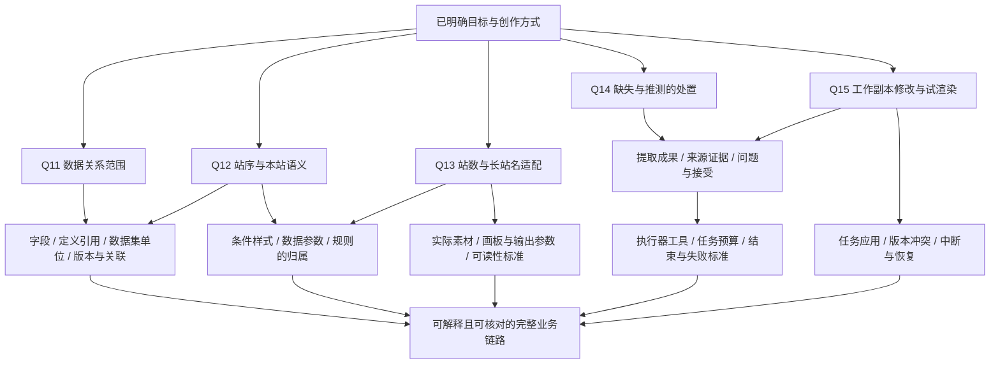

# RenderWeave 需求探索

状态：第 1–3 轮已答；建模草稿 M1–M104 已定。本文保存目标、事实、建议和决策树；已明确术语见 [GLOSSARY.md](../../GLOSSARY.md)，项目现状见 [CONTEXT.md](../../CONTEXT.md)。

## 用户已明确

- 新项目位于 `F:\GenCode\RenderWeave`，来源是 `D:\Yiwer\code\RenderWeave` 的重构迁移。
- 核心是设计数据定义、数据结构、数据关系，设计关联模板，再用符合定义的数据集渲染出图。
- 首个业务场景为线路牌：单条线路、一个行驶方向、有序站点。
- 用户明确旧项目在模板表达式部分的失败是：没有达成共同理解、实现成本太高、过于复杂而难以使用。
- 此次重新挖掘需求，重点是 human 与开发 coding agent 对项目上下文达成共同理解，使实现可理解、可核对。
- 希望借助 Coding Agent As an API server 的理念，聚合 coding agent 能力，把单次或串行 LLM 流程改为 agent 任务，覆盖 Schema 提取、模板修改、模板设计和数据集提取。
- 产品内 agent 主要承担提取、辅助设计和辅助修改。渲染由系统提供，并可作为 agent 调用的 function；边界已记入 [ADR-0001](../adr/0001-agent-assistance-and-rendering-boundary.md)。
- 重新设计；数据定义与模板 DSL 可以复用经过实例核对的概念，表达式重新依据需求选择。其他实现可参考但全部重写，旧文件原样加载仅在有明确资产需要时纳入范围。
- 每个增量的共同理解以用户能解释业务概念、数据关系、模板规则、agent 改动差异及验证结果为标准；难以解释的行为或高代价取舍再深入代码。
- 输入来源原则：结构化业务数据负责核对字段值，图像或设计稿负责核对呈现；只有图像时，分别交付可核对的数据定义与数据值候选。
- 模板以可视配置与中文意图辅助创作为主；必需规则无法清楚表达时再引入公式入口，见 [ADR-0002](../adr/0002-template-rules-before-expression-language.md)。
- 首先统一业务任务成果要求，使执行 agent 可替换，用一个 agent 跑通首场景；具体任务需要分工时再引入协作，见 [ADR-0003](../adr/0003-business-tasks-and-replaceable-agents.md)。

## 已核查事实

核查日期：2026-09-30。旧仓库代码快照：`830cdf2046893d6d6a5705ce4a68c7b1e4d1c5e1`。以下为静态代码和文档核查，需求访谈期间未运行产品测试或模型调用。

旧项目来源路径均相对 `D:\Yiwer\code\RenderWeave`。

| 事实 | 证据 | 证据边界 |
|---|---|---|
| 新工作目录最初为空，尚未初始化 Git | `Get-ChildItem -Force` 的 `EntryCount=0`；`git status --short --branch` 返回 `not a git repository` | 是本次落文档前的目录状态 |
| 旧表达式使用自有语言，输入读取只接受 `input.alias`，函数取自固定枚举 | `renderweave-template/src/main/java/cn/hbads/renderweave/template/internal/ExpressionParser.java:377`、`:421`；`.scratch/renderweave-template-v1/issues/07-value-binding-expression-model.md:66`、`:69` | 证明已有实现及边界；不能据此推断用户的失败原因 |
| 旧表达式要求理解类型、缺失值和作用域；前端另有保守语法解析器 | 上述规范 `:35`、`:46`、`:53`、`:75`；`web/src/features/template-editor/template-expression-syntax.ts:17` | 用户已确认表达式复杂难用；哪些具体规则产生负担仍需用实例拆解 |
| 旧 AI 提取由程序控制固定阶段，包含模型分析、本地结构物化、确定性验证及 critique/repair | `renderweave-inference/src/main/java/cn/hbads/renderweave/inference/live/LiveInferenceWorker.java:544` | 该控制流程不能直接等同于自主 coding-agent 工具循环 |
| 候选成果进入审核，apply 检查 revision、阻断问题并落为 Draft | `renderweave-inference/src/main/java/cn/hbads/renderweave/inference/candidate/CandidateApplyService.java:43` | 是旧项目的业务流程；新项目的审核职责由后续访谈决定 |
| 旧 Schema 的 reference 字段按嵌套对象递归验证 | `renderweave-validation/src/main/java/cn/hbads/renderweave/validation/RootDocumentValidator.java:535` | 此处是结构引用；新需求是否还涉及实体关联和 join，需结合首个场景决定 |
| 旧渲染合同以单一 RootDocument 作为必需输入 | `openapi/renderweave-v1.yaml:5534` | 不能由此确定新项目“数据集”的批次、提取或复用语义 |
| 旧测试以站点标题为根，包含多条线路及每条线路的停靠站点 | `renderweave-inference/src/test/java/cn/hbads/renderweave/inference/live/SerialVisualAnalysisContractTest.java:290`、`:302`、`:310` | 是站点下多线路的站牌模型；不能直接解释用户所说的线路牌 |
| 旧视觉语料是确定性合成评估 fixture，来源声明明确无真实业务记录 | `renderweave-inference/src/main/resources/visual-eval/v2/SOURCE-NOTICE.md:3` | 不能作为用户真实素材或真实线路数据 |
| 旧通用示例通过重复节点、条件节点、直接字段绑定表达列表、显隐与宽度变化 | `web/e2e/template-candidate-preview-live.spec.ts:359`、`:365`、`:381` | 本次只核对测试代码；这些示例没有使用 Expression，也未定义线路牌的必需规则 |
| 保存并重载的真实产品 E2E 曾因 Docker/backend 不可用而未执行 | `.scratch/renderweave-template-v1-implementation/issues/224-land-static-schema-definitions-and-bindings.md:48` | 是该票的历史记录；本轮没有验证当前运行状态 |
| 旧 reference 复用结构，数据值必须内嵌；站点数组按出现位置验证 | `renderweave-validation/src/main/java/cn/hbads/renderweave/validation/RootDocumentValidator.java:543`、`:583` | 不具有共享站点实例的自动关联或更新能力 |
| 旧图像元素合同保存类型提示与 Evidence，没有实际提取的数据值字段 | `renderweave-inference/src/main/java/cn/hbads/renderweave/inference/live/VisualElementInventory.java:42` | Schema 推断的不确定性合同不能直接等同于数据值提取合同 |
| 旧 renderer 当前 Text 切片限制为裁切、无缩字，正例不能证明中文长站名适配 | `renderer/crates/engine/src/lib.rs:1917`；`renderer/crates/engine/tests/native_text_vectors.rs:36`、`:93` | 需对新线路牌单独定义长站名与站数变化的验收，不能据词汇存在推断功能已交付 |
| 旧 dirty 编辑内容先保存再预览，渲染闭包读取已保存的 current | `web/src/features/template-editor/TemplateEditorShell.tsx:2012`；`renderweave-template/src/main/java/cn/hbads/renderweave/template/internal/CanonicalTemplateClosureAuthority.java:197` | 候选模板直接试渲染需要重新设计入口语义 |

公开能力参照：[Codex App Server 官方文档](https://learn.chatgpt.com/docs/app-server) 已描述会话历史、交互审批和流式 agent 事件，并使用双向 JSON-RPC 通信。这里只核查概念可行性，具体 agent 产品、协议和部署方式留待任务需求明确后选择。

### 参考资料核查（2026-10-08）

用户提供的参考来源：公交站牌制作系统后台模板模块 `E:\MiLu\code\route-info-board\rid-rs`（下称 rid-rs，路径相对其 `src/main/java/cn/hbads/ridrs/modules/template/`）、设计渲染端 `D:\Yiwer\code\design-layout-draw`（含布局引擎 `ts-layout-wpf`、渲染器 `canvaskit`、在线编辑器 `svg-edit-web`）、旧 RenderWeave 草稿项目。`D:\Yiwer\code\stop-sign-mgt` 只有 `pom.xml` 与 `.gitignore`，没有可核查内容。以下为静态阅读，未运行任何系统。

| 事实 | 证据 | 证据边界 |
|---|---|---|
| rid-rs 的模板类型是写死的业务层级（整张站牌、线路单边、途径站点、分站列表、班时、单值等），每类对应一份固定的系统数据结构 | rid-rs `models/enums/TemplateType.java`；`domain/component/document/SystemSourceKeys.java` | 新设计用可定义的数据定义取代固定层级，是对这一结构的泛化 |
| rid-rs 模板数据源分系统、自定义、映射、拼接四类；自定义数据源可"暴露"给上层模板填充，并有默认值 | rid-rs `models/enums/TemplateDynSourceType.java`；`domain/aggregate/TemplateDynSource.java` | 对应新模型的数据字段、模板参数、派生变量 |
| rid-rs 求值按固定阶段：系统 → 自定义 → 映射（映射之间拓扑排序）→ 拼接；映射以"结果非空"判定命中，未命中取默认值，最多 10 条规则 | rid-rs `domain/component/context/RenderContextLoader.java:205`、`:216`、`:430`、`:419`；`models/dto/dyn_source/MappingDynSourceDTO.java:44` | 结果为空的分支会被当作未命中继续向下匹配；拼接不能被映射引用 |
| rid-rs 拼接把数值按 `#0` 格式化，小数会丢失 | rid-rs `RenderContextLoader.java:514` | 如"票价拼接"遇到 2.5 元会显示整数；支持把展示格式放在变量插槽上 |
| rid-rs 绑定值为空时跳过绑定，元素保留设计时的静态内容 | rid-rs `RenderContextLoader.java:269` | 缺数据时成品会出现设计占位文字；需明确新模型的缺值处置 |
| rid-rs 支持嵌套子模板（上层填充子模板暴露的数据源）、循环容器（每项渲染一个子模板，可合并相邻同值项、可反序）和动态模板（按条件选择子模板，含默认模板） | rid-rs `domain/component/processor/ExpandEmbeddedTemplateProcessor.java`、`LoopContainerExpandProcessor.java`、`DynamicTemplateProcessor.java` | 新模型尚未定义子模板 |
| rid-rs 在代码中派生了途径站状态（已经过/当前站/未经过）、是否下一站/起点站/终点站、开往名称（缺省取终点站）、线路名称字符长度、线路经过同站序号 | rid-rs `SystemSourceKeys.java:48`、`:51`、`:66`、`:75`；`domain/component/document/RouteLayerSystemSourceStruct.java` | 新模型中这些值需由数据集提供或由派生变量计算，可作为运算种类的需求来源 |
| rid-rs 模板以毫米记录适用尺寸范围（最小/最大宽高）并带 DPI；业务文档称整版按最小尺寸设计、出图时在范围内缩放 | rid-rs `domain/aggregate/TemplateDefinition.java:57`、`:82`；`svg-edit-web/src/views/Editor/agent/skills/stopsign-design-tutorial/SKILL.md` | 与"固定画板"的假设不同，影响 Q13 |
| rid-rs 中 `render=false` 的元素在交给渲染端前被移除，不占布局空间 | rid-rs `domain/render/RenderPipeline.java:62` | 条件显示的语义是"不参与布局"而非"透明" |
| 渲染端字体缺字时按字重选用思源黑体逐字替代；替代成功记为提示，替代后仍缺字记为严重问题 | `design-layout-draw/canvaskit/src/drawCore/V4/text/font/checker.ts:194`、`:225` | 用户所说"黑体"在旧系统中即思源黑体 |
| 渲染端自动缩字可一直缩到 1px，没有最小可读字号 | `canvaskit/src/drawCore/V4/text/horizontal.ts:546` | Q13 建议的最小可读标准在旧系统中不存在 |
| 渲染端按模板数据的计算日期加载当日冻结的渲染代码，以保证历史图可复现 | `canvaskit/docs/ARCHITECTURE.md:139` | 业务上存在历史出图复现需求 |
| 旧 RenderWeave 的数据定义 DSL：类型为 text/decimal/date/time/boolean/reference/array，time 固定 `HH:mm:ss`，字段出现时 `null` 永远无效，不持久化 fieldId（改名即删除加新增） | 旧 RenderWeave `specs/renderweave-v1.md:61`、`:132`、`:189` | 约束种类与冲突规则（§3.6）可复用；时刻精度、字段身份需在新模型中决定 |
| 旧 RenderWeave 以自有验证器为权威，编译出的 JSON Schema 仅用于互操作 | 旧 RenderWeave `docs/adr/0002-closed-dsl-inline-compiler-and-authoritative-validator.md` | 新草稿写的是用 JSON Schema 验证数据，两者不同 |
| 旧 RenderWeave 模板侧已有：带对外/私有之分且必须有默认值的自定义定义、首个命中加必填 otherwise 的映射定义、按显式上下文和参数填充调用子模板的 TemplateUse；绑定不回退到静态值 | 旧 RenderWeave `docs/context/template-editor.md:46`、`:52`、`:60`、`:67` | 概念可参照，不代表其版本、授权、Profile 等机制需要继承 |
| 旧 RenderWeave 资源（Asset）内容可替换、引用指向当前内容；删除时只检查各模板当前内容中的引用 | 旧 RenderWeave `docs/context/asset.md:10`、`:21` | 与 M10 一致，可回答"历史版本是否计入引用" |

### Rust 渲染器核查（2026-10-09）

用户提供 `E:
ust-appusbox-render-engine`，由子 agent 阅读、主会话抽查。路径相对该仓库根；只读，未构建。

| 事实 | 证据 | 证据边界 |
|---|---|---|
| 仓库含两套引擎：Legacy 把 design-layout-draw 的 CanvasKit drawCore V4（TS）逐段移植为 skia-safe + SkParagraph；Haibo 是 2026-07-26 加入的严格 DSL 服务，文本与布局自写 | `docs/specs/001-render-engine/requirements.md:12-19`；`crates/engine/src/text/vertical.rs:599-615`（注释逐段对应 `vertical.ts` 行号）；最后提交 2026-07-26 | 旧 RenderWeave 的 `renderer/` 是另一套代码，从未调用该引擎（子 agent 结论，未逐条复核） |
| 竖排两端分布按字形墨迹让首字贴顶、末字贴底，溢出时以 scaleY 压缩；但没有"先收紧字距"、没有 60% 下限，也不上报严重问题 | `crates/engine/src/text/vertical.rs:188-257`、`:599-725` | 我们的 M82、M88 需要在其算法上补齐 |
| 横排两端按墨迹宽度分配间隙，间隙为负时改用 scaleX；缩字号用二分搜索，可缩到 1px | `crates/engine/src/text/horizontal.rs:253-380`；`crates/engine/src/text/fit.rs:45-96` | 顺序、下限与上报不符合 M84、M86 |
| 缺字按 glyphId 为 0 检测并分两级上报，但实际整段换用后备字体；斜体固定为直立；外描边画两遍；两套引擎都不支持 SVG 图片、缩字组与布局摘要 | `crates/engine/src/text/horizontal.rs:1081-1097`；`crates/engine/src/text/stroke.rs:141-171` | M10/M12 的逐字替代、M80 倾斜、M74 SVG、M91 缩字组需自行实现 |
| 原生 Skia 在 Windows（DirectWrite）与 Linux（FreeType）出图像素不同；绘制约比 CanvasKit WASM 快 18 倍 | `docs/specs/001-render-engine/design.md:84`；`acceptance.md:140-173`、`:206-210` | 性能数字为其文档记录，未复测 |
| 拟合在绘制阶段进行、最终字号不回写，因此产不出布局摘要，也做不了跨元素的统一缩字 | 子 agent 结论（`crates/engine/src/pipeline/mod.rs`） | 我们的实现须把"测量、决定、记录"放在绘制之前 |

### Agent 执行环境核查（2026-10-08）

用户计划借用 `F:\GenCode\CloudKiln`（coding agent 加云沙箱的异步任务平台）作为业务 Agent 任务的实施环境。以下为静态阅读，路径相对 CloudKiln 仓库根，未提交任何云任务。

| 事实 | 证据 | 证据边界 |
|---|---|---|
| CloudKiln 以 Caller、Task、Attempt、Environment、Sandbox、Skill、Artifact、Publication 为领域词汇；RenderWeave 将作为一个 Caller | `GLOSSARY.md` | Attempt 尚无独立实体，见其 `.scratch/agent-platform/spec.md` 基线表 |
| 首版为独立批处理 Task：需要补充信息时明确结束，补充后重试；暂停、恢复返回 409，运行中不能等待用户输入 | `.scratch/agent-platform/spec.md:78`；`README.md:65` | 重试归属同一 Task 还是新 Task 尚未决定 |
| 平台只保证 agent 执行与文件交付，业务验收由调用方负责 | `docs/adr/0002-first-release-callers-and-delivery-boundary.md`；spec `:80` | RenderWeave 须自行对成果做业务校验 |
| 进入 agent 执行前，沙箱出网收紧到模型端点（文档环境另含少量依赖域名） | `task_platform/execution.py:33`、`:35`、`:111` | agent 运行中无法直接访问 RenderWeave 服务，除非另行放行 |
| MCP 目前显式配置为空；首批 MCP 范围建议为只读，尚待其访谈确认 | `task_platform/remote_runner.py:58`；spec `:106` | 通过 MCP 提供校验与渲染未经验证 |
| Skills 由管理员审核后登记，按 Task 选择注入，不能上传任意技能包；较重工具链预装在环境镜像中 | `README.md:217`；`docs/adr/0001-cloud-sandbox-and-dynamic-skills.md` | RenderWeave 的领域知识可作为 Skill 提供 |
| 输入：单文件 20 MiB、二进制合计 40 MiB、最多 10 个路径；输出：单文件 5 MiB、合计 20 MiB | `README.md:148`、`:178` | 线路牌素材、DSL 与预览图通常在范围内，未实测 |

### 外部 OCR 能力核查（2026-10-08）

用户计划调用阿里云百炼的 Qwen-OCR 系列（如 Qwen-VL-OCR）。来源为[阿里云帮助中心《文字提取（Qwen-OCR）》](https://help.aliyun.com/zh/model-studio/qwen-vl-ocr)，页面更新于 2026-09-10；只阅读文档，未调用接口。

| 事实 | 证据边界 |
|---|---|
| 当前系列包括 qwen3.5-ocr 与 Qwen-VL-OCR（qwen-vl-ocr 稳定版、latest 及 2025-11-20、2025-08-28 等带日期版本）；2025-04-13 及更早版本不推荐，文档建议迁移到 qwen3.5-ocr | 线路牌素材上的实际效果未测 |
| "高精识别"内置任务（`ocr_options={"task": "advanced_recognition"}`）返回每行文字及旋转矩形坐标 `rotate_rect: [center_x, center_y, width, height, angle]`，位于 `ocr_result.words_info` | 完整内置任务需 DashScope SDK；OpenAI 兼容方式需自行构造 Prompt 并解析输出 |
| 文档未提供逐字或逐行置信度；明确提示文字过小或分辨率低时可能产生幻觉，关键业务建议人工审核 | "看不清"无法由置信度阈值自动判断 |
| 图像限制：宽高均大于 10 像素，宽高比不超过 200:1；qwen3.5-ocr 单图不超过 20MB，其他版本不超过 10MB；4K–8K 仅支持 JPEG/PNG | |
| qwen3.5-ocr 支持多轮对话、内置任务与自定义 Prompt 结合、经 Response API 直接解析 PDF；qwen-vl-ocr-2025-11-20 及更早版本只处理最新一条消息 | |
| 按输入、输出 token 计费，按地域使用不同端点与 API Key；另有 Batch API 用于大规模非实时调用 | 费用与限流未按线路牌业务量估算 |

## 决策树

第 1、2 轮已确定场景、失败问题、agent 职责、重写范围、规则创作方式与聚合原则。当前前沿是 Q11–Q15；具体字段、数值阈值与技术选择按答案继续展开。讨论样例见[线路牌案例](../examples/route-sign.md)。

## 第 1 轮答案

| 问题 | 用户明确的答案 |
|---|---|
| Q1 首个场景 | 线路牌 |
| Q2 旧项目失败 | 没有达成共同理解；表达式实现成本太高，复杂难用 |
| Q3 agent 职责 | 主要是提取、辅助设计、辅助修改；渲染可以是 agent 调用的 function |
| Q4 继承范围 | 重新设计，DSL 可部分复用；其他实现参考后全部重写 |
| Q5 理解标准 | 接受业务概念、数据关系、模板规则、agent 改动差异及验证结果可解释的标准 |

## 第 2 轮答案

用户回答“全部按推荐”，接受以下原则：

| 问题 | 已接受选择 |
|---|---|
| Q6 场景含义 | 单线路、单方向、有序站点 |
| Q7 输入与提取 | 结构化数据核对值，图像或设计稿核对呈现；仅有图像时分别交付 Schema 与数据值候选 |
| Q8 创作方式 | 可视配置加中文意图辅助；必需用例触发公式入口 |
| Q9 DSL 复用 | 核对后复用数据与模板概念，表达式按需求重新选择；明确资产需要时才要求旧文件加载 |
| Q10 聚合方式 | 统一任务成果要求、可替换执行 agent、先单 agent 闭环，具体需求触发协作 |

## 第 3 轮

进展：Q12 由 M30 与模型走查回答；Q14 由 M29、M44–M47 回答；Q15 由 M49–M52 回答；Q11 由 M60–M66 回答；Q13 由 M81–M88 回答。第 3 轮 Q11–Q15 均已回答。以下保留原问题与建议，具体反例见[线路牌案例](../examples/route-sign.md)。

### Q11：数据关系范围

首版的数据关系需要表达对象、列表和数据定义之间的结构复用，还是还要管理独立站点实体，按 ID 跨数据集关联并同步更新？

建议：先支持结构复用，渲染消费一份准备好的完整数据。跨数据集的共享实体与关联展开在出现明确业务需要后引入。

### Q12：站序与本站语义

线路牌是否需要标出本站？若站序中两次出现相同站名，如何确定标记哪一次？

建议：每个行驶方向提供明确的有序站点列表；本站是可选出图参数，定位到列表中的一次出现，首版可按位置明确指定。数据变化后重新核对该位置；相同站名保留，不据站名自动合并。

### Q13：站数和长站名适配

同一模板从 6 个站变成 28 个站，或出现很长的站名时，应该自动适配、改换模板，还是直接拒绝？

建议：固定画板上的同一模板先通过排布、换行与有限缩字适配；设最小可读标准，超限时给出可定位的问题。具体尺寸、字号和排布策略在实际素材确定后验收。

### Q14：缺失与推测的处置

素材不完整、字看不清或来源冲突时，agent 是否可以补出候选值？这些情况如何影响预览和正式出图？

建议：可以提出候选，但保留来源与待确认项，区分已提供值、未提供、看不清、推测与业务允许缺失。未解决的必需数据问题阻止正式出图；草稿预览允许清楚标注问题后用于讨论。

### Q15：工作副本修改与试渲染

agent 是否能在工作副本上直接修改、校验和反复试渲染，还是必须先把候选保存到已有模板内容才能预览？

建议：允许直接在工作副本上修改并试渲染，交付规则差异、前后预览和检查结果；试渲染本身不写入已有模板内容。成果应用、保存与冲突处理在这项边界明确后继续展开。

## 建模草稿讨论

2026-10-08 用户提交数据定义、字段、约束、DSL、模板与"数据源定义"的建模草稿，讨论后确定：

| 编号 | 已确定 |
|---|---|
| M1 | 三要素为数据定义、模板、数据集；模板侧统称模板变量，分为数据字段、模板参数、派生变量（第三类原称条件变量，见 M8） |
| M2 | 派生变量定义在所属模板中；列表项的派生变量（如站点状态）定义在循环模板中，由其对外参数（如序号、本站序号）计算；作用域不嵌套（随 M13 修订） |
| M3 | 条件分支的条件只用结构化比较（变量、运算符、值），按序取首个命中的分支，必须有"否则"分支 |
| M4 | 条件分支产出业务语义值（如站点状态），元素按该值选择样式，不直接产出颜色等呈现值 |
| M5 | v1 可配置约束限于可编译为 JSON Schema 2020-12 的子集 |
| M6 | 日期如 `2026-01-02`；时刻为 `HH:mm`，秒可选，如 `10:28`；时间如 `2025-01-02 09:08:12`（空格分隔、带秒）；均不带时区 |
| M7 | 增加图片类型；必填是字段上的约束，用于约束数据集，判定为"键存在且值不为 null"，空字符串与空列表交给长度、项数约束。图片取值有两种形式：资源仓库中的资源引用，或 URL；URL 不预先校验图片是否有效，仅在渲染时获取并嵌入 |
| M8 | 派生变量由一个运算加若干操作数构成，不嵌套，靠引用其他变量组合；条件分支是其中一种运算；拼接放入文本元素内容中的变量插槽；暂不引入文本表达式，见 [ADR-0004](../adr/0004-derived-variables-without-text-expressions.md) |
| M9 | 图片取值在数据集中统一写为字符串：资源引用使用专用前缀，URL 限 http/https；图片字段可设"允许的来源"约束。资源引用的存在性与资源种类检查属于类型自带的检查，不计入 M5 |
| M10 | 资源仓库分图片、字体两类，资源种类不可改变；资源内容可以替换，引用保持不变，每次替换产生新的内容版本号，替换前列出引用它的模板与数据集；被引用的资源不可删除，"被引用"只看各模板与数据集的当前内容；每次出图记录所用资源的内容版本与渲染器版本，以便复现历史图片。模板自身使用的装饰图片与字体只来自资源仓库 |
| M11 | URL 图片需经过安全校验器：在实际取图时按解析出的 IP 校验，每次重定向重新校验；数据集校验时只做静态检查用于提前反馈。取不到或未通过校验时，草稿预览用占位图并标出问题，正式出图失败并指明位置 |
| M12 | 字体缺字时按字重选用思源黑体逐字替代；替代成功记为提示，替代后仍缺字记为严重问题 |
| M13 | 模板地位平等，子模板是被调用时的角色。子模板的数据来自调用方的单引用字段、调用方的当前数据（基准相同时），或没有数据（以空数据定义为基准）；不继承调用方作用域，参数通过其对外参数显式填写。列表[数据定义引用] 由循环容器遍历，容器须指定基准与列表元素一致的循环模板。后续扩展为在同一基准数据定义的不同模板之间按条件选择（动态模板），见 [ADR-0007](../adr/0007-equal-templates-composed-by-schema-references.md) |
| M14 | 画板以毫米为单位；模板声明适用尺寸范围；渲染请求给出实际尺寸；DPI 为出图参数；需设定最小可读字号 |
| M15 | 模板参数类型为字段类型或颜色；分对外参数与内部参数：内部参数必须有默认值、调用方不能修改；对外参数没有默认值时调用方必须提供 |
| M16 | 缺值时绑定不回退到设计时的占位内容，结果为空；必填字段缺失在数据集校验时拦截；草稿预览可显示占位但须标出问题 |
| M17 | 以编译出的 JSON Schema 为数据集校验权威；前提是注册时刻、时间的自定义格式，并按十进制精确解析数值，见 [ADR-0006](../adr/0006-compiled-json-schema-as-dataset-validation-authority.md) |
| M18 | 数据定义可修改，发布后形成不可变的静态数据定义（StaticSchema）；数据集必须选定一个静态数据定义，依赖不可变版本使已有数据集不受后续修改影响。字段以字段名称为身份，数据集中的键与模板绑定都使用字段名称；显示名称可随时修改、不影响绑定（据 G1 两次修订；ADR-0005 已被取代），见 [ADR-0008](../adr/0008-immutable-static-schemas-for-datasets.md) |
| M19 | 循环容器通过循环模板的对外参数显式传入循环信息：序号（从 1 开始）、是否首项、是否末项、总数 |
| M20 | 基本类型的列表（如换乘线路列表[文本]）由系统内置的单值数据定义包装每一项后调用循环模板；每种基本字段类型一个单值数据定义，只含一个"值"字段 |
| M21 | 子模板所用单引用字段的路径可经过多层单引用，不能穿过列表 |
| M22 | 动态模板（后续扩展）的每个条件分支分别填写所选模板的对外参数 |
| M23 | 条件分支的条件是结构化比较，右侧可以是固定值或另一个变量（G2） |
| M24 | 引入"取项"运算：从列表取首项、末项或第 N 项；派生变量可以产出数据定义引用类型的值，插槽与绑定的路径可以经过它的单引用（G3） |
| M25 | 模板可声明检查项：一个布尔派生变量，加问题等级与提示文字，渲染前求值；为此引入"长度"运算，求文本字数或列表项数（G9） |
| M26 | 模板之间的调用关系（子模板调用与循环调用）必须是无环图，保存模板时检查（G11） |
| M27 | 条件显示隐藏的元素不参与布局（G4） |
| M28 | 状态样式：元素按某个模板变量的取值选用不同属性取值，未列出的取值归入"其他取值"；条件显示即对"是否显示"属性的状态样式（G5） |
| M29 | 数据集只放已确定的数据；候选值、来源证据与待确认项属于 Agent 任务成果，确认后才写入数据集（G7） |
| M30 | 线路牌的本站序号默认 0，表示不标本站（G8，回答第 3 轮 Q12 的"可选"） |
| M31 | 修改被其他模板调用的模板时，保存前列出受影响的调用方模板并要求确认（G12） |
| M32 | 数据定义之间的引用不能成环（G13） |
| M33 | 列表的元素不能又是列表（G14） |
| M34 | 模板创建后不能更换基准数据定义；需要时复制模板并选定新基准（G15） |
| M35 | 模板元素、子模板调用、条件显示、状态样式、渲染请求、问题清单、草稿预览、正式出图加入术语表 |
| M36 | 模板的基准是静态数据定义的确切版本（G16） |
| M37 | 渲染时，数据集选定的静态数据定义必须与模板的基准完全一致（G17） |
| M38 | 静态数据定义以数据定义名称加自动递增的版本号标识，如"线路牌 v1"（G18） |
| M39 | 静态数据定义中的数据定义引用指向确切版本，如"线路牌 v1"引用"站点 v1"（G19） |
| M40 | 模板不配置版本，可以直接修改，包括把基准升级到同一数据定义的新版本。升级前列出失效的绑定，由人或 agent 修复后才能保存；字段以名称为身份，系统不区分"改名"与"删除后新增"。改用另一个数据定义仍需复制模板（M34）（G20） |
| M41 | 模板升级前列出会失配的数据集与调用方模板，由用户选择：一并迁移到新版本，或先复制一份模板留给旧版本。数据集迁移生成新数据集，原数据集保持不变（G21） |
| M42 | RenderWeave 构建 MCP 服务，执行 agent 经 CloudKiln 的 MCP 支持接入，借此使用 RenderWeave 的能力（回答 T11，选择 MCP 方案；CloudKiln 将支持 MCP） |
| M43 | 业务 Agent 任务分四种：数据定义提取、数据集提取、模板辅助设计、模板辅助修改，每个任务产出一种成果；只给图片时，先做数据定义提取并由人发布，再做数据集提取（T1） |
| M44 | 待确认项分四类：看不清、推测、来源冲突、必填未提供；可选字段没有值不算待确认项（T2） |
| M45 | 每个待确认项记录位置、候选值（可无）、原因与来源证据；来源证据只能指向已记录的识别结果中的文字行，或结构化素材中的位置，审核时把框画回原图；证据说明出处，不保证正确（T3、O3） |
| M46 | 草稿预览可以使用候选值并标出问题；所有待确认项处理完才生成数据集，因此之前不能正式出图（T4） |
| M47 | 审核时，待确认项逐项处理；其余来自图片识别的值连同识别框展示，由人整体确认一次（O4） |
| M48 | 每轮交回 `outcome.json` 与一份说明；RenderWeave 先校验结构，不合格的轮次由人决定是否带着问题清单重跑，首版不自动重试（T12） |
| M49 | 模板所有未保存的修改（人或 agent 产生）统称工作副本；可校验、可草稿预览，不影响已保存的模板；应用即保存（T5，回答第 3 轮 Q15） |
| M50 | 草稿预览可以指定若干工作副本，代替对应的已保存模板，用于在调用方模板中查看被调模板的修改效果（T6） |
| M51 | 系统记录工作副本基于哪次保存的内容；应用时若模板已被他人保存，重新显示差异，由人选择覆盖或基于最新内容重做（T7） |
| M52 | 给人审核的修改前后预览由 RenderWeave 重新渲染，不采用 agent 交回的图片；agent 自己的渲染只用于自查（T13） |
| M53 | MCP 服务只提供读取、校验、草稿预览、识别四类只读工具；agent 不能保存、发布、删除或正式出图；成果以 CloudKiln 产物文件交回，不经 MCP 写入（T8） |
| M54 | RenderWeave 为每一轮签发只对该轮有效的 MCP 凭据，只能访问本任务相关的素材与对象，任务结束即失效 |
| M55 | OCR 统一经 MCP 识别工具按需调用，不在沙箱内直连；新增素材与识别结果两个实体，识别结果归属素材、不可变、记录模型名与确切版本，相同素材、模型与区域的调用复用已有结果（O1、O2） |
| M56 | OCR 固定使用带日期的模型版本；首选模型在 qwen3.5-ocr 与 qwen-vl-ocr-2025-11-20 之间用线路牌样图对比后确定（O5） |
| M57 | 接受素材经过阿里云百炼、CloudKiln 云沙箱与 DeepSeek 模型服务三处（O6） |
| M58 | 一个业务 Agent 任务由若干轮组成，每轮对应一个 CloudKiln Task，输入为素材、上一轮成果（含人工修改）与反馈；轮与轮之间由 RenderWeave 保存状态（T9） |
| M59 | 正式出图时记录模板内容快照（含被调模板）与所用数据集，连同 M10 的资源内容版本与渲染器版本，用于复现历史图片（T10） |
| M60 | 数据集既可以作为实体保存在系统中（有身份，可列出、审核、复用），也可以随渲染请求附带 JSON；附带的 JSON 同样按选定版本校验（D1） |
| M61 | 保存的数据集可以直接修改，修改后仍须通过所选版本的校验；正式出图的出图记录保存数据集内容快照（D2，细化 M59） |
| M62 | 一份数据集对应一个业务对象，如一条线路的一个方向；出图张数与本站等由渲染请求决定（D3） |
| M63 | 新增批量出图：一个模板加多个渲染项，每项为数据集、对外参数值与出图参数；每项独立校验、独立出图、各有问题清单，一项失败不影响其他项；首版由调用方或界面显式列出各项，"每站各出一张"等便捷操作以后再加（D4） |
| M64 | 数据集首版来源：按数据定义表单录入、导入 JSON、Agent 数据集提取；表格类素材也经 Agent 提取；不做直连数据库或定时同步的 Connector（D5） |
| M65 | 每份数据集自成一体，不设跨数据集的共享实体；同一站点出现在多份数据集中时分别维护，或由外部系统重新推送；首版不提供"改一处全部更新"与数据变更后的站牌影响追踪（D6，回答第 3 轮 Q11），见 [ADR-0010](../adr/0010-self-contained-datasets.md) |
| M66 | 数据集可以删除，出图记录中的快照不受影响；每份数据集记录来源：手工录入、导入、来自哪个 Agent 任务，或从哪份数据集迁移而来（D7） |
| M67 | 模板元素目录首版：画板、容器、循环容器、子模板调用、文本、图片、矩形、椭圆、线条、多边形、路径、二维码、条形码；多边形、路径、条形码为用户追加（G10，见[模板元素目录](../model/template-elements.md)） |
| M68 | 容器是一种元素，以"布局方式"属性区分自由、堆叠、网格（E1） |
| M69 | 模板中所有长度单位都用毫米，包括字号（E2） |
| M70 | 子模板与循环模板以调用框尺寸作为实际尺寸重新排布，须落在其适用尺寸范围内，否则记入问题清单；不整体缩放（E3，可随 Q13 复核） |
| M71 | 可以绑定：文本内容（经变量插槽）、图片来源、二维码与条形码内容、颜色、数值（尺寸、间距、内边距、字号、圆角、透明度、旋转）、是否显示（经条件显示），以及元素在网格中的位置（所在行、列与跨行、跨列数，用户追加）；不可以绑定：元素种类、布局方式、循环容器的列表字段与循环模板、子模板调用的被调模板、元素名称、多边形顶点与路径数据（E4） |
| M72 | 叠放顺序等于容器内的元素顺序，后者在上，不设层级编号（E5） |
| M73 | 文本内容由片段组成，片段是一段文字或一个变量插槽，可单独设字体、字号、颜色、字重（E6） |
| M74 | 图片资源支持 PNG、JPEG、WebP 与 SVG，SVG 入库时去除脚本与外部引用（E7） |
| M75 | 网格的行列定义不绑定变量，可用状态样式按变量取值切换几套预设定义；元素在网格中的位置（所在行、列与跨行、跨列数）可以绑定（E9，与 M71 一致） |
| M76 | 路径数据采用 SVG 路径语法，坐标以毫米计、相对元素框（E10） |
| M77 | 设计稿中的 ①②③ 是地标图片；地标是停靠站点的属性（图片），显示在站名下方，没有地标时隐藏不占位，站名占满整列（N1） |
| M78 | 引入"加减"运算；下一站 = 取项（停靠站点，第"本站序号 + 1"项），本站是末站时为空，整行隐藏（N2） |
| M79 | 循环容器可按某个字段合并相邻同值项：每组调用一次循环模板，组内项数作为循环信息传入并跨相应列数；按原始项数等分宽度，使道路带与站点列对齐（N3，同时回答 G6 的主要部分） |
| M80 | 文本片段增加倾斜属性，以倾斜变换模拟；M402 设计稿中的线路号是图片素材（N4） |
| M81 | 线路的停靠站点数为 2–50 站（Q13a） |
| M82 | 每个停靠站点一列，平分可用宽度；一块线路牌上所有停靠站点的站名字号一致，字号随站数变化；站名过长时纵向压缩字形，不减小字号（Q13b，取代原 Q13c 建议中"缩字"一步） |
| M83 | 站数多到列宽放不下时，统一缩小全部站名字号，直到最小可读字号；仍放不下记为严重问题，正式出图失败；设计者可另备两排版式，用状态样式按站数切换（Q13d） |
| M84 | 横排短文本放不下时，先横向压缩字形，最多压到原宽的 60%，再缩小字号，仍放不下报问题；跨度大时拉开字距（Q13e） |
| M85 | 画板宽度在适用尺寸范围内变化时重新排布，站点列随之变宽，字号不因宽度改变（Q13f） |
| M86 | 最小可读字号默认 5 mm，模板可为个别元素设得更高（M14） |
| M87 | 站名统一字号由设计者用条件分支按站数分档给出（如站点数 ≤ 20 用 12 mm、≤ 35 用 9 mm、否则 7 mm），经对外参数传给站点模板并绑定到字号；不由排版引擎按宽度自动求（与 M85 一致） |
| M88 | 纵向压缩字形最多压到原高的 60%，与横向压缩的下限一致；仍放不下记为严重问题，正式出图失败 |
| M89 | DSL 的结构关键字用英文；被引用的变量名（字段名称、参数名、派生变量名）一般用英文，中文写在显示名称里，因此数据集中的键也是英文；其他业务名称（数据定义名、模板名、元素名称、状态取值）不作语言要求（M402 DSL 草稿 S1，按用户意见修订） |
| M90 | 确认 M402 DSL 草稿的写法约定 S2–S13：变量引用写法与"."路径、模板内统一命名空间、属性值写成变量引用即为绑定、状态样式写法、数据集文件分为身份与数据两部分、编译产物不允许未定义的键、资源引用写成 `res:资源ID`、单值数据定义命名、网格行列从 1 编号、条件运算符与派生变量须声明类型、取项超出范围结果为空、模板按名称引用 |
| M91 | 文本适配增加"缩字组"：同一次出图中同组的文本缩到相同字号，用于站数过多时统一缩小全部站名（F1，落实 M83） |
| M92 | 调用框设为"随内容"时，被调模板的实际尺寸取其内容的自然尺寸，仍须落在适用尺寸范围内（F2，补充 M70） |
| M93 | 自由布局的位置可选"距左或距右""距上或距下"，使元素能贴住可变尺寸容器的右边或下边（F3） |
| M94 | 路径与多边形的坐标以毫米计、相对元素框，框变化时图形不拉伸；异形外框用固定尺寸的路径加可伸缩的容器拼接（F4） |
| M95 | 首版接受多个循环容器靠相同内边距保持列对齐（F5） |
| M96 | 循环模板的适用尺寸范围可以写得很宽，主要用于防止明显错误的调用（F7） |
| M97 | M402 设计稿中站名上方的蓝色"1"圆标是早期的错误设计，忽略；地铁、医院等标识沿用草稿处理，作为停靠站点的"标识"（列表[文本]，按取值选图）（F6） |
| M98 | 渲染引擎用 TypeScript（Node 22）实现为不依赖框架的模块加命令行入口；数据集校验用 ajv，栅格化与文字排版基于 Skia（必要时按字形逐个排版），布局自行实现；本期不用 NestJS，服务外壳后续再选（实施规划，见 [ADR-0011](../adr/0011-typescript-framework-free-render-engine.md)） |
| M99 | 栅格化定为 CanvasKit，字体全部显式加载、不使用系统字体，以保证跨平台出图一致；busbox-render-engine 只作算法参考，不作后端；排版按"测量、决定、记录、绘制"分步，布局摘要在绘制前生成（实施规划，见 [ADR-0011](../adr/0011-typescript-framework-free-render-engine.md)） |
| M100 | 毫米换算像素：像素数 = 毫米 ÷ 25.4 × DPI，四舍五入为整数；740 × 165 mm、120 DPI 得 3496 × 780 像素，与设计稿一致（票据评审） |
| M101 | 元素路径：由模板调用链上的元素名称逐层组成，循环容器处带循环序号（从 1 开始），如 `标准线路单边/站点面板/站点列[12]/名称区/站名`；问题清单、布局摘要与草稿预览的标注共用；模板内元素名称唯一（票据评审，细化 G10 的"名称"） |
| M102 | 渲染检查顺序：先解析；再执行互不依赖的模板静态检查、数据集校验、版本一致性与对外参数检查，全部执行并汇总；存在阻止展开的问题（模板或数据集无法解析、数据集的静态数据定义版本与模板基准不一致、调用成环、循环模板基准与列表元素不一致）时停止，两种模式都不出图；否则依次求值（含检查项）、排版、绘制（票据评审，取代业务实体模型中的建议顺序） |
| M103 | 工作区中的静态数据定义附带编译产物 JSON Schema；渲染入口只读取编译产物，出图时不编译（票据评审，落实 ADR-0006、ADR-0008） |
| M104 | 草稿预览中，因问题而缺值的变量插槽显示该变量的显示名称作为占位，缺值的图片不画内容、只画问题边框；可选字段正常缺值时不显示占位；正式出图从不显示占位（票据评审，落实 M16） |

待答：暂无需要讨论的问题。以下需要实测后确定：

- M56 OCR 首选模型：用线路牌样图对比 qwen3.5-ocr 与 qwen-vl-ocr-2025-11-20。
- CloudKiln 的执行模型能否看图；若不能，agent 只能依据问题清单自查版式（ADR-0009）。

## 文档归属与后续

- `GLOSSARY.md` 保存已明确的领域术语；`CONTEXT.md` 保存项目现状快照与文档入口；`AGENTS.md` 保存 agent 工作方式。
- 本文件持续更新场景、证据、决策树和访谈答案。
- [业务实体模型](../model/business-entities.md) 汇总已定的实体、关系与规则，并集中列出待定事项（G 编号）。
- [模板元素目录](../model/template-elements.md) 是 G10 的草稿：元素一览、共有属性、位置与尺寸、可绑定范围，待对齐的问题为 E 编号。
- [线路牌案例](../examples/route-sign.md) 按业务实体模型走查线路牌：数据定义、数据集、模板组合与演示 A–D。
- [M402 设计稿解读](../examples/m402-design-analysis.md) 把用户提供的真实设计稿（[原图](../examples/materials/m402-route-sign.jpg)）对照到模型，列出缺口 N1–N4 与观察到的适配规则，作为 Q13 的依据。
- [M402 DSL 草稿](../examples/m402-dsl/README.md) 把模型写成数据定义 DSL、编译产物 JSON Schema、数据集、模板 DSL 与渲染请求；起草约定为 S 编号，发现的问题为 F 编号。
- 涉及高变更成本、真实取舍且未来需要解释的已达成决定，写入 `docs/adr/`；当前已接受 ADR-0001–0004、ADR-0006–0011；ADR-0005 已被 ADR-0008 取代。
- 下一步：首期规格 `.scratch/render-pipeline/spec.md` 已拆成 14 张票据（`.scratch/render-pipeline/issues/`），从 01 开始实施。
