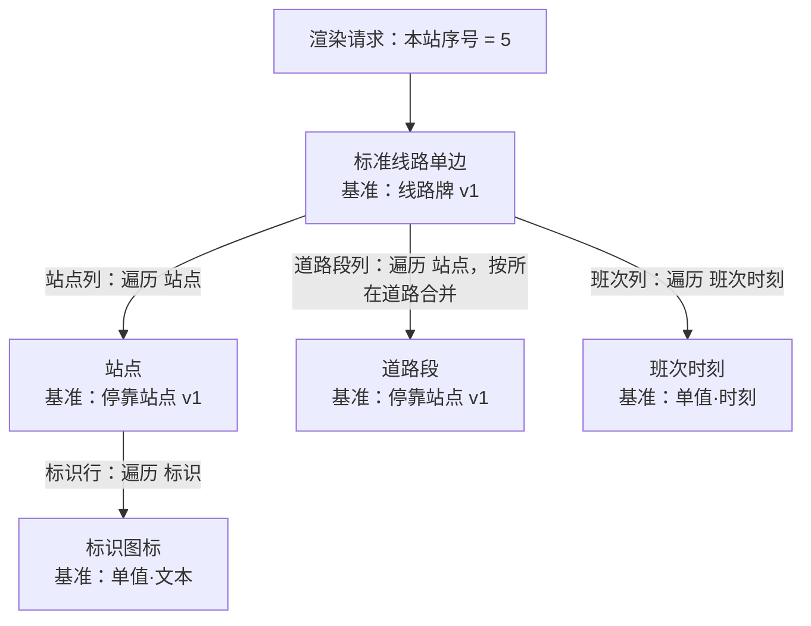

# M402 DSL 草稿

状态：2026-10-08 起草。用 [M402 设计稿](../materials/m402-route-sign.jpg)把业务实体模型写成可执行形式的第一层：数据定义 DSL、编译产物 JSON Schema、数据集、模板 DSL 与渲染请求。起草时作出的约定（S 编号）与发现的问题（F 编号）均已确认（M89–M97）。尺寸、颜色按设计稿估计。

## 文件

| 文件 | 内容 |
|---|---|
| [schema-stop-v1.json](schema-stop-v1.json) | 静态数据定义"停靠站点 v1"：站名、地标、所在道路、标识 |
| [schema-route-sign-v1.json](schema-route-sign-v1.json) | 静态数据定义"线路牌 v1"，站点为列表[停靠站点 v1]，2–50 项 |
| [compiled-route-sign-v1.schema.json](compiled-route-sign-v1.schema.json) | "线路牌 v1"的编译产物 JSON Schema 2020-12，停靠站点内联展开 |
| [dataset-m402.json](dataset-m402.json) | 按设计稿转录的 M402 数据集，35 个停靠站点 |
| [template-route-sign.json](template-route-sign.json) | 主模板"标准线路单边"：顶栏、站点面板、道路带、底栏 |
| [template-stop.json](template-stop.json) | 循环模板"站点"：标识行、竖排站名、地标、本站高亮 |
| [template-road-segment.json](template-road-segment.json) | 循环模板"道路段"，用于合并相邻同名道路 |
| [template-stop-badge.json](template-stop-badge.json) | 循环模板"标识图标"，基准为单值·文本 |
| [template-departure-time.json](template-departure-time.json) | 循环模板"班次时刻"，基准为单值·时刻 |
| [render-request-m402.json](render-request-m402.json) | 正式出图请求：本站序号 5（东门），740 × 165 mm、120 DPI、PNG |

已做的检查（2026-10-08，本地 Python 与 jsonschema 4.26.0）：10 个文件均为合法 JSON；数据集按编译产物校验 0 个错误，加入未定义的键会被拒绝（S7）；5 个模板中的变量引用、插槽路径、循环模板基准与参数填写全部能对上，被引用的变量名均为英文（S1）。尚未实际渲染。

## 模板如何组合

## 起草时作出的约定

S2–S13 已确认（M90）。

| 编号 | 约定 | 依据或理由 |
|---|---|---|
| S1 | 结构关键字用英文；被引用的变量名（字段名称、参数名、派生变量名）一般用英文，中文写在显示名称里；其他业务名称（数据定义名、模板名、元素名称、状态取值）不作语言要求 | **已定（M89）**，按用户意见修订 |
| S2 | 变量引用写成 `{"var": "路径"}`（如 `{"var": "terminal.name"}`），字面值写成 `{"value": …}`，循环信息写成 `{"loop": "index"}`（另有 isFirst、isLast、count、groupSize）；路径用"."经过单引用。因此各类名称不能含"." | M21、M24 |
| S3 | 一个模板内，数据字段、参数、派生变量共用一个命名空间，不能重名 | 引用只写名字，不分前缀 |
| S4 | 可绑定的属性直接把值写成 `{"var": …}` 即为绑定，不另设绑定列表 | M71 |
| S5 | 状态样式写成 `"states": {"by": 变量, "cases": {取值: 属性覆盖}}`；未列出的取值用元素自身属性；布尔取值写作 `"true"`/`"false"`；覆盖值可以是字面值或变量 | M28 |
| S6 | 数据集文件分为 `dataset`（身份、选定的静态数据定义、来源）与 `data`（按编译产物校验的业务数据） | M60、M66 |
| S7 | 编译产物设 `additionalProperties: false`，数据集出现未定义的键即报错 | 避免字段改名后旧键被静默忽略 |
| S8 | 资源引用写成 `res:资源ID`，图片与字体都用它 | M9、M10 |
| S9 | 单值数据定义命名为"单值·文本""单值·时刻"等，版本 1 | M20 |
| S10 | 网格的行、列从 1 开始编号 | 与循环序号一致（M19） |
| S11 | 条件运算符为 eq、ne、lt、le、gt、ge、empty、notEmpty；派生变量必须声明结果类型 | M3、M23 |
| S12 | 取项超出范围时结果为空，不报错 | 末站时"下一站"为空，整行隐藏（M78） |
| S13 | 模板按名称引用，模板名称唯一 | |

## 实现中补充的写法

实现票据 01（渲染骨架）时补充，M402 草稿原有写法不变（M105）。

| 编号 | 写法 | 说明 |
|---|---|---|
| S14 | 自由布局写成 `"layout": {"mode": "free"}`；元素的 `place` 写 `left` 或 `right`、`top` 或 `bottom`（毫米，缺省为距左 0、距上 0），以及 `width`、`height`（`{"fixed": 毫米}` 或 `"hug"`） | M93；省略 `layout` 时按自由布局 |
| S15 | 文本 `horizontalAlign` 取 start、center、end，缺省 start；`verticalAlign` 取 top、center、bottom，缺省 top；两端分布 distribute 随票据 02、09 加入 | 草稿中已用到 center 与 distribute |
| S16 | 渲染请求的 `dataset` 写成 `{"id": 数据集 ID}` 或 `{"inline": 数据集文档}`，数据集文档与 S6 的文件格式相同（内联时 `dataset.id` 可省略）；`output.format` 取 png 或 jpg（jpeg 同义）；`mode` 取 draft 或 final | 规格"渲染请求" |
| S17 | 资源仓库目录下的 `resources.json` 列出资源：`{"resources": [{"id": 资源ID, "kind": "image" 或 "font", "file": 相对路径}]}` | S8；文件形式的首版资源仓库 |

工作区目录中的 JSON 文件按内容归类，不看文件名：`dslVersion` 区分数据定义与模板，带 `x-renderweave-static-schema` 的是编译产物，由 `dataset` 与 `data` 组成的是数据集，其他文件（如渲染请求）忽略。因此本目录可以直接作为工作区加载（票据 14）。

## 起草中发现的问题

| 编号 | 问题 | 结论 |
|---|---|---|
| F1 | M83 要求站数过多时"统一缩小全部站名字号"，但每个站名在各自的循环模板实例里，需要一种跨实例统一的写法 | **已定（M91）**：增加缩字组（草稿写作 `widthOverflow.shrinkGroup`） |
| F2 | 班次时刻按内容宽度排列，被调模板的尺寸应由内容决定；M70 只规定了"调用框尺寸即实际尺寸" | **已定（M92）**：取其内容的自然尺寸，仍须在适用尺寸范围内（草稿写作画板 `"size": "hug"`） |
| F3 | 画板宽度可变，而自由布局只有 x、y，角标、叠放类元素无法贴住右边或下边。草稿暂时用堆叠布局绕开 | **已定（M93）**：自由布局可按距右、距下定位 |
| F4 | 路径和多边形的坐标以毫米计、相对元素框，框变大时图形不会拉伸 | **已定（M94）** |
| F5 | 道路带与站点列在两个容器里，靠相同的左右内边距（23 mm）保持对齐 | **已定（M95）**：首版接受 |
| F6 | 站名上方的蓝色"1"圆标含义未知 | **已定（M97）**：是早期的错误设计，忽略；地铁、医院仍作为"标识"（列表[文本]，按取值选图） |
| F7 | 站点模板被 2–50 站、740–1500 mm 宽度调用，适用宽度只能写成 8–800 mm，范围检查几乎不起作用 | **已定（M96）** |

## 更正

设计稿共有 **35** 个停靠站点（30 个黑色站名、4 个灰色已过站与 1 个本站），[设计稿解读](../m402-design-analysis.md)初稿误写为 34，已更正。
