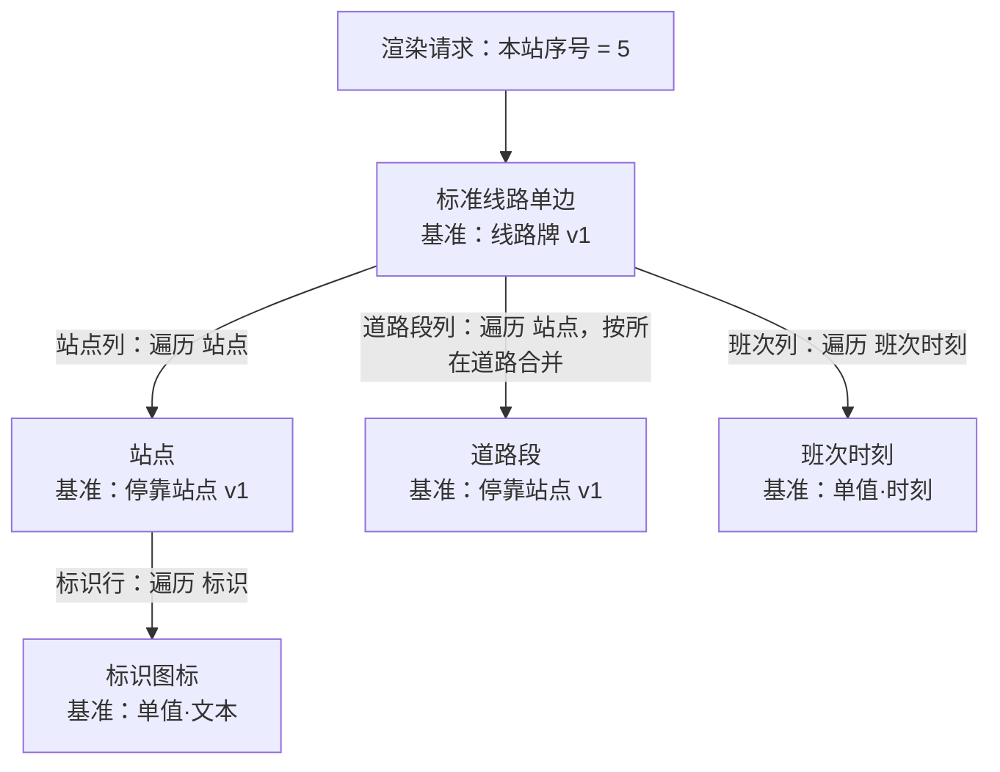

# M402 DSL 草稿

第二阶段 CODE128 使用[独立资产码样例](../barcode-dsl/README.md)，语法见[条形码说明](../../render-barcode.md)；本目录 11 份 JSON 保持兼容基线。

第二阶段票据 01 新增二维码语法，独立可执行样例见 [查询码工作区](../qrcode-dsl/README.md)，规则见 [二维码说明](../../render-qrcode.md)。原 M402 的 11 份 JSON 与既有出图行为保持不变。

状态：票据 14 已完成首期端到端验收，详见 [验收记录](../m402-acceptance.md)。本目录于 2026-10-08 起草，用 [M402 设计稿](../materials/m402-route-sign.jpg)把业务实体模型写成可执行形式的第一层：数据定义 DSL、编译产物 JSON Schema、数据集、模板 DSL 与渲染请求。起草时作出的约定（S 编号）与发现的问题（F 编号）均已确认（M89–M97）。尺寸、颜色按设计稿估计，已知外观差异见验收记录。

## 文件

| 文件 | 内容 |
|---|---|
| [schema-stop-v1.json](schema-stop-v1.json) | 静态数据定义"停靠站点 v1"：站名、地标、所在道路、标识 |
| [schema-route-sign-v1.json](schema-route-sign-v1.json) | 静态数据定义"线路牌 v1"，站点为列表[停靠站点 v1]，2–50 项 |
| [compiled-route-sign-v1.schema.json](compiled-route-sign-v1.schema.json) | "线路牌 v1"的编译产物 JSON Schema 2020-12，停靠站点内联展开 |
| [compiled-stop-v1.schema.json](compiled-stop-v1.schema.json) | "停靠站点 v1"的编译产物，由发布生成（票据 03） |
| [dataset-m402.json](dataset-m402.json) | 按设计稿转录的 M402 数据集，35 个停靠站点 |
| [template-route-sign.json](template-route-sign.json) | 主模板"标准线路单边"：顶栏、站点面板、道路带、底栏 |
| [template-stop.json](template-stop.json) | 循环模板"站点"：标识行、竖排站名、地标、本站高亮 |
| [template-road-segment.json](template-road-segment.json) | 循环模板"道路段"，用于合并相邻同名道路 |
| [template-stop-badge.json](template-stop-badge.json) | 循环模板"标识图标"，基准为单值·文本 |
| [template-departure-time.json](template-departure-time.json) | 循环模板"班次时刻"，基准为单值·时刻 |
| [render-request-m402.json](render-request-m402.json) | 正式出图请求：本站序号 5（东门），740 × 165 mm、120 DPI、PNG |

起草时的检查（2026-10-08，本地 Python 与 jsonschema 4.26.0）：当时的 10 个文件均为合法 JSON；数据集按编译产物校验 0 个错误，加入未定义的键会被拒绝（S7）；5 个模板中的变量引用、插槽路径、循环模板基准与参数填写全部能对上，被引用的变量名均为英文（S1）。当时尚未实际渲染，后续结果见各票据记录。

票据 06 复查（2026-10-10，按引擎的展示格式解析逐个检查）：5 个模板中的 22 个文本片段都符合 S23 的写法，没有竖排片段设颜色以外的样式；带展示格式的 4 个插槽（`fare` 用 `0.##`，`firstDeparture`、`lastDeparture` 与班次时刻的 `value` 用 `HH:mm`）与字段类型相符。`terminal.name`、`nextStop.name` 经过派生变量，留待票据 07 检查。

票据 07 复查（2026-10-10，用引擎的模板解析与静态检查）：去掉后续票据的写法（3 个循环容器与画板 `size` 属票据 08，道路名的横排适配属票据 09，站名的 `widthOverflow` 属票据 10）后，5 个模板解析都没有问题；基准为"线路牌 v1""停靠站点 v1"的 3 个模板静态检查都没有问题，共 44 处变量引用（绑定、插槽与状态样式）全部对得上，包括 `terminal.name`、`nextStop.name`。"标识图标""班次时刻"的基准是单值数据定义，留待票据 08 检查。主模板去掉循环容器后按 M402 数据集实际出图（见 `test/golden/m402-bars.png`）：顶栏与底栏的元素与内容和设计稿逐项对得上（线路号、开往箭头、终点站、票价、运营方、下一站及地标、服务时间、运营说明）；设计稿中终点站与服务时间用的斜体美术字、各元素的精确尺寸未还原（草稿尺寸为估计），班次时刻一行属票据 08。

票据 08 复查（2026-10-11）：本目录现有 11 个 JSON 文件均合法；仅临时去掉票据 09/10 的布局语法后，5 个模板全部通过解析与调用图静态检查（47 处普通变量引用，另检查调用的数据来源与参数），单值数据定义已由引擎内置提供；M402 数据集校验 0 个问题。实际出图保留站点列、嵌套标识行和班次列，只移除道路合并循环与站名缩字组：3496 × 780 像素、0 个问题，见 `test/golden/m402-stops.png`。35 列宽度为 694/35 mm，第 5 站黄底红字，已过站灰字及半透明地标，15 个班次按内容宽度排列，最后一项不带 `/`。完整道路带、缩字组与端到端验收仍分别属于票据 09、10、14。


票据 09 复查（2026-10-11）：11 个 JSON 文件合法，5 个模板及 47 处普通变量引用通过解析与调用图静态检查，M402 数据集校验 0 个问题；检查和渲染只在内存副本中移除票据 10 的 `widthOverflow`，本目录 JSON 保留完整目标写法。道路带得到 15 段，起始原始站序为 1、4、5、6、8、10、11、14、22、23、25、28、29、34、35；各段边界与站点列一致，首段不画分隔线。实际出图 3496 × 780 像素、0 个问题，见 `test/golden/m402-roads.png`，已目视核对。道路名按 M131 使用同间隔分布（spaceEvenly），左右留白与字间距相同，并支持先横向压缩、再缩字；缩字组和端到端验收仍属于票据 10、14。


票据 10 复查（2026-10-12）：共享草稿不再需要移除任何配置，11 个 JSON、5 个模板、47 处普通变量引用及调用图静态检查全部通过，数据集校验无问题。CLI 直接出图为 3496 × 780 像素、0 个问题，图片与 `test/golden/m402-roads.png` 一致；35 个站名均为 10 mm，摘要均标记 shrinkGroup: stopNames。2/20/35/50 站在 740 和 1500 mm 下分别为 12/12/10/7 mm；50 站加大名称区内边距的实验全组统一为 5.88 mm。道路段适用宽度上限同步扩到 1500 mm，允许整条线路合并为一段。这是初次实现的历史结果；默认分档随后按 M135 取消，见下文复核。


票据 10 密度复核（2026-10-12，M135–M136）：参照用户提供的 [366 图片](../materials/366-route-sign.png)，主模板 stopNameSize 从分档派生变量改为缺省 10 mm 的内部参数，站数增加优先收窄列间留白，确实不足才统一缩字。2/20/35/50 站在 740/1500 mm 下均保持 10 mm；59 站实验在 740 mm 下为 9.763 mm、1500 mm 下为 10 mm。实验经发布入口生成取消 50 站上限的 v2 副本，并同步切换模板基准；本目录的静态 v1 和旧数据集不被改写。像素测量与判断见 [参考图复核](../m402-design-analysis.md#八366-密集站点参考图复核2026-10-12)。布局算法仍使用等分列与列内居中，视觉留白随列宽缩小，不额外绑定 itemLayout.gap。

票据 14 验收：直接读取现有 11 份原 JSON，不再裁剪模板。原请求正式输出 3496 × 780 px、120 DPI、0 个问题；完整布局快照已固定。本站 0/35/36、1500 mm、11 字站名和 U+31350 缺字场景均有端到端测试；CLI 输出与入口函数逐字节相同。未改写任何 JSON，未调整 DSL 语法。场景结果、对照制品与外观差异见 [验收记录](../m402-acceptance.md)。

## 模板如何组合



## 起草时作出的约定

S2–S13 已确认（M90）。

| 编号 | 约定 | 依据或理由 |
|---|---|---|
| S1 | 结构关键字用英文；被引用的变量名（字段名称、参数名、派生变量名）一般用英文，中文写在显示名称里；其他业务名称（数据定义名、模板名、元素名称、状态取值）不作语言要求 | **已定（M89）**，按用户意见修订 |
| S2 | 变量引用写成 `{"var": "路径"}`（如 `{"var": "terminal.name"}`），字面值写成 `{"value": …}`，循环信息写成 `{"loop": "index"}`（另有 isFirst、isLast、count、groupSize）；路径用"."经过单引用。因此各类名称不能含"." | M21、M24 |
| S3 | 一个模板内，数据字段、参数、派生变量共用一个命名空间，不能重名 | 引用只写名字，不分前缀 |
| S4 | 可绑定的属性直接把值写成 `{"var": …}` 即为绑定，不另设绑定列表 | M71 |
| S5 | 状态样式写成 `"states": {"by": 变量, "cases": {取值: 属性覆盖}}`；未列出的取值用元素自身属性；布尔取值写作 `"true"`/`"false"`；覆盖值可以是字面值或变量 | M28 |
| S6 | 数据集文件分为 `dataset`（身份、选定的静态数据定义、来源）与 `data`（按编译产物校验的业务数据） | M60、M66 |
| S7 | 编译产物设 `additionalProperties: false`，数据集出现未定义的键即报错 | 避免字段改名后旧键被静默忽略 |
| S8 | 资源引用写成 `res:资源ID`，图片与字体都用它 | M9、M10 |
| S9 | 单值数据定义命名为"单值·文本""单值·时刻"等，版本 1 | M20 |
| S10 | 网格的行、列从 1 开始编号 | 与循环序号一致（M19） |
| S11 | 条件运算符为 eq、ne、lt、le、gt、ge、empty、notEmpty；派生变量必须声明结果类型 | M3、M23 |
| S12 | 取项超出范围时结果为空，不报错 | 末站时"下一站"为空，整行隐藏（M78） |
| S13 | 模板按名称引用，模板名称唯一 | |

## 实现中补充的写法

实现票据 01（渲染骨架）时补充，M402 草稿原有写法不变（M105）。

| 编号 | 写法 | 说明 |
|---|---|---|
| S14 | 自由布局写成 `"layout": {"mode": "free"}`；元素的 `place` 写 `left` 或 `right`、`top` 或 `bottom`（毫米，缺省为距左 0、距上 0），以及 `width`、`height`（`{"fixed": 毫米}` 或 `"hug"`） | M93；省略 `layout` 时按自由布局 |
| S15 | 文本 `horizontalAlign` 取 start、center、end，缺省 start；`verticalAlign` 取 top、center、bottom，缺省 top；两端分布 distribute 随票据 02、09 加入 | 草稿中已用到 center 与 distribute |
| S16 | 渲染请求的 `dataset` 写成 `{"id": 数据集 ID}` 或 `{"inline": 数据集文档}`，数据集文档与 S6 的文件格式相同（内联时 `dataset.id` 可省略）；`output.format` 取 png 或 jpg（jpeg 同义）；`mode` 取 draft 或 final | 规格"渲染请求" |
| S17 | 资源仓库目录下的 `resources.json` 列出资源：`{"resources": [{"id": 资源ID, "kind": "image" 或 "font", "file": 相对路径}]}` | S8；文件形式的首版资源仓库 |
| S18 | 文本 `writingMode` 取 horizontal（缺省）或 vertical；`verticalAlign: "distribute"` 只用于竖排。`fit` 写成 `{"steps": [...], "compressMin": 数, "onFail": "severe" 或 "hint"}`：竖排步骤为 tightenSpacing、compressGlyphs，收紧字距必须排在压缩字形之前；compressMin 缺省 0.6，只能设得更高；onFail 缺省 severe。横排步骤见 S29，`widthOverflow` 缩字组见 S31。`stroke` 写成 `{"color": 颜色, "width": 毫米}` | 票据 02；M402 草稿中的 fit 与 stroke 写法不变（M108、M109） |
| S19 | 布局：`layout` 写成 `{"mode": "free"}`、`{"mode": "stack", "direction": "row" 或 "column", "gap", "justifyContent": start/center/end/spaceBetween/spaceEvenly, "alignItems": start/center/end}` 或 `{"mode": "grid", "rows": [...], "columns": [...], "rowGap", "columnGap"}`，行列每项为 `{"fixed": 毫米}`、`{"fraction": 比例}` 或 `"hug"`。`place` 可写的属性随所在容器而定：自由为 left/right/top/bottom；堆叠为 margin、alignSelf；网格为 row、column、rowSpan、columnSpan、margin、justifySelf、alignSelf；三者都可写 width、height（`{"fixed": 毫米}`、`"hug"`、`"fill"`、`{"fill": 权重}`）与 minWidth、maxWidth、minHeight、maxHeight。未写宽高时，网格中为填满，堆叠与自由中为随内容 | 票据 04（M111） |
| S20 | 外观：padding、margin 可写成一个毫米数或 `{top, right, bottom, left}` 中的若干项；cornerRadius 可写成一个毫米数或 `{topLeft, topRight, bottomRight, bottomLeft}` 中的若干项；所有元素可写 `visible`（布尔）、`opacity`（0–1）、`rotation`（度）；容器与画板可写 `clip`。图形的 `stroke` 写成 `{"color", "width", "dash"?: [实, 空, …], "cap"?: butt/round/square}`。图形：rect（fill、stroke、cornerRadius）、ellipse（fill、stroke）、line（from、to、stroke 必填）、polygon（points 至少 3 个顶点）、path（d、fill、stroke、fillRule: nonzero/evenodd） | 票据 04（M110、M111） |
| S21 | 数据定义：字段类型为 text、number、date、time、datetime、boolean、image、list、ref；列表写 `items`（元素不能又是列表），引用写 `ref: {name, version}`。约束随类型：所有字段可写 required；text 可写 minLength、maxLength、pattern、enum；number 可写 min、max、integer、enum；image 可写 allowedSources（resource、url，不写时两种都允许）；list 可写 minItems、maxItems；列表元素的约束写在 `items.constraints`，不能写 required。字段名称以英文字母开头，只含字母、数字与下划线。编译时日期用标准 `date` 格式，时刻、时间用 `rw-time`、`rw-datetime`，都附等价正则 | 票据 03（M113） |
| S22 | 图片：`{"type": "image", "source": "res:资源ID", "fit": "contain" 或 "cover" 或 "fill"}`，fit 缺省为 contain（完整显示）；没有 source 时不画内容 | 票据 05（M114） |
| S23 | 文本内容 `content` 是片段列表：文字片段 `{"text": 文字}`，变量插槽 `{"slot": 变量路径, "format"?: 展示格式}`；两种片段都可另写 `font`、`fontSize`、`color`、`slant`，未写的沿用文本元素。文本元素可写 `slant`（倾斜角度，度，正值向右倾，绝对值不超过 45，缺省 0，只用于横排）。展示格式：日期与时刻用 `yyyy`、`MM`、`M`、`dd`、`d`、`HH`、`H`、`mm`、`ss`，如 `HH:mm`、`yyyy年M月d日`；数值用 `0` 与 `#`，如 `0.##`、`0.00`。字重随字体资源，不写 `fontWeight`（换用 `res:font-hei-heavy` 等）。竖排文字的片段只能单独写 `color` | 票据 06（M115–M118）；草稿中票价、服务时间、运营说明与线路号的写法不变 |
| S24 | 模板变量：`parameters` 每项 `{"name", "displayName", "visibility": "public" 或 "internal", "type", "constraints"?, "default"?}`，type 为基本字段类型或 color，内部参数必须有 default；`derived` 每项 `{"name", "displayName", "type", "ref"?, "op", …}`，op 取 branch（`branches: [{"when": 条件, "then": 运算数}]`、`otherwise`）、pickItem（`list`、`position`: "first"、"last" 或 `{"index": 运算数}`）、length（`of`）、add 或 subtract（`left`、`right`），type 为 ref 时写明 `ref`；`checks` 每项 `{"name", "problemWhen": 运算数, "level": "severe" 或 "hint", "message"}`。运算数写成 `{"var": 路径}` 或 `{"value": 固定值}`。绑定见 S4，尺寸写成 `{"fixed": {"var": …}}`；状态样式见 S5，可覆盖除 type、name、children、states 以外的属性 | 票据 07（M119–M122）；草稿原有写法不变 |

工作区目录中的 JSON 文件按内容归类，不看文件名：`dslVersion` 区分数据定义与模板，带 `x-renderweave-static-schema` 的是编译产物，由 `dataset` 与 `data` 组成的是数据集，其他文件（如渲染请求）忽略。因此本目录可以直接作为工作区加载（票据 14）。

### 票据 08：调用写法（S25–S27）

- **S25 循环容器**：沿用草稿的 `list`、`template`、`args` 和 `itemLayout`。`direction` 目前为 `row`，`widths` 取 `equal`、`content` 或 `{ "fixed": 毫米 }`；`gap` 缺省 0；每项高度填满内容区。外观可写 padding、fill、stroke、cornerRadius、clip。序号从 1 开始，循环信息只能在 args 中写 `{ "loop": "index" / "isFirst" / "isLast" / "count" }`；被调模板需要声明相应的对外参数。合并相关的 `mergeBy`、`spanBy`、`groupSize` 见 S28。
- **S26 子模板调用**：`type: "call"`；`template` 为固定模板名；`data` 取 `{ "var": "单引用字段路径" }`、`"current"` 或 `"none"`（缺省）。`args` 中每项写 `{ "var": "调用方变量" }` 或 `{ "value": 固定值 }`。模板目标不能经状态样式更换；其他参数与呈现属性仍可使用状态样式。被调模板按调用框实际尺寸重新排布，随内容时自然测量，不整体缩放、不按适用尺寸范围裁剪尺寸。
- **S27 内置基准与路径**：`空数据定义 v1` 及 S9 的七种基本字段类型单值数据定义由引擎提供，无需额外 JSON 文件；单值字段 value 必填，内置名称不能被工作区覆盖。调用中的参数问题与检查项增加 `location.path` 指向实例；元素问题和布局摘要使用 `标准线路单边/站点面板/站点列[12]/名称区/站名` 一类路径。静态声明问题在模板定义处报告，运行时问题定位到具体实例。

例如，在同以 `停靠站点 v1` 为基准的另一个模板中调用“站点”（自由布局）：

```json
{
  "type": "call",
  "name": "站点预览",
  "template": "站点",
  "data": "current",
  "args": {
    "index": { "value": 5 },
    "currentIndex": { "value": 5 },
    "stopNameSize": { "value": 10 }
  },
  "place": { "width": { "fixed": 20 }, "height": { "fixed": 100 } }
}
```

此示例与站点列共用“站点”模板，其 `widthOverflow` 已由票据 10 实现，可直接渲染；票据 08 的历史演示在内存副本中移除过该属性。


票据 09 补充（M127–M130）：

- **S28 合并相邻同值项**：循环写 `mergeBy: "road"`，`itemLayout` 写 `{ "direction": "row", "widths": "equal", "spanBy": "groupSize" }`，可加 gap。mergeBy 从列表项出发，可经单引用取基本类型字段；仅合并相邻且严格相等的值，缺值各自成组，空文本/0/false 仍可合并。每组取首项数据，按原始项数分列并跨组内项数，组宽包括内部列间距。`{ "loop": "groupSize" }` 可传入组内项数；index 与调用路径用首项的原始序号，count 是原始项数，isFirst/isLast 判断是否含原列表首项/末项。未合并时 groupSize 为 1。
- **S29 横排两端分布与适配**：`horizontalAlign: "distribute"` 以字形墨迹铺满内容区，含片段的字体、字号与倾斜，间距均分且不为负；单字墨迹居中，空格用前进宽度占位。`fit: { "steps": ["compressGlyphs", "shrink"], "compressMin": 0.6, "minFontSize": 5, "onFail": "severe" }` 表示先横向压缩，再在宽或高不足时同比缩小本元素各片段；任一非空片段达到最小字号即停，已经低于下限的片段不再缩小。compressMin 缺省 0.6（可提高到 1），minFontSize 缺省 5 mm（可提高）；步骤不可颠倒，只有 shrink 时也拒绝。只写 compressGlyphs 则保持字号；不写 fit 不做适配。仍超出返回 layout.textOverflow；摘要记录最终字号、片段字号、压缩比及字距。跨实例统一字号见票据 10。

- **S30 横排同间隔分布**（M131）：`horizontalAlign: "spaceEvenly"` 将内容区余宽分为“字形数 + 1”份，两侧与相邻字形间各留一份。按实际墨迹计算，含倾斜和片段样式；单字居中，空文本字距为 0。布局摘要 width 仍为首字墨迹到末字墨迹的跨度，不含两侧留白；spacing 同时表示字间距与每侧留白。空间不足时留白归零，再按 S29 适配。M402 道路段使用此值；distribute 继续表示两端贴边。


- **S31 竖排缩字组**（M132–M134）：`fit.widthOverflow: { "shrinkGroup": "stopNames", "minFontSize": 5 }`，minFontSize 可省略，最低 5 mm。组名在一次出图内共用，跨循环与子模板；隐藏文本不参与，可见空文本参与。第一轮按实际内容宽求组内最小可用字号，第二轮统一重排，重新计算自然尺寸与竖排压缩，字号和片段字号均写最终值，摘要另写 text.shrinkGroup。组内下限取最高值；下限高于任一原字号时报配置错误，宽度在下限仍不足报严重问题。高度不足仅做原有竖排适配，不因此缩小全组。需要随列宽缩字时，可使用 fill，或在有明确可用宽的自由/网格/纵向堆叠布局中使用 hug；横向堆叠主方向 hug 仍按自然尺寸分配，固定尺寸不会改写。

直接运行完整草稿：

```bash
npm run render -- render --workspace docs/examples/m402-dsl --resources fixtures/resources --request docs/examples/m402-dsl/render-request-m402.json --out out/ticket14/base
```

## 起草中发现的问题

| 编号 | 问题 | 结论 |
|---|---|---|
| F1 | M83 要求站数过多时"统一缩小全部站名字号"，但每个站名在各自的循环模板实例里，需要一种跨实例统一的写法 | **已定（M91）**：增加缩字组（草稿写作 `widthOverflow.shrinkGroup`） |
| F2 | 班次时刻按内容宽度排列，被调模板的尺寸应由内容决定；M70 只规定了"调用框尺寸即实际尺寸" | **已定（M92）**：取其内容的自然尺寸，仍须在适用尺寸范围内（草稿写作画板 `"size": "hug"`） |
| F3 | 画板宽度可变，而自由布局只有 x、y，角标、叠放类元素无法贴住右边或下边。草稿暂时用堆叠布局绕开 | **已定（M93）**：自由布局可按距右、距下定位 |
| F4 | 路径和多边形的坐标以毫米计、相对元素框，框变大时图形不会拉伸 | **已定（M94）** |
| F5 | 道路带与站点列在两个容器里，靠相同的左右内边距（23 mm）保持对齐 | **已定（M95）**：首版接受 |
| F6 | 站名上方的蓝色"1"圆标含义未知 | **已定（M97）**：是早期的错误设计，忽略；地铁、医院仍作为"标识"（列表[文本]，按取值选图） |
| F7 | 站点模板被 2–50 站、740–1500 mm 宽度调用，适用宽度只能写成 8–800 mm，范围检查几乎不起作用 | **已定（M96）** |

## 更正

设计稿共有 **35** 个停靠站点（30 个黑色站名、4 个灰色已过站与 1 个本站），[设计稿解读](../m402-design-analysis.md)初稿误写为 34，已更正。

票价框原估为 68 × 11 mm，实现票据 04 时排版报出"票价：一票制2元"在框内放不下（8 mm 字号需宽 60.6 mm，框内只有 50 mm）。按设计稿逐像素量得白框约为 x 539.4–659.8 mm、y 13.3–29.2 mm，已改为 120 × 16 mm（2026-10-09）。
