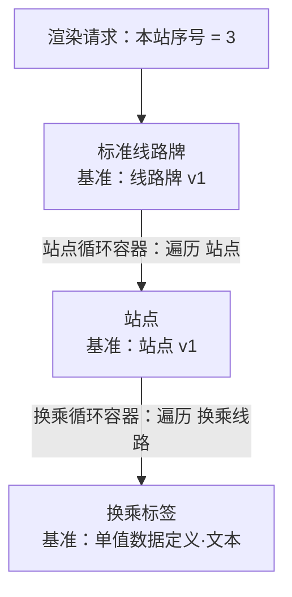

# 线路牌讨论案例

状态：2026-10-08 按[业务实体模型](../model/business-entities.md)重写的走查。以下值全部为编造的演示数据，用于核对业务规则，未经过真实素材提取或产品渲染。文中 G 编号指业务实体模型中的待定事项，带 G 编号的写法是按建议暂定的。

## 场景

线路牌呈现单条线路在一个行驶方向上的有序站点。真实基准素材、目标图尚未指定；画板尺寸与 DPI 取演示值，参照 rid-rs 的线路单边模板。

## 一、数据定义

**线路牌**

| 字段 | 类型 | 约束 | 说明 |
|---|---|---|---|
| 线路号 | 文本 | 必填，最长 8 | |
| 首班 | 时刻 | | |
| 末班 | 时刻 | | |
| 站点 | 列表[站点] | 必填，至少 2 项 | 按行驶顺序排列 |

**站点**

| 字段 | 类型 | 约束 | 说明 |
|---|---|---|---|
| 站名 | 文本 | 必填 | |
| 换乘线路 | 列表[文本] | | 可停靠的其他线路号 |

两个数据定义都已发布为 v1 静态数据定义，"线路牌 v1"中的站点列表引用"站点 v1"（版本标识与引用规则见 M38、M39）。

"站点"只是结构嵌入，没有站点 ID。两处"乙站"只是同名的两次出现，不据站名合并，也不推断它们是否为同一现实站点（第 3 轮 Q11、Q12）。

## 二、数据集（演示 A 使用）

数据集选定静态数据定义"线路牌 v1"：

```json
{
  "线路号": "示例 811",
  "首班": "06:00",
  "末班": "22:30",
  "站点": [
    { "站名": "甲站", "换乘线路": ["示例 23"] },
    { "站名": "乙站" },
    { "站名": "乙站", "换乘线路": ["示例 7", "示例 102"] },
    { "站名": "丁站" }
  ]
}
```

数据集中的键就是字段名称（M18）；字段另可设置显示名称，修改显示名称不影响数据集与绑定。以后"线路牌"即使改了字段名称，也只体现在 v2 中，这份选定 v1 的数据集不受影响。没有换乘的站点直接缺省"换乘线路"，不写 null。

## 三、模板

三个模板沿数据定义的引用结构组合。模板的基准取静态数据定义的确切版本（M36）；模板本身没有版本（M40）：



### 标准线路牌（基准：线路牌 v1）

- 画板：适用尺寸范围宽 740–1500mm、高 165mm。
- 对外参数：本站序号，数值，整数且 ≥ 0，默认 0 表示不标本站（M30）。
- 内部参数：主色，颜色，默认 `#0050a0`。
- 派生变量：
  - 终点站 = 取项（站点，末项）。结果是一个"站点"值，方向文本再读它的站名（M24）。
  - 站点数 = 长度（站点），供检查项使用（M25）。
  - 有首末班 = 条件分支：首班为空 → 否；末班为空 → 否；否则 → 是。
- 检查项：本站序号 > 站点数时为严重问题，提示"本站序号超出站点数"（M25）。
- 元素：
  - 线路号文本：`〔线路号〕`。
  - 方向文本：`开往 〔终点站.站名〕`。
  - 首末班文本：`首班 〔首班｜HH:mm〕 末班 〔末班｜HH:mm〕`，条件显示取"有首末班"。首末班缺任一项时整行不显示，而不是印出空白（M16）。
  - 站点循环容器：遍历"站点"，循环模板为"站点"。填写对外参数：序号 ← 循环序号，是否首项 ← 循环是否首项，是否末项 ← 循环是否末项，本站序号 ← 本站序号，主色 ← 主色。

### 站点（基准：站点 v1，作为循环模板）

- 对外参数：序号（数值，默认 1）、是否首项（布尔，默认否）、是否末项（布尔，默认否）、本站序号（数值，默认 0）、主色（颜色，默认 `#0050a0`）。默认值让它可以单独预览。
- 派生变量：
  - 站点状态 = 条件分支：
    1. 本站序号 = 0 → 普通
    2. 序号 < 本站序号 → 已过站（右侧是变量，M23）
    3. 序号 = 本站序号 → 本站
    4. 否则 → 未到站
  - 是本站 = 条件分支：站点状态 = 本站 → 是；否则 → 否。
- 元素：
  - 高亮底框：黄色，条件显示取"是本站"。当前站用底框包住，不只是改字色，这一点沿用旧编辑器的站牌规范。
  - 站名文本：`〔站名〕`，颜色绑定主色；状态样式按站点状态，已过站 → 灰色，其他取值保持主色（M28）。长站名的适配见演示 B。
  - 左连线：状态样式按"是否首项"，是 → 不显示；右连线：状态样式按"是否末项"，是 → 不显示。首站不画左连线，末站不画右连线，隐藏的连线不占位（M27、M28）。
  - 换乘循环容器：遍历"换乘线路"，循环模板为"换乘标签"。填写对外参数：主色 ← 主色。

### 换乘标签（基准：单值数据定义·文本）

- 对外参数：主色（颜色）。
- 元素：圆角底框，填充主色；文本 `〔值〕`。

## 四、渲染请求

| 项 | 值 |
|---|---|
| 模板 | 标准线路牌 |
| 数据集 | 第二节的数据集（选定线路牌 v1，与模板基准一致，M37） |
| 对外参数 | 本站序号 = 3 |
| 出图参数 | 宽 1200mm、高 165mm、DPI 120、PNG |

检查依次通过：数据集符合"线路牌"（4 个站点满足至少 2 项，站名齐全）；本站序号 3 是 ≥ 0 的整数；检查项 3 ≤ 4 通过；1200mm 落在 740–1500mm 内。

要给这条线路的 4 个站各做一块牌，就提交一次批量出图：同一模板、同一数据集，4 个渲染项的本站序号分别为 1–4（M63）。数据集也可以不预先保存，直接随渲染请求附带上面的 JSON（M60）。

## 五、演示走查

### 演示 A：同名站点出现两次

本站序号 = 3 时，站点模板被调用 4 次：

| 序号 | 站名 | 站点状态 | 呈现 |
|---|---|---|---|
| 1 | 甲站 | 已过站 | 灰色站名，无左连线，一个换乘标签 |
| 2 | 乙站 | 已过站 | 灰色站名 |
| 3 | 乙站 | 本站 | 黄色高亮底框，两个换乘标签 |
| 4 | 丁站 | 未到站 | 主色站名，无右连线 |

方向文本为"开往 丁站"。两处"乙站"按位置得到不同状态，不需要站点身份。

本站序号 = 0 时 4 项都是"普通"，不出现高亮；本站序号 = 5 时检查项报严重问题。如果没有检查项，4 个站会全部显示为已过站，而且没有任何提示。

### 演示 B：站数和长站名变化

同一模板分别使用 6 个站和 28 个站，其中一个站名为"演示国际会展中心东广场站"（11 字）。规则来自 [M402 设计稿解读](m402-design-analysis.md)：

| 情况 | 处理 | 依据 |
|---|---|---|
| 站点怎么排 | 每站一列，平分可用宽度 | M82 |
| 6 站与 28 站的字号 | 标准线路牌用条件分支按站点数分档给出站名字号（如 ≤ 20 站 12 mm、≤ 35 站 9 mm），经对外参数传给站点模板；同一块牌上所有站名字号一致 | M82、M87 |
| 长站名放不下 | 两端分布、收紧字距，再纵向压缩字形，最多压到原高 60%；仍放不下记严重问题，正式出图失败 | M82、M88 |
| 列宽连一个字都放不下 | 统一缩小全部站名字号，直到最小可读字号 5 mm；仍放不下记严重问题 | M83、M86 |
| 站牌宽度在 740–1500 mm 之间变化 | 重新排布，列变宽，字号不变 | M85 |

站点数为 2–50（M81）。按 M402 设计稿的比例估算，740 mm 宽放 50 站时字形高约 6 mm，仍高于最小可读字号。

### 演示 C：素材不完整

用户上传一张线路牌照片作为素材，选定静态数据定义"线路牌 v1"，发起数据集提取任务。其中一个站名在照片中只能看清"会展……站"。

1. 第 1 轮提交为一个 CloudKiln Task（M58）。agent 经 MCP 服务调用识别工具读取照片；识别结果记录每行文字、坐标和模型版本，归属这份素材（M55）。
2. agent 对那一行再调用识别工具放大重读，仍读不清。它交回 `outcome.json`：候选数据集，加一个待确认项（M44、M45）：

   | 位置 | 候选值 | 原因 | 来源证据 |
   |---|---|---|---|
   | 站点[4].站名 | 会展中心站 | 看不清 | 识别结果中的第 17 行 |

3. RenderWeave 校验成果结构，用候选值生成草稿预览，该站在问题清单中标出（M46、M48）。
4. 审核时，这个待确认项逐项处理，用户改为"会展中心东站"；其余来自照片的值连同识别框一起展示，用户整体确认一次（M47）。
5. 全部确认后应用，生成一份选定"线路牌 v1"的新数据集（M29、M46）。此后才能正式出图。

如果素材里根本没有这个站名，原因记为"必填未提供"；如果是 agent 从前后站推断出来的，记为"推测"；两张素材写法不一致，记为"来源冲突"。可选字段（如换乘线路）没有值，不算待确认项。

### 演示 D：辅助修改模板

用户意图："站名太挤，把这一条线路的站点排布调整得更清楚。"

1. agent 先判断改哪里：站点之间的排布属于标准线路牌中的站点循环容器；单个站名的换行、缩字属于站点模板。假设它要改站点模板，于是为站点模板产生一个工作副本（M49）。
2. agent 调用草稿预览：渲染标准线路牌，并指定用站点模板的工作副本代替已保存的站点模板（M50），查看效果、自查问题清单。执行模型能否看图尚未验证；如果不能，它只能依据问题清单判断。
3. 成果交回规则差异与说明。RenderWeave 自己用权威渲染器生成修改前后两张预览供审核，不采用 agent 交回的图（M52）。
4. 用户应用时，系统列出站点模板的所有调用方（M31）；如果这期间站点模板已被别人保存过，则重新显示差异，由用户选择覆盖或基于最新内容重做（M51）。

## 六、走查发现

现有模型能完整表达这张线路牌。过程中发现需要补充的地方，已作为待定事项记入业务实体模型：

- 运算方面：线路牌首次需要"取项""长度"两个运算，条件比较的右侧需要允许变量，均已定（M23–M25）。
- 检查方面：参数与数据之间的检查由"检查项"表达，已定（M25）。
- 显示方面：隐藏的元素不占位，条件显示即对"是否显示"的状态样式，已定（M27、M28）。
- 组合方面：模板调用关系必须无环、修改被调用的模板要列出调用方，已定（M26、M31）。
- 数据集方面：数据集对应一个业务对象，可保存、可修改、可随请求附带；一线路多牌用批量出图；站点不作为跨数据集共享实体（M60–M66、ADR-0010）。
- Agent 方面：演示 C、D 的提取、审核、工作副本与应用流程已定（M43–M59、ADR-0009）。
- 版本方面：数据集与模板都以静态数据定义的确切版本为依据，渲染时必须一致；模板没有版本，可升级基准版本（M18、M36–M40）。升级前列出会失配的数据集与调用方模板，由用户选择一并迁移或复制模板留给旧版本；数据集迁移生成新数据集（M41）。
