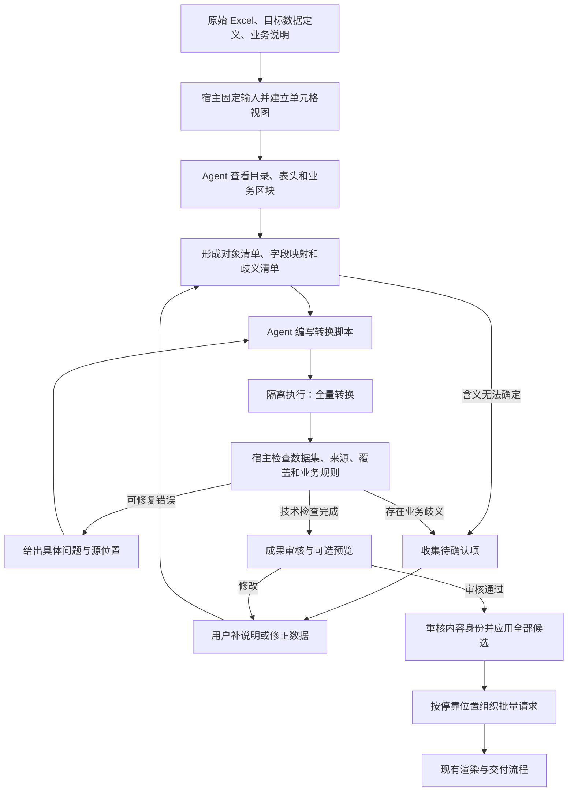

# CodingAgent 处理 Excel 制作表的流程设计

2026-11-03。对应 M363、M364；使用现有 **Claude Code + Claude 模型 + OpenCode Go**。本文是实施前的流程设计，新增工具、文件和状态均为计划，不代表当前命令已经支持。业务范围与旧系统证据见[接入规格](../.scratch/excel-agent-extraction/spec.md)，执行隔离见 [ADR-0028 草案](adr/0029-excel-agent-script-execution.md)。

## 1. 核心选择

采用“**理解表格 → 编写转换程序 → 执行全量转换 → 独立校验 → 按反馈修正 → 审核应用**”。Agent 负责判断数据的含义、选择处理方法和修改程序；程序遍历全部数据；RenderWeave 负责检查、审核记录、应用和出图。

一次任务处理一份工作簿，可以产生多份数据集。首期选定一个静态数据定义及其确切版本，所有候选均符合这一版本；公交场景按一条线路的一个方向形成一份数据集。遇到多个业务对象先列全清单，不因旧模块只允许一条线路而默默丢掉其他线路。不同对象需要不同数据定义时，拆成明确关联的任务。

先做本地数据集提取闭环，沿用现有 `run → review → apply` 的职责。数据集提取不顺便修改数据定义、生成模板或正式出图；用户要快速出图时，由外层流程串起这些已有阶段。没有适用数据定义时先完成数据定义提取和发布，再回来处理原始工作簿。

## 2. 一次任务如何流转

等待某个歧义的答案时，可以继续处理不依赖该答案的方向或字段；整份成果保留“待确认”，不能把未处理部分当成空值交付。表结构和映射在没有歧义时由 Agent 自主推进，不增加逐步骤人工批准。

| 阶段 | 主要执行者 | 输入 | 交回的产物 | 进入下一阶段的条件 |
|---|---|---|---|---|
| 接收 | 宿主 | 原文件、业务说明、选定数据定义、可选模板 | 输入清单、固定文件和依赖身份 | 文件可读、范围明确、目标版本存在 |
| 建立视图 | 受控读取器 | 固定工作簿 | 工作表目录、单元格、合并区域、读取问题 | 全工作簿读取有完整结果，超限不能静默截断 |
| 理解 | Agent | 目录、区域数据、字段定义、说明 | 对象清单、映射方案、排除理由、待确认项 | 每个工作表和业务区块都有处置；歧义有显式记录 |
| 编程 | Agent | 视图、映射方案、前次反馈 | 转换脚本及脚本说明 | 脚本可交给隔离执行工具，不需要宿主命令权限 |
| 执行 | 隔离环境 | 固定视图、脚本、参数 | 全部候选、来源声明、执行诊断 | 正常退出并完整交回；退出码成功不等于业务通过 |
| 检查 | 宿主和引擎 | 候选、原始视图、规则、可信基准 | 检查报告、有效内容身份 | 结构和必检项通过；未知与待确认明确列出 |
| 修正 | Agent / 用户 | 带位置的反馈或业务问题 | 新脚本、新映射或人工修正 | 生成新内容后重新检查，原报告保留 |
| 审核 | 用户与审核流程 | 有效候选、原表定位、差异、预览 | 审核记录 | 待确认已处理，严重问题清零，审核对象未变化 |
| 应用 | 宿主 | 已审核的完整候选集合 | 数据集与应用回执 | 提交前重核，全部成功或可恢复到完整状态 |
| 出图 | 业务层与引擎 | 已应用数据集、模板、出图配置 | 逐项结果和出图记录 | 数据定义一致，当前站和尺寸明确，交付有单独回执 |

## 3. 固定什么输入

必需输入为原始工作簿、业务说明、选定的静态数据定义。开始时把“最新版本”等可变化的选择解析为确切身份，再固定本轮实际使用的字节。

| 输入 | 固定内容 | 用途 |
|---|---|---|
| 工作簿 | 原始字节、哈希、原文件名和格式 | 原件留存；名称只展示，不承担文件身份 |
| 数据定义 | 名称、版本、编译产物及引用依赖的哈希 | 字段与类型的权威依据 |
| 业务说明 | 实际文本与哈希 | 单位、方向、特殊时间列、处理范围等约定 |
| 可选可信基准 | 人工核准的字段和值及其来源 | 评估正确性；Agent 不能写入或替换它 |
| 可选既有数据集 | 明确选定对象及内容身份 | 展示本次变化；不能默认为全部历史数据 |
| 可选出图配置 | 模板修订、参数、尺寸、资源身份 | 预览和随后逐站出图 |

Excel 提取可独立于模板完成；没有模板时仍能得到合格数据集，出图阶段再配置。发现目标定义缺字段时，返回“需要调整数据定义”的问题及源位置；不往未声明字段里塞数据，也不修改已发布版本。

## 4. 如何读 Excel

### 4.1 受控读取器先建立完整视图

读取器处理工作簿格式，Agent 不负责猜测二进制内容。首期接受不加密 `.xlsx`；`.xls`、宏工作簿和其他格式明确提示转换或进入后续兼容工作，不伪装成已兼容。

视图至少保留工作表原始顺序、名称与隐藏状态、有效区域、行列坐标、合并范围；每个单元格保留原始类型和值、数字格式、可可靠生成的显示文本、公式及缓存结果状态。显示文本无法可靠还原时，标明未知并保留原值，不能给一个猜出来的字符串。

合并单元格保留锚点和覆盖范围，不把填充后的多个副本算成多条数据。隐藏行列默认仍纳入盘点；是否排除由本单范围说明决定并留记录。格式空白不构成业务数据，但数据区域中的空格位保留，供程序区分“缺值”和“不存在这一列”。

公式不执行、不联网取外部引用。缓存值存在只说明文件保存了一个结果，不能证明结果最新；影响必填值或业务结论的公式缺缓存、错误值或外部引用进入问题清单。首期不承诺图片、批注或图形中的文字被提取；发现这些内容时明确列出未读取范围，业务依赖它们则转待确认。

### 4.2 Agent 按需观察，程序处理全量

Agent 首先看全工作簿目录、候选表头、合并区域和各区块的头尾样本，再按区域查看具体内容。分页返回真实范围、总量及下一页位置；工具输出达到上限时给续取入口，不截断后报告读取完成。

脚本执行始终拿到本轮范围内的完整单元格视图，不只处理 Agent 看过的样本。宿主盘点所有工作表及有值区域；未查看、未分类的区域持续列出。大表按固定行块流式处理，保持原始坐标和顺序；跨块的合并表头、分组边界和业务对象身份不能丢失。

首期先用一次脚本执行处理全工作簿；只有规模测试证明需要时再分块并行。预览只抽样不代表检查可以抽样，字段来源和数量核对覆盖所有候选。

## 5. Agent 在编程前要确定什么

Agent 输出一份可查看的处理计划，不要求用户学习新的 DSL。它记录以下判断，并与脚本版本一起固定：

- **业务对象**：工作簿里有几条线路、哪些方向，各自来自哪个工作表和区块。显示名称与稳定的内部对象标识分开。
- **记录边界**：表头范围、数据行、页内重复表头、汇总行和说明行如何区分；不能只用“第一行非空就是表头”。
- **字段映射**：目标字段路径、源列或单元格、字段层级、转换规则、缺值处理；列表要写明完整列组和收集顺序。
- **单位及格式**：时刻、日期、尺寸、编码分别怎么处理。编码和站名不当数值处理；前导零、①②和重复项保留。
- **排除项**：每个不提取的工作表、区块和有值列的理由；业务说明未授权、又可能影响结果的排除项进入待确认。
- **不确定项**：指出问题、源位置、影响的候选/字段及建议答案。方向不明不按出现顺序猜，时间含义不明不同时写成两种确定事实。

业务说明优先于通用领域约定；原表与说明冲突时显式提出，不能用优先级静默抹去冲突。一次任务的新解释仅对本次输入生效，不自动升级成所有客户的约定。

## 6. Agent 如何写和执行程序

首期规划使用 **Python 3 转换脚本**：输入为读取器生成的结构化单元格视图与处理参数，输出为 JSON 候选和来源声明。转换本身用标准库即可起步；不让 Agent 临时安装依赖，也不让每份脚本各选一套 Excel 解析规则。工作簿读取器的具体依赖及隔离实现留给原型验证，固定后记录版本。

| 执行要求 | 约定 |
|---|---|
| 可读 | 本轮固定的单元格视图、目标数据定义、业务说明、明确给出的前次反馈 |
| 可写 | 本次尝试的独立临时输出目录；不得修改原件、可信基准或宿主检查记录 |
| 环境 | 固定语言版本和依赖；无网络、无宿主凭据；隔离与资源上限由工具执行，不靠提示词 |
| 转换 | 显式按源顺序遍历；不依赖当前时间、随机数、机器目录或未固定外部数据产生业务结果 |
| 输出 | 候选集合、来源声明、处理统计；诊断单独保存，不把大批数据全打印进模型上下文 |
| 失败 | 异常、超时、输出超限都交回明确原因；半写结果只供诊断，不成为完整候选 |
| 重跑 | 新尝试使用新目录；相同输入与脚本的业务输出应可重现，生成时间等运行信息由宿主另记 |

工具能力按职责分为“查看工作簿目录”“读取区域”“执行转换”“检查候选”“读取完整反馈”。前两项读取固定视图，执行工具只调度隔离环境，检查工具复用引擎并保存宿主报告。这里只定职责，不在本轮冻结 MCP 名称、参数 Schema 或 HTTP 接口。

文件写入工具继续用于 Agent 编写脚本和候选说明；不开放宿主通用命令执行。脚本完成后由宿主导入普通文件，拒绝越界路径、链接、重复输出身份和超限内容，再固定候选字节。更完整的执行边界见 [ADR-0028](adr/0029-excel-agent-script-execution.md)。

## 7. 如何证明没有漏抄、乱抄

检查分五层，每层单独给结论。不能以“JSON 合法”“脚本正常退出”或“Agent 说已自检”替代其他层。

| 检查层 | 检查方法 | 能证明什么 | 不能单独证明什么 |
|---|---|---|---|
| 文件与结构 | 宿主检查清单、候选文件与 DSL；引擎按编译产物校验 | 文件完整、字段类型和约束符合目标定义 | 内容符合原表业务含义 |
| 来源与变换 | 宿主按源位置重新取值，独立重做支持的转换 | 声明的原值真实存在、转换结果相符 | Agent 选对了业务列 |
| 范围与数量 | 对照全部工作表、区块及记录清单核对候选 | 已声明范围内没有漏行、多行、误去重或漏列表项 | 尚未核准的区块划分一定正确 |
| 业务语义 | 对照本单说明、独立基准与人工确认 | 方向、字段层级、单位、时间含义有依据 | 没有事实依据的判断自动变成正确 |
| 出图适配 | 用引擎检查/预览真实请求 | 模板与数据定义匹配、请求可展开、当前站等参数合法 | 源数据本身完整正确 |

### 7.1 来源声明的粒度

每个来自原表的字段值记录：候选文件、字段路径、工作表、单元格或范围、源记录标识、使用的转换规则。列表追溯到每一项，不能只写“来自 Sheet1”。合并表头提供解释依据，但不算业务值的重复来源。

源记录标识按“本次原件身份 + 工作表位置 + 区块 + 行位置”组织；站名和站点编码都是业务值，不是唯一记录身份。同名站、相同编码在多个停靠位置出现仍保留。相同来源有意用于多个输出字段时声明用途，不能一律判为重复，也不能靠重复消费掩盖遗漏。

人工补充值记录为人工来源；说明中的常量记录为说明来源；派生值记录上游字段和规则。由此允许合法补充，同时能区分“忠实提取”和“人工决定”。

### 7.2 覆盖如何计算

宿主枚举读取器实际取得的非空单元格、合并锚点和区域，不采用脚本自报的总数。Agent 的分类是待核对的声明：业务值、表头/上下文、说明、明确忽略、待确认。每个有值位置都须有处置，业务记录及列表项另按身份和顺序核对，不能仅比较行数。

检查同时看三个集合：输入实际存在的位置、处理计划声明的位置、候选实际引用的位置。位置不存在、应取未取、出现未声明输出、无理由忽略等返回具体差异。空单元格虽不计非空覆盖，若对应必填字段仍报缺失。

**结构覆盖完整不等于业务完整。** Agent 可能把一整块业务数据误认成备注；这种分类不能因“每格都有标签”自动通过。用户说明或人工核准过的范围才能作为独立语义依据。未核准的映射及排除清单在最终审核中展示，报告保留“来源核对完成、语义待审核”的分离结论，不生成一个合并成功率。

### 7.3 转换如何独立核对

首批可独立核对的规则为原样复制、明确的首尾空白处理、按指定分隔符拆分、按坐标顺序收集/拼接、明确类型转换和显式单位换算。宿主使用受测的固定检查函数重新计算，不执行 Agent 的转换函数来证明该函数正确。

复杂自定义 Python 计算允许产生候选，但宿主不把重复执行同一脚本当成独立验证。没有独立预期值时标为未核查，并进入业务审核；常见且反复需要的转换，再补固定检查能力。新增一种转换方式不能同时由 Agent 生成它自己的权威判据。

## 8. 反馈、修复和停止

每项反馈至少包含候选/字段位置、源工作表/坐标、问题类别、实际结果、可证明的预期及依据、是否阻止应用。问题过多时分页给出全部结果，第一页附总数；不能让 Agent 只修第一页便宣称完成。

| 情况 | 后续处理 |
|---|---|
| 脚本语法、运行异常 | 回传异常位置与受限诊断，Agent 修改脚本后重跑 |
| 字段类型或定义不符 | 回传引擎问题；改转换，或明确提出目标定义缺口 |
| 漏行、漏班时、错序 | 给缺少的源位置和候选位置；修复遍历/映射并重新检查全体 |
| 方向、时间含义或单位不明 | 形成待确认项；继续无依赖部分，等业务答案，不反复猜测 |
| 目标数据定义不适用 | 保留已有成果和证据，转数据定义任务；本轮不自动改版本 |
| 校验器无法证明复杂计算 | 记录未核查项；补独立基准或交人工审核，不能改判据来消除红项 |
| 外部调用瞬时失败 | 沿用现有有界重试；保持相同输入身份，不伪装成一次成功尝试 |
| 取消、硬额度、时限到达或停滞 | 沿用现有停止与检查点机制；保留最后完整集合与已知用量 |

整轮时间和轮数沿用现有配置，默认值与限制见[预算合同](agent-budgets.md)。新增单次脚本执行也要有有限的时间、资源与输出上限，实际值写进轮次配置；保护值由原型测量后确定，不凭本文宣称性能达标。解析准备阶段另设文件规模与读取时限，避免尚未进入整轮预算就无限占用。

停滞只按已有机制认定的完整修复机会计数，不把阅读下一页、等待用户回答和正常终检当作无进展。修复后至少重跑受影响转换与完整候选校验；首期工作簿规模未证明需要增量优化前，统一全量重跑。

## 9. 人工修改怎样保留

审核展示原表定位、转换前后值、方向与站序、列表长度、未映射区域、未核查项及与指定既有数据集的差异。问题按业务对象聚合，一次问清相关歧义，用户不需要编辑 Python。

用户操作分三类：补充解释、修改映射、直接改值。解释与映射改变时生成新版本说明/计划并重跑；直接改值保存为宿主持有的修正记录，带原候选值、目标字段、源记录标识、修改者和原因。脚本重跑之后，宿主核对原候选值和源身份再重放修正；不匹配就显示冲突，不按旧数组下标盲目覆盖另一站。

人工修正优先于同一依据下重新生成的值，但必须重新通过类型与业务检查。重跑后新站点插入、原字段消失或目标定义变化，都可能使修正失效。已有批准绑定完整有效候选；任何候选、映射依据或人工修正变化都重新检查，不继承旧批准。

用户确认某个歧义的答案与批准整个成果是不同动作。首个本地闭环沿用现有审核和应用流程；未来托管仍遵循 ADR-0022 的身份权限与租户审批策略，不把本文的本地审核步骤扩展成全系统新增审批要求。

## 10. 多份候选的应用与逐站出图

同一次提取范围作为一个完整候选集合。某个方向失败时默认整份暂不应用；用户要先处理可完成部分，必须显式缩小范围或另起关联任务，把暂缓对象留在记录里，不能悄悄少交一半。

每份数据集分别核查身份、数据定义、覆盖、待确认项和人工修正；集合另查 ID 重复、对象遗漏、范围重叠与候选数量。应用前重新检查工作区依赖和候选字节，使用现有提交意图与恢复机制，做到对产品读取入口呈现完整状态。不能把逐个写文件描述为天然原子事务。

应用成功后形成独立出图计划：数据集身份、模板修订、参数、尺寸、逐项标识、停靠位置、跳过理由和数量。沿停靠顺序生成请求，不按站名去重；当前站用所选模板约定的参数表达，例如现有 M402 的 `currentIndex`，不能把这个名字强加给所有模板。

模板基准必须与数据集所选静态数据定义一致。缺模板、缺尺寸或资源不能归为“数据提取失败”，而是出图准备问题。尺寸、材质、预设和历史配置继承遵守显式业务规则，与 Excel 字段转换分开；额外牌也单列出图项。

数据集已应用不等于批次已提交，批次已提交不等于所有图片完成。分别记录应用回执、提交回执和逐项交付结果；恢复时依据对应回执继续，不能因为出图中断而重做已完成的提取，也不能没有交付回执就假定图已生成。已有交付入口缺少所需去重能力时，该接缝须补齐后才能宣称自动恢复不会重复出图。

## 11. 保存哪些产物

以下是规划的逻辑产物，不要求立即新增同名物理文件。已有轮次、检查点、审核和应用记录继续复用；新增内容进入它们的内容身份或关联清单。

| 产物 | 写入者 | 必须包含 |
|---|---|---|
| 输入清单与原件 | 宿主 | 文件哈希、定义身份、说明、可选基准、范围、实际模型配置 |
| 单元格视图与读取报告 | 受控读取器/宿主 | 源位置、类型、值、格式、合并范围、未读内容、读取器版本 |
| 处理计划 | Agent 提议，宿主存版本 | 对象/记录边界、映射、转换、排除、歧义 |
| 转换脚本 | Agent | 本次可执行脚本、固定运行环境与参数 |
| 执行回执 | 宿主执行工具 | 输入/脚本/环境哈希、退出状态、资源用量、产物清单 |
| 候选与来源声明 | 脚本/Agent，宿主导入固定 | 全部候选数据集、逐字段/逐列表项来源、待确认项 |
| 检查报告 | 宿主/引擎 | 各层结果、依据与未核查范围、完整候选集合身份 |
| 人工修正与审核 | 审核流程 | 修改依据、前后值、冲突、批准的实际内容身份 |
| 应用与交付回执 | 宿主/交付系统 | 提交身份、数据集、批次及逐项结果 |

任何报告的结论都对应确切输入和候选；仅文件路径相同不代表同一成果。日志中的时间和模型尝试用于追踪，数据转换的离线重放只依赖固定输入、脚本、运行环境和修正规则。

## 12. 失败与接续状态

下表是用户可见阶段的规划，不直接替换现有 `execution`、`review` 或交付状态枚举。

| 阶段 | 可以做什么 | 恢复原则 |
|---|---|---|
| 准备输入 | 查看读取问题、补文件或说明 | 原件变化生成新输入身份 |
| 理解/转换/检查中 | 查看进展、取消 | 完整检查点之外的文件只作诊断 |
| 待确认 | 回答业务问题，查看未受影响部分 | 从有效计划和候选新开轮次，记录新增说明 |
| 待审核 | 对照原表、改值、批准或退回 | 修改后生成新的有效候选并重查 |
| 已应用 | 查看数据集、准备出图 | 凭应用回执接续，不能再重复应用 |
| 交付中/部分失败 | 查看逐项结果、处理失败项 | 复用批次回执，按现有交付能力重试 |
| 停止/中断/失败 | 查看原因、已有成果与已知成本 | 先确认原执行已终止；只有完整检查点可作为正式接续依据 |

首期不依赖供应商保留的隐含会话。新轮次读取上一轮固定材料、完整候选、脚本、反馈和人工修正；没有完整检查点时重新执行，不能把半写 JSON 当成可批准成果。

## 13. 用一个具体例子走通

这是流程演示用的人工构造例子，不是真实客户文件或已验证结果。假设已发布的数据定义具有 `lineName`、`direction`、`stops`，停靠项含 `stopName`、`weekdayTimes`、`fridayTimes`。

工作表“制作表”里，A1 为“示例线路”，A2 为“上行”；B4 为“站名”，C4:D4 合并为“周一至周四”，E4:F4 合并为“周五”。数据如下：

| 行 | B：站名 | C | D | E | F |
|---|---|---|---|---|---|
| 5 | 田贝② | 06:40 | 06:50 | 07:00 | 07:00 |
| 6 | 田贝② | 08:00 | 空 | 08:20 | 08:30 |

1. 读取器提供合并范围与六列真实位置，两个“田贝②”是不同停靠记录。
2. Agent 判断 C:D 属于 `weekdayTimes`，E:F 属于 `fridayTimes`；空格跳过，时间顺序和重复值保留；这一映射供最终审核查看。
3. 脚本遍历第 5、6 行，生成一份上行数据集。首站得到 `weekdayTimes = ["06:40", "06:50"]`、`fridayTimes = ["07:00", "07:00"]`；第二站工作日列表只有 `"08:00"`。两个站名均保留圈号。
4. 每个列表项记录独立源位置。若脚本只输出第一班，宿主根据完整列组及独立收集规则发现 D5 未输出；若去重周五列表，则发现 E5、F5 的两项只剩一项。
5. Agent 收到缺项反馈，修正遍历，再执行全量检查。若它把 C:D 错认成周五但内部处理完全一致，不能靠数量检查识破；需要原表表头映射核对或人工审核解决。
6. 用户若把第二站的 08:00 修为 08:05，修正记录定位该源记录和列表项，保留原候选 08:00。重跑时条件匹配才重放该修改，并标为人工来源。
7. 审核、应用后，业务层生成两个停靠位置的渲染项。尽管站名相同，也分别显示第一个和第二个当前站；最终出图数量与两个请求对应。

## 14. 实施顺序与完成标准

| 顺序 | 交付内容 | 必须证明 |
|---|---|---|
| P01 | 输入固定、工作簿视图和区域查看 | 合并范围、时间、前导零、空值、隐藏数据与未读内容均可追溯 |
| P02 | 转换脚本隔离执行与完整产物导入 | 正常转换能完成；越界、超限、异常和半写不能冒充成功 |
| P03 | 计划、来源、覆盖检查和完整反馈 | 注入漏站、错序、误去重、截断列表能被拒绝；未知语义不会被判为已验证 |
| P04 | Claude 任务编排与修复循环 | 使用指定 Claude + OpenCode Go，从真实输入修复至少一个注入缺陷，留下全部尝试 |
| P05 | 多份候选、人工修正、审核与应用 | 按选定 staticSchema 核查全部候选，改值重跑不丢失；中断恢复不出现半套数据集 |
| P06 | 按模板参数准备渲染项与交付接续 | 模板、参数、尺寸、数量和跳过项与核准结果一致；公交当前站只是参数场景之一，提取/应用/交付状态分开 |
| P07 | 真实业务验收与完整替代范围 | 真实制作表独立真值、人工工时和总尝试成本；历史继承、额外牌、格式兼容按规格验收 |

每段先用受控夹具和故障注入证明机制，再用真实工作簿与人工核准值验证业务正确性。夹具必须覆盖双方向不同列数、跨 Sheet、多层表头、重复站名、圈号、含前导零编码、列表内重复值、公式缺缓存、单位不明、额外说明区及取消恢复。样本由客户提供也不能自动视为真值，需固定实际核准结果。

已有模板识别评估只能证明原任务的能力，不能替代本流程的 Excel 提取验收。公交素材使用 M358 更正后的完整站名，不能沿用旧错误基准。测试报告分别列机械正确性、语义正确性、人工修正量、耗时和全部尝试成本；真实样本缺失不阻止完成设计和机制开发，但不能据此宣布业务验收通过。

## 15. 与当前实现的接缝

| 已核查位置 | 当前事实 | 实施时的调整 |
|---|---|---|
| `src/agent/run.ts:277`、`:287` | 首轮要求示例图并检查图像文件头 | 加工作簿输入分支，图像任务行为保持兼容 |
| `src/agent/run.ts:54`、`:491` | 默认模型渠道与 Claude Code 执行器 | 沿用配置、代理及轮次身份 |
| `src/agent/tasks.ts:34` | 数据集任务只有文件工具与既有领域工具 | 加本任务所需读取、执行和反馈能力，保留任务级白名单 |
| `service/src/xlsx.ts:1` | 现有标准导入只读值，不保留完整格式语义 | 标准导入继续可用；新增视图读取能力不得把合并和显示信息丢掉 |
| `src/agent/outcome.ts:25`、`:51` | 已有待确认原因、候选集合与成果校验 | 复用原因和成果模型，新增结构化工作簿来源关联；不要往现有严格 Schema 直接塞未声明字段 |
| `src/agent/candidates.ts:41`、`:80` | 已逐份校验候选，并检查重复 ID 和目标定义 | 保留已有校验，补范围、来源和覆盖，不重复发明数据集校验器 |
| `src/agent/coverage-verification.ts:70` | 当前提取覆盖取第一份数据候选 | 改成按候选与业务对象逐份核对后汇总 |
| `src/agent/review.ts:529`、`:673` | 已有审核后应用与提交回执 | 纳入映射、人工修正和完整候选身份，复用提交恢复机制 |
| `docs/examples/m402-dsl/render-request-m402.json:4` | 示例以 `currentIndex` 表达当前站 | 逐站请求按具体模板的参数约定生成 |

P01–P03 的机制验证见[原型报告](agent-eval/excel-data-prototype.md)；P04 按用户补充要求，以工作空间的 staticSchema 作为通用边界（M366），对象、列表和字段路径均来自选定定义，公交内容只是示例。已完成的首轮真实测试见[报告](agent-eval/excel-agent-p04.md)，验收记录以[票据 02](../.scratch/excel-agent-extraction/issues/02-connect-schema-driven-agent.md)为准。P05 的正式导入、审核修正与完整应用见[使用说明](excel-agent-review.md)和[嵌套实测](agent-eval/excel-agent-p05.md)，验收以[票据 03](../.scratch/excel-agent-extraction/issues/03-review-correct-apply.md)为准。P06 的模板参数、通用列表位置展开、固定依赖和交付重放见[出图接续说明](excel-agent-output.md)及[报告](agent-eval/excel-agent-p06.md)，验收以[票据 04](../.scratch/excel-agent-extraction/issues/04-prepare-and-deliver-output.md)为准。下一步 P07 用实际制作表、独立真值和人工工时核准完整业务；提取仍是原型入口，尚非生产接入。
