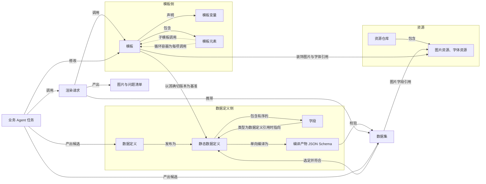
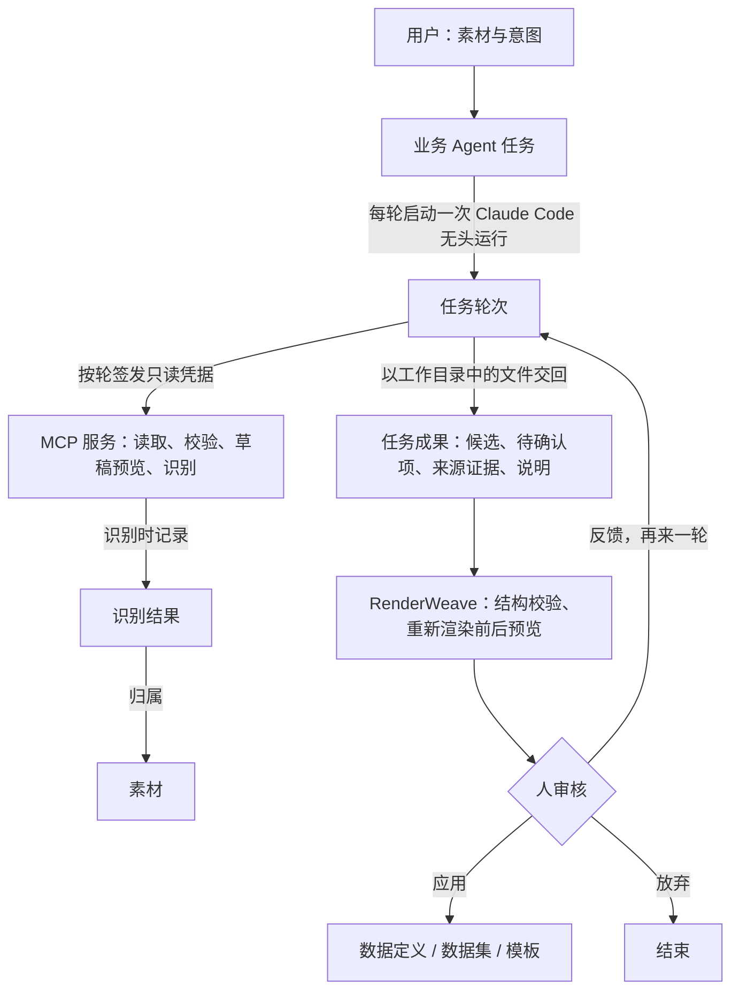

# RenderWeave 业务实体模型

状态：2026-10-08 起草。汇总[需求探索记录](../discovery/requirements.md)中建模草稿讨论 M1–M104 与 ADR-0004、ADR-0006–0010 的已定内容；标注"待定"或 G 编号的部分尚未达成共同理解，集中列在文末。术语以 [GLOSSARY.md](../../GLOSSARY.md) 为准，完整走查见[线路牌案例](../examples/route-sign.md)。

## 核心思路

模板是一个出图函数：输入是一份符合基准数据定义的数据（数据集）和若干对外参数，输出是一张图片和一份问题清单。

数据定义可以修改，发布后形成不可变的静态数据定义（如"线路牌 v1"）。数据集和模板都以静态数据定义的确切版本为依据，渲染时两者必须一致；数据集因此不会被后续修改破坏。模板本身没有版本，可以直接修改，包括升级到新版本。

数据定义之间的引用结构决定模板如何组合：单引用字段对应子模板，元素为数据定义引用的列表对应循环模板。所有模板地位平等，任何模板都能用自己的数据和参数单独渲染、单独预览。

agent 只能提出候选：它以 Claude Code 无头运行（ADR-0015），经 RenderWeave 的只读 MCP 服务读取、校验、预览和识别，成果以文件交回，经人审核后才应用为真实内容。

## 实体关系总览

## 数据定义侧

| 实体 | 是什么 | 关键规则 | 依据 |
|---|---|---|---|
| 数据定义 | 对数据结构的可修改描述 | 字段有序；发布后形成静态数据定义；系统内置空数据定义和每种基本类型一个的单值数据定义 | M18、M20、ADR-0008 |
| 静态数据定义 | 由数据定义发布得到的不可变版本 | 以名称加自动递增版本号标识（v1、v2……）；其中的引用指向确切版本；数据集与模板都以它为依据，渲染时版本必须一致 | M18、M36–M39、ADR-0008 |
| 字段 | 数据定义中的一个属性 | 以字段名称为身份，数据集中的键与模板绑定都使用它；显示名称可随时修改、不影响绑定；修改字段名称只体现在新发布的版本中 | M18、ADR-0008 |
| 字段类型 | 字段取值的种类 | 基本类型：文本、数值、日期、时刻、时间、布尔、图片；构造类型：列表、数据定义引用。日期 `2026-01-02`，时刻 `HH:mm`（秒可选），时间 `2025-01-02 09:08:12`，均不带时区。列表的元素不能又是列表；数据定义之间的引用不能成环 | M6、M7、M32、M33 |
| 约束 | 字段上对数据集取值的限制 | 可用种类由字段类型决定；必填适用于所有类型，判定为"键存在且值不为 null"；限于可编译为 JSON Schema 的子集；保存时做冲突检测 | M5、M7 |
| 图片取值 | 图片字段在数据集中的写法 | 统一为字符串：资源引用带专用前缀，URL 限 http/https；字段可约束允许的来源 | M9 |
| 编译产物 JSON Schema | 由静态数据定义单向编译而来 | 数据集校验的权威；时刻、时间用注册的自定义格式，数值按十进制精确解析 | ADR-0006 |

## 数据集

| 实体 | 是什么 | 关键规则 | 依据 |
|---|---|---|---|
| 数据集 | 一份用于出图的 JSON 对象，对应一个业务对象（如一条线路的一个方向），选定并符合一个静态数据定义 | 可保存为实体（可列出、审核、复用、直接修改，修改后仍须通过校验），也可随渲染请求附带；自成一体，不与其他数据集共享实体（M60–M62、M65、ADR-0010）；由该静态数据定义的编译产物 JSON Schema 校验；只放已确定的数据，候选值与待确认项不进入数据集（M29）；可选字段只能缺省，不能写 null；图片字段中的资源引用必须存在且是图片资源（类型自带检查，不算可配置约束） | M7、M9、M18、M29、M60–M62、M65、ADR-0006、ADR-0010 |
| 数据集迁移 | 按新版本由已有数据集生成新数据集 | 原数据集保持不变；字段改名或删除造成的差异由人或 agent 处理 | M41 |
| 数据集来源 | 每份数据集记录的出处 | 首版来源：按数据定义表单录入、导入 JSON、Agent 数据集提取（表格类素材也经提取）；记录手工录入、导入、来自哪个 Agent 任务或从哪份数据集迁移而来；数据集可删除，出图记录中的快照不受影响 | M64、M66 |

首版不提供"改一处全部更新"，也不追踪数据变更后哪些站牌需要重做（M65）。

## 资源

| 实体 | 是什么 | 关键规则 | 依据 |
|---|---|---|---|
| 资源仓库 | 系统维护的图片资源与字体资源 | 种类不可改变；内容可替换，引用保持不变，每次替换产生新的内容版本号，替换前列出引用方；被任一模板或数据集的当前内容引用时不可删除；出图记录所用内容版本与渲染器版本 | M10 |
| 资源引用 | 指向仓库中某个资源的标识 | 替换内容后指向新内容；模板自身的装饰图片与字体只能使用资源引用 | M10 |
| URL 图片 | 数据集中直接给出的图片地址 | 不预先校验有效性；渲染时经安全校验器取图，按解析出的 IP 校验并逐次校验重定向；取不到或未通过校验时，草稿预览用占位图并标出问题，正式出图失败 | M7、M11 |
| 后备字体 | 字体缺字时的替代 | 按字重选用思源黑体逐字替代；替代成功记为提示，仍缺字记为严重问题 | M12 |

## 模板侧

| 实体 | 是什么 | 关键规则 | 依据 |
|---|---|---|---|
| 模板 | 以基准数据定义为数据输入的出图设计 | 基准是静态数据定义的确切版本，创建时未选则为空数据定义；模板没有版本，可直接修改；可升级到同一数据定义的新版本（升级前列出失效绑定、会失配的数据集与调用方模板，修复并选择处置方式后才能保存），不能改用另一个数据定义（需要时复制）；拥有以毫米为单位的画板和适用尺寸范围；声明模板变量；包含模板元素 | M1、M14、M34、M36、M40、M41 |
| 模板变量 | 作用域内可读取的具名值 | 分数据字段、模板参数、派生变量；每次模板调用是一个作用域，不继承调用方 | M1、M2、ADR-0007 |
| 数据字段 | 基准数据定义的字段在模板中的形态 | 路径可经过多层单引用；列表只能交给循环容器，不能直接读取其中某一项 | M21 |
| 模板参数 | 模板声明的输入值 | 类型为字段类型或颜色。对外参数可由调用方赋值，没有默认值时必须提供；内部参数只由设计者设定，必须有默认值 | M15 |
| 派生变量 | 由一个运算计算出的值 | 不嵌套运算，按名字组合；可以产出数据定义引用类型的值，插槽与绑定的路径可以经过它。已有运算：条件分支（按序首个命中、必须有"否则"、产出业务语义值，比较右侧可为固定值或变量）、取项（首项、末项、第 N 项）、长度（文本字数、列表项数）、加减（M78）；其他运算由必需用例触发引入 | M3、M4、M8、M23–M25、M78、ADR-0004 |
| 检查项 | 渲染前求值的布尔派生变量 | 带问题等级与提示文字，表达字段约束无法表达的检查，如本站序号不超过站点数 | M25 |
| 模板元素 | 构成模板画面的单元 | 包括文本、图片、容器、循环容器与子模板调用；完整目录见[模板元素目录](template-elements.md)：13 种元素，单位一律毫米，可绑定范围含网格位置 | M35、M67–M76 |
| 变量插槽 | 文本内容中引用模板变量的位置 | 带该处的展示格式；取代旧的拼接数据源 | M8 |
| 子模板调用 | 在模板中调用另一个模板的元素 | 被调模板的数据三选一：调用方的单引用字段、调用方的当前数据（基准相同）、不传数据（被调模板以空数据定义为基准）；参数通过被调模板的对外参数显式填写；模板之间的调用关系（含循环调用）必须无环，保存时检查 | M13、M26、ADR-0007 |
| 循环容器 | 遍历一个列表字段、为每项调用循环模板的元素 | 循环模板的基准必须与列表元素一致，基本类型列表对应单值数据定义；循环信息（序号从 1 开始、是否首项、是否末项、总数，合并时另有组内项数）经对外参数传入；可按某字段合并相邻同值项，每组跨相应列数 | M19、M20、M79、ADR-0007 |
| 动态模板（后续） | 按条件在同一基准的多个模板之间选择 | 每个分支分别填写所选模板的对外参数 | M13、M22 |

模板规则落在元素上的方式：

- **字段绑定**：元素的某个属性取某个模板变量的值。缺值时不回退到设计时的占位内容，结果为空（M16）。哪些属性允许绑定随元素目录确定（G10）。
- **列表循环**：由循环容器完成。
- **条件显示**：元素按一个布尔值显示或隐藏；隐藏的元素不参与布局（M27）。
- **状态样式**：元素按某个模板变量的取值（如站点状态）选用不同的属性取值，未列出的取值归入"其他取值"；条件显示即对"是否显示"属性的状态样式（M4、M28）。

修改被其他模板调用的模板时，保存前列出受影响的调用方并要求确认（M31）。

模板尚未保存的修改是工作副本，可校验与草稿预览，保存即应用（M49–M51，见"业务 Agent 任务"）。

## 渲染

| 实体 | 是什么 | 关键规则 | 依据 |
|---|---|---|---|
| 渲染请求 | 一次出图调用 | 指定模板、数据集（引用已保存的或附带 JSON）、对外参数值与出图参数；数据集选定的静态数据定义必须与模板基准一致；实际尺寸必须在模板的适用尺寸范围内，DPI 与图片格式（PNG/JPG）由请求给出 | M14、M37、M60 |
| 批量出图 | 一个模板一次产出多张图 | 由多个渲染项组成，每项为数据集、对外参数值与出图参数；每项独立校验、独立出图、各有问题清单，一项失败不影响其他项；首版显式列出各项 | M63 |
| 问题清单 | 渲染各阶段发现的问题 | 每个问题可定位到字段、参数或元素；草稿预览可以带问题出图并标出，正式出图遇到严重问题即失败 | M11、M12、M16 |
| 出图记录 | 正式出图时保存的复现依据 | 模板内容快照（含被调模板）、数据集内容快照、资源内容版本与渲染器版本 | M10、M59、M61 |

检查顺序（M102）：

1. 解析：工作区中的模板、数据集与渲染请求。
2. 以下几项互不依赖，全部执行并汇总问题：
   - 模板：绑定能找到变量、类型匹配、循环模板基准一致、调用关系无环（M26，保存时已检查，渲染前复核）。
   - 数据集：编译产物 JSON Schema 校验，加图片资源引用检查；所选静态数据定义版本与模板基准一致。
   - 对外参数：类型与约束，必须提供的是否都已提供。
3. 存在阻止展开的问题（模板或数据集无法解析、版本不一致、调用成环、循环模板基准不符）时停止，草稿预览与正式出图都不出图。
4. 求值：派生变量、检查项（参数与数据之间的关系，如本站序号不超过站点数，M25）、条件显示、状态样式、循环与子模板调用。
5. 排版与渲染期：URL 取图与安全校验、字体缺字、低于最小可读字号、内容溢出。
6. 正式出图有严重问题即失败；草稿预览照常出图，标出问题元素并显示占位（M104）。

问题以字段路径、参数名、元素路径（M101）或检查项名定位。

## 业务 Agent 任务

| 实体 | 是什么 | 关键规则 | 依据 |
|---|---|---|---|
| 业务 Agent 任务 | 委托给 agent 的一项工作 | 四种：数据定义提取、数据集提取、模板辅助设计、模板辅助修改；每个任务产出一种成果；只给图片时先做数据定义提取并由人发布，再做数据集提取；执行 agent 可替换 | M43、ADR-0001、ADR-0003 |
| 任务轮次 | 任务中的一次执行 | 即一次 Claude Code 无头运行；输入为素材、上一轮成果（含人工修改）与反馈；轮与轮之间由 RenderWeave 保存状态 | M58、M212、ADR-0015 |
| 素材 | 用户提供的原始文件 | 图片、PDF、表格与结构化数据 | M55 |
| 识别结果 | 对素材做一次 OCR 的记录 | 归属素材，不可变；记录每行文字、坐标、模型名与确切版本；相同素材、模型与区域复用；模型固定带日期的版本 | M55、M56 |
| MCP 服务 | RenderWeave 为 agent 提供的工具 | 只有读取、校验、草稿预览、识别四类只读工具；凭据按轮签发、只覆盖本任务对象、任务结束失效；agent 不能保存、发布、删除或正式出图 | M42、M53、M54、ADR-0015 |
| 任务成果 | 一轮交回的内容 | 以文件交回 `outcome.json` 与说明；RenderWeave 先校验结构，不合格的轮次由人决定是否重跑 | M48 |
| 待确认项 | 需要人确认的值 | 原因为看不清、推测、来源冲突、必填未提供；记录位置、候选值、原因与来源证据 | M44、M45 |
| 来源证据 | 候选值的出处 | 只能指向已记录识别结果中的文字行，或结构化素材中的位置；审核时画回原图；说明出处，不保证正确 | M45 |
| 工作副本 | 模板尚未保存的修改 | 人或 agent 均可产生；可校验、可草稿预览，草稿预览可用它代替对应的已保存模板；记录它基于哪次保存，应用时有冲突则重新显示差异由人选择 | M49–M51 |
| 应用 | 把成果写入真实内容 | 只能由人在审核后执行；数据集成果在全部待确认项处理完后生成新数据集；模板成果保存时走调用方影响（M31）与升级检查（M40） | M29、M46、M49 |

审核方式：待确认项逐项处理；其余来自图片识别的值连同识别框展示，由人整体确认一次（M47）。给人看的修改前后预览由 RenderWeave 重新渲染，agent 自己的渲染只用于自查（M52）。草稿预览可以使用候选值并标出问题，全部待确认项处理完之前不能正式出图（M46）。

待定：执行模型能否看图尚未验证；若不能，agent 只能依据问题清单自查版式。

## 待定事项

以下由本次整理和线路牌走查发现。已定的标注对应 M 编号，其余附建议。

| 编号 | 问题 | 建议或结论 |
|---|---|---|
| G1 | 数据集用什么作字段的键？M18 说改名不影响绑定，但数据集里的键如果随名称变化，已有数据集会失效 | **已定（M18 两次修订、ADR-0008）**：以字段名称为身份；修改显示名称不影响绑定。数据定义发布为不可变的静态数据定义，数据集必须选定一个，已有数据集不受后续改名影响 |
| G2 | 站点状态要比较"序号"和"本站序号"两个变量，M3 写的是"变量、运算符、值" | **已定（M23）**：右侧可以是固定值或另一个变量 |
| G3 | "终点站 = 取站点列表末项"得到的是一个"站点"值，插槽还要读它的"站名" | **已定（M24）**：引入取项运算；派生变量可产出数据定义引用类型的值，路径可经过它的单引用 |
| G4 | 条件显示隐藏元素后，该元素是否仍占布局空间 | **已定（M27）**：不参与布局 |
| G5 | 状态样式具体是什么形态 | **已定（M28）**：按变量取值给出属性覆盖，另有"其他取值"；条件显示即对"是否显示"属性的状态样式 |
| G6 | 循环容器如何排布项：方向、间距、等分或按内容、自动换行、反序、相邻同值合并 | **已定（M79、M82）**：每项一列平分宽度，可合并相邻同值项；反序、列表过滤、前后附加固定项等首版不提供，有需要再加 |
| G7 | 看不清、推测得到的候选值放在哪 | **已定（M29）**：数据集只放确定的数据；候选值属于 Agent 任务成果，确认后才写入 |
| G8 | 本站是可选的，但没有默认值的对外参数必须提供 | **已定（M30）**：本站序号默认 0，表示不标本站 |
| G9 | 本站序号超过站点数时，所有站都会被判为"已过站"而没有报错；这类参数与数据之间的检查无法用字段约束表达 | **已定（M25）**：模板可声明检查项；引入长度运算 |
| G10 | 模板元素目录尚未定义 | **已定（M67–M76）**：见[模板元素目录](template-elements.md) |
| G11 | 基准相同时可以传入当前数据，模板 A 调用 A 会无限展开 | **已定（M26）**：模板之间的调用关系必须是无环图，保存时检查 |
| G12 | 站点模板可能被多个线路牌模板循环调用，修改它会影响全部调用方 | **已定（M31）**：保存前列出受影响的调用方模板并要求确认 |
| G13 | 数据定义之间的引用能否成环 | **已定（M32）**：不能成环 |
| G14 | 列表的元素能否又是列表 | **已定（M33）**：不能；需要时用列表[数据定义引用]，在被引用的数据定义里再放列表 |
| G15 | 模板创建后能否更换基准数据定义 | **已定（M34）**：不能；需要时复制模板并选定新基准。同一数据定义的新版本是否算"更换"，见 G20 |
| G16 | 引入静态数据定义后，模板的基准是否也是静态数据定义（含版本） | **已定（M36）**：是 |
| G17 | 渲染时，数据集选定的静态数据定义与模板的基准必须完全一致吗 | **已定（M37）**：必须完全一致 |
| G18 | 静态数据定义的版本如何标识 | **已定（M38）**：数据定义名称加自动递增的版本号（v1、v2……） |
| G19 | 静态数据定义中的数据定义引用指向哪里 | **已定（M39）**：指向确切版本 |
| G20 | 模板能否从数据定义的旧版本升级到新版本 | **已定（M40）**：模板不配置版本，可以直接修改，包括升级基准版本。升级前列出失效的绑定，由人或 agent 修复后才能保存（系统不区分改名与删除后新增）。改用另一个数据定义仍按 M34 复制模板 |
| G21 | 模板没有版本又要求版本完全一致：站点模板从"站点 v1"升级到 v2 后，选定旧版本的数据集、仍循环"站点 v1"的线路牌模板都无法再与它匹配 | **已定（M41）**：升级前列出会失配的数据集与调用方模板，由用户选择一并迁移到新版本，或先复制一份模板留给旧版本；数据集迁移生成新数据集，原数据集不变 |
