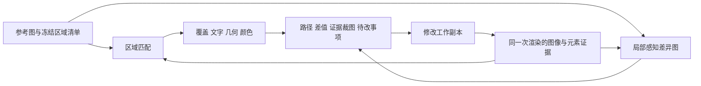

# 模板代建 Agent 的视觉还原评估与反馈闭环

- 日期：2026-10-22（用户时区）
- 状态：research / proposal；本轮形成研究建议，不表示方案已接受或能力已实现。
- 范围：RenderWeave 模板辅助设计、模板辅助修改中，草稿预览与示例图的相似性、缺失信息、局部差异与修改反馈。首要验证对象是公交线路牌，也覆盖价签等模板。
- 来源：实际阅读论文、作者代码和官方文档；本仓库事实单独列证据。文中的候选数量、轮数与验收办法属于建议，不是论文保证或已经测出的项目表现。
- 后续复核：结合项目 Agent 的补充反馈与当前源码对照实验，已收敛为[视觉反馈设计提案](../../.scratch/agent-template-authoring/visual-feedback-design.md)，其中补充了坐标校准、实例到源码定位、单轮反馈边界及分批验收。
- 后续实施：用户已批准首期方案；2026-10-23 将验收聚焦中文和英文（M307）。[实现与结果](../agent-visual-feedback-results.md)记录已验证能力；本文保留当时的研究证据与建议，未实施部分不视为完成。

## 结论

采用“信息完整性检查 + 区域级几何、文字和颜色测量 + 感知差异图 + 受证据约束的视觉评审”，给 Agent 返回能定位到元素路径的差异清单。不要把 SSIM 换成另一个单一总分。

用户报告的“空骨架 SSIM 0.69、完整模板 0.55”应成为评估器必须通过的反例。它能否定该评分在这组样本上的排序，却不能证明 LPIPS、CLIP 或视觉模型在本项目上已经更准。新的评估器需要同时回答三个问题：**该有的信息有没有；已有部分哪里不一致；这次修改究竟改善了什么。**

第一版优先做经人工核准的示例图区域清单、渲染证据、逐区比较与结构化反馈，不以 OCR 为前置依赖。OCR 自动起草清单、局部感知差异图和视觉模型评审作为后续增强。首先交付“缺了什么、偏了多少、下一步改哪个元素”，再校准能否将这些证据汇总成可靠排序。

## 本仓库实证与接入点

本轮按用户确认，以 `F:/GenCode/render-weave` 为目标；读取时源码提交为 `33305e5d7b5d54aafcf750af831e4fcbf9d4b0ef`。下表是代码核实，不把历史计划当作已实现能力。

| 当前能力 | 证据 | 接入判断 |
|---|---|---|
| 当前示例相似度不是 SSIM，而是将两图缩到 437×98 后算 `1 − RGB 平均绝对差 / 255`，仅供参考 | `scripts/agent-eval/score.ts:162,280–294` | 保留历史对照，另建区域评价 |
| `render_draft` 返回 PNG 和问题，最长边 2000；`region` 用毫米裁切并提高 DPI | `src/mcp/tools.ts:33–38,273–299` | 可复用局部出图；报告须带实际 DPI 与坐标换算 |
| `inspect_layout` 有循环实例路径、毫米框、文字、字号、字距、压缩、溢出；框未计旋转 | `src/mcp/tools.ts:303–336`；`src/layout/types.ts:16–31,76–110` | 候选侧不必完全依赖 OCR；旋转、裁切、遮挡与墨迹框需补证据 |
| `check_outcome` 的内容评价固定为 `needsReview`；渲染评价看严重问题与有无图像 | `src/agent/outcome.ts:110,284`；`src/agent/assessment.ts:19–22` | 新增独立视觉维度 |
| 设计流程要求先骨架，再逐段补齐 | `agent/tasks/template-design.md:14–23` | 中途缺项标 pending，交回时查完整性 |
| 草稿追加占位与问题边框；正式模式有严重问题时不出图 | `src/render.ts:138–151` | 需补无调试层诊断图；严重问题仍阻断交付 |
| 绘制统一执行 `DrawOp[]`，使用毫米坐标；指令缺少统一源元素身份字段 | `src/draw.ts:23–41`；`src/layout/types.ts:120` 起 | 在布局到绘制之间保留节点来源，无需重建 DOM |
| 审核预览已有输入/build 哈希缓存，最长边 4000，与 MCP 的上限不同 | `src/agent/preview.ts:18–20,50–56,87–94` | 统一比较用 profile，避免 agent 与审核页比较不同分辨率 |

已有票据 **34** 要求先用人工核准区域和布局摘要，**35** 要求记录复现身份，**36** 要求先验证 OCR 收益。本研究与其衔接，不把 OCR 或复杂像素归属系统设为一期前置。依据：`.scratch/agent-template-authoring/issues/34-verify-element-styles.md:11–18`、`35-reproducible-runs-and-acceptance.md:11–15`、`36-ocr-measurement-trial.md:11–16`。

### 本轮离线实测

经当前 `src/index.ts` 的公开 `loadWorkspace` / `render` 重放已有阿拉伯文站牌，未调用生成模型。两者均为 800×900 mm、50 DPI 草稿，实际 1575×1772 px。

| 观测 | 空骨架 | 保存的完整候选 |
|---|---:|---:|
| 产生图像 | 是 | 是 |
| 布局节点数 | 6 | 388 |
| `visible` 且面积为正的节点 | 6 | 317 |
| 非空文字节点 | 0 | 116 |
| 摘要中的文字字符数 | 0 | 1609 |
| 严重问题 | 0 | 75，全部为 `text.unshapedScript` |

**已验证：零错误出图可以完全没有文字；布局摘要能暴露这个差别。** 另起 Node 进程重复两份输入，两张 PNG 各自的 SHA256 均与首跑相同。这是布局声明计数，不证明未被遮挡、读序正确或与参考一致。完整候选有已知阿拉伯文塑形错误，不是合格模板，也不是中文校准集。

另在 `out/research-visual-fidelity-2026-10-22/venv` 隔离安装并实跑 **FLIP 1.7 CPU**。参考图原为 3200×3600 RGBA，白底合成后 LANCZOS 缩至 1575×1772；候选同样合成白底，固定 67 PPD，不做局部配准。

| FLIP 试验（越低表示外观越近） | 全图 mean error |
|---|---:|
| 参考图与自身 | 0.000000 |
| 参考图与空骨架 | 0.127656 |
| 参考图与保存的完整候选 | 0.165238 |

已生成并查看局部误差热图。两次比较内部计算耗时约 0.12–0.14 秒，双图 CLI 总耗时 0.81 秒。**FLIP 全图均值在这组输入上仍把骨架排在前面。** 此处含草稿错误框、错误塑形与缩放，只有两个候选；不能推断 FLIP 在干净图像或中文站牌上失效，也不构成容量基线。热图中错误框本身明显进入热区，需要先分离诊断图层。

用户给出的 SSIM 0.69/0.55 未找到原始运行配置，本轮没有重算，与上述 FLIP 实测分开记录。

本机复现（仓库根目录；依赖已有 `out/arabic-board-retest-2026-10-20/` 样本、资源与候选）：

```powershell
node --import tsx out/research-visual-fidelity-2026-10-22/probe.mjs
python out/research-visual-fidelity-2026-10-22/normalize.py
out/research-visual-fidelity-2026-10-22/venv/Scripts/flip.exe -r out/research-visual-fidelity-2026-10-22/reference-normalized.png -t out/research-visual-fidelity-2026-10-22/skeleton-rgb.png out/research-visual-fidelity-2026-10-22/saved-candidate-rgb.png -ppd 67 -txt -d out/research-visual-fidelity-2026-10-22
```

环境：Node 24.12.0、Python 3.13、Pillow 12.2.0。隔离 venv 内可用 `python -m pip install --only-binary=:all: flip-evaluator==1.7` 复现依赖。输入 SHA256、结果与归一化参数在本机 `out/research-visual-fidelity-2026-10-22/results.json`、`normalization.json`；FLIP 原始结果为同目录 `pooled_values.*.txt`、`identity.txt`，热图为 `flip.*.png`。探针仅保存在 Git 忽略目录，未改生产实现或依赖文件。

## 一级来源给出的可用方法

### 0. CANVAS 与 Canvas 渲染专项

**优先参考 CANVAS（AAAI 2026）。** 它研究 Agent 通过 Figma 工具复现和修改设计，使用 Hungarian 一对一组件匹配，再评价组件覆盖、位置、文本与颜色。人评分析中 SSIM 项不显著；这一结果支持多维评价，但仅适用于其移动 UI 样本，不能直接移植中文阈值。多轮收益也随模型而变。[CANVAS 论文及附录 E/F](https://arxiv.org/html/2511.20737v2)

注意 **CANVAS 不是 HTML Canvas 专用库**。它的参考侧有设计结构，本项目常只有 PNG，这部分真值仍须建立。官方代码 MIT，完整实验依赖 Figma Desktop、插件和 Node/Python 服务；适合借用 `evaluation/`，不必迁移运行环境。[作者仓库](https://github.com/kixlab/CANVAS)、[评价入口](https://github.com/kixlab/CANVAS/blob/main/evaluation/README.md)

| 组件 / 研究 | 可借用的能力 | 本项目落点与限制 |
|---|---|---|
| [NVIDIA FLIP](https://github.com/NVlabs/flip) | Python/C++/CUDA 感知误差图；BSD-3-Clause；Python ≥3.10 | 已在本机跑通；作为区域残差图候选，记录 PPD、归一化与版本；不判断文字语义或完整性 |
| [Skia Debugger](https://skia.org/docs/dev/tools/debugger/) | SKP 逐命令回放、clip/matrix、像素变色断点 | 查哪条绘制指令影响错误区域；需补命令范围到模板 path 的映射，不是相似度工具 |
| [Konva 架构](https://konvajs.org/docs/overview.html)、[Shape 源码](https://github.com/konvajs/konva/blob/master/src/Shape.ts) | scene canvas 与独立 hit canvas；颜色键映射 shape | 借机制在 CanvasKit 加 ID mask；不迁移框架。点击命中图不能原样当真实墨迹图 |
| [IntroSVG 项目](https://gitcat-404.github.io/IntroSVGProject/)、[代码](https://github.com/gitcat-404/IntroSVG) | 生成、渲染、结构化批评、再修改；代码 Apache-2.0 | 借闭环形式；训练模型与 SVG 任务效果不证明普通 agent 自修订有效 |
| [SVG-Score 论文](https://arxiv.org/html/2609.03806v1)、[项目页](https://potpov.github.io/svg-score-webpage/) | 用颜色、数量、空间关系的可控扰动检验评价器 | 借校准方法；调研时仍标代码/数据待发布，不作为可安装组件 |
| [diffvg 作者代码](https://github.com/BachiLi/diffvg) | 可微矢量渲染，优化路径和颜色；Apache-2.0 | 首期不选：不是 CanvasKit 的可微接口，第二渲染器会引入字体与排版差异 |

CanvasKit 有录制入口：本机 `canvaskit-wasm@0.42.0` 的 `node_modules/canvaskit-wasm/types/index.d.ts:470,2934–2947` 声明 `PictureRecorder` 与 `Picture.serialize()`；[官方类型源码](https://github.com/google/skia/blob/main/modules/canvaskit/npm_build/types/index.d.ts)可交叉核对。这只验证接口存在，尚未接入本项目或实跑 SKP 回放。

**Canvas 归因建议**：先用现有布局树定位区域与疑似元素；遇到旋转、遮挡、裁切或重叠再补绘制来源与掩码，避免一期就搭完整调试器。

1. 布局生成绘制指令时保留 `instancePath → templateName/sourcePointer → drawOpRange`；既指出循环中的具体实例，也指出它们共同来自哪个模板。
2. 同一次布局生成干净图像与证据；需要时用相同 transform、clip、z-order 生成节点 ID/覆盖掩码，分清布局框、变换后框和实际墨迹框。
3. 热图通过掩码关联到疑似 `elementPath`，再结合几何差值解释。热区不是根因：错误可能来自上层遮挡或父容器。
4. 缺失元素在候选掩码里没有像素，必须由参考清单查出。透明混合、图片 alpha 和抗锯齿不能直接混合 RGB 节点 ID；需独立覆盖掩码或返回归因不确定，不能总归给最后绘制的节点。

这些连接层需要开发；调研到的项目分别提供指标或绘制诊断，尚未提供“参考 PNG → RenderWeave 路径 → 可验证修改建议”的开箱实现。



### RenderWeave 最小接入顺序（提案）

| 顺序 | 位置 | 交付行为 |
|---|---|---|
| 1 | `src/render.ts`、`src/layout/types.ts` 与独立比较模块 | 提供无调试层诊断图；在固定参考区域输出覆盖与几何报告，保留严重问题阻断规则 |
| 2 | `src/mcp/tools.ts`、`src/agent/tasks.ts` | 暂名 `compare_reference` 的只读工具，复用同一快照/候选/请求；摘要列优先问题，按 region 查询详情，遵守字符预算；参考清单由 harness 固定注入，agent 不能换成自己截图来过关 |
| 3 | `agent/tasks/template-design.md`、`template-revision.md`、`src/agent/outcome.ts` | 骨架、内容补全、交回前检查；独立记录视觉评价，候选修改后旧报告失效；可审核与可交付分开 |
| 4 | `scripts/agent-eval/score.ts` 与现有场景 | 添加中文可控退化和盲比，保留极端数据压测；验证修复率、回退率与成本 |
| 5 | 比较模块旁的可选本地进程 | 固定文件/JSON 协议运行 FLIP；按需试 OCR、LPIPS 与视觉评审，不把 Python/PyTorch 放进核心绘制逻辑 |

业务 agent 仍修改模板工作副本，测量工具只观察；文件落盘与缓存由外层 harness 管理，保持当前 MCP 只读约定。SKP、掩码、模型评审按实际定位收益增加。

### 1. Design2Code 的价值是分解评价，而非一个现成总分

Design2Code 的正式论文把截图评价拆成 Block-Match、Text、Position、Color 和 CLIP；作者强调整体相似与细节匹配需要并用。其自修订实验并非普遍提高：收益随模型、数据难度改变，因此“看两张图再改一次”本身不构成质量保障。[Design2Code，NAACL 2025，§2.3、§4](https://arxiv.org/html/2403.03163v3)

它的关键限制是**块来自文本提取**。附录 C 使用参考 HTML 的文字变色和额外渲染来定位文字，避免 OCR 噪声。因此不能把其 Block-Match 当作任意图片中“所有图标、线条、文本都已还原”的证明；只有示例图时，也不能原样复用其参考侧提取流程。[Design2Code，附录 C](https://arxiv.org/html/2403.03163v3#A3)

作者实现通过文本匹配、位置和颜色计算细分指标；颜色使用 CIEDE2000，但将其转换成 0–1 分数的归一化在代码中明确属于可调整约定。这说明应保留原始差值，不能把某个归一化数值解释成“还原百分比”。[作者评价代码](https://github.com/NoviScl/Design2Code/blob/main/Design2Code/metrics/visual_score.py)

**本项目建议**：借用分维度和块匹配思路，将文本块扩充成有语义的区域清单，并用引擎的元素路径、循环实例与布局结果提供候选侧证据；不要移植网页 DOM 的实现。

### 2. SSIM、LPIPS、DISTS、CLIP 各能回答一部分问题

| 方法 | 已核实能力 | 对模板还原的判断 |
|---|---|---|
| SSIM / 像素差 | SSIM 是参考图像质量测量，作者明确指出单尺度结果依赖分辨率及观看尺度。[SSIM 作者说明](https://ece.uwaterloo.ca/~z70wang/research/ssim/) | 保留作稳定渲染后的回归证据。不能从全图均值推断文字、图标是否齐全；大面积相同底色会影响全图聚合，这是本任务需要防止的情况。 |
| LPIPS | 学习深层特征间的感知距离；官方实现距离越低越接近，并要求 RGB 输入及正确归一化。[LPIPS 官方代码与用法](https://github.com/richzhang/PerceptualSimilarity) | 首选作为局部外观差异补充。它没有站名正确性、可编辑性或信息完整性契约，不能直接取代内容检查。 |
| LPIPS spatial map | 官方 `spatial=True` 会把各层距离上采样后合并成空间图，而非仅做空间平均。[LPIPS 实现](https://github.com/richzhang/PerceptualSimilarity/blob/master/lpips/lpips.py) | 可生成“这里值得看”的热图。它是特征响应的定位线索，不能直接断言热区根因是字号或某个精确像素。 |
| DISTS | 结合结构和纹理，对纹理重采样及轻微平移、缩放相对不敏感。[DISTS 论文](https://arxiv.org/abs/2004.07728) | 适合容忍照片纹理变化的补充比较；模板中平移与大小本来就是缺陷，不能用其容忍性替代几何检查。 |
| CLIP / DreamSim | Design2Code 使用 CLIP 衡量整体外观；DreamSim 面向中层视觉相似，关注前景、语义，也对颜色与布局敏感。[Design2Code](https://arxiv.org/html/2403.03163v3#S2.SS3)、[DreamSim 作者项目](https://dreamsim-nights.github.io/) | 可以参与同一参考下的候选排序实验；不承担小字、单字错误、细边线的验收，也不直接显示成相似百分比。 |
| Pixelmatch | 可输出差异图，支持抗锯齿检测、差异遮罩等功能。[Pixelmatch 官方代码](https://github.com/mapbox/pixelmatch) | 可廉价产生像素级证据，特别适合已接受版本后的视觉回归；仍无法说明差异对应什么业务内容。 |

LPIPS 原论文的优势来自其人类感知数据集，不是公交线路牌数据集上的测量。把这一结论迁移为本项目优劣，需要本地校准。[LPIPS 作者论文页](https://richzhang.github.io/PerceptualSimilarity/)

### 3. OCR 可以让“缺字、错字、位置错误”成为可测量证据

PaddleOCR 的通用 OCR 输出包括 `rec_texts`、`rec_scores`、`rec_polys`、`rec_boxes`，能保存成 JSON；这些是实现文本匹配和框位置比较的直接原料。[PaddleOCR 3.4.1 OCR 文档](https://www.paddleocr.ai/v3.4.1/en/version3.x/pipeline_usage/OCR.html)

PP-OCRv5 的官方能力范围包含简繁中文、英文、日文、拼音，以及竖排和生僻字场景；这使它适合作为本轮固定版本候选，但不证明它在项目图上的准确率。[PP-OCRv5 官方说明](https://www.paddleocr.ai/v3.4.1/en/version3.x/algorithm/PP-OCRv5/PP-OCRv5.html)

注意：其文字行方向分类器是 0°/180° 二分类，不能据此宣称能完整处理 90°、竖排读序或从右向左排版。[文字行方向分类文档](https://www.paddleocr.ai/main/en/version3.x/module_usage/textline_orientation_classification.html)

**本项目建议**：参考侧保留原始图、多边形、文字、读序和置信度；候选侧优先读取渲染引擎实际展开的文字，再用 OCR 或可见墨迹证据确认它确实画出。OCR 低置信度应是 `unknown`，不能自动判缺失，更不能把低置信度内容从分母删掉。重复站名、重复数字、拆行和多语言内容要单独匹配。

### 4. 视觉模型适合指出语义差异，但必须经工具复核

MLLM-as-a-Judge 对三种评价方式的研究发现，成对比较比绝对打分和批量排名更接近人类判断，但仍存在位置偏好、幻觉与不一致。这是相关任务的经验，不等于当前任意模型的固定准确率。[MLLM-as-a-Judge，ICML 2024](https://mllm-judge.github.io/)

较新的细粒度图像编辑评价研究把评价拆成图像保留、编辑质量和指令符合性等因素，支持“按维度问具体问题”这条方向；其对象是图像编辑，不是本项目的模板生成，不能直接移植其阈值。[Human-Aligned MLLM Judges，2026 预印本](https://arxiv.org/abs/2602.13028)

DCGen 的截图转代码研究则将复杂画面拆成区域，再逐区生成和组合。它为局部裁图提供方法依据，但本项目仍需验证“局部比较反馈”是否有效，不能套用其网页生成效果数字。[DCGen，FSE 2025](https://doi.org/10.1145/3729364)、[作者代码](https://github.com/WebPAI/DCGen)

**本项目建议**：让视觉评审输出有区域编号的观察与修改假设，避免只报“86 分”。评审应同时看全图和关键区域裁图，不看作者的自评分；比较两版时交换左右顺序、显式允许平局和无法判断。自动测量负责确认偏移、字号、缺字等事实，视觉模型负责解释层次、组合方式、图标语义等残余问题。

## 推荐的评估流程

以下全部是基于上述来源提出的工程方案，不是现有功能声明。

### A. 先固定比较目标与示例图证据

为每张示例图建立一次性、可复用的 `reference manifest`（示例图区域清单）。第一版用少量人工核准的语义区域跑通闭环，可让 Agent 起草清单后复核，不要求先手工标完所有字框。OCR、简单图像处理和视觉模型自动起草是后续省人工的候选，先以试验确认收益，再纳入默认流程。

每项至少记录：稳定 `regionId`、角色、父区域、参考多边形或框、期望文字或变量语义、方向和读序、重要性、来源与置信度。非文本也要入清单，例如标志、箭头、线路、站点圆点、边框、背景分区。区域权重来自任务语义或审核结果，不随候选自己生成的面积改变。

比较意图需要分开：

- **同数据还原**：示例图与草稿预览使用相同的数据内容，可以核对全文与几何。
- **换数据套用样式**：文字内容本来会不同，只核对绑定是否完整、信息角色、方向、层次和版面；不能把不同站名当错误。
- **局部修改**：同时保存原模板与修改要求，核对目标区域改善，以及其他区域是否回退。

区域清单在一轮优化开始前冻结并记录哈希。Agent 能提出清单修正建议，但不能靠删掉难还原的区域提高自己的分数。记录示例图不可辨识项，最终结论里保留这些未知项。

### B. 固定渲染条件，避免比较器奖励错位补偿

固定画板长宽、输出分辨率、背景与透明度、颜色空间、数据集、资源内容版本、字体文件和渲染器版本。每张图保存渲染输入哈希；至少先重复渲染同一输入，确定比较器的噪声下限。

评价用图必须排除草稿的调试标注层：问题边框、诊断文字和占位提示会污染视觉差异。建议在同一次渲染中输出不含调试层的诊断图，同时保留原有草稿预览与问题清单；诊断图不能绕过正式出图的严重问题检查，也不能据其存在声称已经可以交付。

浏览器渲染的官方实践会固定环境，并等待连续两张截图一致；平台和字体差异本来就会影响截图。[Playwright 视觉比较指南](https://playwright.dev/docs/test-snapshots)、[截图断言](https://playwright.dev/docs/api/class-pageassertions#page-assertions-to-have-screenshot-1) RenderWeave 应沿用自身渲染器的稳定化机制，无需为此改成浏览器截图。

纯截图先按画板边界裁切，保持长宽比，禁止为得到高分任意拉伸成方图。现场照片若有透视，可通过四角建立透视变换，OpenCV 提供相应变换能力。[OpenCV 几何变换](https://docs.opencv.org/4.x/da/d54/group__imgproc__transform.html) 建议把变换作为固定的参考预处理记录下来；不按每个候选重新寻找最优局部对齐，否则会把真实的排版错位抹掉。照片上的阴影、反光、遮挡需要显式掩码与不确定性，不能默默加入模板误差。

### C. 把参考区域匹配到实际渲染元素

候选侧应尽量使用引擎输出的元素路径、解析后的文字、布局框、字号、颜色、资源、循环实例和裁切信息。参考侧仍来自图片，因此两边的证据能力不对称；例如示例图可测的是文字墨迹高度，不是准确的源字号。

匹配先依据信息角色、文字和父区域，再使用几何及读序消歧。重复站名用所属线路、循环序号和邻接关系区分。线性分配算法可解决一对一最优匹配，SciPy 官方有 `linear_sum_assignment` 实现。[SciPy 文档](https://docs.scipy.org/doc/scipy/reference/generated/scipy.optimize.linear_sum_assignment.html) 工程上仍需增加未匹配虚拟项、匹配置信度和最小接受条件，不能强迫每个参考区域找到候选。

位置偏移很大的同一个标题也应能匹配成功并报偏移，而不是错当成另一个标题。拆行、合行、竖排文本可先做局部分组，保留组到元素路径的映射。匹配不确定时返回候选映射，禁止给出精确修改量。

**“存在元素”不等于“已画出来”。** 元素可能在画板外、被裁切、被覆盖、透明、与底色同色，或整段文字被缩到几乎不可读。覆盖检查至少结合可见区域或墨迹证据；在 DSL 中找到同名节点不能直接算通过。

### D. 先做门禁，再报多维度结果

| 维度 | 建议输出的事实 | 失败后 Agent 能做什么 |
|---|---|---|
| 信息覆盖 | 必需区域的 matched / missing / unknown；文字角色与图片角色分开；计数与权重召回同时报告 | 补齐遗漏元素、循环数据或绑定；先解决空骨架胜出 |
| 文字正确性 | 缺字、错字、额外文字、归一化编辑距离、读序；并列 OCR 与引擎实际文本 | 修绑定、取值、展示格式与方向 |
| 几何 | 框 IoU、中心位移、宽高比例差、间距、对齐、文字墨迹高度；像素与归一化尺寸，能换算时再给毫米 | 改自由布局坐标、容器尺寸、间距和对齐 |
| 外观 | 区域前景和背景色差、边框宽度、线条与形状、局部 LPIPS 距离；保留原始值与方向 | 改配色、描边、图片适配、字重和字距 |
| 语义与层次 | 视觉评审的区域化观察、严重性、证据、置信度 | 改图标类别、信息分组、视觉主次；复测其假设 |
| 引擎可交付性 | 校验和渲染问题、缺字字体替代、溢出、异常缩字、正式出图结果 | 解决功能与布局故障，避免只追求看起来接近 |

信息完整性应同时统计缺失和多余内容。只按面积加权仍会漏掉重要小字；只按数量又会把一个标题和装饰圆点等价。建议为关键文字单设门禁、按语义组聚合，并报告最差区域，不让大背景或大量正确小元素稀释关键错误。

输出采用 `in_progress / needs_work / ready_for_review / inconclusive` 等明确状态，字段名属于示例。设计骨架阶段尚未加入的区域应标 `pending`，作为下一步任务，不阻止 Agent 继续补齐；最终交回时关键缺失才进入完整性门禁。参考不清楚、工具失败或匹配不确定应保留未知，不能“未测视为通过”。严重引擎问题仍需按已有规则阻止正式出图；`ready_for_review` 表示可交回审核，不等于已应用。

在校准完成前，展示“关键区域 12/14 已覆盖，2 项未知；站名区中心右偏 3.2 mm；局部外观距离下降”比“还原度 87%”更诚实。所有数字必须来自本次实测；这里的数值仅用于解释输出形式。

若以后需要总分，应在本地人工成对判断数据上学习或选择权重，并把信息门禁与总分分开。分数不能抵消关键内容缺失；LPIPS 距离、CLIP 余弦及 VLM 分数也不是同一种量，不能直接平均后命名为相似百分比。

### E. 将差异清单做成工具结果，而不是一段笼统评语

每次比较应关联不可变的 `referenceHash`、`candidateHash`、数据与资源哈希、算法版本、区域清单版本及预处理参数。再次检查时能确认 Agent 修改的正是上一份报告指出的候选。

下例是**建议输出结构，所有值均为示意，不是本轮实测或已发布合同**：

```json
{
  "status": "needs_work",
  "referenceHash": "sha256:...",
  "candidateHash": "sha256:...",
  "policyVersion": "visual-review-experiment-1",
  "coverage": {
    "required": 14,
    "matched": 12,
    "missing": 1,
    "unknown": 1
  },
  "issues": [
    {
      "id": "issue-title-offset",
      "regionId": "header.route-number",
      "elementPath": "线路牌/标题区/线路号",
      "category": "geometry.position",
      "severity": "major",
      "measurement": {
        "source": "reference-box+render-layout",
        "deltaXmm": 3.2,
        "matchConfidence": 0.98
      },
      "evidence": {
        "referenceCrop": "evidence://reference/header",
        "candidateCrop": "evidence://candidate/header",
        "overlay": "evidence://compare/header"
      },
      "suggestion": "检查标题容器的左侧间距，使线路号向左对齐参考框",
      "verification": "重渲染后复测标题区中心偏移，并检查相邻内容没有重叠"
    }
  ],
  "unknowns": ["右下角小字在示例图中不可辨识"],
  "omittedIssueCount": 0
}
```

工具给出的是已观测的差值，建议是修改假设。不能从墨迹高度差直接断言应该把字号改成某个值，也不能只凭模型生成的坐标宣称精确定位。

默认返回最重要的少量问题、总数、整体叠图及对应裁图；需要时按 `regionId` 取详情。报告必须保留所有严重问题或明确计数与分页，不可因为输出上限把它们隐去。第一次参考分析可以较重，后续按图片哈希与区域版本缓存，避免每轮重新 OCR 同一参考。

### F. 让 harness 保证测量真的进入下一轮修改

建议闭环：

1. 载入固定的示例图清单、数据与评估意图；Agent 先了解必需信息和已知未知项。
2. 生成或修改工作副本，校验并草稿预览；同时取得不含调试标注层的诊断图及布局证据。
3. 比较工具输出覆盖、逐区测量、问题清单和裁图。按“关键缺失 → 结构错位 → 文字与视觉细节”排序。
4. Agent 每轮选择少量问题，声明具体修改目标和复测办法；目标指向元素路径，不因一次评语重写全部模板。
5. 修改后重跑相同比较。记录已修复、新引入、未变化的问题；保留当前最佳候选，关键门禁回退时不能只因总体外观更好而替换它。
6. 自动指标接近可接受区间后再调用视觉评审检查残余语义问题。出现测量与评审冲突时补裁图或局部测量，不让一句“更像了”覆盖证据。
7. 用另一组代表数据检查模板规则，再交回现有审核流程。连续无有效进展、达到成本限制或存在无法辨识区域时，以真实状态交回，并列明剩余问题。

这是控制策略提案，不能承诺每轮都提高质量。尤其要保留最后一次修改前后的比较结果，防止 Agent 在最终报告中重复引用旧图的好分数。

## 先做哪一版

| 阶段 | 建议范围 | 进入下一阶段的条件 |
|---|---|---|
| 0：校准集与测量合同 | 保存用户反例、若干已接受模板和有意退化候选；确定区域、数据、坐标、未知项和排序口径 | 可以重复运行并识别至少缺失、偏移、错字三类已知差异 |
| 1：可解释的确定性反馈 | 人工核准的参考区域 + 引擎候选证据 + 匹配 + 内容/几何/颜色指标 + 无调试层诊断图/裁图；先离线评估，再作为只读工具接入 | 空骨架不能通过最终完整性门禁；设计中缺项可待办；每条重要反馈有区域和证据；未知不被当作正确 |
| 2：感知与语义增强 | OCR 清单起草试验、局部感知差异图、按需局部视觉评审、前后候选盲比 | 在相同模型、预算、参考集下，补充渠道确实提高缺陷发现或修改成功率，或减少区域核准工作量 |
| 3：经过校准的自动终止 | 基于本地判断验证阈值/排序、成本限额、最佳候选保留和回退 | 在保留样本上验证误通过率及成本收益；满足条件后才作为默认工作流 |

第一版建议暂不为总分训练新模型，也不同时引入 LPIPS、DISTS、DreamSim 三套重模型。先让工具提供内容、几何和位置明确的反馈；感知模型的选择由反例集决定，若 LPIPS 对重要的小字退化不敏感，补文本测量，不能只换更大的 embedding 模型。

## 如何证明它比现在有效

### 评估样本

先选能代表现有业务的少量示例图，例如横版与竖版线路牌、密集站名、含图标与复杂线条的模板、价签、现场照片。建议首轮 10–20 张作为工程试跑规模，数量不是统计充分性的承诺。把模板/示例图家族划分到校准集和保留集，不能将同一图的退化版本分散到两边造成信息泄漏。

每张图构造可控退化：空骨架、删除标题或整段站名、漏一个关键小字、错一个汉字、文本换序、部分区域移位、字号或墨迹高度改变、字距和颜色变化、丢失箭头、方向反转、被遮挡、移出画板、使用错误资源。加入无害变化：允许范围内的抗锯齿差异、照片微小噪声。所有变化都保留生成原因和被影响区域。

还应加入“示例图整张作为背景”的候选，以及在固定数据下看似正确、换数据后绑定失败的候选。它们会暴露纯图像相似度无法判断模板规则的局限。对于合法的静态图片资源不应一概拒绝；检查的是用户要求可变的信息是否仍由数据驱动。

### 成败指标

- **反例排序**：完整但有局部缺陷的模板不能被空骨架凭大面积背景一致性击败；关键文字丢失不能被平均分掩盖。
- **缺陷定位**：已知变更的类别、目标区域、元素路径是否命中；统计错误报警和遗漏，单列关键缺陷。
- **不确定性**：无法识别的参考文字、低置信度匹配、模型/工具失败能否返回未知，且不偷偷提高通过率。
- **与人一致性**：对“同一参考、两个候选”做盲比，记录一致率、平局和争议；只在独立保留集上报告最终结果。
- **修改有效性**：反馈后缺陷是否真的减少，是否引入新缺陷；比较生成一次、只看截图自修订、只用确定性工具、混合反馈四组。
- **成本与稳定性**：固定生成模型、输入、token/轮数或渲染预算；同时记录延迟、调用量、外部服务费用以及重复运行的差异。模型更新后重跑。

门禁不能从“SSIM ≥ 0.8”“LPIPS ≤ 0.2”一类通用常数开始。先用可控退化和人工盲比寻找本项目的容忍范围；关键内容规则可以独立于视觉模型先成立。测量噪声较大时，应增大不确定区间，而不是继续输出更多小数位。

本轮已实跑公开渲染入口与 FLIP；未实跑 OCR、LPIPS、DISTS、DreamSim，也没有调用付费视觉评审去宣称效果。**下一步：取原空骨架/完整模板反例与一组已接受的中文模板，人工核准参考区域，跑内容覆盖和区域几何的离线对照，再决定 OCR、局部感知差异与视觉模型评审各自是否值得接入。**

## 主要来源索引

以下均为实际阅读的一级来源；论文实验结论限定于其数据集和模型。实现时需固定依赖、权重、预处理与源码版本，避免浮动 `main` 改变评分。

1. [Design2Code 正式发表记录，NAACL 2025](https://aclanthology.org/2025.naacl-long.199/)；[论文全文](https://arxiv.org/html/2403.03163v3)；[作者仓库](https://github.com/NoviScl/Design2Code)。
2. [Design2Code 评价实现](https://github.com/NoviScl/Design2Code/blob/main/Design2Code/metrics/visual_score.py)；[通过渲染提取文字块](https://github.com/NoviScl/Design2Code/blob/main/Design2Code/metrics/ocr_free_utils.py)。
3. [SSIM 作者网站与原始论文入口](https://ece.uwaterloo.ca/~z70wang/research/ssim/)。
4. [LPIPS 作者论文页](https://richzhang.github.io/PerceptualSimilarity/)；[官方代码](https://github.com/richzhang/PerceptualSimilarity)；[空间图实现](https://github.com/richzhang/PerceptualSimilarity/blob/master/lpips/lpips.py)。
5. [DISTS 论文](https://arxiv.org/abs/2004.07728)；[作者代码](https://github.com/dingkeyan93/DISTS)。
6. [DreamSim 作者项目与论文入口](https://dreamsim-nights.github.io/)。
7. [PaddleOCR 3.4.1 OCR 输出合同](https://www.paddleocr.ai/v3.4.1/en/version3.x/pipeline_usage/OCR.html)；[PP-OCRv5 能力说明](https://www.paddleocr.ai/v3.4.1/en/version3.x/algorithm/PP-OCRv5/PP-OCRv5.html)；[文字方向分类](https://www.paddleocr.ai/main/en/version3.x/module_usage/textline_orientation_classification.html)。
8. [MLLM-as-a-Judge，ICML 2024](https://mllm-judge.github.io/)；[论文](https://arxiv.org/abs/2402.04788)。
9. [Human-Aligned MLLM Judges，2026 预印本](https://arxiv.org/abs/2602.13028)。
10. [DCGen，FSE 2025](https://doi.org/10.1145/3729364)；[作者代码](https://github.com/WebPAI/DCGen)。
11. [Playwright 视觉比较](https://playwright.dev/docs/test-snapshots)；[截图断言与稳定条件](https://playwright.dev/docs/api/class-pageassertions#page-assertions-to-have-screenshot-1)。
12. [Pixelmatch 官方仓库](https://github.com/mapbox/pixelmatch)。
13. [OpenCV 几何变换](https://docs.opencv.org/4.x/da/d54/group__imgproc__transform.html)。
14. [SciPy 线性分配](https://docs.scipy.org/doc/scipy/reference/generated/scipy.optimize.linear_sum_assignment.html)。
15. [CANVAS 论文](https://arxiv.org/html/2511.20737v2)；[官方代码](https://github.com/kixlab/CANVAS)；[评估层](https://github.com/kixlab/CANVAS/blob/main/evaluation/README.md)。
16. [FLIP 官方代码](https://github.com/NVlabs/flip)；[Python API 示例](https://github.com/NVlabs/flip/blob/main/src/python/api_example.py)。
17. [Skia Debugger](https://skia.org/docs/dev/tools/debugger/)；[CanvasKit 官方类型](https://github.com/google/skia/blob/main/modules/canvaskit/npm_build/types/index.d.ts)。
18. [Konva 架构](https://konvajs.org/docs/overview.html)；[Shape 实现](https://github.com/konvajs/konva/blob/master/src/Shape.ts)。
19. [IntroSVG](https://gitcat-404.github.io/IntroSVGProject/)；[SVG-Score](https://arxiv.org/html/2609.03806v1)；[diffvg](https://github.com/BachiLi/diffvg)。
