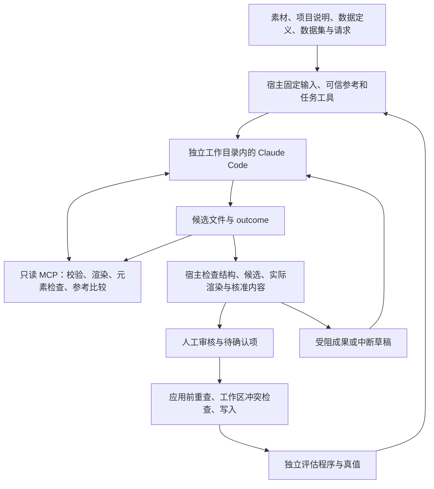

# Agent 设计模板 DSL：harness 工程评估与优化建议

日期：2026-10-23。审查基线：`4a1323670bb56f439614fcdc570d3050280e71e5`，MCP 合同 `0.10.1`。范围是 RenderWeave 的业务 Agent 任务、模板 DSL、工具反馈、成果审核应用与评估系统；服务端出图能力只作为阶段 5 的已有基础。

## 判断

**当前工程成熟度评为 7.1/10：已具备内部代建的完整基础，下一阶段最值得投入的是验证可信度、审核一致性和任务恢复。保持“单个生成 Agent + 确定性宿主 + 按需独立评审”，不重写 Agent 循环，也不先扩成多个常驻 Agent。**

证据是本轮构建、类型检查、191 个聚焦回归用例，以及中英文各 8 个受控视觉场景全部通过；与此同时，最小反例实测暴露了两处现有测试未覆盖的缺口：366 的站点顺序错误/多报仍可通过评分判据，资源版本变化后旧审核预览仍可能被用于批准和应用。最新两份真实模型评估各为 7 个 `pass`、1 个额度原因的 `invalid`，完整门槛均为 `incomplete`。

**面向阶段 5 客户自助、直接发布的就绪度另评 4.5/10。** 这是切换场景后的判断，不与当前内部代建总分混算。阶段 5 已接受的方向是人类与 Agent 共用能力面、默认直发、可选审批；不能因为当前需要审核，就把永久人工批准重新写成架构前提。见 `docs/adr/0022-agent-human-capability-parity.md:11`。

本文的分数是基于下述标尺和代码证据的工程判断，不是模型成功率、视觉相似度或行业排名。建议均待后续采纳，本轮没有新增 M 编号、修改 ADR、关闭票据或修复实现。

## 本轮验证与证据范围

| 检查 | 本次结果 | 能证明什么 |
|---|---|---|
| `npm run build` | 退出 0 | 当前代码可构建 |
| `npm run typecheck` | 退出 0 | 当前类型检查通过 |
| Agent、MCP、DSL 聚焦回归 | 10 文件、191 用例通过，48.31 秒 | 现有自动断言通过；不是完整仓库回归或真实模型质量验证 |
| `accept-agent-visual.mjs … zh` | 8 场景及 DPI 对照通过 | 中文受控缺项、字号、位置、错字、颜色等反馈方向正确 |
| `accept-agent-visual.mjs … en` | 8 场景及 DPI 对照通过 | 英文受控反馈方向正确；不是英文真实模型纠偏 |
| 366 评分反例 | 反序与多报的 `judge` 均无失败项 | 业务评分门槛存在漏检 |
| 资源更新后的审核与应用探针 | 旧审核仍批准，应用成功，实际出图已改变 | 审核所见与应用结果未完整绑定资源版本 |

运行环境为 Windows、Node `v24.12.0`、npm `11.6.2`。项目要求 Node >=22；本轮没有另跑 Node 22 或 Linux。首次测试遇到沙箱临时缓存 `ENOENT`，改用仓库内临时目录后又遇到本地连接 `EACCES` 与链接 `EPERM`；在获准的沙箱外重跑同一批测试后全部通过。没有为通过测试修改源码。

研究采用并行的一手资料检索、独立代码审查及本地探针；外部文献的版本、结论和适用限制见[一手来源笔记](2026-10-23-agent-dsl-harness-primary-sources.md)。历史真实模型结果来自仓库记录，本轮没有调用付费模型；研究资料和本轮测试不能替代票据 38 的真实验收。

## 当前 harness 的实际结构

这里的 harness 指围绕模型的执行、工具、状态、反馈、权限和验证机制。RenderWeave 已有两层：Claude Code 提供模型与工具调用循环；业务宿主负责输入、成果和交付边界。独立的评估程序再通过产品路径测它们的组合。



关键实现对应：

- 四类任务按前置条件、候选种类、参考资料和工具集合划分，模板任务默认 80 轮，提取任务 40 轮：`src/agent/tasks.ts:28`。
- 参考、内容事实与检查上下文保存在 Agent 工作目录之外，交回前后共用规则；实际提示词和资料另存：`src/agent/run.ts:373`、`:385`。
- 执行环境按白名单组装，使用独立配置目录、受限工具和严格 MCP 配置；Google 代理只将本轮令牌交给执行器：`src/agent/run.ts:395`。
- 技术检查区分未检查、可渲染、受阻，模板实际渲染有严重问题会阻止应用：`src/agent/assessment.ts:22`、`src/agent/review.ts:539`。
- `compare_reference` 为本次真实渲染读取的资源字节记哈希，并绑定参考、工作区与构建：`src/agent/visual-comparison.ts:35`、`:59`。

需要保留这些边界。外部通用框架不会自动提供 RenderWeave 的领域校验、毫米布局证据、资源版本或模板规则验证；替换框架无法直接解决本次找到的缺口。

## 多维评分

标尺：5 分表示已有可运行闭环但关键覆盖不足；7 分表示适合受控使用、主要边界明确；9 分要求代表性场景、故障和独立验收有持续证据。权重按当前“内部代建模板”目标分配，DSL、视觉反馈与评估共占 45%。总分为 `Σ(权重×得分)/100 = 7.125`，显示为 **7.1**。

| 维度 | 得分 / 10 | 权重 | 主要依据与扣分原因 |
|---|---:|---:|---|
| DSL、确定性渲染与候选契约 | 9.0 | 15% | JSON Schema 与引擎检查分工，公开入口、实际渲染、结构化问题清单；本轮 DSL 回归通过。语法合法仍不能证明业务内容正确。见 `src/agent/candidates.ts:39`、`src/agent/assessment.ts:29` |
| 任务分解与工具接口 | 8.5 | 10% | 按任务收窄工具，预览、元素定位、差异范围和参考比较形成有效反馈；输出上限与分页已有回归。见 `src/agent/tasks.ts:28`、`src/mcp/tools.ts:305`、`src/mcp/server.ts:15` |
| 上下文组织 | 8.0 | 10% | 项目说明、领域约定、通用做法有优先级，示例避免直接泄漏评估答案；但模板任务仍要求先读全部资料，缺少按阶段检索和收益实测。见 `agent/README.md:5`、`agent/tasks/template-design.md:4` |
| 视觉与内容反馈 | 7.5 | 15% | 可信参考、多维局部差异、源模板定位、真实内容三联图、未知状态；最终遮挡/对比度未核查，真实英文和多样式独立验收不足。见 `src/agent/style-verification.ts:135`、`docs/agent-visual-live-acceptance.md:39` |
| 评估判据与泛化证据 | 5.0 | 15% | 产品路径、真值、压测与故障分类齐全；仅两张中文线路牌覆盖四场景，顺序/多报漏检，两版门槛未完成。见 `scripts/agent-eval/config.json:1`、`scripts/agent-eval/eval.ts:424` |
| 长任务控制与故障恢复 | 6.0 | 10% | 轮次链、受阻草稿、硬额度停止已实现；宿主中途崩溃恢复、整轮时间预算、按质量保留最佳候选不足。见 `src/agent/run.ts:425`、`:473`、`src/agent/review.ts:1183` |
| 审核、应用与一致性 | 6.5 | 10% | 候选哈希、工作区冲突、应用前重渲染较扎实；已实测资源变化后审核未失效。见 `src/agent/review.ts:496`、`src/agent/preview.ts:56` |
| 权限与信任边界 | 7.0 | 5% | 本地受限运行、只读 MCP、宿主固定基准、代理令牌合理；未证明面向不可信客户输入的端到端注入防御与托管隔离。见 `src/agent/run.ts:373`、`:395`、ADR-0015 的托管前置项 |
| 可观测、来源与实验复现 | 7.5 | 5% | 提示词/资料/构建/工具耗时与大小都有记录；续跑实验身份校验不足，重试删除旧轮次影响证据链。见 `src/mcp/server.ts:73`、`scripts/agent-eval/run.ts:70`、`scripts/agent-eval/eval.ts:274` |
| 成本与性能治理 | 5.5 | 5% | token、缓存、thinking、耗时、推理力度可追踪；缺完整尝试成本、成功订单成本、人工时间和整轮预算。见 `src/agent/run.ts:99`、`scripts/agent-eval/eval.ts:543` |

这不是“所有能力都差一点”：确定性工具和领域模型是优势，主要风险集中在评价是否可信、审核依据是否保持不变，以及失败后能否恢复。

## 本次确认的关键问题

### 1. 366 评分会放过整表反序和多报站点

**已验证。** 用真值构造三个内存输入，调用正式评估使用的 `scoreTranscription` 与 `judge`：

| 输入 | 站点数 | 命中站名 | 顺序 LCS | 多报 | 判定失败项 |
|---|---:|---:|---:|---|---|
| 真值原序 | 59/59 | 59 | 59 | 无 | `[]` |
| 全部反序 | 59/59 | 59 | 1 | 无 | `[]` |
| 增加不存在的站 | 60/59 | 59 | 59 | 1 站 | `[]` |

评分器已经算出 `namesInOrder`、`unexpected` 和图标 `extra`，见 `scripts/agent-eval/score.ts:134`；通过判定只检查站名、地标和设施的命中数量，见 `scripts/agent-eval/eval.ts:424`。独立审查又用真实 0.10.1 候选验证：原候选命中 58 个站名，反序后 LCS 为 1，产品共用候选校验和评分判定仍均无问题。此处没有声称重跑了整个模型任务。

**建议优先修复判据，保留人工核准的容错政策。** 顺序是线路牌业务语义；可允许少数难辨字待确认，但不能因命中足够多站名而容许整表反序。增加有序匹配、额外/重复项、地标/设施误报门槛；同名站点应按出现次数和顺序对齐，不能简单要求名称全局唯一。

同时扩充模板反事实检查：换数据后不仅“没有严重渲染问题”，还要断言目标文字、实例数量、状态样式和参数确实改变。目前模板压测主要以严重问题数判定，见 `scripts/agent-eval/score.ts:221`、`:240`。这有助于识别把示例值写死、只对一张图正确的模板。

### 2. 资源更新后，审核所见可能不是实际应用结果

**已验证，主代理与独立审查各复现一次。** 在独立临时资源仓库中：生成只引用一张图片的模板 → 审核通过 → 相同资源 ID 合法追加 v2 → 再读审核 → 应用 → 重新渲染。结果：

```text
verdict = qualified
previewPathUnchanged = true
cachedPreviewBytesUnchanged = true
reviewStillApproved = true
applySucceeded = true
applyProblems = []
freshCurrentRenderDiffers = true
```

旧审核图哈希为 `eecc9bf57bb023b1b9fa6690f72c9bfae896aa8a734523fda3dbdb87d3fd388a`；新资源实际渲染与应用后图均为 `cdc84d527a06d6ce4de6c695c31a0c3d1eec5430fe7dbb2e8a39f4cf46df862e`。原工作区、仓库夹具和真实资源没有改动。

根因链路：轮次只记资源目录（`src/agent/run.ts:362`）；审核重新载入当前资源（`src/agent/review.ts:662`）；预览缓存键没有资源版本/字节（`src/agent/preview.ts:56`）；应用前重渲染拦截的是渲染受阻，不是与审核图一致（`src/agent/review.ts:539`）。`compare_reference` 本身记录实际资源哈希，并不等于审核应用全链路已固定资源。

**建议复用已有资源版本固定能力。** 将本轮使用的资源版本映射纳入审核摘要和缓存键；应用时发现相关资源变化，旧审核失效，重新预览并核准。已有 `VersionedResourceStore.pin(versions)`，见 `src/versioned-resources.ts:28`、`:261`，不需要重造资源系统。长期仍可遵守“资源引用跟随新内容”的领域规则；需要保证的是本次审核到应用之间的内容一致性，而非让模板永远锁死资源。

### 3. 有中断草稿，但还不是可持久恢复的任务执行器

**代码已确认：** `round.json` 在执行结束、成果检查之后才写出（`src/agent/run.ts:473`）；`--from` 又先要求它存在（`src/agent/review.ts:1183`）。当前捕获模型失败、硬额度停止后恢复草稿的行为不能推出宿主被杀死、断电后也能直接续跑。此次没有杀真实业务进程。

建议启动即写任务记录，使用原子更新与追加事件保存阶段、候选清单、哈希和停止原因；候选每完成一版保存不可变检查点。恢复读取最后一个通过校验的检查点，损坏文件保留诊断，不补造完成状态。先使用本地文件实现；达到托管调度需求后再引入数据库队列或工作流服务。

此外，`maxTurns` 与 API 单次超时已经存在，但它们不是整轮时间/费用预算。应增加宿主控制的总时限、token 或调用量上限、停滞检测，触发后保存当前最佳有效候选并说明剩余问题。最佳候选按硬约束和分项缺陷判定，未经校准不以视觉总分自动替换。

### 4. 评估有来源记录，但续跑未充分锁住实验身份

**代码已确认：** 同一 label 续跑检查场景 ID，沿用旧 provenance，同时可以使用当前模型、端点和 effort；见 `scripts/agent-eval/run.ts:70`。报告 runtime 取首个记录，合同号取当前源码常量，见 `scripts/agent-eval/eval.ts:545`。这存在混合配置的入口；本次没有证据表明两份已隔离构建的报告发生混版。

建议用不可变实验清单绑定：执行器版本、模型配置、引擎构建、MCP 合同、提示词与资料、评分器、场景配置、真值、图片、资源版本、运行预算。续跑先逐项比对，不一致另建实验；重新评分产生新报告并指向原始尝试。

重试也应保留每次尝试。现在 `launchRound` 先删除旧轮次（`scripts/agent-eval/eval.ts:274`），成本汇总读取剩余轮次（`:543`），历史错误摘要不能还原所有耗费。采用 `attempt-001/002` 加追加记录即可，不需要引入完整观测平台才解决。

### 5. 回归集成熟度高于泛化证据

**已核查当前配置与最新报告。** 四场景是 M402 数据定义、M402 模板、M402 修改、366 转录，来自两张中文线路牌；M402 模板从已有专家数据定义和数据集起步，不能代表从新示例图开始的完整订单。配置见 `scripts/agent-eval/config.json:1`。

| 最新报告 | 当前单元结果 | 完整门槛 |
|---|---|---|
| `2026-10-22-visual-feedback-0100.json` | 7 pass，1 invalid；366 第二次受额度影响 | incomplete |
| `2026-10-23-visual-feedback-0101.json` | 7 pass，1 invalid；366 第二次受额度影响 | incomplete |

依据分别为 `docs/agent-eval/reports/2026-10-22-visual-feedback-0100.json:813`、`:896` 与 `docs/agent-eval/reports/2026-10-23-visual-feedback-0101.json:815`、`:881`。两份文件在本轮开始时已存在且未跟踪，本轮仅读取。`docs/agent-visual-feedback-results.md` 的 5/8 是旧时间点的快照，不能代替最新 JSON。

**四场景门槛也不等于新视觉反馈的端到端验收。** 当前评估发起器没有传入 `--reference` 或 `--content-baseline`，见 `scripts/agent-eval/eval.ts:55`、`:174`。收齐它能证明新版运行环境下既有场景的回归情况，不能证明模型已经有效使用可信参考与内容核查；需要另设带基准的真实纠偏场景，并把它逐步纳入评估配置。

连续两次达线适合回归放行，不足以估算客户成功率。例如真实单次成功概率若为 70%，独立两次都成功的概率仍为 49%；两次成功不能证明接近 100% 稳定。不能把四种不同任务简单混成同一个成功率，也不能反复重跑只选最好的两次来说明可靠性。

建议保留现有小集，再建立按模板家族隔离的留出集：中英文、线路牌与价签、横竖排、长文本、重复/同名项、可选信息、新状态、低清素材、局部修改。首批可选 12–20 个业务案例，每个固定预算下重复 3 次作为工程发现集；这个数量仍不是生产置信度保证。校准集与留出集不能共享同一参考图的退化版本。

## 一手研究对本项目的启发

下表区分外部研究结论和本项目推断。详细版本与来源见[来源笔记](2026-10-23-agent-dsl-harness-primary-sources.md)。

| 研究或落地方案 | 可借鉴的机制 | 本项目的取舍 |
|---|---|---|
| Anthropic，2026：长期应用开发 harness | 将生成与评价分离，使用结构化交接和具体评价标准；模型能力提高后重新审视编排复杂度 | 保留单生成 Agent；为难样例增加独立局部评审，先验证是否提高修复率。不要把“创新设计”评分移植到严格还原示例图任务。[官方实践](https://www.anthropic.com/engineering/harness-design-long-running-apps) |
| Anthropic，2026：Agent evals | 评价真实终态，结合代码、模型和人工判断，区分回归与能力评估 | 保留产品路径回归，增加评分器反例、留出集和人工盲评；工具调用成功不等于交付成功。[官方实践](https://www.anthropic.com/engineering/demystifying-evals-for-ai-agents) |
| Anthropic，2025：context engineering | 按需取得高信号资料，工具返回应清楚且紧凑 | 先测按阶段读取 DSL 参考和局部差异，避免把长模板、全部参考和全部问题反复放入上下文。[官方实践](https://www.anthropic.com/engineering/effective-context-engineering-for-ai-agents) |
| OpenAI，2026：harness engineering | 将简短入口作为知识地图，详细资料版本化，并使环境反馈和约束可以被工具检查 | 保持现有文档分层；把反复出现的错误转为可执行判据，自动检查合同、参考和样例的一致性。[官方实践](https://openai.com/index/harness-engineering/) |
| Stripe，2026：Minions blueprint | 在同一工作流中组合确定性步骤与灵活的 Agent 循环 | 冻结输入、最终检查、预算和保存由宿主确保执行，模型决定局部修复方法；不照搬其 CI 次数上限。[官方实践](https://stripe.dev/blog/minions-stripes-one-shot-end-to-end-coding-agents-part-2) |
| Design2Code，NAACL 2025；DCGen，FSE 2025 | 将视觉还原分解成文字、布局等可诊断维度，分区处理复杂页面 | 支持当前区域反馈方向；HTML/CSS 实验收益不能直接作为毫米 DSL 收益承诺。[Design2Code](https://aclanthology.org/2025.naacl-long.199/)、[DCGen](https://doi.org/10.1145/3729364) |
| CANVAS，2025 预印本及作者实现 | 工具驱动的 UI 设计基准分别评估整图复制与局部修改 | 新模板看覆盖，修改任务同时看目标满足与非目标保留；它不是 HTML Canvas 渲染器研究，也未验证数据驱动模板规则。[论文](https://arxiv.org/abs/2511.20737)、[作者实现](https://github.com/kixlab/CANVAS) |
| XGrammar-2，2026 作者论文 | 为动态结构生成提供约束解码机制 | 仅当结构错误占比显著且当前模型服务支持时试验；语法约束不能取代引用、作用域和实际渲染检查。[作者论文 v4](https://arxiv.org/abs/2601.04426v4) |
| AgentDojo 与 CaMeL | 从不可信环境数据带入的指令需要独立权限和数据流边界 | 素材文字、客户数据与模型备注不能提升工具权限或改变可信参考；在阶段 5 写入开放前增加实际攻击测试。[AgentDojo](https://arxiv.org/abs/2406.13352)、[CaMeL](https://arxiv.org/abs/2503.18813) |

架构判断：评价器可以独立，但不应复制一份渲染规则。技术校验共用引擎能保证一致性；业务真值、保留样本和人工判断独立，才能发现引擎或评分器共同犯错。结构约束解码可以减少 JSON 语法错误，却不能证明站序、绑定或最终视觉正确；当前优先级低于已实测的业务判据缺口。

## 推荐实施顺序与完成标准

下列 P0/P1/P2 表示本研究建议的投入顺序，不是已创建票据的状态或安全漏洞定级。工期仅给相对规模，避免在未拆票前承诺天数。

| 顺序 | 工作 | 规模 | 可验收的完成标准 |
|---|---|---|---|
| P0-1 | 补 366 的顺序、多报、重复与图标误报判据；为模板加反事实语义断言 | 小 | 本文反例被拒绝，原合法例仍达线；同名站点合法序列不误伤 |
| P0-2 | 将资源版本绑定到轮次、审核和预览缓存；应用前校验相关资源变化 | 中 | 本文探针不再用旧批准应用新资源；重审后成功；变更未使用资源不必无谓阻断 |
| P0-3 | 评估清单严格锁定；每次尝试独立保留 | 小至中 | 改模型/资料/评分器后同 label 续跑被拒绝或新建实验；所有尝试可追踪与计量 |
| P0-4 | 在固定构建与判据下收齐当前回归门槛；明确旧判据与新判据报告关系 | 取决于额度 | 四场景所需有效次数完整，invalid 另列；不拼接合同、构建或评分器的结果；带参考的真实纠偏单独验收 |
| P1-1 | 宿主持久任务状态、原子检查点、整轮预算与停滞退出 | 中 | 杀宿主后可恢复最后有效候选；超预算可靠停止；不把草稿伪装成完成成果 |
| P1-2 | 英文真实纠偏、中英文多样式/状态与冻结留出集 | 中 | 报告逐案例、全部重复结果、错误类别、人工分钟；质量失败与基础设施失败分开统计 |
| P1-3 | 核查最终像素可见性，加入遮挡、出界、透明度、低对比、错误图片反例 | 中 | 被挡住的正确文字不算“已覆盖”；无法可靠测量的保持未知并进入独立审核 |
| P1-4 | 上下文和修复策略对照实验 | 小至中 | 相同模型/预算/样本下比较成功率、修改范围、P50/P95 延迟、总调用量；收益成立再默认启用 |
| P2 | OCR 草拟区域、结构约束输出、按需视觉评审与模型路由 | 逐项试验 | 降低核准劳动或提高保留集质量；不恶化关键错误误通过率，费用可解释 |
| 阶段 5 前置 | 按 ADR-0022 接共享写入能力、角色、审计、修订回退；托管时补容器与网络隔离 | 独立规格 | 越权、跨租户、重复提交、版本冲突、提示注入、失败恢复均从真实入口验证 |

**最先做 P0-1 与 P0-2。** 它们直接影响“评分说对”和“用户审核过”的可信度，比换模型、增加常驻 Agent 或加入另一套视觉总分更接近当前失败根因。

### 上下文优化具体怎么试

本轮测得模板任务相关五份材料合计 46,140 UTF-8 字节：通用做法 6,201、模板参考 24,781、成果参考 9,204、领域约定 2,892、任务提示词 3,062；尚不含项目说明、请求和工具 Schema。这是字节数，不是 token 数，也不能仅据此断言上下文过大。

先保留简短的强制规则与目录：命名、单位、作用域、交回格式、能力边界。按模板阶段检索“循环/子模板”“文本与适配”“状态与变量”等章节；错误按代码聚类，反馈只显示当前目标和必要邻域。用现有全量阅读作为对照。若按需读取增加漏约束或反复查阅，就保留对应章节前置，不能为了压 token 降低可靠性。

### 质量闭环具体怎么增强

建议宿主保存每个候选的内容哈希、比较报告 ID、关键缺项、目标问题、已修复/新增问题和预算余量。模型一次修少量相关问题，复测同一清单，并用不同数据/参数检查模板规则。停滞或预算触发时返回最好的一版和剩余问题。

独立视觉评审只处理确定性测量覆盖不了的内容，输入为参考、真实内容图、局部图和明确标准；先不给生成过程的自我解释，减少锚定。结论必须指向区域和可核查事实，争议由人工标注解决。不能把多个同类模型投票当作自动真值。

### 成本应按成功交付计算

最新两份历史报告中的各轮耗时求和约为 106.7 与 91.0 分钟；输出分别为 417,001 与 433,838 tokens，其中 thinking 已包含在输出中，不能重复相加。新版有并行，91 分钟不是整次实验的墙钟时长。报告没有完整表达被删除重试的全部费用，也不能据此推导每单金额。来源：两份报告的 `totals`，分别自第 938 与 923 行起。

建议最终同时报三组指标：

- 质量：技术合格率、内容关键错误率、视觉盲评结果、换数据后正确率、越界修改率。
- 交付：全流程成功率、首次通过率、P50/P95 墙钟时间、硬额度/上游失败率、审核与修正分钟。
- 成本：所有尝试的 token/模型调用/工具调用、计价版本或订阅用量口径、每个成功应用订单的成本。

`invalid` 可以从模型能力统计中剔除，但仍属于交付可用性和成本分母。人审从 30 分钟降到 10 分钟可能比省少量 token 更有价值，需实测后排序。

## 复现入口

```powershell
npm run build
npm run typecheck

# Windows 沙箱中的临时目录需要可由测试子进程一致访问。
New-Item -ItemType Directory -Path out/harness-research-temp -Force | Out-Null
$env:TEMP = (Resolve-Path out/harness-research-temp).Path
$env:TMP = $env:TEMP
npx --no-install vitest run --project engine test/agent.test.ts test/agent-rounds.test.ts test/agent-review.test.ts test/agent-dataset-template.test.ts test/agent-eval.test.ts test/agent-coverage-verification.test.ts test/agent-style-verification.test.ts test/mcp.test.ts test/dsl-schema.test.ts test/dsl-template-schema.test.ts

node --import tsx scripts/accept-agent-visual.mjs out/harness-research-2026-10-23/visual-zh zh
node --import tsx scripts/accept-agent-visual.mjs out/harness-research-2026-10-23/visual-en en
```

评分反例无需历史模型目录，可以直接运行：

```powershell
@'
import fs from 'node:fs';
import {scoreTranscription} from './scripts/agent-eval/score.ts';
import {judge} from './scripts/agent-eval/eval.ts';
const truth=JSON.parse(fs.readFileSync('scripts/agent-eval/scenarios/366/truth.json','utf8')).stops;
const policy=JSON.parse(fs.readFileSync('scripts/agent-eval/config.json','utf8')).scenarios.find(s=>s.id==='366-transcription');
const rows=truth.map(s=>({name:s.name,...(s.landmark!==undefined?{landmark:'res:landmark-'+s.landmark}:{}),...(s.facilities?{facilities:s.facilities}:{})}));
for(const [label,stops] of [['baseline',rows],['reversed',rows.toReversed()],['extra',[...rows,{name:'完全不存在的站'}]]]) {
  const score=scoreTranscription(stops,truth);
  console.log(JSON.stringify({label,score,failures:judge(policy,{transcription:score})}));
}
'@ | node --import tsx --input-type=module
```

资源探针使用 `runAgentTask → readReview → changeReview(confirmRest/approve) → localResourceBackend.commit(append) → readReview → applyAgentRound → render`，执行器是仓库的 `test/support/fake-claude.mjs`。本机脚本与完整输出在 `out/harness-research-2026-10-23/probe-resource-review.mjs`、`out/harness-research-2026-10-23/resource-run-1792746302114/result.json`，均是忽略目录下的研究证据；换机不保证存在。关键输入是任意合法、只引用 `res:probe-image` 的图片模板，同 ID 的 v1/v2 使用仓库已有的两张不同图片，出图尺寸和 DPI 保持一致。

### 资源审核反例的完整脚本

将下列内容保存为仓库内 `out/harness-research-2026-10-23/probe-resource-review.mjs`，从仓库根执行 `node --import tsx out/harness-research-2026-10-23/probe-resource-review.mjs`。每次建立独立临时目录，使用假执行器，不连接模型服务；输出的布尔值和图片哈希可直接比较。

```javascript
// 本地公开入口探针：不调用模型，不改源码；每次在本目录创建独立数据目录。
import { mkdir, writeFile, readFile, cp } from 'node:fs/promises';
import { dirname, join, resolve } from 'node:path';
import { fileURLToPath } from 'node:url';
import { createHash } from 'node:crypto';
import { runAgentTask, readReview, changeReview, applyAgentRound, initializeResourceStore, localResourceBackend, loadWorkspace, render } from '../../src/index.ts';

const root = resolve(dirname(fileURLToPath(import.meta.url)), '../..');
const base = join(dirname(fileURLToPath(import.meta.url)), `resource-run-${Date.now()}`);
const store = join(base, 'resources'), workspace = join(base, 'workspace'), preset = join(base, 'preset'), round = join(base, 'round');
const sha = bytes => createHash('sha256').update(bytes).digest('hex');
const ensure = result => { if (result.problems.some(p => p.level === 'severe')) throw new Error(JSON.stringify(result)); return result; };
await mkdir(base, { recursive: true });
await cp(join(root, 'fixtures/workspaces/single-text'), workspace, { recursive: true });
ensure(await initializeResourceStore(store));
const backend = localResourceBackend(store);
const first = ensure(await backend.commit([{ type: 'create', id: 'probe-image', kind: 'image', bytes: await readFile(join(root, 'fixtures/resources/images/test/quadrants.png')) }]));
await mkdir(join(preset, 'candidates'), { recursive: true });
const template = { dslVersion: 'renderweave-template/1', name: 'ResourceProbe', base: { name: '问候', version: 1 }, artboard: {
  sizeRange: { width: { min: 10, max: 100 }, height: { min: 10, max: 100 } }, fill: '#FFFFFF', layout: { mode: 'free' },
  children: [{ type: 'image', name: 'Picture', source: 'res:probe-image', place: { left: 0, top: 0, width: { fixed: 40 }, height: { fixed: 40 } } }],
} };
const request = { template: 'ResourceProbe', dataset: { id: 'ds-greeting' }, parameters: {}, output: { width: 40, height: 40, dpi: 50, format: 'png' }, mode: 'final' };
await writeFile(join(base, 'brief.md'), '测试临时资源');
await writeFile(join(base, 'request.json'), JSON.stringify(request));
await writeFile(join(preset, 'candidates/template-probe.json'), JSON.stringify(template));
await writeFile(join(preset, 'outcome.json'), JSON.stringify({ candidates: ['candidates/template-probe.json'], pending: [], notes: '临时探针' }));
const result = await runAgentTask({ task: 'template-design', sample: join(root, 'fixtures/resources/images/test/quadrants.png'), brief: join(base, 'brief.md'), resources: store,
  workspace, out: round, dataset: 'ds-greeting', request: join(base, 'request.json'), key: 'fake-local-key', keyEnv: 'RW_FAKE',
  claude: { command: process.execPath, args: [join(root, 'test/support/fake-claude.mjs'), preset] } });
const initial = ensure(await readReview(round));
if (!initial.view?.preview?.image) throw new Error(JSON.stringify(initial));
const before = sha(await readFile(join(round, initial.view.preview.image)));
ensure(await changeReview(round, { type: 'confirmRest', confirmed: true }));
ensure(await changeReview(round, { type: 'approve' }));
const updated = ensure(await backend.commit([{ type: 'append', id: 'probe-image', expected: first.committed[0], bytes: await readFile(join(root, 'fixtures/resources/images/m402/icon-metro.png')) }]));
const reread = ensure(await readReview(round));
const after = sha(await readFile(join(round, reread.view.preview.image)));
const current = await loadWorkspace({ dir: workspace, resourcesDir: store });
const fresh = await render({ ...current, templates: [...current.templates, { name: 'ResourceProbe', document: template }] },
  { ...request, mode: 'draft', output: { ...request.output, dpi: initial.view.preview.dpi } });
if (!fresh.image) throw new Error(JSON.stringify(fresh.problems));
const apply = await applyAgentRound({ roundDir: round });
const appliedWorkspace = await loadWorkspace({ dir: workspace, resourcesDir: store });
const appliedRender = await render(appliedWorkspace, { ...request, mode: 'draft', output: { ...request.output, dpi: initial.view.preview.dpi } });
const report = { base, verdict: result.check.verdict, resourceBefore: first.committed[0], resourceAfter: updated.committed[0],
  previewPathUnchanged: initial.view.preview.image === reread.view.preview.image, cachedPreviewBytesUnchanged: before === after,
  freshCurrentRenderDiffers: sha(fresh.image.bytes) !== after, reviewStillApproved: reread.view.review.status === 'approved',
  applySucceeded: !!apply.applied, applyProblems: apply.problems, reviewedHash: before, rereadHash: after, freshHash: sha(fresh.image.bytes),
  appliedRenderHash: appliedRender.image ? sha(appliedRender.image.bytes) : null, appliedRenderProblems: appliedRender.problems };
await writeFile(join(base, 'result.json'), JSON.stringify(report, null, 2));
console.log(JSON.stringify(report, null, 2));
```

**下一步：先修评分判据与资源审核一致性，按本文反例验收，再锁定新版实验身份补齐 0.10.1 门槛；英文真实纠偏、独立多样式审核和留出集泛化尚未验证。**
