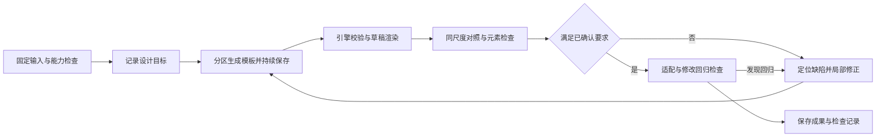

# 模板设计 Agent 的 harness/context 架构评审

- 日期：2026-10-22
- 代码基线：`0ab57b9d7b7d861f2060abf4f6821f4247f50c35`
- 范围：StaticSchema、示例数据集与示例图均已提供时的模板辅助设计与后续修改。
- 性质：架构建议与实施拆解依据；本文不修改已达成的 M 编号决定、DSL/MCP 合同或阶段排期，也不代表下述建议已经实现。

## 1. 判断与优先级

**最大的短板是：设计目标没有成为持续可检查的约束，因而“能渲染”与“设计合格”之间缺少可靠闭环。** 现有系统已经有隔离运行、资料装配、九个任务级 MCP 工具、草稿渲染、布局检查、成果校验与中断恢复；继续增加通用工具或直接换更强模型，不是本轮第一优先级。

证据是具体的：任务已经要求对照示例图、检查字号并验证极端情况，但没有把检查覆盖与当前候选绑定；成果评估的内容结论仍是 `needsReview`。模板评估的确定性视觉断言集中在两项 M402 特征，图像相似度只作参考。见 [任务提示](../agent/tasks/template-design.md#L20)、[成果评估](../src/agent/outcome.ts#L284)、[评估实现](../scripts/agent-eval/score.ts#L197)。

建议顺序：

| 顺序 | 改动 | 首要收益 | 先不扩大的范围 |
|---|---|---|---|
| P0 | 轻量设计目标记录、同尺度对照、检查覆盖与候选绑定；同步保存复现材料 | 能指出当前候选具体哪里不符合目标 | 不新建通用设计语言，不重写执行器 |
| P0 | 短核心、按需参考、上下文观测与可恢复交接 | 控制初始无关资料和长轮次累积，给设计核查留下空间 | 不把完整设计目标和评审记录再次全量常驻 |
| P1 | 关键状态与适配范围测试、独立视觉评审、失败样本与盲评基线 | 从示例图近似提升到可复用模板 | 不把模型自评分当合格凭证 |
| P1 | 配对示例、资源试排、降低常用 DSL 写法的成本 | 减少遗漏、重复探索与错误修复回合 | 不把更多范例全塞进初始上下文 |
| P2 | 图上定位反馈、局部修改、保留用户已确认的选择 | 降低用户纠偏成本，减少改一处坏一片 | 不做自由拖拽画布，不改变 M299 |
| 后置 | 模型选择、推理预算与多 Agent 编排 | 在同一评测下比较质量与总成本 | 不先假定大模型或多个 Agent 必然更好 |

这里的排序是**模板设计方向内部的建议**，不取代当前阶段 4 排期。首批以已有票据 [34](../.scratch/agent-template-authoring/issues/34-verify-element-styles.md)、[35](../.scratch/agent-template-authoring/issues/35-reproducible-runs-and-acceptance.md) 为实施入口；票据状态仍以各票据文件为准。

## 2. 输入前提与完成标准

### 2.1 任务从已有数据开始

- StaticSchema 是不可变的确切版本，示例数据集已绑定它；两者是模板绑定与数据校验的依据。
- 示例图提供视觉参考，不承担重新提取业务数据的职责。图中的示例文字可以与数据集内容不同。
- 项目说明与渲染请求还需给出画板物理尺寸、主模板名、参数、适用尺寸与数据范围、明确的客户要求。现有入口已经要求数据集与渲染请求，见 [任务定义](../src/agent/tasks.ts#L40)。
- 字体、图片资源与引擎能力决定可实现边界。缺少字号依据、图中有字段但 StaticSchema 无对应项、字体不可用时，记录具体缺口与替代方案；不擅自改 StaticSchema 或原始数据集。

这符合 M298：已有并绑定 StaticSchema 的数据集用于模板测试，不反向重新推导数据定义。数据提取任务仍独立存在，不纳入本文成功率或成本。

### 2.2 好模板同时满足六个维度

| 维度 | 合格意味着什么 | 不充分的替代指标 |
|---|---|---|
| 视觉还原 | 区块比例、对齐、字号层级、留白、色彩与素材符合项目目标 | 整图像素相似度高 |
| 信息表达 | 要求展示的语义角色绑定正确，必需信息与状态标签完整 | StaticSchema 的全部字段都画出来 |
| 可读性 | 在目标物理尺寸与使用条件下，文字大小、压缩与层级合理 | 没有溢出或严重问题 |
| 可复用性 | 在约定的数据、参数、状态与尺寸范围内仍成立 | 仅示例数据集出图正确 |
| 可修改性 | 反馈可定位，局部修改不破坏无关内容 | 新一轮看起来更好 |
| 可解释与可复现 | 每条结论能追溯到目标、输入版本、候选和检查结果 | Agent 说“已检查” |

可读性的阈值必须来自项目说明、领域约定或已确认基线，不能从图片像素任意推成统一毫米字号。字号配置、实际字号与墨迹高度是不同指标，应分别记录。

## 3. 当前 harness/context 的真实边界

这里的 harness 指执行器、输入装配、工具、校验与反馈循环；context 指模型实际收到的任务资料、工作状态及按需读取的内容。不要把本仓库开发 Agent 的上下文等同于业务 Agent 的上下文。

| 层 | 当前实现 | 对设计质量的判断 |
|---|---|---|
| 执行与恢复 | Claude Code 无头运行；按任务配置工具与轮数；宿主校验成果、保存轮次；受阻草稿与硬额度停止 | 已有可继续工作的基础，值得保留 |
| 任务输入 | 保存的数据集、其 StaticSchema、示例图、渲染请求、三层资料 | 输入足以开始设计，缺少贯穿各轮的明确设计目标 |
| 上下文文件 | 轮次中的 `docs/brief.md`、`guide.md`、`domain-*.md`、`dsl-reference.md`、`outcome.md`、`request.json`；示例图与候选目录 | 初始提示要求读全部文档；通用指南含其他任务的提取规则 |
| 内置工具 | `Read,Write,Edit,Glob` | 能维护模板工作副本；没有必要为本轮增加任意 shell 能力 |
| MCP 连接 | 一个 RenderWeave MCP 服务；模板任务开放九个工具，服务全部工具共十一个；当前合同 0.8.0 | 工具面覆盖设计基本操作，主要缺口是组织检查与消费证据 |
| 业务技能 | 可确认的显式装配是任务提示、领域约定、通用指南与 DSL 参考 | 尚缺按“分析、试排、核查、修改”组织的专门操作流程与产物 |
| 验收 | 引擎问题、成果评估、示例场景与压力数据；人工审核流程仍在本地实现中 | 技术有效性较强，内容与视觉合格需要更多证据 |

九个任务级 MCP 工具分工如下：

- 查上下文：`list_documents`、`read_document`、`list_resources`、`dsl_reference`。
- 实现与验证：`check_templates`、`render_draft`、`inspect_layout`、`view_image`、`check_outcome`。

对应装配代码见 [tasks.ts](../src/agent/tasks.ts#L40)、[run.ts](../src/agent/run.ts#L252)。根目录 `AGENTS.md`、`CONTEXT.md`、开发环境安装的 skills 和 MCP，不应直接算作业务轮次已获得的能力；应以实际启动配置及留存的提示和工具合同为准。

技能的价值在于明确的触发条件、操作顺序、输出与检查，是否打包成 `SKILL.md` 并不是当前质量瓶颈。后续如使用运行时技能机制，需单独验证它是否被加载、是否可调用、是否改善评估结果。

## 4. 证据支持的诊断及其限度

详细证据、代码行号与外部一手资料见 [证据附录](template-design-evidence.md)。

1. **有检查工具，不等于检查发生且覆盖完整。** 阿拉伯文历史模板轮调用过多次渲染与看图，工具日志没有 `inspect_layout` 调用；候选字号明显偏小。它证明中间候选缺少有效的样式核查，不证明模型在未受中断时最终一定失败。
2. **这个字号问题不能归因于 DPI 或缩字。** 本机诊断将 5.5 mm 改为 11 mm，实际文字尺寸随之增加，压缩比仍为 1；仅把 DPI 从 50 改为 100 不改变物理尺寸。11 mm 是诊断变量，不是所有项目的正确字号。阿拉伯文塑形错误仍是另一项引擎能力阻塞。
3. **现有通过记录有真实价值，但覆盖范围有限。** 第三阶段已有价签和 366 成功案例；当前评估也检查严重问题与适配。不能从单个受阻案例推导整体不可用，也不能从少数场景过门槛推导视觉质量稳定。
4. **文本指南有用，但尚不能替代结构化证据。** 当前提示已要求 `inspect_layout`、极端情况和未核实说明，再加一句“仔细检查”难以解决遗漏、陈旧证据和不一致评价。
5. **质量控制与写入授权必须分离。** 本地现状仍有审核/应用流程；[ADR-0022](adr/0022-agent-human-capability-parity.md) 已决定按角色直接写入与发布，人工批准只是可选租户策略。本文不恢复被取代的全局人工审批或永久只读 Agent 边界。

本轮架构判断是：先补目标、证据与反馈的闭环。改善幅度、模型间差异和成本收益尚需对照评估，不能据现有日志宣称某一提升百分比。

## 5. 目标工作流



每个阶段只携带完成下一步所需的信息。候选变化后检查记录必须失效或重算；用户修改需求后还要更新设计目标。能力受阻、额度耗尽与未完成检查都应保留可继续的工作状态，不把未验证项写成通过。

沿用现有任务提示与 ADR-0021：写出可读骨架就保存 `outcome.json`，每次修改后更新并核对，不等到最后才保存。Agent 有效交回的 `outcome.json` 与宿主恢复的 `draft.json` 必须区分。后者标记为 `hostRecovery`，只用于查看和续做，不能被当作已交回成果批准或应用；新的设计目标和检查记录不改变这条边界。

### 5.1 先形成轻量设计目标记录

建议以轮次内的 `design-spec.json` 保存，名称与字段只是实施提议，**它不是新增的渲染 DSL 或公开合同**。第一版只需服务核查和跨轮续做：

| 信息 | 内容 | 可信度来源 |
|---|---|---|
| 输入版本 | StaticSchema、数据集、示例图、渲染请求、资源与引擎版本 | 宿主计算的标识或内容哈希 |
| 坐标基准 | 示例图尺寸、有效画板裁切、目标物理尺寸、缩放对应关系 | 用户资料或可追溯测量；透视/裁切未知时明确标记 |
| 语义角色 | 标题、站名、价格、说明等角色，分别绑定字段、派生变量、参数或固定显示文字 | 项目要求、数据定义与模板规则 |
| 区块与样式 | 布局比例、对齐、字号层级、字体/字重、色彩、留白和素材 | 观测估计或确认基线，带容差 |
| 适配规则 | 哪些保持不变，哪些可换行、缩字、重排；支持的状态与范围 | 项目说明优先，领域约定其次 |
| 已知差异 | 缺资源、字体替代、引擎限制、尚未确认的选择 | 明确责任与处理方式 |

必须区分“用户已确认”“引擎实测”“图片观测估计”“Agent 推断”。Agent 从图中生成的框与样式只是待校准分析，不能因为被写进 JSON 就成为事实；符合 M220 对图上位置的边界。

信息覆盖的分母是**本项目要求展示的语义角色及其适用状态**，不是 StaticSchema 字段总数。对不展示的字段、不对应的样例文字、固定标签与装饰元素分别说明，避免把模板任务重新变成数据提取。

初始分析不应强制每个参数都向用户确认。能依据项目说明决定的直接决定；存在会改变交付目标的缺口时再请求补充，并继续不依赖该答案的工作。

### 5.2 把同尺度对照做成标准操作

先组合已有 `render_draft`、`view_image`、`inspect_layout`；如果反复调用与结果拼装成为主要成本，再把这一操作封装为单个比较工具。暂称 `compare_reference`，本文不确定其 API、参数格式或合同版本。

一次比较应提供：

- 原图区域与对应草稿区域，采用一致裁切与物理尺度，并分别提供可查看的图片；避免把两幅图独立放大到相同窗口后误判字号。
- 元素路径、语义角色、配置与实际字号、压缩比、墨迹尺寸、元素框、颜色、实际字体与替代信息；引擎暂未暴露的指标单列能力缺口。
- 相对已确认约束的差异；没有可信阈值的项目标为待评审，而非伪造精确误差。
- 覆盖清单：每种独立样式、关键状态都检查，重复元素逐实例检查几何与溢出；按需抽取代表实例供视觉审查。
- 无法比较的原因，例如图中内容与数据集不同、裁切未知、字体替代或透视失真。

整个画板看结构，局部区域看细节；局部均正常也不能替代整图层级检查。像素差只适合内容与资源一致的对照，不能惩罚本来就不同的站名或价格。

### 5.3 检查证据绑定当前候选

由宿主记录检查所依据的完整模板调用树及各文件哈希（含复用的已保存模板）、StaticSchema/数据集、请求参数、资源内容版本、引擎构建标识、示例图与设计目标版本。Agent 可以提出核查结论，但不能自行声明某个哈希已经通过。

第一版使用**整份检查记录失效**即可：任一输入变化，需重新渲染与检查。后续确有性能成本，再按元素依赖细分失效范围，避免过早引入复杂依赖系统。

覆盖情况至少区分：已验证、失败、未覆盖、不适用；附缺陷位置、依据与复查入口。旧的截图或检查过的上一个模板，不能替当前候选提供合格证据。发布或应用前的严重问题阻断继续由引擎负责。

### 5.4 质量检查分层，避免模型自证

| 层 | 可判断的内容 | 结果用途 |
|---|---|---|
| 确定性校验 | DSL、绑定、资源、严重问题、已确认的几何与字号约束、状态信息覆盖 | 对应条件的硬性通过/失败 |
| 视觉评审 | 层级、留白、局部风格、还原偏差、整体一致性 | 有位置与理由的缺陷清单 |
| 人类校准 | 领域可读性、偏好取舍、评审误报漏报与真实可用性 | 校准基线与处理需要用户决定的事项 |

可先在现有执行器内增加独立评审调用：读取固定目标、图片和实际布局，输出缺陷，不依赖生成过程的自我解释。它是后续候选方案，不要求先搭建多 Agent 编排服务，也不能当作独立真值。

修正循环按严重度与影响选择少量缺陷，记录修改理由，保留目前最好且可恢复的候选。达到回合/成本上限后交回已知状态；不能为了满足评审分数无限改写，或把最后一稿默认视为最好一稿。

## 6. 上下文与业务技能如何重组

### 6.1 从“全部先读”转为“核心常驻、阶段加载”

当前任务要求读全部资料，模板参考有 540 行、17,526 个字符（换行归一化后计）；通用指南还含数据定义提取规则。这里测的是字符而非 token。问题不是文档长本身，而是固定输入的设计任务要在不相关指令和大参考中自行挑选。

**第二轮 review 判断：原方案方向符合渐进式披露，但约束不够完整；当前运行时尚未按方案修改。** 把资料复制进轮次目录不等于注入模型，但任务要求全读后，正文就进入历史。当前 `dsl_reference` 只有 JSON Schema 支持按 pointer 读取，人读参考仍整份返回，不能把现有工具描述成已经支持参考文档的分段披露。见 [工具实现](../src/mcp/tools.ts#L403)与[实测记录](template-design-evidence.md#9-2026-10-22-本机上下文与技能加载实测)。

建议把常驻核心限制为：任务边界、明确客户约束与冲突优先级、输入标识、当前阶段/候选、未解决的高影响问题、短成果规则及资料索引。核心是可校验的任务摘要，不承载完整 DSL、全字段目录、完整设计基准或全部评审历史；本文两份架构文档也不进入业务轮次。

| 阶段 | 按需加载；不默认跨阶段全部保留 | 产物与退出条件 |
|---|---|---|
| 开始 | 项目说明与请求、所选 StaticSchema/数据集的目录及必要字段、当前任务的能力限制 | 固定输入可用，缺口可定位 |
| 参考分析 | 原图与当前区域、适用的领域视觉规则、相应基准条目 | 区块/语义/样式与适配目标 |
| 模板实现 | 当前区块的绑定、DSL 片段和最多一个起始范例、相关资源 | 工作副本可校验与渲染 |
| 样式核查 | 当前候选的目标条目、参考/草稿区域、摘要与高影响异常；详细测量按路径展开 | 当前候选的检查证据 |
| 局部修改 | 用户反馈、选中路径/状态、修改范围及相关原候选片段 | 局部差异与回归结果 |

按既有 M216 保留“项目说明 > 领域约定 > 通用做法”的优先级，不能在压缩摘要时丢失明确客户要求。DSL 参考保留完整来源，分段加载；不能仅给摘要而失去语法权威。

删除模板任务里的“先读全部文档”要求；数据提取、定义发布和不适用领域规则不应出现在它的默认任务资料中。成果格式先给模板任务所需的最小形态，其他任务的字段与示例按需查阅。文件复制、模型阅读和正文留在历史是三个不同动作，不能以目录中文件数量代替上下文统计。

分段披露须有可执行入口：第一步可拆分参考文件并给带版本的目录，或让已有文件工具按明确章节范围读取；若扩展 MCP 章节检索，按合同规则验收。已读且内容哈希未变的参考不重复全量返回。工具默认返回完成下一步所需的摘要、异常与索引，不把每次渲染的全部测量灌入对话；不得为了省上下文隐藏严重问题。

### 6.2 值得沉淀的四类技能

1. **参考分析**：分辨业务内容、固定文案与装饰；建立坐标基准、语义绑定、样式层级和不确定项。
2. **字体与资源试排**：以真实文字比较可用字体的尺寸、字重、覆盖范围与替代结果，避免凭字体名称猜效果。
3. **模板核查**：整图与局部同尺度比较，检查状态/样式覆盖、适配范围以及证据是否过期。
4. **局部修改**：先记录修改前基线，明确角色级或实例级作用范围，改后检查目标变化与无关回归。

每类技能都应有触发条件、短步骤、输入/输出和失败处理。先用可单独选择的任务资料实现并做对照评估，之后再决定是否采用特定运行时的技能封装。

示例材料优先采用“图片 + DSL + 输入/资源版本 + 为什么这样设计 + 失败与修正”的配对案例。只堆好看的图片缺少实现路径，只堆 DSL 缺少视觉理由。供 Agent 学习的案例与评估保留集分开，避免把答案教给模型后再评价泛化。

### 6.3 管理历史寿命，不能只控制新增资料

同一次 Claude Code 调用中，阶段切换不会自动移除早先读过的文档、图片或工具结果。完整 `design-spec.json`、覆盖记录、历史候选和预览保存在轮次产物中；常驻仅保留当前目标摘要、状态与回读索引，核查时按元素和状态展开。

上下文预算与最大轮数、费用预算分开管理：记录每请求有效输入、峰值、图片/工具结果数量与体积、重复读取和压缩事件；按端点实际 usage 口径计算，不能只看未命中缓存的 token。当前 Google 转换代理将输入拆成未缓存和缓存两部分，两者相加才对应其 `promptTokenCount`；现有轮次记录主要取末尾汇总，未记录峰值。见 [代理 usage 映射](../src/agent/model-proxy.ts#L285)、[轮次记录](../src/agent/run.ts#L637)。

每个模型/端点配置输出与下一次必要工具结果的余量，依据保留集测量预警和交接点；不规定“占窗口 50% 或 80% 就必然退化”。代理的 `count_tokens` 当前只是序列化字符数除以 4 的估算，不是精确 tokenizer，不能作为唯一安全依据；它是否影响当前执行器的自动压缩时机还需专门验证，见 [估算实现](../src/agent/model-proxy.ts#L100)。

先沿用运行时可用的压缩能力并观测效果；需要新调用接续时，保存候选、有效 outcome 或宿主恢复草稿、设计目标摘要、未覆盖项、输入哈希及索引，再按既有轮次机制恢复。不得声称宿主已经能在进行中的 Claude Code 会话中任意删除历史；显式交接须新增实现与恢复验收，且不能绕过硬额度停止。

验证压缩/交接后仍能遵守客户约束、正确定位元素、识别过期核查并恢复下一项工作。目标是减少无用上下文，同时保留完成任务的依据，不是追求最少字符。

### 6.4 业务轮次隔离个人编码技能

2026-10-22 在本机 Claude Code 2.1.296 上捕获了当前受限配置的实际模型请求：未发现 Matt Pocock 插件标识或其 code-review 正文；初始化登记的 16 项是运行时内置技能，两项插件也都标为 builtin。你的个人配置确实安装了 Matt Pocock，但不能据此认定业务轮次继承了它，详见[实测记录](template-design-evidence.md#9-2026-10-22-本机上下文与技能加载实测)。

建议业务执行器显式声明技能策略：当前任务仅靠文件资料和九个 MCP 工具即可工作时，增加 `--disable-slash-commands` 作为可评估的隔离选项；本机对照已验证技能登记清空且九个 MCP 工具仍连接。但本次系统提示和工具定义体积未下降，不能把它宣传为主要节省 token 的手段。此选项尚未写入 `run.ts`。

以后如采用业务专用 skills，改为明确列出获准的技能与内容版本，并验证实际请求；不继承开发者个人编码插件。启动登记、描述进入请求、正文加载与实际调用分别留证。升级运行时后重复检查，不能把当前版本的结果当作永久保证，也不必卸载开发者自己的技能。

## 7. 工具、资源和 DSL 的投资取舍

### 7.1 工具首先降低核查成本

现有九个工具先保留。增加工具要以减少完整操作的失败率与往返成本为理由，而非补齐工具名称清单。优先让渲染、布局和图像对照能共享同一次候选快照；无需先连接通用浏览器、Figma 或外部设计服务。

OCR 按 [票据 36](../.scratch/agent-template-authoring/issues/36-ocr-measurement-trial.md) 做测量试验，评估文本框测量是否改善样式核查；本文前提下它不负责替换已有数据集，也不预设它优于视觉模型与引擎几何信息。

### 7.2 资源元数据之后是实际试排

`list_resources` 已提供字体字重与覆盖文字。下一步有价值的是：真实文本样条、可用字重对照、实际替代链、图片尺寸与角色说明、与参考的已知差异。字体覆盖某种文字不代表引擎具备该文字的塑形与双向排版能力。

对阿拉伯文等已知能力限制，沿用严重问题与受阻草稿机制。不能靠翻转字符串、换个 prompt 或隐去问题把它包装成成功；更不能用这种受阻任务独占通用设计质量评估。

### 7.3 降低高频表达成本，控制 DSL 范围

历史站牌的途经站列表需要 12 个派生变量，整个标题区有 32 个，说明常用显示逻辑有实际书写成本；这还不能证明某种新语法必然更好。先以 [票据 37](../.scratch/agent-template-authoring/issues/37-text-list-and-fallback-display.md) 比较列表显示与空值回退方案。

遵守 [ADR-0004](adr/0004-derived-variables-without-text-expressions.md)：列表连接与缺省展示放在文本插槽，不新增派生 `join`；只有非文本属性确需消费连接结果时，才重新讨论该 ADR。新增写法同时遵守 [ADR-0016](adr/0016-dsl-1-compatibility.md) 的兼容要求。只有可运行对照能减少变量数、错误与修改成本时，才值得扩语法；届时同步共享样例与一致性检查。

## 8. 从 Claude Design 借鉴什么

公开资料支持借鉴“持续的设计上下文、多个方向、评论定位、直接调整、反复预览”的产品操作方式；不据此推测其未公开的内部 prompt、工具合同或评测体系。官方来源与原文适用边界见 [证据附录](template-design-evidence.md)。

RenderWeave 的重点应是：把设计选择留成下一轮仍然有效的约束，并让反馈指向具体对象。

- 用户指出“站名太小”，关联到元素路径、语义角色、状态与适用范围，形成有明确影响面的修改目标。
- 用户手动确认字体或某区块比例，写入设计目标；后续 Agent 修改时遵守，冲突时明确指出。
- 先用已有路径与修改差异记录。候选结构重排后路径失效则重新定位，不静默把评论套到另一个元素；有证据表明路径不足，再讨论稳定标识。
- 对“忠实还原”任务默认走一个明确方向；只有用户寻求探索或参考留有很大自由度时再生成多个方向，避免不必要的成本。
- 页面与 Agent 共享同一模板状态和修订，局部修改后同时展示预览与结构化差异；按 M299 做结构化属性、旋钮与评论定位，不扩成自由拖拽画布。

这些交互应放在阶段 5 的既定拆分中。首批无需等待完整在线工作台，命令行轮次与现有审核页也可以验证目标记录、比较与局部修正的价值。

## 9. 评估方案：分别测有效性、质量与成本

### 9.1 固定输入，避免把提取质量混入

建立横向线路牌、纵向列表与价签三类起始任务；每个任务固定 StaticSchema、数据集、示例图、请求、可用资源与目标说明。使用专家校准的目标和保留样例，而非把当前生成模板当唯一真值。

同一基线比较旧流程与新流程：模型/版本、推理预算、最大轮数、工具能力与材料版本需记录；改变多个变量时明确无法单独归因。报告首稿与收到反馈后的成果，生成、评审和人工时间分开记录，总成本一并统计。

每场景连续两次通过仍满足 M230 的现有门槛，但这不是稳定成功率的统计证明。用于模型排序或收益宣称时，需要更多独立运行、样本量与波动说明。

### 9.2 优先覆盖会破坏模板的变化

- 列表最少/最多项，短/长文本，可选信息缺失，重要状态及参数边界。
- 约定画板尺寸边界与 DPI 变化；前者可能触发适配，后者不应改变物理布局意图。
- 反馈后的局部修改：标题字号、一个状态配色、一个图标替换，并验证不应变化的部分。
- 有意构造的错误候选：明显小字、缺固定标签、错误状态、过期检查记录，用来检验评估器是否能发现缺陷。

变体必须通过 StaticSchema 与业务约束，不修改原始数据集。覆盖矩阵优先风险高的边界与交互组合，不要求所有变量做笛卡尔积。不同文字塑形能力单独作为能力边界场景。

### 9.3 不用单一视觉分数决定成功

当前相似度将图缩为 437×98 后计算平均像素差，容易稀释局部缺陷；背景占比、字体和实际文字不同也会影响它。保留为诊断信号，不升级成统一硬门槛。

结构断言检查已知要求；视觉评审必须报区域、问题、依据与影响；人类盲评比较还原、可读性和可复用性。还需报告自动评审的误报与漏报，防止评审器推动无意义修正。

## 10. 建议的验收矩阵与实施入口

下表是后续规格的验收建议，不是当前已经通过的检查，也不是新增排期承诺。

| 编号 | 场景 | 可观察的通过条件 | 主要入口 |
|---|---|---|---|
| A01 | 固定数据输入 | 生成期间不改 StaticSchema/原始数据集；缺绑定被明确报告 | 模板任务资料 |
| A02 | 同尺度对照 | 指定区域可追溯到参考像素与目标毫米；字号/墨迹指标分开 | 票据 34 |
| A03 | 样式与状态覆盖 | 独立样式和关键状态有记录；重复实例的几何异常可定位 | 票据 34 |
| A04 | 证据过期 | 改候选或未交回但参与渲染的依赖模板、数据、参数、资源、构建或目标后，旧记录不能被当作当前通过 | 票据 34、35 |
| A05 | 缺陷检出 | 小字、漏标签、错状态等已标注反例被发现，误报漏报可统计 | 票据 34、38 |
| A06 | 可复现 | 留存实际提示、运行时/工具合同、材料及候选哈希；敏感值不入库 | 票据 35 |
| A07 | 范围适配 | 约定边界数据/尺寸通过；已知文字能力限制单列受阻 | 压测与评估 |
| A08 | 局部修改 | 修改前后满足范围说明，未触及的关键视觉约束没有回归 | 已有修改评估 |
| A09 | 受阻与停止 | 硬额度/能力阻塞保存已知状态，不记成功、不无限重试 | 沿用 ADR-0021 |
| A10 | 权限分离 | 质量结论不引入全局人工审批；未来发布沿用角色及租户策略 | ADR-0022 |
| A11 | 真实收益 | 固定输入的对照运行报告质量、修正轮数、token、总时长与人工成本 | 票据 38 |
| A12 | 渐进式披露 | 初始提示无全读要求；默认核心不含无关阶段规则、完整 DSL 或全部基准；可按索引找回当前所需内容 | 后续上下文实施规格 |
| A13 | 历史预算与恢复 | 记录逐请求有效输入/峰值；触发压缩或交接后，客户约束、候选与未覆盖项可恢复；无过期证据复用 | 后续上下文实施规格 |
| A14 | 技能隔离 | 安装个人编码插件的宿主上，业务请求仍不带其描述/正文；允许的工具与任务技能按版本留证 | 后续运行时验收 |

建议按可交付切片推进：

1. **首个切片：34 + 35 的核心。** 一个参考区域到模板元素的目标记录、同尺度查看、实际指标、覆盖与失效、可复现材料，跑通一个固定输入任务。接着用其他样式/状态验证它没有硬编码首个例子。
2. **第二个切片：评估与适配。** 把反例、关键状态和范围数据纳入测试，用校准后的人工评审判断视觉收益。票据 38 跟踪既有门槛与原案例补验；新增跨领域质量对照的具体范围需记入对应实施规格，不自动扩大票据 38。
3. **第三个切片：效率与交互。** 测量上下文拆分、资源试排与票据 37 是否降低错误和成本；按阶段 5 接上定位反馈和局部修改。

合同与资料的验收分别处理：现有 0.8.0 按票据 38 补验；后续只改资料时记录实际资料哈希并复跑受影响场景，改变工具合同则按规则升版，以实际合同版本评估，不能把扩展能力记作旧 0.8.0 已验收。

若首个切片不能发现已知“小字但无溢出”的反例，先修正观测和评判方法，不扩大到更多工具或模型。若能发现但修不动，再用同一案例区分上下文、模型推理、DSL 表达与引擎能力的限制。

## 11. 对方案本身的 review

| 容易走偏的建议 | Review 后的约束 |
|---|---|
| 让 Agent 写设计规格，再按它自己写的规格打分 | 观测估计与确认事实分开；反例与人工校准从规格外部验证 |
| 对每个像素追求一致 | 数据内容允许不同；按语义角色、几何与风格比较，允许明确替代 |
| 所有字段都要显示 | 覆盖以项目要求和适用状态为准，Schema 负责数据合法性 |
| 调过一次检查工具就算完成 | 宿主记录覆盖和输入哈希，修改后失效 |
| 强制最小字号统一为某个值 | 阈值依项目/领域/用途确定，区分配置字号与实际墨迹 |
| 多加一个 reviewer 就可靠 | 它仍可能误判；保留有依据的缺陷，并用盲评校准 |
| 多候选、更多循环总会更好 | 固定预算，保留最佳候选，分别测首稿与修正收益 |
| 一次解决所有设计状态管理 | 先轮次文件和整份失效；证明成本后再做细粒度依赖 |
| 质量不确定就强制人工批准所有写入 | 不覆盖 ADR-0022；质量验证、角色授权与租户策略分离 |
| 原始图上失败说明整个 harness 失败 | 中断候选只证明已观测缺口；受阻能力与通用质量分开评估 |
| 在本分支直接更新所有任务资料与引擎 | 本分支只形成评审方案；实现需落实到对应规格、合同与验收 |

独立 review 提出了四项具体修正，已纳入本文：生成循环持续保存成果并区分恢复草稿；分开当前合同补验与未来扩展验收；核查覆盖完整模板调用树；明确不新增派生 `join`。这次 review 检查的是方案一致性与可验收性，不代表新增机制已经实现或效果已经验证。

2026-10-22 用户要求的第二轮 review 又补齐四处缺口：明确常驻核心与完整产物分开；章节检索落到实际入口；阶段加载之外管理历史与观测峰值；验证个人技能是否进入实际请求。上下文控制因此提前到 P0，与设计核查同步设计；新验收范围仍需进入相应实施规格，不改写现有票据的既定承诺。

## 12. 验证记录与下一步

本次结论建立在代码、任务资料、M 编号决定、ADR、已有评估和复跑报告的交叉核对上。探索阶段在原工作区运行过：

```powershell
npx vitest run test/agent.test.ts test/agent-dataset-template.test.ts test/agent-rounds.test.ts test/mcp.test.ts
```

结果为 4 个文件、94 个测试通过。这证明当时已有 Agent/MCP 路径的回归检查通过，不验证本文尚未实现的视觉质量方案，也不是本分支新增能力的测试。

字号/DPI 诊断来自本机忽略目录 `out/arabic-board-retest-2026-10-20/diagnostics/font-size.mjs`，新 worktree 不携带该目录；可移植事实与上下文见 [复跑报告](agent-arabic-retest.md)。后续按票据 35 固定可复跑材料，不能把本机历史文件当作团队共有 fixture。

本分支修改方案/证据文档、补充脱敏的上下文审查摘要与 `CONTEXT.md` 入口，检查本地链接目标、源码行号范围、代码围栏和空白格式。第二轮 review 使用本机假模型端点核查运行时请求，并复核历史 usage；未修改业务资料或实现，未新增或重跑付费模型评估。

下一步：以票据 34、35 细化首个切片的输入、记录格式与验收反例；现有 0.8.0 的待验收部分按票据 38 补验，后续实现按实际资料/合同版本及明确后的对照规格验证，本文不宣称这些真实模型评估已经完成。
