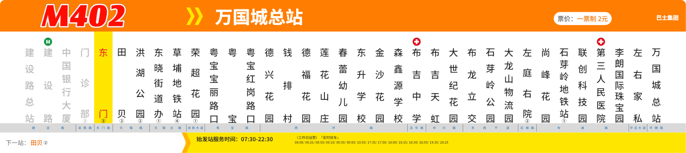
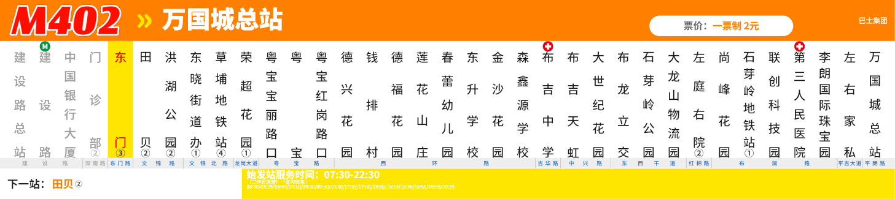
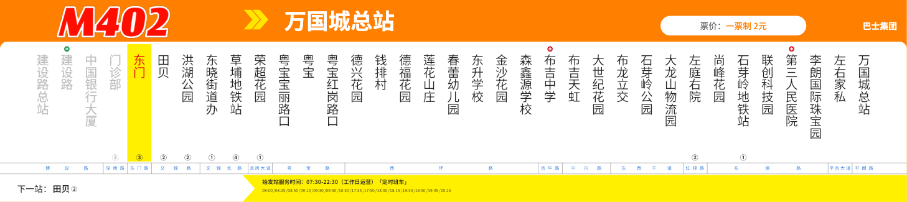
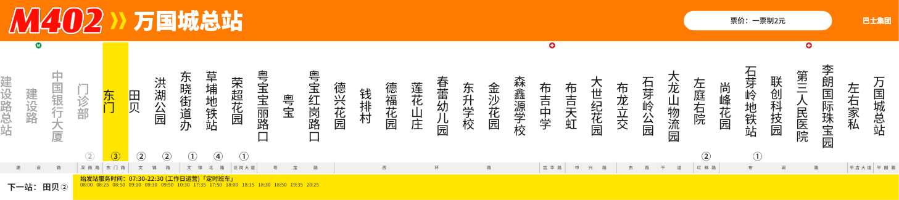

# 模板上下文 P0：实现与实测

日期：2026-10-22。分支：`template-design`。改前：`8f845f8`（修订后方案，尚未实施）。实现、规格和 ADR 见 [票据 01](../.scratch/template-design-context/issues/01-controlled-context.md)、[规格](../.scratch/template-design-context/spec.md)、[ADR-0023](adr/0023-agent-context-handoff.md)。本次落地上下文 P0，票据 34/35 的信息覆盖及样式核查不在本次验收内。

**判断：P0 已实现并通过测试、两轴 review 与 Haiku 5.5 门槛；起步减量有效，但没有证据表明长任务峰值或视觉质量得到稳定改善。** 模板设计平均峰值下降 3.75%，修改任务下降 31.37%；新建模板第二次峰值仍达 142,682 tokens。初版失败、修订依据和全部样本均保留。

## 已实现的行为

| 部分 | 改前 | 改后 |
|---|---|---|
| 任务入口 | 模板任务要求先读全部 docs，混有数据提取规则 | 短任务入口 + 958 字符核心；客户原文、需求与数据基准保留 |
| DSL | 17,526 字符整篇参考，另可通过 MCP 重复取回 | 索引 + 9 章，由同一原文生成；完整参考逐章可还原，完整示例保留 |
| 领域约定 | 提取与模板内容一起读 | 适用条件与模板章节；提取资料不复制 |
| 设计指导 | 通用指南包含提取、模板和转录指导 | 原指南的模板章节生成 template-guide.md，按可选元素、状态、文字排布的需要读取 |
| 占用观测 | 轮次末累计 usage，不能直接看单请求峰值 | context.json 按 message ID 去重，缓存计入有效输入，记录峰值/压缩/工具体积与运行时清单；未知不记 0 |
| 上下文停止 | 只有轮数/额度停止 | 可选 context-limit；响应 usage 达阈值后停止，保存已有成果及短交接，不自动重试 |
| 恢复 | 旧成果与审核记录；本轮反馈另读，历史反馈未完整保留 | 短交接优先，历史按问题取回；输入、资源内容、候选变化或交接被改则旧进度失效 |
| skills | restricted + 独立配置目录，仍登记 16 个内建 skills | 另加 disable-slash-commands，实际 skills 清单为空；开发者个人配置不变 |

上下文阈值是运维参数，不是行业通用“注意力溃散窗口”；它也不能阻止已发送的超大请求。stage 是 Agent 自述，不是阶段状态机，不会自动清空历史。进度保存不保证每次中断前都有 state；没有时从当前候选与原始要求继续。

## 改前/改后本地实测

运行真实 Claude Code 2.1.296，经公开 runAgentTask 启动真实 MCP。两个版本使用同一 M402 项目说明、工作区、请求、资源。模型端点为本地 SSE 脚本，要求取回同一起步资料：改前遵循全读，改后读短资料及前三章。示例图使用同一个有效占位图且不读图，不设计模板。**它验证装配和上下文体积，不测模型自主检索、视觉质量或真实 token。**

计量单位为 JSON 文本封套的 UTF-16 字符数（system + messages + tools，含历史与 Read 包装）。

| 指标 | 改前 | 改后 |
|---|---:|---:|
| 首请求文本封套 | 20,953 | 20,305 |
| 起步资料取回后文本封套 | 53,808 | 29,492 |
| 读取文件数 | 6 | 9 |
| 脚本端点请求数 | 2 | 3 |
| 运行时登记 skills | 16 | 0 |
| 运行时工具数 | 13 | 13 |
| MCP rw 状态 | connected | connected |
| 工具调用错误 | 0 | 0 |
| Matt Pocock 标记/编码审查正文 | 未发现 | 未发现 |
| 根目录 owner 指令 | 未发现 | 未发现 |

`c2aac1f` 复测起步资料取回后减少 **45.19%**，代价是按需取章多一次请求。两边工具定义仍为 10,511 字符，系统提示仍为 6,520 字符；主要收益来自减少任务资料，不应把总收益归因于禁用 skills。内建插件仍有两个元数据条目，不能宣称“所有插件都被移除”。完整捕获摘要见 [JSON](template-design-p0-context-audit.json)。初版 `0b6140f` 的同批实测为 54,063 → 29,575（45.30%）；补回指导后重新采集。绝对字符数还受运行时附加消息与轮次路径长度影响，比较应使用同批前后配对值。脚本只读取起步资料，没有读取按需设计指导，不能代表任意真实设计流程的资料总量。

复跑（两个目录须已 npm run build；输出目录用新的）：

```powershell
node scripts/agent-context-probe.mjs --before out/p0-baseline --after . --claude D:/nodejs/node_global/node_modules/@anthropic-ai/claude-code/bin/claude.exe --out out/p0-context-probe-boundaries
```

基线目录来自 `git archive 8f845f8`，附同一依赖和构建产物。脚本不接外部模型，不记录请求头、凭据或完整模型请求正文；usage 是明确的合成值，不列为 token 测量。

## 测试与 review

公开接缝测试涵盖短资料/章节完整性、缓存与重复 usage、未知 usage、压缩事件、工具结果文字/图片体积、非法预算、阈值主动停止、有效 outcome 与 hostRecovery 两种恢复、损坏/过大 state、输入/资源/候选/交接变更失效、审核修改后续接。

已执行 `npm run typecheck`、`npm run build`，均通过。规则恢复后的 `npx vitest run test/agent test/mcp.test.ts`：7 个文件、145 项全部通过，31.15 秒。最终 `npx vitest run --project engine`：**44 个文件、947 项全部通过，40.84 秒**。服务端与 Docker 测试不在本次回归范围，API/MCP 合同未修改。

## Standards

最终剩余硬性问题 0 项，possible smell 0 项。公开接缝、模块边界、渐进披露与个人技能隔离符合仓库标准。增量审查发现候选扫描可能读取以 .json 结尾的目录、阻断轮次落盘（本轴评为 P1）；已改为 lstat 过滤普通文件，无法获得完整快照时只使摘要失效并警告，补了公开入口回归。详见最终源码中的 candidateSnapshot。

## Spec

最终剩余 finding 0 项。初审发现历史反馈约束跨三轮丢失（P1）、新增候选未使旧摘要失效（P2）；已补反馈原文与索引、完整工作候选集合指纹及三轮/空集合回归。增量发现候选目录读取问题（本轴评为 P2），修复后复审通过。

两轴独立审查基线为 8f845f8。真实模型首轮失败后又审查了精简时的规则保留：恢复全部被调模板的极端尺寸约束；可选元素排布、状态切换和文字排布按需取回；不确定值及设计推断进入 pending。按原指南生成章节，保持单一权威来源。修订 `c2aac1f` 经两轴复审：Standards 硬问题 0、possible smell 0，Spec finding 0。审查不替代测试或真实模型门槛。

## 真实模型对照

三组统一使用 **claude-haiku-5-5**（主模型、小模型、服务端报告均一致）、Claude Code 2.1.296、MCP 0.8.0、默认推理力度。key 通过进程环境变量 OPEN_CODE_API_KEY 提供。示例图、工作区、项目说明、出图请求、修改要求的哈希逐场景一致。模板任务的 StaticSchema 与数据集均已提供，不从示例图重新提取。

- 改前 `8f845f8`：模板设计、模板修改各两次，[原始报告](agent-eval/reports/2026-10-22-template-design-p0-before.json)。
- 初版 `0b6140f`：四场景各两次，[原始报告](agent-eval/reports/2026-10-22-template-design-p0-initial.json)。
- 修订 `c2aac1f`：补回模板指导后，模板设计、模板修改各两次；提取任务资料与执行器未变，沿用初版的两次结果。

各组 jobs=1，改前与初版作业曾重叠运行。耗时记录为各轮之和，仅用于描述，不能当作隔离性能基准。早前有一次额度 429 和一次本机启动 ENOENT，均未产生有效样本；获得可用凭据后重做失效单元。以下结果没有把失效尝试计入成功率，也没有重试质量失败来择优。

### 初版失败与修订依据

初版 8 个单元中 7 个达线。数据定义、修改、366 转录均为两次达线；新建模板为失败、通过，因此初版门槛未通过。

首轮模板压测 **9/10**：两站场景中，站徽子模板的实际框为 **362 × 8 mm**，但声明宽度上限 **100 mm**，触发 render.sizeOutOfRange。Agent 自造的两站样本没有 badges 字段，没有执行这条渲染路径。原指南要求所有被调模板覆盖极端尺寸，短核心只概括成“验证边界”，明确约束被遗漏。错误已通过公开渲染入口复现，具体输入与错误见[失败证据](template-design-p0-initial-failure.json)。这是修订依据，单次失败不足以证明因果关系或普遍质量下降。

修订补回精确约束：主模板及全部被调模板覆盖目标尺寸与列表极值下的实际分配尺寸；边界数据复制原数据、仅改被测维度，可选字段缺省另测。复审发现的其他模板指导通过 template-guide.md 按需恢复。未修改任何评估样本、门槛或模型候选来消除失败。

### 修订后的结果

修订后模板设计、修改各连续两次达线，[原始报告](agent-eval/reports/2026-10-22-template-design-p0-final.json)。本次修订的资料哈希只变化于 template-core.md、template-outcome.md，生成的设计指导只供模板任务读取；提取任务使用的资料、执行器与 MCP 合同未变。按 M230 沿用初版两个提取场景的两次结果，四场景门槛通过。仍不关闭含其他验收项的票据 34/35/38。

| 场景 | 改前 | 初版 P0 | 修订后采用结果 |
|---|---|---|---|
| M402 新建模板 | 2/2 达线，压测 10、10 | 1/2 达线，压测 9、10 | 2/2 达线，压测 10、10；版面均 2/2 |
| M402 模板修改 | 2/2 达线，压测 6、6 | 2/2 达线，压测 6、6 | 2/2 达线，压测 6、6；版面均 2/2、范围违例均 0 |
| M402 数据定义 | 未对照 | 2/2 达线：字段 15/15、14/15；约定均 6/6 | 沿用未受修订影响的结果 |
| 366 转录 | 未对照 | 2/2 达线：站名均 58/59；地标均 15/15；设施 17/18、18/18（第二次另有 1 项多识别） | 沿用未受修订影响的结果 |

以下均为同场景两次的算术平均，改后指修订 `c2aac1f`。完整逐轮数值、读取清单、运行时清单及哈希见[上下文实测](template-design-p0-live-context.json)，计算摘要见[模型评估状态](template-design-p0-model-eval.json)。

| 指标 | 设计：改前 → 改后 | 变化 | 修改：改前 → 改后 | 变化 |
|---|---:|---:|---:|---:|
| 首请求有效输入 tokens | 9,595 → 9,121 | -4.95% | 9,770 → 9,284 | -4.98% |
| 首次候选落盘前有效输入 tokens | 56,750 → 44,223 | -22.07% | 43,884 → 36,006 | -17.95% |
| 单轮输入峰值 tokens | 125,602 → 120,897 | **-3.75%** | 68,525 → 47,032 | **-31.37%** |
| 模型请求数 | 26 → 29.5 | +13.46% | 19 → 15.5 | -18.42% |
| 输出 tokens（含思考） | 73,077 → 70,999 | -2.84% | 18,841 → 13,938 | -26.03% |
| 耗时，分钟 | 8.40 → 7.63 | -9.11% | 2.56 → 1.59 | -37.81% |

平均值没有抹平波动：

| 场景 | 改前两次峰值 | 初版两次峰值 | 修订后两次峰值 |
|---|---:|---:|---:|
| 新建模板 | 130,106 / 121,097 | 103,989 / 81,699 | 99,111 / **142,682** |
| 模板修改 | 63,273 / 73,776 | 61,138 / 52,951 | 45,146 / 48,917 |

修订后的新建模板分别读取 7/9、8/9 个 DSL 章节，均读取了按需设计指导；修改任务分别只读 0/9、2/9 章。初版首轮却读取了全部 9 章：渐进披露提供选择，不能保证模型始终少读。修订后的第二次新建模板还有 9 次 Schema 检索，整轮 38 个模型请求；任务检索和历史累积仍能把峰值推高。不能把本地 45.19% 文本减量宣传成真实峰值减少 45%。

改前各模板轮登记 16 项内建 skills，改后各轮为 0；前后工具均为 13 个（4 个文件工具、9 个任务 MCP 工具）。本地捕获前后都未发现个人 Matt Pocock 正文；本次显式禁用进一步固定了业务执行器的策略，开发者个人安装没有变动。修订后四个模板轮均保存 state 与带候选指纹的交接包。

### 同尺度成图与视觉限制

下面保留两次对照，均使用相同数据、740 × 165 mm、50 DPI 和公开 render 入口；四张示例请求正式出图均无问题。参考图见[原始 M402 图](examples/materials/m402-route-sign.jpg)。

| 次数 | 改前 | 修订后 |
|---|---|---|
| 1 |  |  |
| 2 |  |  |

示例图相似度：改前 **0.9262、0.9185**，初版 **0.8901、0.8652**，修订后 **0.8891、0.8808**。这是诊断指标，本批也没有视觉质量提升的证据。目视仍可见站名留白、班次时刻字号和色彩差异；现有两项版面断言不覆盖这些要求。下一步优先把边界组合与视觉要求变成宿主可核查、与候选绑定的证据，再评估主动交接能否控制长任务峰值。

### 观测口径与限制

有效输入 = input_tokens + cache_read_input_tokens + cache_creation_input_tokens。按 message ID 去重并合并 usage；单轮峰值是最大单请求输入，不是累计计费用量。首次候选落盘前输入定位到首个 Write/Edit 的消息，不能用同 ID 的最后一个内容块覆盖此前工具块。基线与改后日志用同一个观察器重放。

每场景仅两次，不能据此估计稳定成功率或证明视觉质量提升。相似度只是诊断指标。修改任务的压测门槛为 6/10，允许保留原模板的历史问题；新建模板为 10/10，二者不能混算。质量门槛独立于 round.json 的 qualified，后者不代表全部边界与视觉核查完成。

本批没有设置 context-limit，也未观察到压缩事件；真实模型验证了 usage、运行时隔离和正常结束时交接落盘。阈值停止、跨轮恢复及摘要失效由公开入口回归覆盖，不能写成真实模型已实测断点恢复。

### 复跑

```powershell
$env:Path = 'D:\nodejs\node_global\node_modules\@anthropic-ai\claude-code\bin;' + $env:Path
# 工作目录 out/p0-baseline；重新采样须使用新的 label/out
npx tsx scripts/agent-eval/run.ts --label p0-before-native --repetitions 1-2 --scenarios m402-template,m402-revision --jobs 1 --out out/p0-before-native --reports out/reports
# 工作目录为 template-design 分支；最终修订只影响两个模板任务
npm run build
npx tsx scripts/agent-eval/run.ts --repeat 2 --scenarios m402-template,m402-revision --jobs 1 --model claude-haiku-5-5 --small-model claude-haiku-5-5 --key-env OPEN_CODE_API_KEY --label p0-after-boundaries --out out/p0-after-boundaries --reports out/reports
```

汇总与出处见[模型评估状态](template-design-p0-model-eval.json)。模型或运行时变化后须重建基线；不能把不同模型的变化归因于 P0。源码、初版失败与修订后结果分别保留，不能用修订后结果覆盖初版失败。
