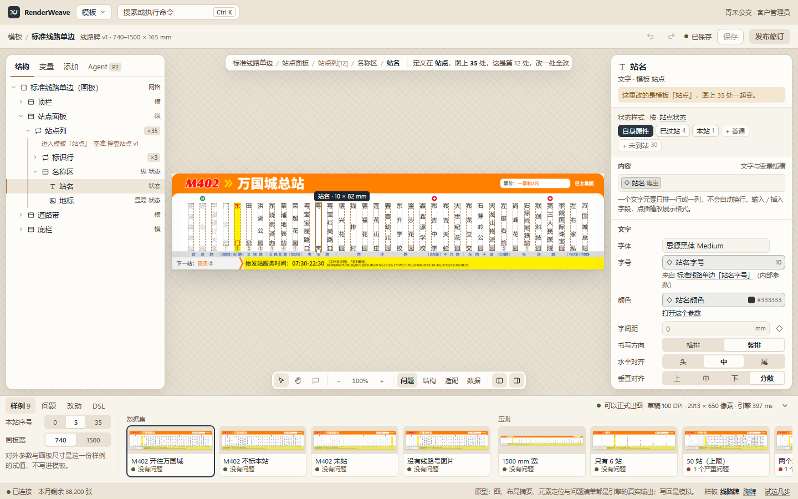
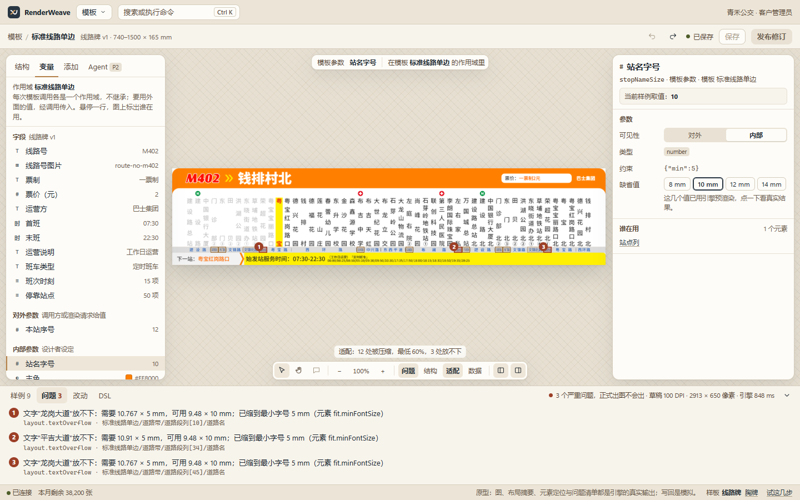
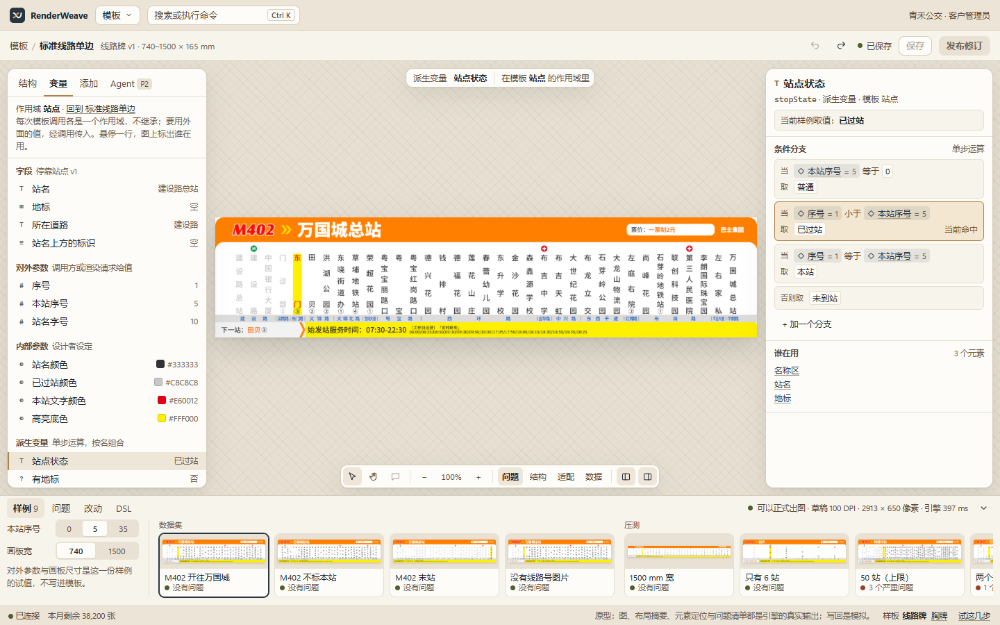
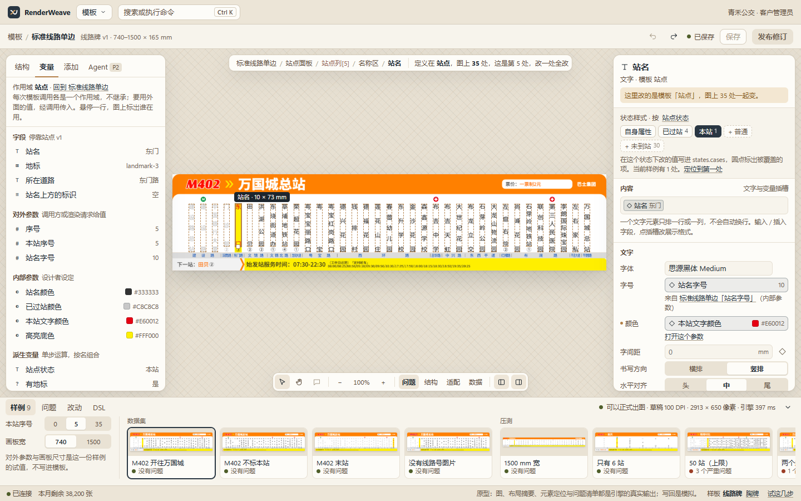
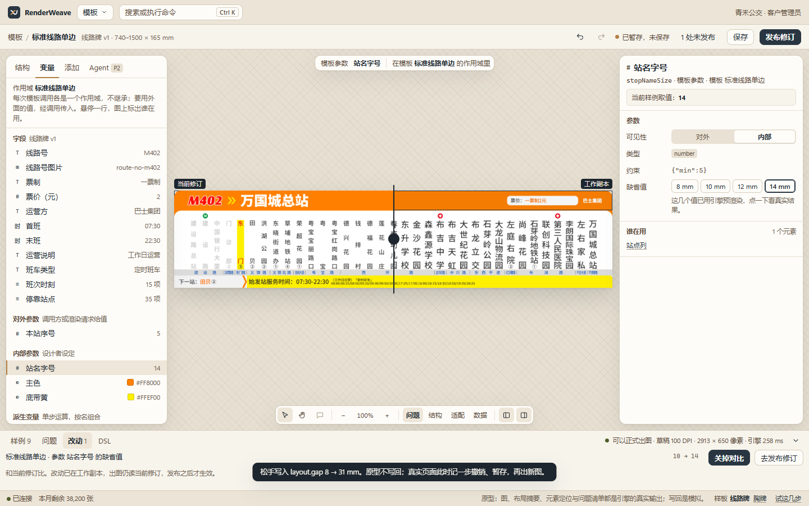

# 模板设计页整体方案

状态：用户已确认（M393），按[规格与票据](../.scratch/template-design-page/README.md)实施第一、二期。手柄见 M392。对应 CONTEXT「模板设计的修正」（M383）。

**结论：把模板设计页从"一张图加一个属性表"重做成"函数编辑器"。** 模板是"数据、参数、尺寸 → 图"的函数（ADR-0007），现有页面只让人看一份输入、改一个属性，看不到函数本身。新页面中间是引擎出的真图，左边是函数的结构与变量，右边改选中的东西，底部换输入。DSL 不变，现有的属性生成规则、编辑会话、保存语义都留着。

可交互原型：[docs/prototypes/template-design/](prototypes/template-design/README.md)，图、布局摘要、元素定位、问题清单全是引擎的真实输出，写回是模拟。



## 依据

| 依据 | 内容 |
|---|---|
| 读过 | [模板 DSL](dsl/template.md)、[元素目录](model/template-elements.md)、[术语表](../GLOSSARY.md)、M205、M208、M299、M343、M346、M352、M356、M380、M383、[画板 09–12](prototypes/desktop-workbench/README.md)、现有页面 `service/console/src/pages/template-design.tsx` 与 `service/console/src/template/` |
| 旧项目 | `outside_context/legacy-renderweave/specs/changes/20260910-template-editor-variant-b-pixel-parity.md` 记录用户反复打磨过的 Canvas Focus 版式，基准图在同目录的 `.scratch/renderweave-template-v1-implementation/visual-parity/baseline/`。取它的版式，不取它的模型 |
| 已验证：语料统计 | 仓库里 311 份 Agent 产出的模板（`out/`，按内容去重）：每份元素中位数 6、p90 为 29、最多 47；子元素 54% 在自由布局、39% 在堆叠、7% 在网格；文字 48% 写了 `fit`、36% 多片段；17% 的元素按变量显隐，7% 有状态样式；派生变量每份中位数 2、最多 26，其中 70% 是 `branch`；旋转的元素只有 9 个（约 3400 个里） |
| 已验证：引擎耗时 | M402（740 × 165 mm，296 个节点）在本机进程内渲染：50 DPI 113–147 ms，120 DPI 约 340 ms，200 DPI 约 806 ms。不含队列、网络与写回 |
| 已验证：接口 | `POST /v1/previews` 把引擎的布局摘要原样带回（`service/src/api/previews.ts`），摘要里有 `text.compression`、`overflow`、`fontSize`、`shrinkGroup`，页面现在没用（`service/console/src/types.ts` 的 `LayoutNode` 没声明） |
| 未知 | 真实服务上"改一项到换图"的端到端耗时。P1 验收记过点选、改字号到预览变化共 3.0 秒，是脚本整段耗时，不是延迟。下一步在 Docker 环境里打点 |

现有页面没有实际打开：打开设计页会给正在跑的环境多写工作副本和审计（M356），所以现状判断来自读代码和画板。工作区里未入库的 `service/console/src/prototype/` 用百分比和像素定位，和 DSL 的毫米与布局模型对不上，不作依据。

## 1. DSL 决定页面必须做什么

| DSL 的事实 | 页面的后果 | 现有页面 |
|---|---|---|
| 同一模板，2 站和 50 站是两张完全不同的图 | 输入是一等公民：样例带，一眼看到每份输入的结果 | 一个下拉框，一次看一份 |
| 一份定义多处实例（循环、子模板调用） | 选中时分清定义与实例，明说"改一处全改" | 有虚线框，没说影响范围；切子模板时换地址 |
| 作用域不继承，值靠 `args` 一层层传 | 值从哪来要能一键追到 | 只显示变量名 |
| 一个属性的值有三种来源：字面值、变量、状态覆盖 | 所有属性格共用一种控件（值格） | 变体下拉与映射编辑器，状态覆盖要在 JSON 形状里找 |
| 派生变量单步运算按名组合，70% 是 `branch` | 派生变量要有编辑器，分支要标出当前命中 | **没有入口**：只能当建议项读，改不了 |
| 元素可增删移动、可调用别的模板 | 结构要能改，循环与调用要有表单 | **没有增删移动**（P1 只做小改，M343）；循环与调用走通用字段 |
| 文字放不下时走 `fit`，48% 的文字写了它 | 这个领域最常见的压力要能一眼看到 | 布局摘要里有压缩比，页面没用 |
| `place` 的键随父容器布局而定 | 字段与手柄都随父容器变 | 字段已按三种布局生成，这部分留着 |
| 不能绑定的属性、互斥的写法（`wrap` 不能配 `equal` 或 `mergeBy`）是 DSL 硬规则 | 不给入口并写明原因，不等报错 | 靠 Schema 收窄了一部分，留着并补原因 |

## 2. 页面总览

```text
┌ 标题栏（全局）───────────────────────────────────────────────────────┐
├ 文档条：模板 / 标准线路单边  线路牌 v1 · 740–1500 × 165 mm   ↶ ↷  ● 已暂存，未保存  1 处未发布  保存  发布修订 ┤
├ 舞台（织纹底）────────────────────────────────────────────────────────┤
│ ┌结构│变量│添加│Agent┐   ┌范围条：…/站点列[12]/名称区/站名 · 图上 35 处，改一处全改┐  ┌检查器────┐ │
│ │ 跨模板的元素树       │                                              │ 站名 · 文字│ │
│ │                     │            ┌──────────────┐                  │ 状态样式   │ │
│ │  288 px，可收起      │            │ 引擎出的真图 │                  │ 内容 文字  │ │
│ │                     │            └──────────────┘                  │ 适配 位置… │ │
│ │                     │  ┌工具 缩放 叠加层 面板开关┐                  │ 328 px     │ │
│ └─────────────────────┘  └──────────────────────┘                  └───────────┘ │
├ 样例带：样例 9 │ 问题 3 │ 改动 1 │ DSL      ● 可以正式出图 · 草稿 100 DPI · 引擎 397 ms  ⌄ ┤
│ 对外参数与尺寸的试值 │ 数据集卡片 │ 压测卡片                                    │
├ 状态栏（全局）───────────────────────────────────────────────────────┤
```

| 区域 | 回答的问题 |
|---|---|
| 文档条 | 这是哪个模板，改到什么程度了 |
| 舞台 | 这份输入现在出来什么样 |
| 范围条 | 我选中的是谁，改了影响谁 |
| 左面板 | 函数长什么样：元素树、变量、能加什么 |
| 检查器 | 选中的东西怎么改 |
| 操作条 | 工具、缩放、叠加层、面板开关 |
| 样例带 | 换输入，看问题、改动与 DSL |

和现有页面、画板 10 相比，拍板了三处：

1. **面板浮在舞台上，不占栏。** 线路牌宽高比 4.5:1，三栏停靠时舞台太窄。"适应"按两个面板之间的空隙算，放大后图从面板底下穿过去。这是旧项目 Canvas Focus 的做法。走查觉得遮挡烦人就改成停靠，只动外壳。
2. **检查器不再分页。** 现在属性、参数、结构、规则四页挤在右边，选中后常要切页。结构与变量搬到左边，右边永远只显示"选中的东西"，所以元素树和属性能同时看。适配规则归进元素的属性，检查项归进变量页。
3. **草稿与正式不再是切换按钮。** 接口只出草稿（M356），两种模式的差别是一句结论，所以改成样例带上常驻的"可以正式出图 / N 个严重问题，正式出图不会出"。

## 3. 选择与范围

**选中的东西只有一个，右边永远显示它：** 元素、变量或检查项；什么都没选时是画板。一次只选一个，因为 DSL 没有分组概念，多选等真实需求。

| 操作 | 结果 |
|---|---|
| 点图 | 选中最深的、会显示的元素（沿用现有 `hitElement`，符合"点什么改什么"） |
| Alt + 点 | 沿层叠往下穿透 |
| 右键 | 列出这个位置的全部元素，从最深到画板，再加复制元素路径、在结构中定位、打开绑定的变量 |
| Esc / Enter | 上一层 / 下一层 |
| 双击文字 | 就地改内容片段 |
| 点结构树 | 选中定义，图上所有实例一起标出 |

**范围条**写三件事：元素路径（每段可点，跨模板的段用另一种颜色）、定义在哪个模板、图上几处。循环模板里的元素，主框实线，其余实例虚线，检查器顶部明写"这里改的是模板「站点」，图上 35 处一起变"。

切子模板不离开这张图：预览始终是根模板（M356 的判断不变），地址照旧带 `?in=`。

## 4. 舞台

**引擎图是唯一的画面。** 不在浏览器里模拟排版。旧项目用 DOM 投影，要标"本地草稿投影·非权威"，缩字组、竖排分布这些规则都要再实现一遍。框、手柄、标注全部画在图上方的屏幕空间，坐标来自布局摘要。

**预览节奏：**

| 动作 | 写回 | 出图 |
|---|---|---|
| 选项、开关、拖动松手 | 立刻 | 立刻 |
| 打字 | 停 500 ms（现状） | 写回后 |
| 拖动中、滑块拖动中 | 不写 | 不出，只画幽灵框与读数 |
| 改缩放 | 不写 | 按屏幕需要重出，上限 200 DPI（现状） |

- 旧图一直留着，新图到了连框一起换，框和图不会错位；
- 只重出当前样例，其他样例卡片标"改动后没重新出"，点到才出。租户限制是每分钟 60 次、并发 2 个（`docs/service.md`），全部重出很快撞限；
- 实时旋钮等 P3 的预览通道。引擎本身 125 ms 够用，慢在暂存防抖、队列与轮询，所以不把引擎搬进浏览器。**切换条件**：P3 之后 p95 仍超过 500 ms，再评估 WASM 进浏览器（字体体积是主要代价）。

**叠加层**由操作条开关，都不重新出图：

| 层 | 内容 | 数据来源 |
|---|---|---|
| 问题（默认开） | 编号框，点了选中元素并打开问题页 | 问题清单 |
| 结构 | 全部元素框 | 布局摘要 |
| 适配 | 被压缩的文字按压缩比着色，放不下的标红，图例写"12 处被压缩，最低 60%" | `text.compression`、`overflow` |
| 数据 | 灰底是数据驱动，虚线是固定内容 | 模板文档 |

选中容器时另有排布参考：堆叠的间距条、内边距，网格的轨道线与尺寸。



### 手柄（M392）

手柄只写 DSL 里已有的数，能拖什么由父容器的布局决定。拖动中只画幽灵框与读数，松手记一步撤销、写回、出图。吸附 0.5 mm，按 Shift 到 0.1 mm；方向键微调的步长相同，所以键盘也能完成。值绑定了变量的，没有对应的手柄。

| 父容器 | 能拖 | 写什么 |
|---|---|---|
| 自由 | 移动、八个手柄 | `place` 的锚点值（保持原来是距左还是距右，3.5% 用了距右或距下）、`width`、`height` |
| 堆叠 | 沿主轴改顺序；固定尺寸才有主轴手柄 | `children` 顺序（同时决定叠放，读数里写明）、`place.width` 或 `height` |
| 网格 | 吸到格子；边缘改跨度 | `place.row`、`column`、`rowSpan`、`columnSpan` |
| 选中堆叠容器 | 间距条 | `layout.gap` |
| 选中网格容器 | 轨道线（固定轨道） | `layout.rows[i].fixed`、`columns[i].fixed` |
| 循环项 | 不能拖 | 项是数据决定的，排布在循环容器上改 |
| 画板 | 不能拖 | 实际尺寸是出图参数，在样例带里调 |

"随内容"的元素没有尺寸手柄，先在检查器切成固定。旋转的元素框不计旋转（布局摘要的口径），只有 0.3% 的元素，按元素的角度把框转过去。

## 5. 结构面板

- **一棵树跨模板。** 循环容器和子模板调用展开后直接是被调模板的元素，用一条竖线标出作用域边界，写明"进入模板「站点」· 基准 停靠站点 v1"。不用在模板之间切页。元素最多 47 个，不需要虚拟滚动。
- **每行的标记：** 排布方式（横、纵、网格、自由）、循环项数、显隐、状态，当前样例不显示的元素变淡并带图标，有问题的带红点。
- **改结构（二期）：** 拖动排序、复制、删除、包进容器、拆开容器、提取为子模板、重命名。子模板被多处调用时，删除与改名先列出调用方。
- **顺序就是 DSL 的顺序：** 下面的压在上面，也是堆叠里的先后，不像设计软件那样倒过来显示。

## 6. 变量面板

作用域是选中元素所在的模板，头部写明"不继承"。四组，每行有类型标记、显示名称和当前样例的取值；悬停一行，图上标出谁在用（连带派生变量）。

| 组 | 右边显示 | 能做什么 |
|---|---|---|
| 字段 | 类型、约束、用到它的元素 | 只读，链到数据定义；可拖到舞台创建元素 |
| 对外参数、内部参数 | 可见性、类型、约束、缺省值 | 改缺省值。对外参数的**试值**在样例带里，不写进模板，这两者要分开 |
| 派生变量 | 按运算的表单 | 见下 |
| 检查项 | 条件、等级、提示文字、当前是否成立 | 成立的标红 |

**分支编辑器**（占派生变量的 70%）每行是"当 [左] [比较] [右]，取 [值]"，最后一行"否则取"；`all` / `any` 是一层分组。当前样例命中的那行高亮，运算数旁边显示当前值。不做表达式输入框（ADR-0004）。其他运算（取项、拆取、长度、加减乘除取模）各是两三个运算数的小表单。底部列出"谁在用"，可点。



## 7. 检查器与值格

**值格是这一页最重要的控件。** 每个属性一格，形态只有这几种：

| 形态 | 样子 | 行为 |
|---|---|---|
| 字面值 | 输入框加单位 | 改数；拖标签可调 |
| 没写 | 淡色显示缺省值（如缩字下限 5） | 写了就变字面值 |
| 绑定 | 灰底条：显示名称、当前值 | 点开换绑定或断开；断开时当前值变字面值 |
| 被状态覆盖 | 标签前加圆点 | 编辑写进 `states.cases`，可重置 |
| 不能绑定 | 右边没有绑定按钮 | 按 [DSL 的能绑定表](dsl/template.md#绑定与状态样式)；字体的提示写"要按取值换字体，用状态样式" |

- **绑定弹层只列类型相符的变量**（颜色属性只列颜色变量），分字段、参数、派生三组，带当前值。底部两项：**提取为参数**（把当前值存成内部参数的缺省值并绑定它，这就是 M208 旋钮的来源）、新建派生变量。
- **来源链：** 绑定的是对外参数时，下方写"来自 标准线路单边「站名字号」（内部参数）"，一键跳过去。作用域不继承的代价由这一行抵消。

**分组顺序按类型定，**没写的可选项也在组里，显示缺省值，不再收进"其他 N 项"。

| 元素 | 分组 |
|---|---|
| 文字 | 内容（片段与插槽）、文字、适配、位置与尺寸、显示 |
| 循环容器 | 循环（列表、模板）、传入参数、每项排布、位置与尺寸、外观、显示 |
| 子模板调用 | 调用（模板、数据）、传入参数、位置与尺寸、显示 |
| 容器 | 排布、位置与尺寸、外观、显示 |
| 图片、码、形状 | 各自的属性、位置与尺寸、外观、显示 |
| 画板（什么都没选） | 基准、适用尺寸范围、缩字下限、排布、外观 |

几个 DSL 专属的编辑器：

- **内容：** 文字和插槽排成一行 token，打字是文字，`/` 插入字段，点插槽改展示格式。写明"一个文字元素只排一行或一列"（M339）。
- **适配：** 按 DSL 的合法顺序画成 `收紧字距 → 压缩字形 → 缩字`，下面是下限、放不下时的等级、缩字组及其成员数。最后一行是**这一处实例的结果**："压到 74%，字号 10 mm，字距 0 mm"。
- **状态样式：** 检查器顶部的一排取值按钮，每个带当前样例里的命中数（"已过站 4、本站 1"）。没覆盖的取值（从派生变量的分支结果推出来）显示成虚线的"+ 未到站"。选中一个取值后，下面的编辑都写进这个取值的覆盖；能定位到第一处实例。
- **循环与调用：** 模板选择只列基准相符的模板；"传入参数"列出被调模板的全部对外参数，每行来源是变量、固定值或循环信息（序号、是否首项等），没有缺省值又没传的标红。互斥的写法直接禁用并写原因（折行不能配等分或合并）。
- **字体：** 字重靠换字体资源（M115），所以按字体族分组列字重，选的还是资源引用。



## 8. 样例带

**样例就是一个渲染项：** 数据集、对外参数、画板尺寸。它只用来看，不写进模板。

- **来源：** 基准相同的已存数据集；名称带"压测"的单独一组（M356 的认法）；另有页面现场生成的压测样例，用内联数据集，不落库。写法沿用模板设计评估集的 `stress.json`（在数据上取前 N 项、改某个字段、改参数或尺寸）。
- **一键压测（三期）：** 按数据定义的约束推出边界：列表取最少与最多项、文本取最长、可选字段全空，加上尺寸范围的两端。这和模板设计评估集（M333、M337）的压测是同一组检查。
- **旋钮：** 左边按对外参数的类型生成控件（数值有范围时是滑块，枚举是分段，颜色是色块），加画板宽高。
- **其他三页：** 问题（点一条定位到元素、字段或检查项，三种位置都接得上）、改动（和当前修订比，可在图上拖分割线对比）、DSL（选中元素的片段或整份，可复制下载；M380 对数据定义提过同样的要求）。

**不新建"样例集"实体。** 试值先存在浏览器里。**切换条件**：做 P3 的模板改动影响检查时，要一份租户共享的样本清单，那时再落库。



## 9. 保存与发布

不改，语义沿用 M346、M356、M383：改动自动暂存进工作副本，"保存"记一笔"看过了"，"发布修订"才生效。三层状态收成文档条上的一句话（`1 处未保存`、`正在暂存…`、`已暂存，未保存`、`已保存`）加一个 `N 处未发布`。改回原值不算改动。发布修订页（画板 12、票据 09）不动。

## 10. Agent 与评论

接入前都不显示（票据 08 的规矩），位置先定下：

- **Agent（P2）** 是左面板的第四页，打开时面板加宽到 380 px。画板 10 是常驻左栏，这样会只剩不到 500 px 给舞台，线路牌看不清。`@元素` 跟着选中变（M208）。Agent 的改动走同一个工作副本（ADR-0022），出现在"改动"页。
- **评论（P4）** 是操作条上的第三个工具（`C`），定位用元素路径。

## 11. 键盘

`V` 选择；`H` 或按住空格平移；滚轮缩放；`Ctrl+0` 适应；`Ctrl+1` 物理 1:1（96 DPI）；`Esc`、`Enter` 上下一层；`Ctrl+Z`、`Ctrl+Y`、`Ctrl+S` 同现状；`Ctrl+\` 收起面板；方向键微调 0.5 mm（Shift 0.1 mm）；`Del`、`Ctrl+D`、`F2` 删除、复制、重命名；`/` 在内容里插入字段。

## 12. 实现：留什么、换什么、缺什么

- **留：** `template/properties.ts`（Schema 生成字段，加属性自动多一项，这是对的）、`template/session.ts`（撤销、暂存、冲突）、`template/document.ts`、`useLivePreview`、`hitElement`、发布修订页。
- **换：** `pages/template-design.tsx` 拆成外壳、舞台、结构、变量、检查器、样例带；字段外观换成值格，`property-fields.tsx` 的输入逻辑沿用。
- **DSL：** 不变。

**开放 API 的缺口，都是 1.x 的加法：**

| 缺口 | 为什么要 | 期 |
|---|---|---|
| 读当前修订内容（如 `GET /v1/templates/{name}/content`） | 结构树要读被调模板，不该为了看就开工作副本。顺带去掉"只看不改留两条审计"（M356、P1 验收后续第 5 项），工作副本改成第一次改动时才开 | 一期 |
| 预览带求值（如 `inspect=<元素路径>`） | 变量的当前值、命中的分支、状态命中数都要引擎算；页面自己算等于再实现一遍。原型里是页面算的，只为演示 | 一期 |
| 开放 API 描述补布局摘要的 `text` | 回答里已有，`docs/api/openapi.json` 没写 | 一期 |
| 新建空白工作副本 | 从零新建（M356 说放 P2） | 二期 |
| 预览带内容（M352 的切换条件） | 实时旋钮不能每次都暂存，否则审计被淹 | 三期 |

模板之间的调用关系、变量用途都能从文档算，不用接口。

## 13. 分期

| 期 | 做什么 | 依赖 | 做完的标准 |
|---|---|---|---|
| 一：重组 | 新外壳、范围条、跨模板结构树（只选不改）、变量面板（只读加改参数）、值格与来源链、适配层等叠加层、样例带；两个接口加法 | 无 | P1 的 12 种元素改属性用例照过；新增选中范围、来源链、切样例、问题定位的浏览器用例；和原型截图逐张对照，真人走查 |
| 二：结构编辑 | 增删移动、从字段创建元素（文本与数值变文字，图片变图片，列表变循环加循环模板，单引用变调用）、循环与调用表单、分支编辑器、状态样式编辑、手柄（M392）、从零新建 | 一期；空白工作副本接口 | 不写 DSL 从空白做出 M402 的站点模板，写回通过 `checkDslDocument`，真人走查 |
| 三：看得更全 | 一键压测、多样例一起看、实时旋钮、模板缩略图、DSL 片段直接编辑 | P3 预览通道 | 旋钮 p95 达到 P3 的拍板值 |
| 四：Agent 与评论 | Agent 页、`@元素`、评论定位、让 Agent 改这里 | P2、P4 | 按 P2、P4 各自的标准 |

一期和二期不依赖 Agent 门槛，现在就能开工。操作员继续走模板预览页（画板 11），和设计页共用舞台与样例带。

## 14. 决定与待定

- **已定：允许按布局约束的手柄**（M392，用户 2026-11-05 定）。
- **待定：模板设计页上，Agent 进左面板，不常驻左栏**（修订 M342 在这一页的做法）。我建议进左面板，理由见第 10 节。只影响第四期，P2 前定，不挡第一、二期。

其他都已拍板，切换条件写在各节。

## 15. DSL 覆盖核对

| DSL | 页面位置 |
|---|---|
| `parameters`、`derived`、`checks` | 变量面板 |
| `base` | 检查器·画板；模板升级不在本方案内（M343） |
| 画板 `sizeRange`、`size`、`minFontSize` | 检查器·画板；实际尺寸在样例带 |
| `layout` 三种模式及其全部键，`padding`、`clip` | 检查器·排布；舞台参考线 |
| `place` 三套键 | 检查器·位置与尺寸；手柄 |
| 文字全部键、片段样式、展示格式 | 检查器·内容、文字（片段样式在点开的 token 里） |
| `fit`、缩字组 | 检查器·适配；适配层 |
| 图片、二维码、条形码 | 检查器·各自分组；资源选择用现有 `image-picker` |
| `line`、`polygon`、`path` 的几何与 `viewBox` | 检查器·形状（数值与文本，不做矢量编辑） |
| 循环全部键（`reverse`、`slice`、`mergeBy`、`spanBy`、`wrap`） | 检查器·循环、每项排布 |
| 调用 `data`、`args` | 检查器·调用、传入参数 |
| `visible`、`states`、`opacity`、`rotation` | 检查器·显示、状态样式、外观 |

**不做：** 矢量路径的图形编辑、多选、任意摆放、模板升级与数据集迁移（M343）。

## 下一步

[规格与票据](../.scratch/template-design-page/README.md)已是 `ready-for-agent`，从票据 01–03 开工。"舞台""样例"两个术语在票据 03、07 进术语表。第一期验收（票据 11）在 Docker 环境打点"改一项到换图"的端到端耗时。
