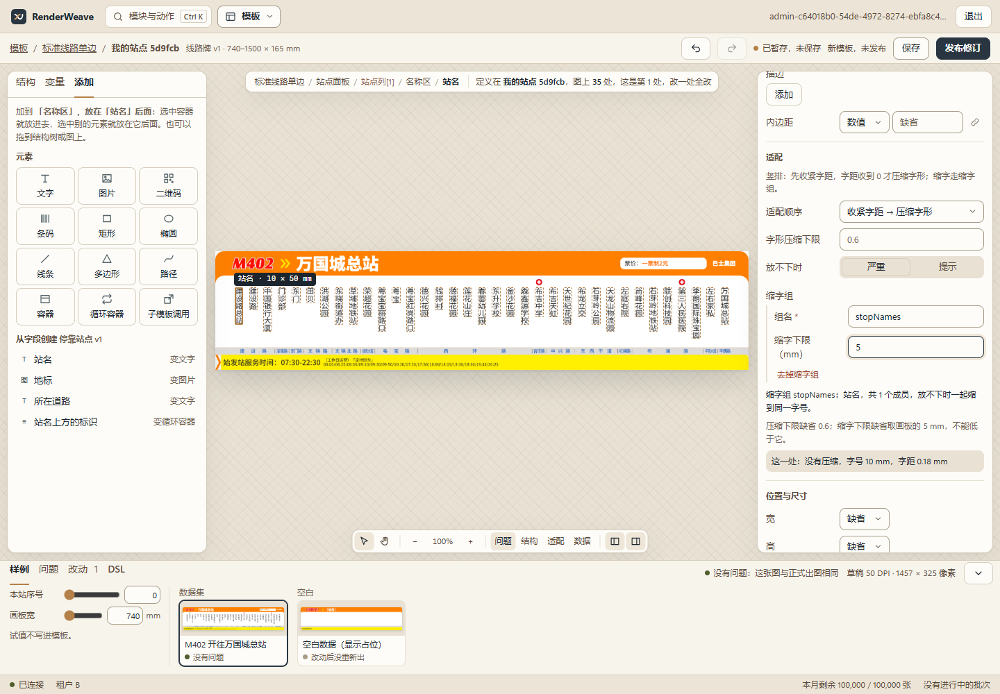
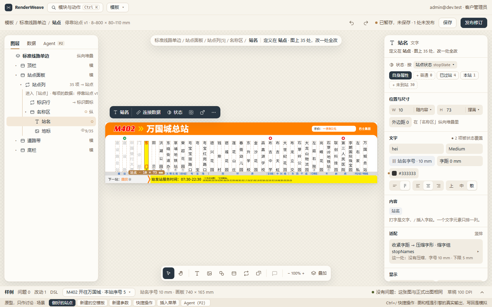
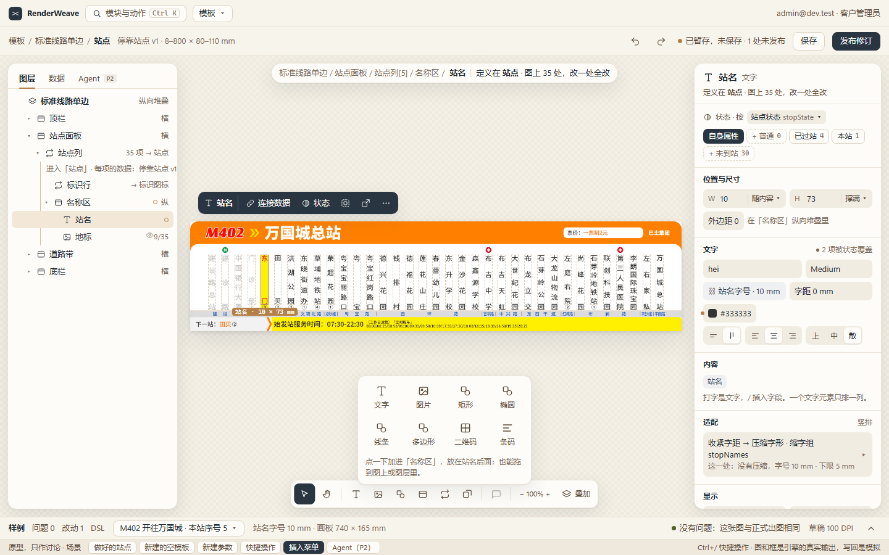
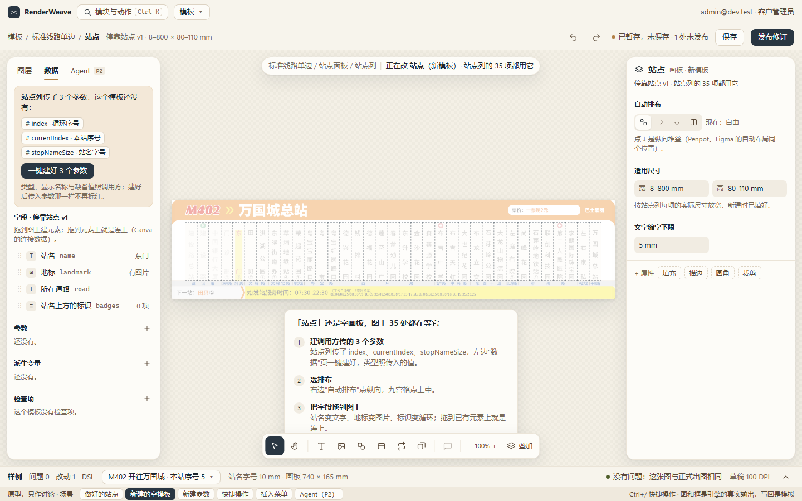
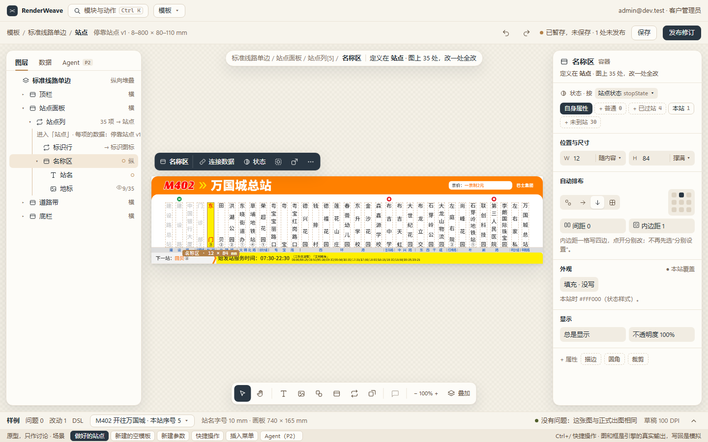
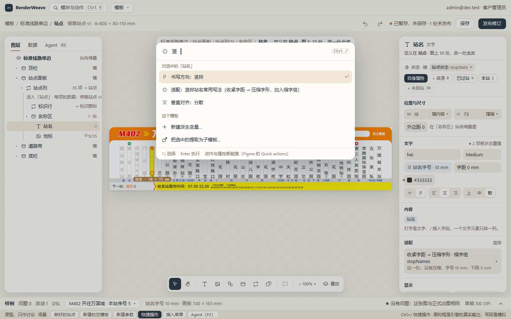

# 模板设计页第三轮：参照成熟设计软件优化页面与流程

状态：方案，待用户确认。起因是第二期走查后的要求（M395）："参考一些著名、成熟、先进的二维设计软件页面（比如 Claude Design）去优化整体页面以及操作流程"。第一、二期的方案见[模板设计页整体方案](template-design-page.md)，这一轮在它上面改，不推翻。

**结论：骨架不动，改三件事。**

1. **少切页**：插入搬到舞台底部的工具栏（Figma、Canva、Penpot 都这样），左面板从"结构 / 变量 / 添加"三页合成"图层 / 数据 / Agent"，字段在"数据"页里直接拖到图上建元素、拖到元素上连上（Canva 的连接数据）。
2. **检查器照 Figma UI3 收紧**：一行写完宽高与尺寸方式（打一个数就是固定），内边距、外边距一格写四边，排布用方向图标加九宫格，文字的字体、字号、颜色、对齐挤成一块；没写的可选项不再摆一排"缺省"，收进底部的"+ 属性"。
3. **重复劳动交给页面**：调用方已经传了的参数一键建好；"当某字段不为空时显示"在绑定弹层里一步做完；新元素按父容器的布局给尺寸；再加选中条与快捷操作（Ctrl+/）。

DSL、保存语义、开放 API 都不变，只动控制台。按走查路径数，从空白做出站点模板的操作估计从 120 下降到 70 下左右（下面逐步列）。

可交互原型：[docs/prototypes/template-design-v3/](prototypes/template-design-v3/README.md)，图和元素框是引擎的真实输出，写回是模拟。

| 现在 | 第三轮原型 |
|---|---|
|  |  |

## 依据

**走查（2026-11-09）**：用户说走查完了，没有给具体的卡点。本地预览服务上查不到这次走查的改动（审计里只有灌数据与登录，没有工作副本），所以动手时长**未知**，手柄也没有反馈。下面的卡点是我按同一条路径（票据 20 的浏览器用例，就是客户会点的顺序）逐步数出来的，加上自己在预览里点的体会。

**参照物**（只借交互，不借模型）：

| 软件 | 看了什么 | 借什么 |
|---|---|---|
| [Claude Design](https://www.unite.ai/anthropic-launches-claude-design-for-visual-prototyping-and-presentations/)（Anthropic Labs，2026-04） | 左边对话、右边画布；对话、行内评论、直接改三种方式并存 | Agent 是左面板的一页，带着选中的元素做上下文；它的改动是提案，放进同一个工作副本 |
| Figma UI3（[帮助](https://help.figma.com/hc/en-us/articles/23954856027159-Navigating-UI3-Figma-s-new-UI)、[宽高与 Hug/Fill 的讨论](https://forum.figma.com/suggest-a-feature-11/ui3-show-layout-properties-width-height-fill-hug-35315/index2.html)、[插件 API](https://developers.figma.com/docs/plugins/api/properties/nodes-layoutsizingvertical)） | 工具栏浮在底部；右边属性面板分节；宽高框旁边就是 Hug、Fill、Fixed，在宽度框里打数就变成 Fixed；组件属性与变体；Quick actions | 底部工具栏管插入；尺寸一格写完；检查器分节、按需展开；快捷操作搜动作与属性 |
| [Penpot 的弹性与网格布局](https://help.penpot.app/user-guide/flexible-layouts/) | 设计面板的 Layout 一节，方向、对齐、间距、内边距一组；快捷键加布局；布局直接对应 CSS | 排布一节用方向图标加九宫格；`place` 的键随父布局变，这一点我们已有 |
| Framer 的 [Collection List](https://www.framer.com/academy/lessons/creating-cms-collection-lists) 与 [CMS index 变量](https://www.framer.com/updates/cms-index-variable) | 设计一项，组件字段连 CMS 字段；按序号或字段值换变体 | 循环与"按变量换样式"的说法；我们的状态样式与它的变体是同一件事 |
| Webflow 的[条件显示](https://university.webflow.com/article/display-visibility) | 选中元素，写"字段 is set"就按数据显隐 | 绑定显示时直接给"当「地标」不为空"，派生变量由页面建 |
| Canva（[Glow Up 改版](https://www.canva.com/newsroom/news/glow-up/)、[批量创建](https://www.canva.com/help/bulk-create/)） | 选中后浮出快捷操作条，换掉固定工具栏；批量创建里把字段拖到元素上就连上，右键"连接数据"，还能自动匹配 | 选中条；字段拖到元素上就是绑定 |

**不借的**：任意摆放、多选与对齐分布（M392 只放开按布局约束的手柄）；图层倒序显示（我们的顺序就是 DSL 的顺序）；像素单位；让 AI 直接改模板而不经提案（ADR-0022）；面板可停靠（第一期定了浮动，没人说遮挡烦）。

## 走查路径逐步数

从主模板的站点列当场新建站点模板，做到出图和原来逐字节相同。"现在"是票据 20 用例里的实际操作数，"改后"是按本方案估计。

| 步骤 | 现在 | 卡在哪 | 改后 | 靠哪一条 |
|---|---:|---|---:|---|
| 新建并进入 | 10 | 弹窗要填四个尺寸；建好还要再点"进入" | 5 | 尺寸按站点列每项的实际尺寸预填（提取子模板已有这套算法）；建好直接进入 |
| 画板排布 | 3 | 排布、方向、交叉轴是三个分开的控件 | 2 | 方向图标加九宫格 |
| 三个对外参数 | 24 | 要切到"变量"页；新参数缺省是文本，再改数值；显示名称预填成参数名，直接打字会接在后面 | 1 | 调用方传了的一键建好，类型、显示名称、缺省值照调用方 |
| 两个派生变量 | 29 | 每个运算数先选"变量 / 固定值"，再选值；`hasLandmark` 只是"地标不为空" | 19 | 运算数合成一个下拉（变量与打字的固定值同在）；`hasLandmark` 由绑定显示时一步建 |
| 标识行 | 12 | 从"添加"页切回来；新循环是固定 60 × 20，要改成随内容；外边距要先选"分别设置" | 8 | 新元素按父布局给尺寸；打 9 就是固定；四边一格 |
| 名称区 | 10 | 新容器固定 30 × 20；改名要再找输入框 | 8 | 同上；新建容器直接进改名 |
| 站名 | 20 | 文字的十几项散在三组里，竖排、对齐、适配要来回滚 | 15 | 文字一块；适配收成一行摘要 |
| 地标 | 12 | 显示要先建派生变量再绑 | 10 | "当「地标」不为空" |
| **合计** | **120** | | **约 68** | |

估计的依据是把用例里的每一步换成原型里的对应操作；真人的时长要等第三轮走查。

## 页面改什么

### 1. 底部工具栏管插入

- 工具栏：选择、平移 ｜ 文字、图片、形状（弹出矩形、椭圆、线条、多边形、路径、二维码、条码）、容器、循环、调用 ｜ 评论（第四期）｜ 缩放、叠加层。现在左面板"添加"页的元素目录搬到这里。
- 点一下加到当前位置（选中容器就放进去，选中别的就放在它后面，同票据 14），也能拖到图上或图层里。循环与调用点了弹出选列表、选模板的小表单。
- 快捷键：`T` 文字，`F` 容器（Figma 的 Frame），`V`、`H` 照旧。

### 2. 左面板：图层 ｜ 数据 ｜ Agent

- **图层**就是现在的结构树，不变。
- **数据**合并现在的"变量"页与"添加"页的"从字段创建"：字段（拖到图上建元素，拖到元素上就是连上）、参数、派生变量、检查项，每组标题旁一个 +。
- **Agent**（P2 接入）照 Claude Design：对话在左，图在中间，输入框带着 `@选中元素`；回答是提案，"放进工作副本"后出现在改动页，可撤销。这也回答了待定的"Agent 进不进左面板（修订 M342）"：建议进，作左面板第三页。

### 3. 检查器：紧凑分节，按需展开

| 现在 | 改后 |
|---|---|
| 宽、高各是"变体下拉 + 输入框"两个控件 | 一格：`W 10 随内容 ▾`，打数就是固定，下拉只选随内容、撑满、按比例 |
| 外边距、内边距要先选"分别设置"，再出四个框 | 一格写四边，点开分别改 |
| 排布是"堆叠"下拉，方向、主轴、交叉轴分开 | 方向四个图标（自由、横、纵、网格），对齐一个九宫格，间距与内边距一行 |
| 文字的字体、字号、颜色、书写方向、对齐各占一行 | 一块：字体族与字重一行，字号与字距一行，颜色一行，书写方向、水平、垂直对齐三组图标一行 |
| 适配展开成六行 | 一行摘要"收紧字距 → 压缩字形 · 缩字组 stopNames · 这一处没有压缩"，点开才是现在的编辑器 |
| 没写的可选项一律显示"缺省" | 只显示写了的与常用的；其余在底部"+ 属性"（描边、圆角、旋转、裁剪…） |

值格、绑定弹层、来源链、状态样式的取值按钮、"定义在 站点 · 图上 35 处"都留着，这些是这一页比通用设计软件多出来的东西。

### 4. 选中条

选中元素后，图的上沿浮出一条：元素名 ｜ 连接数据 ｜ 状态 ｜ 包进容器 ｜ 提取为子模板 ｜ ⋯（同右键菜单）。照 Canva 改版后的快捷操作条，把最常用的结构操作从右键菜单里提出来。放在图外面，不压住图；水平跟着元素，但不进两边的面板。

### 5. 快捷操作（Ctrl+/）

照 Figma 的 Quick actions：搜动作与属性，对选中的元素直接执行。"竖"能找到"书写方向：竖排"、竖排站名的适配常用写法；"提取"找到"提取为子模板…"。现有的 `Ctrl+K` 管模块与页面，不混。

### 6. 样例带默认收成一行

收起时一行写当前样例、试值摘要与"没有问题：这张图与正式出图相同"，点开才是现在的卡片与旋钮。舞台多出约 120 px 高，横长的线路牌看得更大。

## 流程改什么

1. **调用方传了的参数一键建**：被调模板缺调用方传入的参数时（循环表单里现在标"被调模板没有这个对外参数"），数据页顶部与空画板提示里给"一键建好 N 个参数"。类型照传入值：循环序号是整数，变量照它的类型；显示名称与缺省值照调用方那个参数。站点模板的三个参数从 24 下变 1 下。
2. **新建参数、派生变量用一个弹层**：名称、显示名称、类型、谁来给（对外 / 设计时定）、缺省值一次填完，回车建好（原型 06）。显示名称没填时用名称，不再先写进去让人删。
3. **按字段是否为空显示**：布尔属性（显示）的绑定弹层里，除了布尔变量，再列"当「某字段」不为空 / 为空"。选了就建一个 `branch` 派生变量并绑定，名字照 `has` 加字段名，一步撤销。
4. **新元素按父布局给尺寸**：父容器是堆叠或画板是堆叠时，文字、容器、循环、调用两边都随内容；图片、码、形状给固定尺寸；自由布局照旧给坐标与固定尺寸。新建容器直接进改名。
5. **尺寸里打数就是固定**：同 Figma。手柄写的也是这个数（M392 不变）。
6. **运算数一个下拉**：分支条件的左右两边，变量与固定值在同一个下拉里，打字就是固定值，选一项就是变量；比较默认"等于"。
7. **新建被调模板时预填尺寸并直接进入**：从循环或调用当场新建时，适用尺寸按这一处各实例的实际尺寸放宽（票据 19 的 `planExtract` 已有），建好就进入它。

## 不改

DSL 与 Schema；保存、暂存、发布语义（M346、M356、M383）；开放 API；舞台只显示引擎出的图；跨模板的图层树；值格与来源链；状态样式的取值按钮；手柄只按布局约束（M392）。

## 分期（草案，确认后拆票据）

| 段 | 内容 | 依赖 |
|---|---|---|
| A 检查器 | 尺寸一格、四边一格、排布图标与九宫格、文字一块、适配摘要、"+ 属性" | — |
| B 插入与左面板 | 底部工具栏插入、"数据"页合并字段与变量、字段拖到元素上就是连上 | — |
| C 省事的流程 | 一键建参数、建参数的弹层、按字段是否为空显示、新元素的尺寸、运算数一个下拉、新建被调模板预填并进入 | A（尺寸）、B（数据页） |
| D 选中条、快捷操作、样例带收起 | — | A、B |
| E 第三轮验收 | 同一路径的浏览器用例改成新操作，操作数降到 70 以内；真人走查记时长 | A–D |

Agent 页的位置这一轮只占位，接入跟 P2 走。

## 要你拍板

1. **这三件事的方向对不对**，尤其是"添加"页拆掉、插入搬到底部工具栏。我的建议是改：每加一个元素要切页，是这次数出来最多的往返。
2. **Agent 进左面板**（修订 M342，原定 P2 前定）：建议照 Claude Design 进，作左面板第三页。切换条件：P2 时发现对话要和检查器同时看，再改成可拆出的独立窗口。
3. **有没有我没看到的卡点**：这次走查没有记下具体卡在哪，表里的卡点是我数的。你点的时候哪里最别扭，直接说，我加进 A–D。
