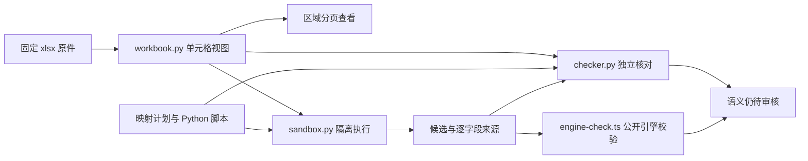

# Excel 数据处理验证原型

## P04：工作空间 staticSchema 接入

后续接入在分支 `prototype/excel-agent-p04`。新入口以 `--workspace` 中选定的已发布 `--definition name@version` 为依据，从该定义和编译产物读取字段、引用与约束；运行器与独立检查器不包含公交字段。旧 P01–P03 文件作为历史验证保留，新通用合同见 [CONTRACT.md](CONTRACT.md)。

运行真实模型的一轮测试（先完成下文的依赖安装与 build，并在环境变量设置 `OPEN_CODE_API_KEY`）：

```powershell
node --import tsx scripts/prototypes/excel-agent/agent-run.ts --workspace fixtures/workspaces/price-tag --definition '商品价签@1' --workbook fixtures/excel/price-tags.xlsx --brief scripts/prototypes/excel-agent/fixtures/price-brief.md --out out/excel-agent-p04/new-run --claude '<claude.exe 的路径>' --inject-list-truncation
```

已有目录拒绝覆盖。日常转换去掉 `--inject-list-truncation`；它只用于测试宿主注入失败反馈。参数 `--timeout-ms` 控制整轮时间（缺省 10 分钟），`--python` 可指定 Python 可执行文件；模型、渠道和执行器复用现有 Claude Code + OpenCode Go 配置。脚本仅经容器执行，Agent 只有五个任务工具。

本地机制检查：`python -X utf8 scripts/prototypes/excel-agent/test_generic.py`。`generic_check.py` 只负责通用来源核对；引擎逐份校验实际工作空间的 staticSchemas。动态选择字段不等于兼容所有工作簿格式、派生计算或资源字段；当前模型工具无资源仓库解析或跨表 join 运算；数据应用由下述正式导入链路承接。

实际模型记录与原始脚本在 [P04 归档](evidence-p04/README.md)，解释见仓库 `docs/agent-eval/excel-agent-p04.md`。这是本地提取入口。P05 通过正式 `agent import-excel` 接入审核、人工修订重放与完整应用，见[使用说明](../../../docs/excel-agent-review.md)和[嵌套实测归档](evidence-p05/README.md)；仍未并入 `agent run` 的工作簿运行与检查点。

## P01–P03 历史原型

本原型回答 P01–P03 的机制问题：能否固定 Excel 单元格视图，让 Python 脚本在受限环境全量转换，再由宿主独立发现漏项、错序和伪造来源。结论是该窄路径可行；真实 Claude 调用、业务语义审核和产品接入尚未实现。

这是分支 `prototype/excel-agent-p01-p03` 上的验证代码，不是生产模块。原始记录见 [results.json](evidence/results.json)，可交互查看每项证据的 [report.html](evidence/report.html)。票据位于仓库 `.scratch/excel-agent-extraction/issues/01-validate-data-processing-prototype.md`。

## 复跑

已在 Windows、Python 3.13.13、Node 24.12.0、Docker Desktop 的 Linux 引擎 29.2.0 上运行。需要可运行 Linux 容器的 Docker、本仓库 Node 依赖和 Python 3.13；Python 读取器只用标准库。

在仓库根目录依次运行；每次验收必须使用新的输出目录：

```powershell
npm ci --ignore-scripts
npm run build
npm run typecheck
docker pull python:3.13-slim@sha256:ae14d4ce8771606477a81446e7ef429edd6762305fc50c84507c1041fa8285d1
python -X utf8 scripts/prototypes/excel-agent/accept.py --out out/excel-prototype/local-run-01
```

执行器使用固定摘要且禁止隐式拉取镜像。验收会创建临时容器并清理；原始工作簿、视图、映射计划、候选、检查报告和故障输入保留在输出目录。全部通过退出 0；报告不宣称真实模型或生产验收通过。

## 组件与数据流



| 文件 | 责任 |
|---|---|
| `workbook.py` | 读 OOXML，保留真实坐标、原值、显示状态、公式缓存、合并范围与隐藏状态；提供有界区域分页 |
| `sandbox.py` | 经 stdin 输入视图、计划与脚本；限制运行环境；导出一个有界 JSON 文件并清理容器 |
| `transform.py` | 人工编写的示例转换脚本，按计划执行 copy/collect，生成两方向候选及来源 |
| `checker.py` | 宿主从原始位置重建期望，逐份检查类型、值、顺序、来源与未分类源单元格 |
| `engine-check.ts` | 通过公开入口发布样例静态数据定义，逐份调用 `checkDataset` |
| `prototype.py` | `read`、`region`、`run`、`check` 命令；拒绝覆盖既有产物 |
| `accept.py` | 独立期望值、故障注入、真实容器探测与证据汇总 |

命令帮助：`python scripts/prototypes/excel-agent/prototype.py --help`，子命令也支持 `--help`。验收输出中的计划展示 copy/collect 的具体形状；当前计划固定使用线路、方向和有序停靠列表，不是任意数据定义的通用映射语言。

## 验证边界

三类结论必须分开读：

- `check-good.json`：机械检查通过；`semantic` 仍为 `needsReview`，`applicable` 为 false，`engineSchema` 为 `notChecked`。
- `engine.json`：另行调用引擎，验证两份候选符合样例数据定义；第二份注入非法时间同样会被拒绝。
- 业务语义：没有核准。把整个列组映射到错误的业务字段，或错误地把数据列归入说明区域，可能与计划完全一致；需要核对表头、业务说明与人工真值。

修复演示由验收程序先换入有截断错误的脚本，再换回正确脚本；没有 Claude 参与，不能当作模型自修复成功。哈希用于标识与防意外篡改，不是外部输入真实性证明。

## 隔离与格式范围

容器无宿主挂载、无模型凭据、无 Docker socket、无外部网络，使用非 root 用户、只读根文件系统、全部移除的 capabilities 和 no-new-privileges。限制为 128 MiB 内存、0.5 CPU、16 个进程、有界 tmpfs、输入 4 MiB、输出及日志合计上限 1 MiB；默认 10 秒，允许指定 0.1–120 秒。宿主负责超时、取消及最终清理。JSON 产物必须为普通文件，拒绝符号链接、重复键和非有限数值。

读取器限制原文件 16 MiB、ZIP 解压总量 32 MiB、2048 个成员和 100000 个实际单元格；拒绝路径穿越、重复成员、加密、宏和 DTD/实体声明。只支持 `.xlsx` 和少量数字格式（文本、布尔、数值、补零整数、时分秒和日期）；其余格式显式未知。公式不执行，缓存即使存在也不视为最新值；图片、批注等未处理内容会报告。它不是完整 Excel 兼容层。

这些探测证明本机列出的限制实际生效，不构成共享生产环境的隔离认证；宿主崩溃后的残留回收、恶意工作簿全部解析路径、并发租户和完整恢复尚未验证。产品实现仍需专门复核。

容器配置依据：[Docker run](https://docs.docker.com/engine/containers/run/)、[资源约束](https://docs.docker.com/engine/containers/resource_constraints/)、[none 网络](https://docs.docker.com/engine/network/drivers/none/)。本地实测细节优先以归档证据为准。

## P01–P03 当时的下一步

P04 沿用现有 Claude Code + OpenCode Go，让模型读取区域、提交映射和 Python 脚本，并根据独立错误反馈修复；保留所有尝试、模型身份与成本。先用本夹具固定机制，再用真实制作表及人工核准结果验证语义。此原型不修改现有 Agent 默认执行器或产品工具合同。
